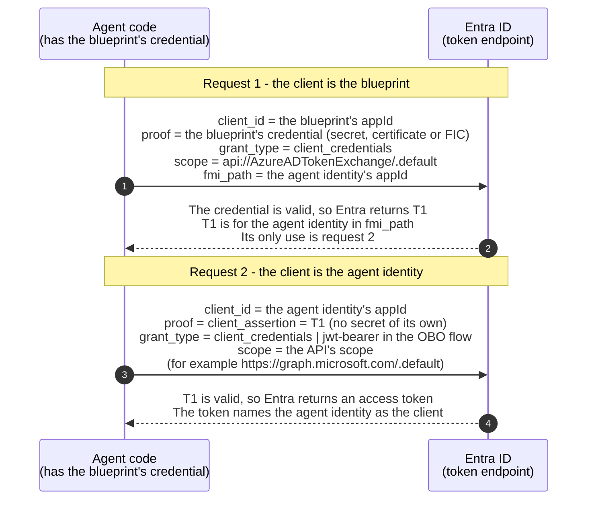

# GLOSSARY - ubiquitous language

A living translation table between the identity world I come from (OAuth2, OIDC, FAPI, Australia's Consumer Data Right) and the world this project lives in (Microsoft Entra, Agent ID, MCP).

Two rules keep this table honest:

1. Every mapping is a **learning scaffold**, not an exact equivalence. The last column says where the analogy breaks.
2. A term is added the first time it appears in a build phase, not before. If a row has no "breaks" note yet, it is unverified.

## Contents

- [Core identity objects](#core-identity-objects)
  - [Object hierarchy](#object-hierarchy)
  - [Who it is vs how it proves it](#who-it-is-vs-how-it-proves-it)
- [Flows and delegation](#flows-and-delegation)
- [Controls and lifecycle](#controls-and-lifecycle)
- [Tooling](#tooling)
- [MCP corner](#mcp-corner)

## Core identity objects

| Known world (OAuth2/OIDC/CDR) | New world (Entra / Agent ID) | Where the analogy breaks |
|---|---|---|
| Authorization server / IdP | Microsoft Entra ID (the tenant's token issuer) | Entra is also the directory and policy engine, not only the token issuer. |
| One IdentityServer deployment: one issuer, its configuration store and its user store | Tenant: one organization's instance of Entra ID (directory and token issuer), with a permanent `<name>.onmicrosoft.com` domain and a tenant ID in every token (`tid`, `iss`) | Microsoft runs the server; the organization only configures it. The organization buys subscriptions for the tenant, but most features are licensed per user (a human), and some app features per workload identity. So the tenant needs a license for everyone who uses a feature, not one license for the whole tenant. Microsoft 365 and Azure also use the tenant as their identity base. |
| Token subject (`sub`): a user (a human); in client credentials there is no subject, only `client_id` | Security principal: what represents a user or an app that needs access in a tenant. It defines that user's or app's access policy and permissions, and it is what Entra authenticates at sign-in. Two kinds: a **user principal** (a human; also an agent's user account) and a **service principal** (software: an app's local representation, a managed identity, a blueprint principal, an agent identity). Software needs a service principal to appear in a token, as the client, the subject or the audience. The `oid` (object ID) claim holds the subject's object ID. Applications and blueprints are definitions, not principals: a token's `oid` is never one of them, although their `appId` can appear as the client ID (`appid` / `azp`). | In IdentityServer, only users are subjects. A client is a configuration entry, so a client-credentials token has no subject: no `sub`, only `client_id`. In Entra, the client is a security principal too: its service principal. So every token has a security principal behind it, even when no user is involved. That is why `oid` exists, and why a service principal can hold roles and appear in sign-in logs. Some service principals can also be blocked by Conditional Access (see the Service principal row). Entra's `sub` is pairwise, like CDR's PPID: each client app sees a different `sub` for the same user. `oid` is the same for every app in one tenant, and different in each tenant. |
| OAuth client (the definition of an app) | App registration (the application object). Its `appId` is the OAuth `client_id`. | Close. One registration can serve many tenants. OOP view: the application is the class and each service principal is an object of it - but at most one object per tenant, so many service principals of one kind in one tenant need an agent identity blueprint instead. Creating an application through Graph does not create its service principal; that is a second call. |
| Client instance operating in an ecosystem | Service principal. The portal calls it an "enterprise application" (Entra ID > Enterprise apps). It holds this tenant's decisions about the app - granted permissions, enabled or disabled, owners, who may use it - while the application declares (requested permissions, offered scopes and app roles). Credentials usually live on the application, but a service principal can hold some too, for example a SAML signing certificate. The application itself can also be deactivated, which stops new tokens. It is an identity record, not code. | CDR had the same split: one software product, with a separate DCR (Dynamic Client Registration) at each data holder. IdentityServer has no split: one `Client` entry is both the definition and the thing that gets access. In Entra, the service principal is a security principal, so it can hold roles and appear in sign-in logs. Conditional Access can block only some service principals: single-tenant apps registered in this tenant (needs Workload ID Premium) and agent identities (needs Agent 365). It cannot block managed identities or multitenant apps. |
| One CDR software product, registered at many data holders | Multi-tenant application. Microsoft registered each of its apps once, in its own tenant. A tenant only holds their service principals: the local representations that let those apps work there. A new tenant here had 0 applications and 187 service principals, and a day later 203. Microsoft adds them just in time (JIT): by default when one of its apps is first needed, or when a subscription makes an app eligible. This can happen later, in the background (audit log initiator: "Microsoft Azure AD Internal - Jit Provisioning"). Here, the first Bicep deploy created the "Microsoft Graph Bicep Extension" service principal. Only Microsoft's own apps get JIT. The audit log field `ServicePrincipalProvisioningType` is logged for every new service principal: `defaultMicrosoft` and `subscription` mean Microsoft JIT, and `Other` means a user or an app created it. So a third-party multi-tenant app gets its service principal only when someone consents, or when a user or an app creates it through Graph. In Graph, `servicePrincipalType` "Application" means "a service principal created from an application", even when that application lives in another tenant; `appOwnerOrganizationId` names that tenant. | In CDR, each data holder issued its own `client_id`. In Entra, the `appId` is the same in every tenant. |
| Non-human identity (my 450 B2B client identities) | Workload identity: Microsoft's term for applications, service principals and managed identities. Microsoft calls agent identities a distinct identity type, although technically an agent identity is still a service principal. | Entra splits non-human identities into several types with different lifecycles, and agents are a type of their own. |
| - (no equivalent) | Managed identity | No CDR analogue: the platform owns the credential, the app never sees one. |
| IdentityServer admin: whoever can change the configuration store, the user store or the code | Global Administrator (the highest built-in Entra admin role) | Plain IdentityServer has no admin roles: whoever can change the config store or the code has full power. Entra has many smaller built-in roles (for example Application Administrator, Conditional Access Administrator). Microsoft recommends fewer than five Global Administrators, smaller roles for daily work, and two emergency access accounts. This project uses Global Administrator for tenant setup only. |
| ASP.NET Identity role: a named set of users, used for authorization | Security group: a directory object that holds members (users, devices, service principals) and is used to grant access in one place - app access, Conditional Access targeting, role assignments, licenses. In Graph: `securityEnabled: true`, `mailEnabled: false`, `groupTypes: []`. The other main kind, the Microsoft 365 group (`groupTypes: ["Unified"]`), is mainly for collaboration (mailbox, Teams). Membership is either assigned (members added by hand or by code; any member type) or dynamic (a rule on attributes, for example `user.department -eq "Finance"`; users or devices only, never service principals; needs Entra ID P1). A group cannot be both. Three limits matter here. A group in a Conditional Access policy covers its user members only, not its service principal members. To hold an Entra role, a group must be role-assignable, with assigned membership. An agent sponsor can be a dynamic group (security or Microsoft 365) or an assigned Microsoft 365 group, but never an assigned security group or a role-assignable group. | An Entra group is its own object with an ID, and its members can be non-humans. ASP.NET Identity has no rule-based membership; attribute rules live in app code (policy-based authorization), while Entra evaluates dynamic rules in the directory itself. Group membership is not in tokens by default. When the `groups` claim is turned on, it carries object IDs, not names, and more than 200 groups in a JWT trigger an overage claim instead of the list. |
| Accredited software product + its SSA | Agent identity blueprint: in Graph, a special application (`@odata.type` `agentIdentityBlueprint`), with its blueprint principal as its service principal in the tenant (same `appId`, `servicePrincipalType` "Application"). It holds the credentials. In the tenant, it can only create and delete agent identities, and it uses its credentials to get tokens for them. A blueprint can be multitenant: the publisher offers it through Microsoft catalogs, and adding it to a customer tenant creates a blueprint principal there. Its agent identities are then created in the customer tenant and stay single-tenant; the credentials stay on the blueprint in the publisher's tenant. A blueprint can have at most 250 agent identities when a non-Microsoft platform creates them with app-only permissions. Delegated calls (like this project's setup script) and Microsoft's own platforms have no such limit. | The blueprint is a live template that holds credentials and mints identities; an SSA was a one-shot signed statement. |
| A deployed instance of a client (in IdentityServer: one more `Client` entry per instance, each with its own secret) | Agent identity: a special service principal (`@odata.type` `agentIdentity`, `servicePrincipalType` "ServiceIdentity") created by a blueprint. It has its own `appId`, always equal to its object ID (`id`), and `agentIdentityBlueprintId` holds its blueprint's `appId`. Seen here: the portal wizard for a new blueprint also created a first agent identity with the same display name. | It holds no credentials and gets tokens only through its blueprint. It is single-tenant, and it needs a sponsor when it is created. An IdentityServer client instance has its own secret and can exist alone. |
| A client's business owner vs its technical contact (B2B onboarding) | Sponsor vs owner. **Sponsor:** the user (a human), or a dynamic group or Microsoft 365 group, accountable for the agent's purpose and lifecycle; required when a blueprint or agent identity is created; can only disable, soft-delete and change sponsors. **Owner:** the technician (a user (a human) or a service principal, never a group); optional; can edit settings and credentials, re-enable, restore and hard-delete. | In onboarding these are usually contacts on a form. In Entra both are directory relationships with their own permissions, and the sponsor is enforced at creation. Changing a blueprint's sponsors later returned 403 here with the documented permission, so this project sets sponsors only at creation. The requirement is checked only at creation: when a sponsor's user account was deleted, Entra removed the link and left the agent with zero sponsors, with no warning. That user had no manager. Microsoft documents that a departing sponsor's role moves to their manager, so with a manager the result would differ. |
| CDR Register (who is accredited, who is accountable) | Agent registry. Microsoft is merging its agent registries into Agent 365, so the registry now lives in the Microsoft 365 admin center (Agents > All agents > Registry). The Entra admin center (Entra ID > Agents) shows only agents that have an agent identity. | The CDR Register was ecosystem-wide and run by the regulator. The agent registry is per tenant and run by the organization itself. Because nobody outside checks it, Entra makes each agent name accountable people: owners and sponsors, set on the Entra objects, not in the registry. |
| Dynamic Client Registration (RFC 7591) | Agent identity creation from a blueprint, through a Graph call; also DCR in MCP client registration | Agent identity creation is a Graph API call, not the RFC 7591 protocol. The MCP spec (2026-07-28) now prefers Client ID Metadata Documents, and keeps RFC 7591 DCR only as an optional, deprecated way for older servers. |

### Object hierarchy

**The short version:** think in **three levels**. A classic app has two of them. Agent ID adds a third.

| Level | Classic app | Agent ID | Graph base type | How many per tenant |
|---|---|---|---|---|
| 1. The definition (the "class") | Application | **Blueprint** | application | One, in its home tenant |
| 2. Its **own** local representation in the tenant | Service principal | **Blueprint principal** | service principal | One |
| 3. Identities for its **agents** | **- does not exist -** | **Agent identities** | service principal | **Many** |

So Graph still has only two base types: application and service principal. A blueprint is a special kind of application. A blueprint principal and an agent identity are special kinds of service principal, and each of the three has its own Graph type (see the detail table below). Their jobs differ: the blueprint principal represents the blueprint itself in the tenant, and each agent identity represents one agent.

```
                         CLASSIC APP                        AGENT ID
                         -----------                        --------
 LEVEL 1                 Application                        Blueprint
 the definition          example: Microsoft Graph           example: agent-steward-guardian
 (an application)        Command Line Tools                 holds the credential, shared by
                                                            all its agents
                              |                                  |
                              | one per tenant                   | one per tenant
                              v                                  v
 LEVEL 2                 Service principal                  Blueprint principal
 local representation    Graph CLI Tools                    agent-steward-guardian
 (a service principal)   in this tenant                     (same appId as the blueprint)
                                                                 |
                                                                 | creates MANY
                                                                 v
 LEVEL 3                 - does not exist -                 Agent identity  agent-steward-guardian-01
 identities for agents                                      Agent identity  (later: -02, -03, ...)
 (service principals)                                       each with its own appId;
                                                            no credential of its own:
                                                            signs in through the
                                                            blueprint's credential
```

**OOP view:** the blueprint is a class with a factory method. The blueprint principal is its one static instance in this tenant, and it runs the factory. The agent identities are the instances that the factory creates.

**The detail per object:**

| Object | Graph collection and type | `servicePrincipalType` | Per tenant | Credentials | Portal page |
|---|---|---|---|---|---|
| Application | `applications` | - | One, in its home tenant | Usually here | App registrations |
| Service principal | `servicePrincipals` | `Application` | At most one | Rarely | Enterprise apps |
| Agent identity blueprint | `applications`, type `agentIdentityBlueprint` | - | One, in its home tenant | **Only here**, shared by all its agent identities | Agents > Agent blueprints > open a row > Developer settings |
| Blueprint principal | `servicePrincipals`, type `agentIdentityBlueprintPrincipal` | `Application` | At most one | No | Agents > Agent blueprints (each row is a principal) |
| Agent identity | `servicePrincipals`, type `agentIdentity` | `ServiceIdentity` | **Many** | **None of its own** (not allowed); signs in through the blueprint's | Agents > Agent identities |

Seen in this tenant: the blueprint `agent-steward-guardian` shows "Agent identities: 1" on the Agent blueprints page, and that child is `agent-steward-guardian-01`. Enterprise apps lists neither the blueprint principal nor the agent identity, although both are service principals. Microsoft Learn documents an Application type value "Agent ID (Preview)" in Enterprise apps that shows agent identities, but this tenant's filter does not offer it (checked 23 October 2026).

### Who it is vs how it proves it

**In one line:** an agent identity says who it is with its own `appId`, but it proves it with its blueprint's credential.

In OAuth, a client answers two questions. Its `client_id` says who it is. Its client authentication, such as a secret or a key, proves it. Agent ID puts these two answers on two different objects:

- **Who it is - the agent identity:** Each agent identity has its own `appId`. So tokens, logs, permissions and disable all work per agent. With a shared `appId`, Entra could not tell the agents apart.
- **How it proves it - the blueprint:** Only the blueprint holds a credential, and all its agent identities share it. So there is one secret to protect and rotate, not one per agent.

Because the agent identity holds no credential, it cannot sign in alone. So its blueprint signs in for it. That is why the blueprint needs its own `appId` too: in OAuth, only a client with a `client_id` can sign in.

#### How it works

The same agent code makes both requests. Only the `client_id` it sends tells Entra which client is asking. The diagram shows the autonomous flow. The on-behalf-of flow changes only request 2 (see [The two requests](#the-two-requests)).



1. **Blueprint signs in:** The blueprint asks Entra for a token, using its own `appId` and its credential. In the same request, it names the agent identity it acts for.
2. **Entra issues T1:** Entra checks the blueprint's credential and returns a first token, T1, for that one agent identity. T1 is not for calling an API. Its only use is the next step.
3. **Agent identity signs in:** The agent identity asks Entra for its own token, using its own `appId`. Unlike a normal client, it sends no secret or key. Instead, it sends T1 as its proof.
4. **Entra issues the agent's token:** Entra accepts T1 and returns a token that names the agent identity as the client. So the API that receives this token sees the agent identity, not the blueprint.

#### The two requests

**Request 1 - the blueprint gets T1:**

- **`client_id`:** the blueprint's `appId`.
- **Grant:** `client_credentials`, with `scope=api://AzureADTokenExchange/.default`.
- **`fmi_path`:** the agent identity's `appId`. This is a Microsoft extension. It is not in any RFC.
- **Client authentication:** a client secret, a certificate, or a federated identity credential. A certificate or a federated credential is sent as an RFC 7523 `client_assertion`.

**Request 2 - the agent identity gets its token:**

- **`client_id`:** the agent identity's `appId`.
- **Grant:** `client_credentials` in the autonomous flow, or `jwt-bearer` in the on-behalf-of (OBO) flow.
- **Client authentication:** `client_assertion` = T1 (RFC 7523).

#### Where it leaves plain OAuth

- **The anchor:** OAuth already lets a client prove itself with an assertion that a third party created for it (RFC 7521 section 3, RFC 7523 section 2.2). Entra's federated identity credentials work the same way: Entra trusts an assertion from another issuer instead of a secret. Entra calls this pattern workload identity federation.
- **The break:** OAuth does not say how the client gets that assertion. Entra fills this gap in a new way. The third party is Entra itself, and the one who asks for the assertion is another client: the agent's own blueprint.

**In short:** both are OAuth clients. The blueprint proves identity. The agent identity acts, and the token names it.

**Security note:** the blueprint's credential can get T1 for any of its agent identities, so a leaked blueprint credential exposes all of them.

## Flows and delegation

| Known world | New world | Where the analogy breaks |
|---|---|---|
| Client credentials grant | Autonomous app flow (app-only), which this project calls autonomous agent mode: the agent gets its token through its blueprint, and no user (a human) is in the token | Same grant underneath; the difference is agent-specific claims and the blueprint as credential source. |
| Authorization code flow + consent | Delegated access, Microsoft's other name for the on-behalf-of (OBO) flow. This project calls it admin sign-in. | Consent in Entra is split: user consent vs admin consent, per permission. CDR consent was consumer-arrangement based. For agents there is a second break: the agent identity cannot run the `/authorize` flow, and nobody can give it consent from a prompt. Instead, the admin (a human) signs in to a client app, and the client sends that token, with the blueprint as its audience, to the agent. So an admin must grant the agent's delegated permissions ahead of time, for example as inheritable permissions on the blueprint. |
| My CDR chain (my data holder's setup): data recipient -> OB IdP -> customer IdP -> user | Agent chain in the OBO flow: the user (a human) signs in to a client app -> the client sends the user's token to the agent -> the agent identity does OBO at Entra -> downstream API. In the final token, the user is the subject (`oid`) and the agent identity is the actor (`azp`, with `xms_act_fct` = 11). | Same shape: federation + delegation, each hop re-proven by signed tokens. Breaks: the agent is a new actor type that can initiate on its own. |
| Token exchange for delegation | On-behalf-of (OBO) flow | OBO is Entra's proprietary shape of the idea; RFC 8693 is the standard shape. Both appear in this project (OBO in code, 8693 in DESIGN-NOTES.md). |
| Scopes | Delegated permissions vs application permissions | One word in OAuth2 became two permission systems in Entra, keyed to whether a user is in the token: a user (a human) or an agent's user account. Microsoft calls them delegated permissions (scopes, in the `scp` claim) and application permissions (app roles, in the `roles` claim). |
| Resource server validating tokens | The Identity API (claim validation middleware) | Same job, with new claims to check. `xms_act_fct` = 11 says the actor is an agent identity. `idtyp` says `app` in the autonomous flow and `user` in the OBO flow, but `user` can also be an agent's user account, so check `xms_sub_fct` (13 = agent's user account) to tell them apart. In the OBO flow, `oid` is the user (a human). `xms_par_app_azp` names the blueprint: log it, but do not authorize on it. The `xms_*` claims are optional claims, so check that real tokens carry them. |

## Controls and lifecycle

| Known world | New world | Where the analogy breaks |
|---|---|---|
| CDR arrangement revocation; my client offboarding | Disabling an agent identity | Disable acts at the identity plane and bites within one token lifetime; CDR revocation was consent-plane. |
| FAPI hardening (PAR, PKCE, JARM, mTLS-bound tokens) | Conditional Access (CA) for agent identities. A policy can target one agent identity, all agent identities of a blueprint, or agents with a custom security attribute. | Different layer: FAPI hardens the protocol messages, while CA is a policy Entra checks when it issues or refreshes a token. Not interchangeable. For agent identities the only control is Block. Targeting a blueprint covers its agent identities, not the blueprint's own requests. In the OBO flow, the policies for the user (a human) apply. Token Protection is not an agent control: it binds sign-in tokens of a user (a human) to a device. |
| Client allow-listing at the gateway | MCP tool allow-list (this project's own control) | Same instinct, different object: CDR allow-listed *who may call*, and this project's MCP server allow-lists *what may be called*. The MCP spec itself only asks servers to have access controls. |
| Audit under CDR rules | Entra sign-in logs + audit logs + my app audit trail; for Bicep deploys, also the Azure deployment history (it shows Graph objects only for deployments run in debug mode) | Entra splits sign-in events from directory changes; correlation across the two plus app logs is on me (NFR4). Each audit entry says whether a user or an app initiated the change (`initiatedBy.user` vs `initiatedBy.app`). Seen here: the Bicep-created group was logged as initiated by the signed-in admin, because ARM called Graph on the admin's behalf; groups that Microsoft services created by themselves show only the app. |

## Tooling

| Known world | New world | Where the analogy breaks |
|---|---|---|
| An IdP's admin API (with IdentityServer: direct access to the configuration and user stores) | Microsoft Graph: one REST API (`https://graph.microsoft.com`) to read and change most tenant data - users, groups, applications, service principals, agents - plus much of Microsoft 365 | The organization cannot touch Entra's store directly. Changes go through Microsoft's own APIs and tools, mostly Graph. Graph also covers much of Microsoft 365, not only identity. Graph is itself protected by Entra: each call needs a Graph token with delegated or application permissions. Graph PowerShell and the Graph Bicep extension are both built on it. |
| IdentityServer clients and API resources defined in code (`Config.cs`) or seeded into the configuration store | Bicep with the Microsoft Graph extension: Entra objects (applications, service principals, groups) declared in `.bicep` files and deployed to the tenant. Why: tenant setup as code, so the tenant can be rebuilt from the repo (NFR5). **Bicep files are deployed by Azure Resource Manager (ARM), Microsoft's deployment engine.** ARM normally deploys into an Azure subscription; a file with only Graph resources can also deploy at tenant scope, with no subscription. Today this is the only reason the project uses Azure, and nothing in the project runs in Azure. If FR10 uses Key Vault, that becomes a second reason. | Bicep is declarative: a file describes the objects, and each deployment creates them or updates them (matched by `uniqueName` or `appId`), so running it again is safe. The docs describe no delete step for objects removed from the file. IdentityServer config is code that runs inside a server the team owns. Bicep covers only some Entra object types, and it has no Agent ID types (checked 23 October 2026). So blueprints, blueprint principals and agent identities are created with Graph PowerShell (see [docs/infra.md](docs/infra.md#agent-id-objects)). |

## MCP corner

| Known world | New world | Where the analogy breaks |
|---|---|---|
| API gateway in front of resource APIs | MCP server in front of tools | The MCP server also *describes* its tools (name, description, input schema) to the client, and the host app passes them to the model. So it is a capability surface, not just a proxy. That is why this project's allow-list lives here. |
| An API endpoint + its scope | An MCP tool + its documented permission (NFR1) | The MCP spec calls tools model-controlled: the model decides when to call them, so the caller is probabilistic. The spec asks for a human in the loop who can deny a tool call. The closest OAuth and OIDC ideas are CIBA (a user (a human) approves on another device) and RAR (RFC 9396, consent to one specific transaction). This project builds its own approval gate. |

---

*Maintained as the build progresses. Rows without a verified "breaks" note are marked and revisited in the phase gap-close hour. Fact-checked against Microsoft Learn, the RFCs, the MCP spec and the CDR standards on 23 October 2026.*
