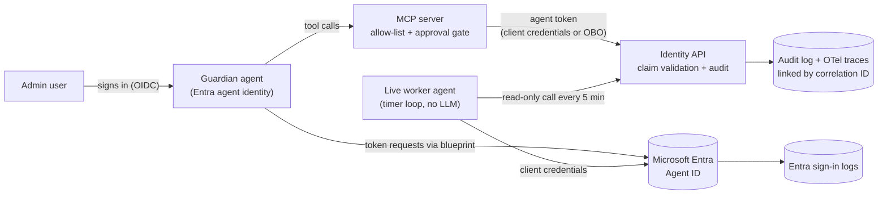

# Agent Registry Guardian

An AI agent that governs other AI agents in a Microsoft Entra tenant.

The guardian has its own Entra agent identity (created from an agent identity blueprint). It autonomously finds badly governed agents - no owner, no sponsor, expiring credentials, excessive permissions, dormant - and reports them. Fixing a problem (disabling an agent, removing a permission, assigning a sponsor) is a privileged operation: it runs on behalf of a signed-in admin (OBO), behind a human approval gate, through an allow-listed MCP tool, and every action is attributed and audited.

The point of this project: demonstrate, end to end, how an autonomous agent can be **identified, authenticated, authorized, constrained, observed and revoked** using Microsoft Entra Agent ID - with Zero Trust and least privilege applied at every step.

## Contents

- [Architecture](#architecture)
  - [Agents in this demo](#agents-in-this-demo)
- [Functional requirements](#functional-requirements)
- [Non-functional requirements](#non-functional-requirements)
- [Deliberately out of code scope](#deliberately-out-of-code-scope)
- [Security controls at a glance](#security-controls-at-a-glance)
- [Repository layout](#repository-layout)
- [Delivery status](#delivery-status)

## Architecture



### Agents in this demo

| Agent | Role |
|---|---|
| **Guardian** | The only agent with a brain. Reads the registry autonomously; performs privileged fixes via OBO + approval. |
| **Live worker** | A tiny timer loop with its own agent identity. Calls one read-only endpoint every few minutes. Exists to produce real sign-in logs, to be blocked by Conditional Access, and to be killed live in the revocation demo. No LLM. |
| **Fixture agents (3-4)** | Registry entries with deliberate flaws: one without a sponsor, one with an expiring credential, one over-permissioned, one dormant. They run no code. The guardian finds them. |

## Functional requirements

- **FR1 - Agent identity.** The guardian runs under an Entra agent identity created from an agent identity blueprint. No shared user account, no plain service principal.
- **FR2 - Ownership.** Every agent identity has a named owner (technical) and sponsor (business), set in Entra.
- **FR3 - Autonomous mode.** For read-only registry checks (orphan agents, expiring credentials, over-permissioned agents, dormant agents), the guardian gets a token via its blueprint using client credentials and calls the Identity API.
- **FR4 - On-behalf-of mode.** An admin signs in. For privileged fixes (disable agent, remove permission, assign sponsor), the guardian calls the Identity API on behalf of that admin using the OBO flow. The API tells the two modes apart from token claims.
- **FR5 - Token validation.** The Identity API rejects any token not issued to a registered agent identity, and rejects agent tokens for scopes the agent was not granted. Negative tests included.
- **FR6 - Tool layer via MCP.** The guardian's tools are exposed through an MCP server. Only allow-listed tools can be called. A call to an unknown tool is refused and logged.
- **FR7 - Human approval.** Privileged tools require explicit human approval before execution. The approver's identity is recorded with the action.
- **FR8 - Audit.** Every action logs: agent object ID, parent blueprint app ID, mode (autonomous or OBO), delegating user if any, tool name, approver if any, correlation ID, timestamp, outcome.
- **FR9 - Conditional Access.** A policy applied to the blueprint blocks the agent under a defined condition, and the block appears in Entra sign-in logs. (If tenant licensing blocks CA for agents, this requirement is documented with the exact licensing constraint instead of demoed - see DEMO.md.)
- **FR10 - Secrets.** No long-lived secrets in code or config. Credentials via Key Vault or environment injection; tokens short-lived.
- **FR11 - Revocation.** Disabling an agent identity in Entra stops its calls within one token lifetime, with no code change. Demonstrated live on the worker's timer loop.
- **FR12 - Live telemetry source.** One real worker agent runs on a timer, continuously producing sign-in logs, fresh short-lived tokens, and traces, so lifecycle and observability demos use live data.

## Non-functional requirements

- **NFR1 - Least privilege.** Each tool documents the exact permission it needs. No agent holds anything beyond its documented set.
- **NFR2 - Attribution.** Any log line traces to exactly one agent identity and, in OBO mode, exactly one human.
- **NFR3 - Untrusted content boundary.** Tool outputs and directory data are data, never instructions. Demonstrated with a prompt injection test: a malicious instruction planted in a fixture agent's description field is treated as text, not executed.
- **NFR4 - Observability.** OpenTelemetry trace per guardian request. One correlation ID links three records: the application trace, the audit line, and the Entra sign-in log. (Per-step token count and cost estimation: optional, first to cut.)
- **NFR5 - Reproducibility.** One `docker compose up` runs the app locally. Tenant setup is documented step by step and scripted as code: Bicep (Microsoft Graph Bicep extension) where the object type supports it, Microsoft Graph PowerShell for the rest.
- **NFR6 - Repo hygiene.** No secrets, tenant IDs or real data in the repo. History scanned with gitleaks.
- **NFR7 - Threat model.** Every OWASP Agentic Top 10 risk is marked mitigated, accepted or out of scope, with a reason, mapped to a MAESTRO layer, and pointing at the code or config that implements the control. See [THREATMODEL.md](THREATMODEL.md).
- **NFR8 - Tests.** Offline tests for all policy logic (allow-list, approval gate, token claim checks). One live test per auth flow.
- **NFR9 - Durable proof.** [DEMO.md](DEMO.md) walks through every control with screenshots captured while the tenant was live, so the whole story is reviewable without running anything.

## Deliberately out of code scope

Workload identity federation for non-Microsoft agents, token exchange (RFC 8693), AIMS, Agent 365 governance, and dynamic agent registration are covered as written designs in [DESIGN-NOTES.md](DESIGN-NOTES.md), not as code. A 14-day timebox forces choices; the notes explain what a production system would add and why.

## Security controls at a glance

Every control that is in place, with the threat it stops and the evidence that it works, is in the control register: [docs/security-controls.md](docs/security-controls.md). It also lists the controls that are planned or exist only as written design. The main ones in place:

- **No credential in the agent:** the blueprint's certificate lives only in the token sidecar, and the harness that talks to the model cannot reach the sidecar at all (C2 to C4).
- **Zero Trust at the API:** seven token checks, tested with forged and real Entra tokens (C7).
- **The MCP server checks every call:** inputs are validated, endpoints never come from the model, and findings reach the audit log without passing through the model (C8 to C11).
- **Limits on the model:** a hard round limit, and a system prompt that treats tool results as data (C12, C13).
- **Governance rules:** orphan, expiring, over-permissioned and dormant agents are found and audited (C14, C15).

## Repository layout

```
config/           Policy: the permissions each agent may hold (agent-permissions.json)
setup/            Tenant setup as code: Bicep + Graph PowerShell (blueprint, identities, fixtures)
src/identity_api/ Identity API (Python / FastAPI): token validation, audit
src/guardian/     Guardian's harness (Python): the agent loop between Claude and the MCP server
src/mcp_server/   MCP server (official Python SDK): the guardian's tools, the four rules, Graph reader
src/worker/       Live worker timer loop (PowerShell)
tests/            Unit tests, offline (unit/); integration tests with real Entra tokens (integration/); end-to-end test of the guardian (end_to_end/)
tools/            Dev tools that print token claims, never tokens (token-claims: the guardian's token from the sidecar; token_exchange: T1 and T2 side by side)
docs/             Reference (entra.md, infra.md, agent-id.md, tokens.md, agent-architecture.md), decision log (decisions.md), control register (security-controls.md), MCP reference (mcp.md), screenshots
GLOSSARY.md       Ubiquitous language: OAuth2/OIDC/CDR terms mapped to Entra Agent ID and MCP
THREATMODEL.md    OWASP Agentic Top 10 x MAESTRO
DEMO.md           Screenshot walkthrough
DESIGN-NOTES.md   Written designs for out-of-scope patterns
```

## Delivery status

The spec above is the backlog. This table tracks delivery: every requirement, its status, and the evidence that proves it. Status values: `not started` / `in progress` / `done` / `documented-only` (demonstrated on paper where tenant licensing or the timebox prevented a live demo - the evidence says why).

| Req | Status | Evidence |
|---|---|---|
| FR1 - Agent identity via blueprint | done | The guardian's agent identity is created from a blueprint by [the setup script](setup/agent-id/Deploy-AgentIdentities.ps1) ([blueprints](docs/screenshots/phase1-agent-blueprints-list.png), [identities](docs/screenshots/phase1-agent-identities-list.png)). The token sidecar gets a real token as this agent identity through its blueprint ([claims](docs/screenshots/phase2-guardian-token-claims.png)): `appid` is the agent identity, `xms_par_app_azp` is the blueprint, and the actor facets contain 11. The guardian now runs under it: it gets every token from the sidecar as this agent identity, and never sees the blueprint's key ([guardian run](docs/screenshots/phase2-guardian-run.png)). |
| FR2 - Owner + sponsor | in progress | Guardian: technical owner and business sponsor are different people ([screenshot](docs/screenshots/phase1-guardian-owner-and-sponsor.png)). The worker's identity comes in Phase 5. |
| FR3 - Autonomous mode | done | The guardian gets its tokens through its blueprint (client credentials, via the sidecar), reads the tenant's agents from Graph with read-only permissions, applies the four checks (orphan, expiring credential, over-permissioned, dormant), and reports the findings to the Identity API. Since 28 October this runs inside the MCP server's `scan_registry` tool ([code](src/mcp_server), [permissions](setup/bicep/guardian-permissions.bicep), [policy](config/agent-permissions.json)). Unit tests: [tests/unit/mcp_server](tests/unit/mcp_server). End-to-end test of the whole run: [tests/end_to_end](tests/end_to_end/test_guardian_scan.py). Every fixture is flagged for its planned flaw ([screenshot](docs/screenshots/phase2-guardian-run.png)). |
| FR4 - OBO mode | not started | - |
| FR5 - Token validation | done | The Identity API checks every token in 7 steps ([docs/tokens.md](docs/tokens.md#what-an-api-must-check), [code](src/identity_api/token_validation.py)). It rejects a caller that is not an agent identity (check 5) or lacks the app role (check 6). Unit tests: [tests/unit/identity_api](tests/unit/identity_api/test_token_validation.py). Integration tests with real Entra tokens: [tests/integration/identity_api](tests/integration/identity_api/test_with_real_tokens.py), where a plain app that holds the role is still rejected as not an agent, and an agent without the role is rejected ([screenshot](docs/screenshots/phase2-integration-tests.png)). |
| FR6 - MCP allow-list | in progress | The guardian's tools run in their own MCP server, which is the only part that can get tokens ([server](src/mcp_server/server.py)). The guardian's harness runs the agent loop with Claude and reaches the tools over MCP ([harness](src/guardian/harness.py)). Unit tests: [server](tests/unit/mcp_server/test_server.py), [harness](tests/unit/guardian/test_harness.py). End-to-end test from the guardian's network, which also proves that the guardian cannot reach the token sidecar: [tests/end_to_end](tests/end_to_end/test_guardian_scan.py). The allow-list itself comes next. |
| FR7 - Human approval | not started | - |
| FR8 - Audit | in progress | The Identity API writes one JSON audit line per decision, rejections included, with the FR8 fields: agent object ID, blueprint app ID, mode, delegating user, tool, approver, correlation ID, timestamp and outcome ([code](src/identity_api/main.py)). The lines go to the container log today. Durable storage comes in Phase 4. |
| FR9 - Conditional Access | not started | - |
| FR10 - Secrets | in progress | The guardian's blueprint uses a certificate. Only the public half goes to Entra, and the private key stays in `secrets/`, which git ignores ([script](setup/agent-id/Deploy-BlueprintCertificate.ps1), [how it works](docs/infra.md#the-blueprints-credential)). Only the token sidecar container mounts the key, so the guardian's code never sees it ([docker-compose.yml](docker-compose.yml), [local run](docs/infra.md#local-run-the-token-sidecar)). The gitleaks sweep comes in Phase 5. |
| FR11 - Revocation | not started | - |
| FR12 - Live worker | not started | - |
| NFR1 - Least privilege | in progress | The guardian holds only four read-only Graph permissions, each with the check it serves ([guardian-permissions.bicep](setup/bicep/guardian-permissions.bicep)), and the Identity API role `Findings.Submit`. The policy of which agent may hold what is a reviewed file ([config/agent-permissions.json](config/agent-permissions.json)), and the guardian flags any agent that holds more. Permissions per MCP tool come in Phase 4. |
| NFR2 - Attribution | not started | - |
| NFR3 - Untrusted content boundary | not started | - |
| NFR4 - Observability | not started | - |
| NFR5 - Reproducibility | in progress | Tenant setup as code: [Bicep smoke test](setup/bicep/phase0-smoke.bicep) and [Agent ID setup script](setup/agent-id/Deploy-AgentIdentities.ps1); see [infra.md](docs/infra.md). [docker-compose.yml](docker-compose.yml) runs the token sidecar today ([local run](docs/infra.md#local-run-the-token-sidecar)); the app services join it as they are built. |
| NFR6 - Repo hygiene | not started | - |
| NFR7 - Threat model | not started | - |
| NFR8 - Tests | in progress | The "offline tests" are unit tests: the token claim checks ([tests/unit/identity_api](tests/unit/identity_api/test_token_validation.py)). The "live test per auth flow" is an integration test with real Entra tokens: the autonomous flow ([tests/integration/identity_api](tests/integration/identity_api/test_with_real_tokens.py)). Unit tests also cover the guardian's rules, its Graph translation and its MCP tools ([tests/unit/mcp_server](tests/unit/mcp_server)) and the harness's agent loop ([tests/unit/guardian](tests/unit/guardian/test_harness.py)), and an end-to-end test calls the real MCP tools ([tests/end_to_end](tests/end_to_end/test_guardian_scan.py)). Tests for the allow-list and the approval gate come in Phase 4, and the OBO integration test in Phase 3. |
| NFR9 - Durable proof | not started | - |

Evidence links point to DEMO.md sections, screenshots in `docs/screenshots/`, test files, or Entra log captures.
