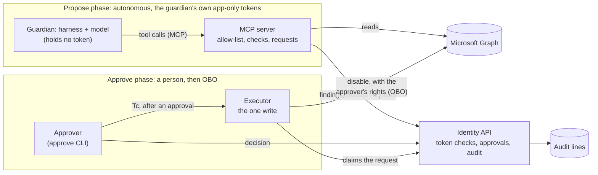

# Agent Registry Guardian

An AI agent that governs other AI agents in a Microsoft Entra tenant.

The guardian has its own Entra agent identity (created from an agent identity blueprint). It autonomously finds badly governed agents - no owner, no sponsor, expiring credentials, excessive permissions, dormant - and reports them. Fixing a problem is a privileged operation, so **the agent proposes, and the approver decides**. The guardian asks for a fix through an allow-listed MCP tool, a person approves that exact action, and every action is attributed and audited. Today the one fix is disabling a dormant agent. After approval, it runs on behalf of the approver (OBO), in a separate executor service, so it uses the approver's rights and the guardian holds no standing write permission. This runs in two phases: in the **propose phase** the guardian scans autonomously and submits its findings and disable requests, and in the **approve phase** a person approves, denies or skips each request. Both phases ran live end to end on 10 November 2026.

The point of this project: demonstrate, end to end, how an autonomous agent can be **identified, authenticated, authorized, constrained, observed and revoked** using Microsoft Entra Agent ID - with Zero Trust and least privilege applied at every step.

## Start here

- **[Agent Steward architecture](docs/agent-steward-architecture.md):** how the guardian is built, decision registry, and every shortcut it takes.
  - **[Agent architecture](docs/agent-architecture.md):** the enterprise design the guardian is compared with.
- **[Threat model](THREATMODEL.md):** each OWASP agentic risk, and how it is handled.
- **[All documents](docs/):** the reference documents, in the `docs/` folder.
- **[Demo](DEMO.md):** what works, shown with screenshots from the live tenant.
- **[Delivery status](docs/delivery-status.md):** every requirement, its status, and its evidence.

## Contents

- [Start here](#start-here)
- [Architecture](#architecture)
  - [Agents in this demo](#agents-in-this-demo)
- [Functional requirements](#functional-requirements)
- [Non-functional requirements](#non-functional-requirements)
- [Deliberately out of code scope](#deliberately-out-of-code-scope)
- [Security controls at a glance](#security-controls-at-a-glance)
- [Repository layout](#repository-layout)
- [Delivery status](#delivery-status)

## Architecture



### Agents in this demo

| Agent | Role |
|---|---|
| **Guardian** | The agent that governs, and the only one that uses a model (an LLM). Reads the registry autonomously; proposes privileged fixes, which a person approves; the approved disable runs with the approver's rights (OBO). |
| **Fixture agents (5)** | The agents it governs: registry entries with deliberate flaws, one each without a sponsor, with an expiring credential, over-permissioned, dormant, and with a prompt injection in its description. They run no code. The guardian finds them. |

The guardian runs when someone starts it. In production it would run on a schedule, and the controls do not depend on it.

## Functional requirements

Status: [✅] done, [▶️] in progress, [📄] design only, [⏸️] not started, [✂️] cut. The evidence for each one is in [Delivery status](docs/delivery-status.md).

- [✅] **FR1 - Agent identity.** The guardian runs under an Entra agent identity created from an agent identity blueprint. No shared user account, no plain service principal.
- [✅] **FR2 - Ownership.** Every agent identity has a named owner (technical) and sponsor (business), set in Entra.
- [✅] **FR3 - Autonomous mode.** For read-only registry checks (orphan agents, expiring credentials, over-permissioned agents, dormant agents), the guardian gets a token via its blueprint using client credentials and calls the Identity API.
- [✅] **FR4 - On-behalf-of mode.** For a privileged fix, disabling an agent, the agent proposes and the approver decides. The approver's sign-in gives a token that the guardian exchanges with the OBO flow, so the fix runs with the approver's rights, limited by the guardian's delegated permissions, and the guardian holds no standing write permission. The API tells the two modes apart from token claims.
  - Cut: removing a permission and assigning a sponsor, because one fix already proves the whole OBO chain, and each extra fix would only repeat it.
- [✅] **FR5 - Token validation.** The Identity API rejects any token not issued to a registered agent identity, and rejects agent tokens for scopes the agent was not granted. Negative tests included.
- [✅] **FR6 - Tool layer via MCP.** The guardian's tools are exposed through an MCP server. Only allow-listed tools can be called. A call to an unknown tool is refused and logged.
- [✅] **FR7 - Human approval.** Privileged tools require explicit human approval before execution. The approver's identity is recorded with the action.
- [✅] **FR8 - Audit.** Every action logs: agent object ID, parent blueprint app ID, mode (autonomous or OBO), delegating user if any, tool name, approver if any, trace ID, timestamp, outcome.
- [✂️] **FR9 - Conditional Access.** A policy applied to the blueprint blocks the agent under a defined condition, and the block appears in Entra sign-in logs.
  - Cut: a Conditional Access policy applies only when the tenant's security defaults are off, and turning them off also removes the tenant's built-in MFA, so the time went to observability instead ([why](docs/conditional-access-and-revocation.md)).
- [✅] **FR10 - Secrets.** No long-lived secrets in code or config. Credentials via Key Vault or environment injection; tokens short-lived.
- [📄] **FR11 - Revocation.** Disabling an agent identity in Entra stops its calls within one token lifetime, with no code change. The ways to stop a token already issued are written design ([DESIGN-NOTES.md](docs/DESIGN-NOTES.md#7-revoking-live-tokens)).
- [✂️] **FR12 - Live telemetry source.** One real worker agent runs on a timer, continuously producing sign-in logs, fresh short-lived tokens, and traces, so lifecycle and observability demos use live data.
  - Cut: the worker was only a live target for the revocation and Conditional Access demos, and revocation is now design only.

## Non-functional requirements

Status: as for the functional requirements above.

- [✅] **NFR1 - Least privilege.** Each tool documents the exact permission it needs. No agent holds anything beyond its documented set ([tool permissions](docs/tool-permissions.md)).
  - Per tool in the code, not in the token: a token carries all the guardian's roles on its API ([why](docs/tool-permissions.md#where-the-guardian-differs)).
- [▶️] **NFR2 - Attribution.** Any log line traces to exactly one agent identity and, in OBO mode, exactly one human.
- [✅] **NFR3 - Untrusted content boundary.** Tool outputs and directory data are data, never instructions. Demonstrated with a prompt injection test: a malicious instruction planted in a fixture agent's description field is treated as text, not executed.
- [▶️] **NFR4 - Observability.** OpenTelemetry trace per guardian request. One ID (the trace ID) links three records: the application trace, the audit line, and the Entra sign-in log. (Per-step token count and cost estimation: optional, first to cut.)
- [▶️] **NFR5 - Reproducibility.** One `docker compose up` runs the app locally. Tenant setup is documented step by step and scripted as code: Bicep (Microsoft Graph Bicep extension) where the object type supports it, Microsoft Graph PowerShell for the rest.
- [✅] **NFR6 - Repo hygiene.** No secrets, tenant IDs or real data in the repo. History scanned with gitleaks.
  - Cut: the gitleaks history scan, because it is not specific to agentic AI.
- [✅] **NFR7 - Threat model.** Every OWASP Agentic Top 10 risk is marked mitigated, accepted or out of scope, with a reason, mapped to a MAESTRO layer, and pointing at the code or config that implements the control. See [THREATMODEL.md](THREATMODEL.md).
- [▶️] **NFR8 - Tests.** Offline tests for all policy logic (allow-list, approval gate, token claim checks). One live test per auth flow.
- [▶️] **NFR9 - Durable proof.** [DEMO.md](DEMO.md) walks through every control with screenshots captured while the tenant was live, so the whole story is reviewable without running anything.

## Deliberately out of code scope

Workload identity federation for non-Microsoft agents, token exchange (RFC 8693), AIMS, Agent 365 governance, and dynamic agent registration are covered as written designs in [DESIGN-NOTES.md](docs/DESIGN-NOTES.md), not as code. A 14-day timebox forces choices; the notes explain what a production system would add and why.

## Security controls at a glance

Every control that is in place, with the threat it stops and the evidence that it works, is in the control register: [docs/security-controls.md](docs/security-controls.md). It also lists the controls that are planned or exist only as written design. The main ones in place:

- **No credential in the agent:** the blueprint's certificate lives only in the sidecar, and the harness that talks to the model cannot reach the sidecar at all (C2 to C4).
- **Zero Trust at the API:** seven token checks, tested with forged and real Entra tokens (C7).
- **The MCP server checks every call:** only tools on its allow-list are listed or run, inputs are validated, endpoints never come from the model, and findings reach the audit log without passing through the model (C8 to C11, C22).
- **Limits on the model:** a hard turn limit, a system prompt that treats tool results as data, tool inputs that must match their schema, and a run that stops when the MCP server rejects a tool call (C12, C13, C21, C23).
- **Governance rules:** orphan, expiring, over-permissioned and dormant agents are found and audited (C14, C15).

## Repository layout

```
config/           Policy: the permissions each agent may hold (agent-permissions.json); the MCP server's tool allow-list (tool-allow-list.json); the calls each tool makes and the permission each needs (tool-permissions.json); the guardian harness's settings: model, effort, turn limit (guardian.json)
setup/            Tenant setup as code: Bicep + Graph PowerShell (blueprint, identities, fixtures)
src/identity_api/ Identity API (Python / FastAPI): token validation, audit
src/guardian/     Guardian's harness (Python): the agent loop between Claude and the MCP server
src/approve_cli/  The CLI (Python): a person approves or denies a request to disable an agent
src/mcp_server/   MCP server (official Python SDK): the guardian's tools, the four rules, Graph reader; it never writes
src/executor/     The executor (Python / FastAPI): the one write, disabling an agent with the approver's rights (OBO)
tests/            Unit tests, offline (unit/); integration tests against the running stack (integration/): the Identity API with real Entra tokens (identity_api/), and the MCP tools from the guardian's network (mcp_server/); an agent eval that runs the guardian with Claude against a planted prompt injection (agent_eval/)
tools/            Dev tools that print token claims, never tokens (token-claims: the guardian's token from the sidecar; token_exchange: T1 and TR side by side)
docs/             Delivery status (delivery-status.md); reference (GLOSSARY.md: OAuth2/OIDC/CDR terms mapped to Entra Agent ID and MCP; DESIGN-NOTES.md: written designs for out-of-scope patterns; entra.md, infra.md, agent-id.md, tokens.md, agent-architecture.md, agent-steward-architecture.md, investigating-agent-activity.md, from-microservices-to-agents.md, conditional-access-and-revocation.md, authentication.md, jwt-bearer-and-token-exchange.md, apps-and-apis.md, messages-api.md), harness reference (harness.md), MCP reference (mcp.md), the permission each tool needs (tool-permissions.md), testing the agent's behaviour with evals (testing-ai-agents.md), decision log (decisions.md), control register (security-controls.md), screenshots
THREATMODEL.md    OWASP Agentic Top 10 x MAESTRO
DEMO.md           Screenshot walkthrough
```

## Delivery status

Every requirement, its status, and the evidence that proves it are in [Delivery status](docs/delivery-status.md).
