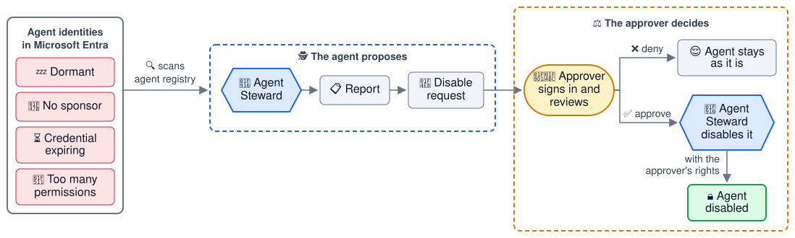
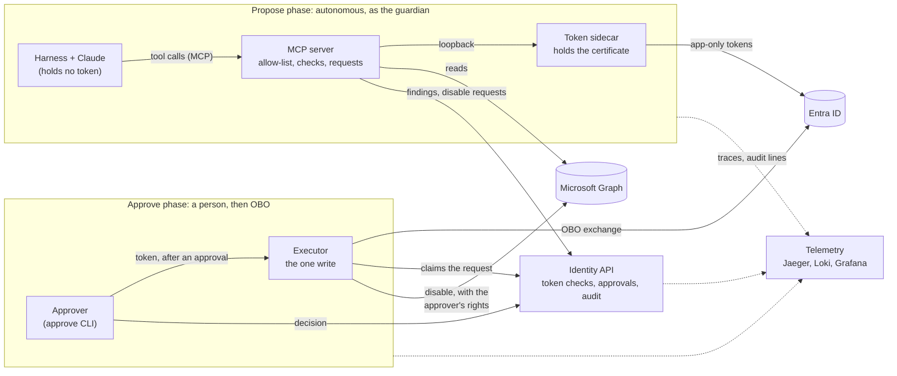

# Agent Steward

An AI agent that governs other AI agents in a Microsoft Entra tenant.

It finds risky agents on its own, in four categories:

- 😴 dormant (no sign-in for 30 days),
- 👻 orphan (no sponsor),
- ⏳ expiring credentials,
- 🔑 excessive permissions.

In short:
- [🤖] The agent writes a report, and submits a request to disable each risky agent, **_autonomously_**.
- [🧑‍💼⚖️] Then a person with the approver role signs in, reviews the pending disable requests, and approves or denies each one.
- [🤖(🧑‍💼)] After an approval, the agent runs the disable itself, with the approver's delegated rights, not its own: **_on behalf of the approver_**.

In summary: **the agent proposes, the approver decides, and the agent executes on behalf of the approver**.



## Contents

- [What It Demonstrates](#what-it-demonstrates)
- [How It Works](#how-it-works)
  - [The Agents](#the-agents)
- [Functional and Non-functional requirements](#functional-and-non-functional-requirements)
  - [Functional](#functional)
  - [Non-functional](#non-functional)
  - [Written Design Only](#written-design-only)
- [Security Controls at a Glance](#security-controls-at-a-glance)
- [Tech Stack](#tech-stack)
- [Read More](#read-more)
- [Repository Layout](#repository-layout)

## What It Demonstrates

The point of this project: demonstrate, end to end, how an agent can be **identified, authenticated, authorized, constrained, delegated, observed and revoked** using Microsoft Entra Agent ID - with Zero Trust and least privilege applied at every step:

- **Identified:** the guardian is an agent identity created from a blueprint, with a named owner and sponsor. It uses no shared user account and no plain service principal.
- **Authenticated:** it never holds a credential. A token sidecar holds the blueprint's certificate and gets each token for it.
- **Authorized:** it holds four read-only Graph permissions and two roles at the Identity API. Its one write permission is delegated, so it works only with an approver's token.
- **Constrained:** the model can call only allow-listed tools, every tool input is checked, and every disable needs a person's approval.
- **Delegated:** after an approval, the disable runs with the approver's own rights. The executor exchanges the approver's token with the On-Behalf-Of flow (OBO), so the guardian needs no write permission of its own.
- **Observed:** every service sends OpenTelemetry traces, and every decision writes an audit line that carries the trace ID.
- **Revoked:** written design only. Disabling an agent stops new tokens, and the options for tokens already issued are in [DESIGN-NOTES.md](docs/DESIGN-NOTES.md#7-revoking-live-tokens).

## How It Works

The guardian works in two phases. In the **propose phase** it scans on its own, as itself. In the **approve phase** a person decides, and the agent runs the fix with that person's rights.

**The propose phase:**

1. **Start:** someone starts the guardian. In production it would run on a schedule.
2. **Scan:** Claude calls the MCP tool `scan_registry`. The MCP server reads every agent identity from Microsoft Graph with the guardian's app-only, read-only token, and applies four rules: orphan, expiring credential, over-permissioned and dormant.
3. **Audit:** the MCP server sends the findings to the Identity API's audit log itself, so they never pass through the model.
4. **Read:** Claude may read one agent with `get_agent`. An agent's description is treated as data, never as instructions.
5. **Propose:** for a dormant agent, Claude calls `submit_disable_agent_request`. The MCP server checks the agent again and creates a pending request at the Identity API. Nothing is disabled yet.

**The approve phase:**

1. **Decide:** an approver signs in with the approve CLI and approves, denies or skips each pending request.
2. **Lend rights:** right after an approval, the CLI sends the approver's token to the executor.
3. **Check and claim:** the executor checks that this person approved this request, checks the agent again, and claims the request at the Identity API.
4. **Disable:** the executor exchanges the approver's token with OBO and disables the agent with the approver's own rights. Its audit line names both the guardian and the approver.



### The Agents

- **The guardian:** the agent that governs, and the only one that uses a model.
- **Five fixture agents:** the agents it governs. They are registry entries with planted flaws: one each with no sponsor, with an expiring credential, over-permissioned, dormant, and with a prompt injection in its description. They run no code.

## Functional and Non-functional requirements

The project is built to demonstrate the below requirements:

_Legend: [✅] done, [▶️] in progress, [📄] design only, [✂️] cut._

### Functional

- [✅] **FR1 - Agent identity.** The guardian runs under an Entra agent identity created from an agent identity blueprint. No shared user account, no plain service principal.
- [✅] **FR2 - Ownership.** Every agent identity has a named owner (technical) and sponsor (business), set in Entra.
- [✅] **FR3 - Autonomous mode.** For read-only registry checks (orphan agents, expiring credentials, over-permissioned agents, dormant agents), the guardian gets a token via its blueprint using client credentials and calls the Identity API.
- [✅] **FR4 - On-behalf-of mode.** For a privileged fix, disabling an agent, the agent proposes and the approver decides. The approver's token is exchanged with OBO, so the fix runs with the approver's rights, and the guardian holds no standing write permission. The API tells the two modes apart from token claims.
  - Cut: removing a permission and assigning a sponsor. One fix already proves the whole OBO chain, and each extra fix would only repeat it.
- [✅] **FR5 - Token validation.** The Identity API rejects any token not issued to a registered agent identity, and rejects agent tokens for scopes the agent was not granted. Negative tests included.
- [✅] **FR6 - Tool layer via MCP.** The guardian's tools are exposed through an MCP server. Only allow-listed tools can be called. A call to an unknown tool is refused and logged.
- [✅] **FR7 - Human approval.** Privileged tools require explicit human approval before execution. The approver's identity is recorded with the action.
- [✅] **FR8 - Audit.** Every action logs: agent object ID, parent blueprint app ID, mode (autonomous or OBO), delegating user if any, tool name, approver if any, trace ID, timestamp, outcome.
- [✂️] **FR9 - Conditional Access.** A policy applied to the blueprint blocks the agent under a defined condition, and the block appears in Entra sign-in logs.
  - Cut: a policy applies only when the tenant's security defaults are off, and turning them off also removes the tenant's built-in MFA ([why](docs/conditional-access-and-revocation.md)).
- [✅] **FR10 - Secrets.** No long-lived secrets in code or config. Credentials via Key Vault or environment injection; tokens short-lived.
  - The blueprint's certificate is a file injected only into the two token sidecars, not Key Vault (shortcut D3).
- [📄] **FR11 - Revocation.** Disabling an agent identity in Entra stops its calls within one token lifetime, with no code change. The ways to stop a token already issued are written design ([DESIGN-NOTES.md](docs/DESIGN-NOTES.md#7-revoking-live-tokens)).
- [✂️] **FR12 - Live telemetry source.** One real worker agent runs on a timer, so the lifecycle and observability features use live data.
  - Cut: the worker was only a live target for the revocation and Conditional Access features, and neither is built.

### Non-functional

- [✅] **NFR1 - Least privilege.** Each tool documents the exact permission it needs. No agent holds anything beyond its documented set ([tool permissions](docs/tool-permissions.md)).
  - Per tool in the code, not in the token: a token carries all the guardian's roles on its API ([why](docs/tool-permissions.md#where-the-guardian-differs)).
- [▶️] **NFR2 - Attribution.** Any log line traces to exactly one agent identity and, in OBO mode, exactly one human.
- [✅] **NFR3 - Untrusted content boundary.** Tool outputs and directory data are data, never instructions. Tested with a prompt injection planted in a fixture agent's description: it is treated as text, not executed.
- [▶️] **NFR4 - Observability.** OpenTelemetry trace per guardian request. One ID (the trace ID) links three records: the application trace, the audit line, and the Entra sign-in log. (Per-step token count and cost estimation: optional, first to cut.)
- [▶️] **NFR5 - Reproducibility.** One `docker compose up` runs the app locally. Tenant setup is documented step by step and scripted as code: Bicep (Microsoft Graph Bicep extension) where the object type supports it, Microsoft Graph PowerShell for the rest.
- [✅] **NFR6 - Repo hygiene.** No secrets, tenant IDs or real data in the repo.
  - Cut: a gitleaks scan of the whole history, because it is not specific to agentic AI.
- [✅] **NFR7 - Threat model.** Every OWASP Agentic Top 10 risk is marked mitigated, accepted or out of scope, with a reason, mapped to a MAESTRO layer, and pointing at the code or config that implements the control ([THREATMODEL.md](THREATMODEL.md)).
- [▶️] **NFR8 - Tests.** Offline tests for all policy logic (allow-list, approval gate, token claim checks). One live test per auth flow.
- [✂️] **NFR9 - Durable proof.** A walkthrough of every control with screenshots from the live tenant.
  - Cut: the project keeps no demo page and no screenshots. The code, the tests and the docs are the record.

Note:
The evidence for each one is in [Delivery status](docs/delivery-status.md), and the shortcuts the guardian takes from the enterprise design (D1 to D6) are in [the architecture](docs/agent-steward-architecture.md#architectural-shortcuts-where-the-guardian-differs).


### Written Design Only

Workload identity federation for non-Microsoft agents, RFC 8693 token exchange (the standard grant; the project's token exchange is Entra's OBO, which is built: [why OBO is not RFC 8693](docs/jwt-bearer-and-token-exchange.md#52-obo-is-not-rfc-8693)), AIMS, Agent 365 governance and dynamic agent registration are written designs in [DESIGN-NOTES.md](docs/DESIGN-NOTES.md), not code. Each note says what a production system would add, and why it was left out.

## Security Controls at a Glance

Every control in place, with the threat it stops and its evidence, is in the [control register](docs/security-controls.md). The main ones are:

- **No credential in the agent:** the blueprint's certificate is only in the two token sidecars, and the harness that talks to the model cannot reach them (C2 to C4).
- **No standing write permission:** the guardian's one write permission is delegated. So a disable runs only with an approver's token, through OBO, and never beyond that person's own rights (C6, C30, C31).
- **A person approves every disable:** the request tool only asks. The approval is checked as a person's, bound to one request, and final (C24, C26, C27).
- **Least privilege per tool:** each MCP tool's calls and permissions are documented, and a test checks them against the code and the grants (C6).
- **Zero Trust at the API:** seven checks on every token, tested with forged and real Entra tokens (C7).
- **The MCP server checks every call:** only allow-listed tools are listed or run, inputs are validated, endpoints never come from the model, and findings reach the audit log without passing through the model (C8 to C11, C22).
- **Limits on the model:** a hard limit on model calls, a system prompt that treats tool results as data, tool inputs that must match their schema, and a run that stops when the MCP server rejects a tool call (C12, C13, C21, C23).

## Tech Stack

- **Identity:** Microsoft Entra Agent ID (blueprints, agent identities, OBO), with Microsoft's Entra ID Auth SDK sidecar as the token source.
- **Services:** Python 3.13. FastAPI for the Identity API and the executor, and the official MCP Python SDK for the MCP server.
- **Model:** Claude, through the Anthropic API, in a harness that runs the agent loop.
- **Observability:** OpenTelemetry in every service, with Jaeger for traces, Loki for audit lines, and Grafana for both, in one telemetry container.
- **Tenant setup:** Bicep with the Microsoft Graph Bicep extension, and Microsoft Graph PowerShell for the object types Bicep does not support.
- **Local run:** Docker Compose ([how](docs/infra.md#run-it)).

## Read More

- **Start here:** [Agent Steward architecture](docs/agent-steward-architecture.md): how the guardian is built, its decisions, and every shortcut it takes. It is compared with the [enterprise design](docs/agent-architecture.md).
- **Security:** the [threat model](THREATMODEL.md), the [control register](docs/security-controls.md), the [permission each tool needs](docs/tool-permissions.md), and the [decision log](docs/decisions.md).
- **How it is built:** [the harness](docs/harness.md), [MCP](docs/mcp.md), [infrastructure and local run](docs/infra.md), [traces and span names](docs/tracing.md), and [testing an agent's behaviour](docs/testing-ai-agents.md).
- **Reference:** [Agent ID](docs/agent-id.md), [tokens](docs/tokens.md), [authentication](docs/authentication.md), [JWT bearer and token exchange](docs/jwt-bearer-and-token-exchange.md), [delegation and the trusted subsystem](docs/delegation-and-trusted-subsystem.md), [from microservices to agents](docs/from-microservices-to-agents.md), and the [glossary](docs/GLOSSARY.md). All documents are in [docs/](docs/).
- **Status:** [Delivery status](docs/delivery-status.md): every requirement, its status and its evidence.

## Repository Layout

```
config/           Policy: what each agent may hold, the tool allow-list, each tool's permissions, the harness's settings
setup/            Tenant setup as code: Bicep and Microsoft Graph PowerShell
src/guardian/     The harness: the agent loop between Claude and the MCP server
src/mcp_server/   The MCP server: the guardian's tools, the four rules, the Graph reader; it never writes
src/identity_api/ The Identity API: token checks, disable requests and approvals, audit
src/executor/     The executor: the one write, disabling an agent with the approver's rights (OBO)
src/approve_cli/  The approve CLI: a person approves or denies a disable request
src/shared/       Code every service uses: telemetry and audit lines
observability/    The telemetry container: Jaeger, Loki and Grafana, with a dashboard
tests/            Unit tests (offline), integration tests (the running stack, real Entra tokens), an agent eval
tools/            Dev tools that print token claims, never tokens
docs/             Architecture, security, reference and delivery status
THREATMODEL.md    OWASP Agentic Top 10, mapped to MAESTRO layers
```
