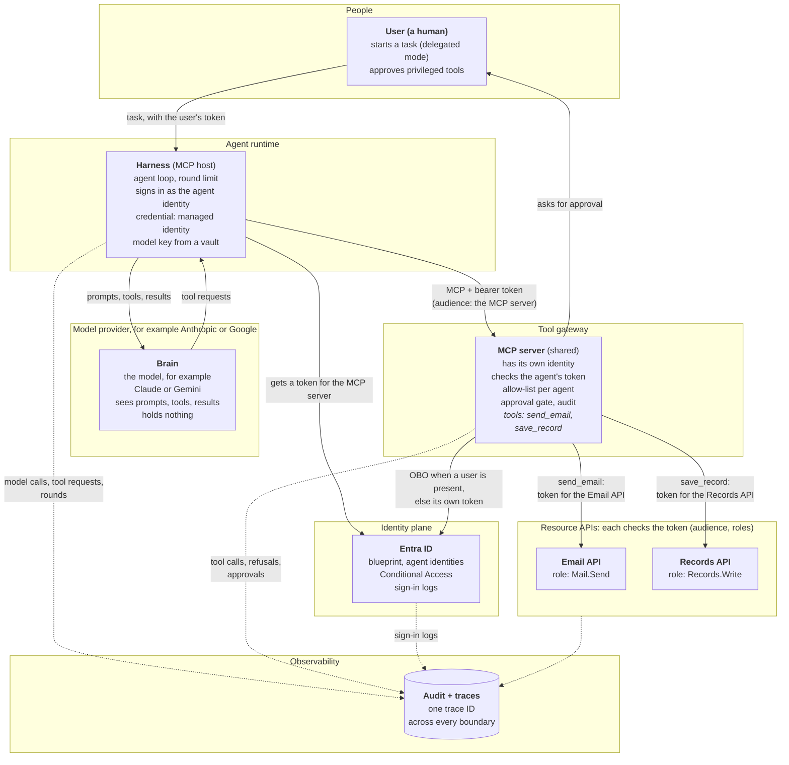
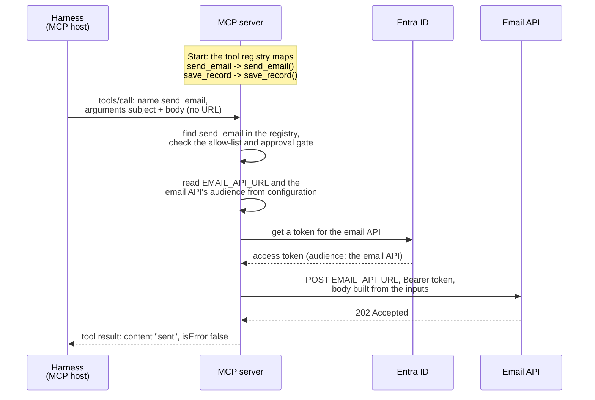
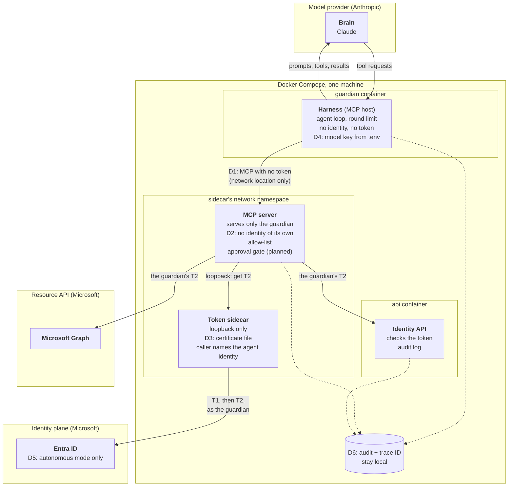
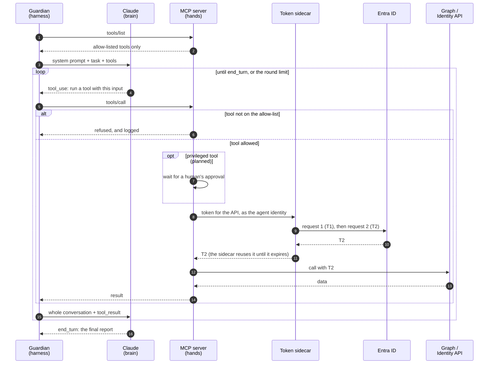

# Agent architecture: harness, brain, hands and identity

This document shows the four parts of an agent, an enterprise reference design with clear trust boundaries, and the guardian's own design with every place where it differs from that reference.

**Status: design.** Built today: the identity, the token sidecar, the Identity API, and the guardian's four registry rules, which still call Graph directly. Not built yet: the MCP server, the model, the tool allow-list and the approval gate. The README's [Delivery status](../README.md#delivery-status) tracks what is done.

## Contents

- [1. The four parts of an agent](#1-the-four-parts-of-an-agent)
- [2. Enterprise reference design](#2-enterprise-reference-design)
  - [Who checks whom](#who-checks-whom)
  - [How a tool reaches its API](#how-a-tool-reaches-its-api)
  - [The MCP contract](#the-mcp-contract)
- [3. The guardian's design today](#3-the-guardians-design-today)
  - [Where the guardian differs](#where-the-guardian-differs)
  - [What each component holds](#what-each-component-holds)
- [4. The agent loop](#4-the-agent-loop)
  - [How one run works](#how-one-run-works)
  - [The messages](#the-messages)
- [5. If one part is compromised](#5-if-one-part-is-compromised)

---

## 1. The four parts of an agent

An agent is more than its model. It is a logical whole made of four parts, and each part runs in its own trust boundary:

- **Harness - the agent's program:** It is the part you write and run. It runs the agent loop, and it is the only part that talks to both the brain and the MCP server. It gives the model the tool list and each result, and it passes the model's tool requests to the MCP server. So it also controls what the model sees: it could change a tool result, or even fake one. In MCP terms, it plays the *host* role: it holds the MCP client that connects to the MCP server. "Host" is only its MCP role, because the harness does much more than MCP.
- **Brain - the model:** It never talks to the MCP server. It only sees what the harness sends: the task, the tool list and the results. From those, it decides the next step and asks the harness for a tool. It runs at the model provider, and it holds nothing: no credential and no token.
- **Hands - the tools on the MCP server:** The MCP server is a separate component, not part of the agent's program, and in general one MCP server can serve many agents. It acts only when the harness calls it, and it checks every call itself, with the allow-list and the approval gate. The tools then call downstream APIs such as Microsoft Graph. Those APIs are not tools: they are resource servers in their own trust boundary, and they check the token of whoever calls them.
- **Identity - the agent identity in Entra:** It says who the agent is, and its roles decide what its tokens allow. It is a record in Entra, not a running component, so it lives inside Entra's trust boundary. It has no credential of its own, so some component must sign in for it: the harness in the enterprise design, and the MCP server (through the token sidecar) in the guardian's design.

In short: the agent is all four parts together, and the harness is its program. The brain decides, the tools act, and the identity says who is acting. The brain never talks to the MCP server and never sees a token. In Entra Agent ID, the agent identity stands for the whole agent, not for the model: the model itself has no identity.

---

## 2. Enterprise reference design

This is the design an enterprise would aim for. Every part has its own trust boundary, every call between boundaries carries a token, and every boundary checks the part that calls it. The agent can run in two modes: **delegated**, when a user (a human) starts the task and the agent acts for them, and **autonomous**, when no user is involved.



Three points in this design need a closer look:

- **Tools are not APIs.** A tool is a function that the MCP server exposes to the model: a name, a description and an input format. An API is a resource server, registered in Entra with its own app roles. Inside each tool, the MCP server's code gets a token and calls an API, so the model sees the tool but never the API or the token. MCP itself knows nothing about the APIs: the link from a tool to an API is only the tool's code and its configuration (the API's URL and token audience). What the MCP server may really call is decided in Entra, by the app roles assigned to its identity. A tool can also be narrower than its API: a `send_email` tool can fix the recipients in code, even when the API's `Mail.Send` role allows any recipient.
- **The harness signs in, not the MCP server.** The harness proves who the agent is: it gets a token for the MCP server as the agent identity, with a managed identity as the blueprint's credential, so no key exists on disk. That token can only open the MCP server, because its audience is the MCP server.
- **The MCP server calls downstream APIs with a token of its own.** When a user is present, it uses OBO, so the downstream token names both the user and the caller. Without a user, Entra's OBO does not apply, because it needs a user in the incoming token. So the MCP server uses its own app token and records in its audit which agent asked. A standard token exchange (RFC 8693) could keep the agent in the downstream token, but Entra does not offer it for this case.

### Who checks whom

| Boundary | It checks the part that calls it |
|---|---|
| Brain | Only its instructions: treat tool results as data, not as instructions. This is the weakest check, so the boundaries below must not depend on it. |
| Harness | The brain's requests: the round limit. It also treats tool results as untrusted data before it passes them on. |
| MCP server | The harness's calls: the token (audience, agent claims), the allow-list for that agent, and the approval gate for privileged tools |
| Resource APIs | The MCP server's token: signature, audience, roles |
| Entra ID | Every sign-in: the credential, the parent blueprint, Conditional Access |

Each boundary checks the one before it, so one tricked or broken part cannot act alone. This is Zero Trust applied inside the agent.

### How a tool reaches its API

An MCP server is a service like an ASP.NET app: a developer writes the code for every tool. A tool is a function, and the MCP server routes each call to it by the tool's name, the way ASP.NET routes a request to a controller action by its path. Inside the function, the code calls the API with an ordinary HTTP request, and the API's URL comes from the MCP server's own configuration. The MCP message from the harness carries only the tool's name and its inputs, never a URL.

This example follows a `send_email` call:

1. **Build time:** A developer writes the `send_email` function in the MCP server. Inside it, the code reads the email API's URL from configuration, gets a token, and sends the POST.
2. **Deploy time:** An operator sets the configuration: the email API's URL and its token audience.
3. **Start:** The MCP server fills its tool registry. For each tool function, it records the name, the description and the input format, and maps the name to the function.
4. **The call arrives:** The harness sends `tools/call` with the name `send_email` and the inputs `subject` and `body`.
5. **Dispatch:** The MCP server finds `send_email` in its registry, checks the allow-list and the approval gate, and runs the function with those inputs.
6. **The function acts:** It reads the email API's URL from configuration, gets a token for the email API from Entra, and sends the POST with the token and a body built from the inputs.
7. **The result goes back:** The function returns "sent", and the MCP server returns it to the harness as an MCP tool result.



The URL is configuration, not an input, so neither the model nor the harness can change where the mail goes. If a tool accepted a URL as an input, a prompt injection could send data to any server. So tool inputs hold only business data, such as a subject and a body, never endpoints.

These are the data at steps 1, 4, 6 and 7. The code is a sketch: the guardian's real tools come later.

```python
# Step 1: the tool, written by a developer inside the MCP server
import os

import httpx
from mcp.server.fastmcp import FastMCP

mcp = FastMCP("tool-gateway")

@mcp.tool()   # step 3: registers the tool - name from the function, description from the
              # docstring, input format from the parameters
def send_email(subject: str, body: str) -> str:
    """Send an email to the team mailbox."""
    url = os.environ["EMAIL_API_URL"]                        # step 2: set at deploy time
    token = get_token(audience=os.environ["EMAIL_API_AUDIENCE"])   # a helper that asks Entra
    httpx.post(url, headers={"Authorization": f"Bearer {token}"},
               json={"to": "team@example.com", "subject": subject, "body": body})
    return "sent"
```

```jsonc
// Step 4: harness -> MCP server. A tool name and inputs, no URL.
// (Every MCP request also carries "_meta" with the protocol version and client details; left out here.)
{ "jsonrpc": "2.0", "id": 7, "method": "tools/call",
  "params": { "name": "send_email",
              "arguments": { "subject": "Weekly report", "body": "4 findings..." } } }
```

```http
# Step 6: MCP server -> email API. An ordinary HTTPS call.
POST https://mailserver.example.com/api/send
Authorization: Bearer eyJ...      (audience: the email API)
Content-Type: application/json

{ "to": "team@example.com", "subject": "Weekly report", "body": "4 findings..." }
```

```jsonc
// Step 7: MCP server -> harness. The MCP tool result.
{ "jsonrpc": "2.0", "id": 7,
  "result": { "resultType": "complete",
              "content": [ { "type": "text", "text": "sent" } ],
              "isError": false } }
```

### The MCP contract

MCP messages are JSON-RPC 2.0 messages, and the MCP specification defines a schema for every request and result (current version: 2026-07-28). For tools, the contract has three parts:

- **A tool definition (`tools/list`):** Each tool has a `name`, a `description` and an `inputSchema`, which is a JSON Schema for its inputs. It can also have a `title`, an `outputSchema` for its results, and `annotations`, which are hints such as "read-only". A client must treat annotations as untrusted unless the server itself is trusted. The list may also differ by the caller's authorization, which is what an allow-list per agent needs.
- **A tool result (`tools/call`):** `content` is a list of blocks (text, image, audio, a resource link or an embedded resource). `structuredContent` is optional JSON, and when the tool declares an `outputSchema`, it must match that schema. `isError` says whether the tool failed.
- **Two kinds of errors:** A *protocol error* is a JSON-RPC error, for example code `-32602` for an unknown tool. A *tool execution error* is a normal result with `isError: true` and a message the model can read, so it can correct its inputs and try again.

In MCP 2026-07-28 there is no `initialize` handshake any more. Every request carries its protocol version, client details and capabilities in `_meta`, so each request stands alone. Older versions, up to 2025-11-25, start every session with `initialize`.

---

## 3. The guardian's design today

The guardian has the same four parts, but it runs on one machine with Docker Compose and takes some shortcuts because of the project's timebox. Each shortcut is marked D1 to D6 in the diagram and explained in the table below it.



### Where the guardian differs

| | Enterprise design | The guardian today | Why | Risk accepted |
|---|---|---|---|---|
| D1 | The harness sends a bearer token to the MCP server, and the MCP server checks it | No token: the MCP server trusts that only the guardian container can reach it | Timebox | Any code that reaches the MCP server's port can call the allow-listed tools |
| D2 | The MCP server has its own identity, and it serves many agents | The MCP server serves only the guardian and gets tokens as the guardian's identity, so it acts as the guardian's hands | One identity and one sidecar are simpler, and no token ever reaches the harness | The MCP server cannot serve other agents. If it is compromised, it can get tokens for any agent identity of the blueprint, because the sidecar lets its caller name the agent identity. |
| D3 | The blueprint's credential is a managed identity, so no key exists | A certificate file, mounted only into the sidecar ([details](infra.md#the-blueprints-credential)) | The demo runs locally, not on Azure | A stolen file exposes every agent identity of the blueprint |
| D4 | The model API key comes from a vault | From a local `.env` file, which git ignores | Local demo | The key sits on disk |
| D5 | Delegated mode with OBO when a user is present | Autonomous mode only. OBO is written design. | Timebox | No user (a human) appears in the token chain |
| D6 | Audit and traces go to a central sink | One trace ID across the guardian, the MCP server and the Identity API, written locally | Timebox | Logs stay on one machine |

### What each component holds

| Component | Part | Holds | Can reach |
|---|---|---|---|
| Claude | Brain | Nothing | Nothing: it only answers the guardian |
| guardian | Harness | The Anthropic API key | Claude, the MCP server. Not the sidecar, so it can never get a token. |
| mcp-server | Hands | No stored secret. It gets T2 from the sidecar when a tool needs it. | The sidecar, Graph, the Identity API |
| sidecar | Signs in for the identity | The blueprint's certificate | Entra. Only callers on its loopback can reach it ([details](infra.md#local-run-the-token-sidecar)). |
| api | A resource API | No secret: it checks tokens with Entra's public signing keys | Nothing: it only answers |

**MCP over Streamable HTTP** is MCP's standard transport for a server that runs as its own network service. The client sends each MCP message as an HTTP POST to one endpoint (`/mcp`), and the server answers with JSON or streams the answer back on the same response.

---

## 4. The agent loop

The four parts work together in a loop. It is usually called the **agent loop** or the tool-use loop. Research calls the pattern ReAct: reason, then act.

The key idea is that the model never acts. It only *asks* the harness for a tool, and the harness and the MCP server decide whether to run it. So a tricked model can change what is asked for, but never what is done without passing the checks. The steps below follow the guardian's design.

### How one run works

1. **Get the tools:** The guardian asks the MCP server for its tools (`tools/list`). The MCP server returns only the allow-listed tools.
2. **Give the task:** The guardian sends Claude a system prompt (its role), the task, and the tool list.
3. **The brain asks:** Claude replies with a tool request (`tool_use`), for example "run `scan_registry`". Nothing has run yet.
4. **The hands check and act:** The guardian sends the request to the MCP server (`tools/call`). The MCP server refuses a tool that is not on the allow-list, and logs the refusal. Otherwise it gets a token from the sidecar, calls Graph or the Identity API, and returns the result.
5. **The result goes back:** The guardian sends Claude a new request with the whole conversation plus the result (`tool_result`). Claude keeps no state between requests, so the guardian always sends everything.
6. **Repeat or finish:** Claude asks for another tool, and steps 3-5 repeat. Or it writes its final report (`end_turn`). The guardian also stops after a fixed number of rounds, even without `end_turn`.



### The messages

The guardian talks to Claude through the Anthropic Messages API. These are the three message shapes from steps 2, 3 and 5, cut down to the parts that matter:

```jsonc
// Step 2: guardian -> Claude
{ "model": "claude-opus-5-5",
  "system": "You are the guardian...",
  "tools": [{ "name": "scan_registry", "description": "...", "input_schema": { } }],
  "messages": [{ "role": "user", "content": "Run today's check and report." }] }

// Step 3: Claude -> guardian
{ "stop_reason": "tool_use",
  "content": [{ "type": "tool_use", "id": "toolu_01", "name": "scan_registry", "input": { } }] }

// Step 5: guardian -> Claude (the whole conversation, plus this at the end)
{ "role": "user",
  "content": [{ "type": "tool_result", "tool_use_id": "toolu_01", "content": "4 findings: ..." }] }
```

---

## 5. If one part is compromised

The trust boundaries exist to limit what a failure can do. In the guardian's design, each part can fail on its own:

- **The brain is tricked (prompt injection):** It can only ask the harness for tools. The allow-list, the approval gate and the round limit still apply, and the brain never sees a token. This is the failure the design expects most.
- **The harness is compromised:** It controls what the brain sees, so it can change the tool list, or change or fake a tool result. It can also call any allow-listed tool and spend the Anthropic API key. But it still cannot get a token, and the MCP server still applies the allow-list and the approval gate, because those checks live in the MCP server, not in the harness. For the same reason, the model's final report is not proof of what happened: the Identity API's audit log is.
- **The MCP server is compromised:** It can get T2 for any agent identity of the blueprint (D2). So in the guardian's design, the MCP server is the most trusted part, and it should stay small.
- **The sidecar is compromised:** The blueprint's certificate is exposed (D3), and with it every agent identity of the blueprint (see the note on blast radius in [Agent ID](agent-id.md#why-use-two-requests-instead-of-one)).
