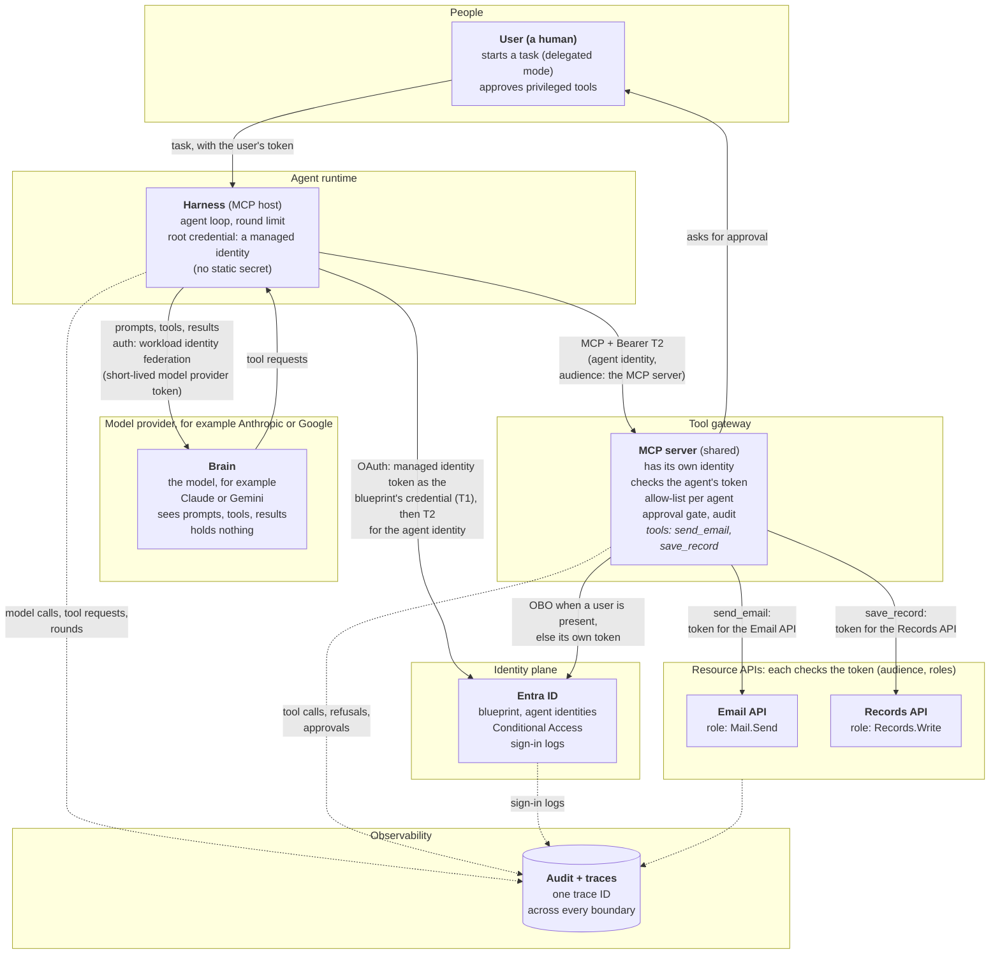
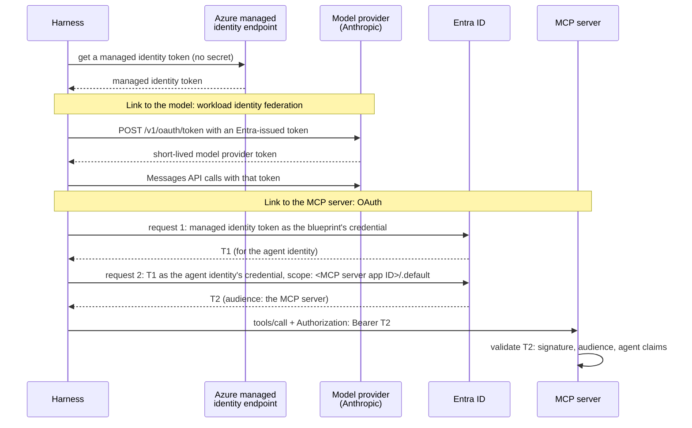
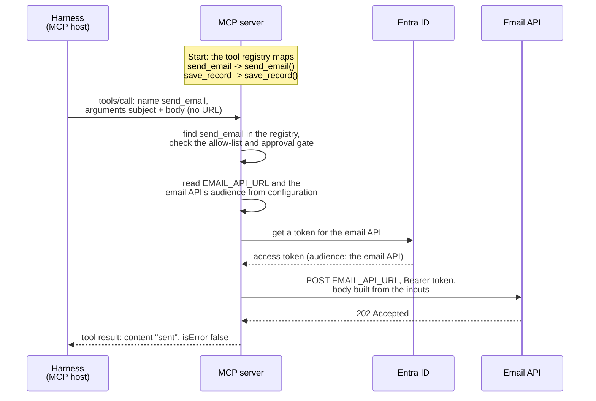
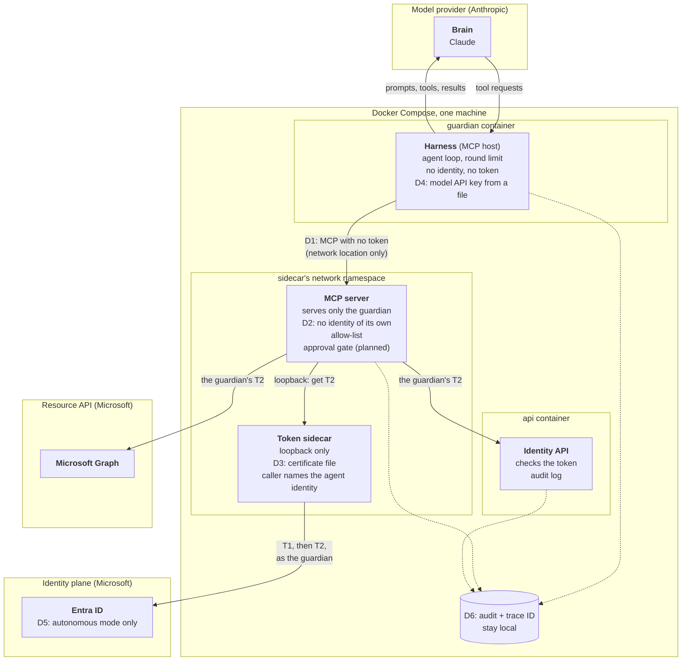
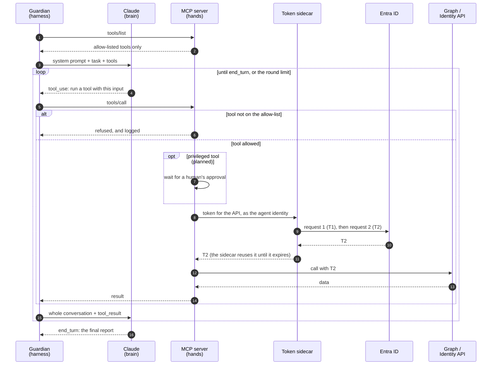

# Agent Architecture: Harness, Brain, Hands, and Identity

This document breaks down the anatomy of an AI agent into four distinct parts, outlines an ideal enterprise reference architecture with strict trust boundaries, and examines how our project's **Guardian** agent is built today—including every pragmatic shortcut it takes and the security trade-offs involved.

> **Current Implementation Status: Design**
> * **Built today:** The Entra identity, the token sidecar, the Identity API, and the Guardian's four registry rules (which currently call Microsoft Graph directly).
> * **Not built yet:** The MCP server, the model integration, the tool allow-list, and the human approval gate. 
> 
> *(See the README's [Delivery status](../README.md#delivery-status) for live progress tracking).*

## Contents

* [1. The Anatomy of an Agent (The Four Parts)](#1-the-anatomy-of-an-agent-the-four-parts)
* [2. The Enterprise Reference Design](#2-the-enterprise-reference-design)
  * [Three Architectural Pillars](#three-architectural-pillars)
  * [How the Harness Authenticates](#how-the-harness-authenticates)
  * [Zero Trust: Who Checks Whom?](#zero-trust-who-checks-whom)
  * [Under the Hood: How a Tool Reaches Its API](#under-the-hood-how-a-tool-reaches-its-api)
  * [The MCP Contract](#the-mcp-contract)
* [3. The Guardian's Design Today](#3-the-guardians-design-today)
  * [Architectural Shortcuts (Where the Guardian Differs)](#architectural-shortcuts-where-the-guardian-differs)
  * [Component Inventory: Who Holds What?](#component-inventory-who-holds-what)
* [4. The Agent Loop in Action](#4-the-agent-loop-in-action)
  * [Step-by-Step: How One Run Works](#step-by-step-how-one-run-works)
  * [The API Payloads](#the-api-payloads)
* [5. Blast Radius: What Happens If One Part Is Compromised?](#5-blast-radius-what-happens-if-one-part-is-compromised)

---

## 1. The Anatomy of an Agent (The Four Parts)

An AI agent is much more than just a Large Language Model (LLM). It is a logical system made of four distinct parts, each operating within its own **trust boundary**:

1. **The Harness (The Agent's Program):** This is the orchestration code you write and run. It executes the agent loop and acts as the sole bridge between the Brain and the MCP server. It feeds the model its available tool list and execution results, and forwards the model's tool requests to the MCP server. Because it sits in the middle, the harness completely controls what the model sees (meaning a compromised harness could alter or fake a tool result). In Model Context Protocol (MCP) terminology, the harness plays the **host** role because it holds the MCP client that connects to the MCP server—though it does much more than just speak MCP.
2. **The Brain (The Model):** Running externally at the model provider (e.g., Anthropic or Google), the brain never communicates with the MCP server directly. It only sees what the harness feeds it: the task, the list of tools, and the results. Based on that context, it decides the next step and *asks* the harness to run a tool. Crucially, the brain holds nothing—no credentials and no tokens.
3. **The Hands (The Tools on the MCP Server):** The MCP server is a standalone component outside the agent's program. In an enterprise setup, a single MCP server can serve many different agents. It only acts when called by the harness, and it enforces its own security checks (such as per-agent allow-lists and human approval gates). Inside the MCP server, the tools call downstream APIs like Microsoft Graph. Those downstream APIs are **not** tools; they are independent resource servers in their own trust boundaries that validate the token of whatever calls them.
4. **The Identity (The Agent Identity in Entra):** This defines *who* the agent is, while its assigned roles dictate what its tokens are allowed to do. Because it is a directory record living inside Entra's trust boundary rather than a running piece of code, it has no credential of its own. Another component must sign in on its behalf: in our enterprise reference design, the **harness** signs in; in the Guardian's local design, the **MCP server** signs in (via the token sidecar).

**The Takeaway:** An agent is the combination of all four parts working together. The harness coordinates, the brain decides, the tools act, and the identity authorizes. The brain never touches the MCP server or sees a token. In Microsoft Entra Agent ID, the agent identity represents this entire four-part system—the LLM itself has no identity.

---

## 2. The Enterprise Reference Design

In a production enterprise environment, every component lives in its own isolated trust boundary. Every cross-boundary call carries a token, and every receiving boundary validates its caller. 

This architecture supports two operational modes:
* **Delegated Mode:** A human user initiates a task, and the agent acts on their behalf.
* **Autonomous Mode:** The agent runs on a schedule or trigger with no human user involved.



### Three Architectural Pillars

To understand why the enterprise diagram is wired this way, look closely at three core mechanics:

1. **Tools Are Not APIs:** A *tool* is simply a function exposed to the model by the MCP server (defined by a name, description, and input format). An *API* is a backend resource server registered in Entra with its own app roles (like `Mail.Send` or `Records.Write`). When a tool runs, the MCP server's internal code fetches a token and calls the API. The model only ever sees the tool; it is completely blind to the underlying API and token. The MCP protocol itself knows nothing about APIs—that connection exists purely inside the tool's code and configuration (the API URL and token audience). While Entra app roles dictate what the MCP server is *allowed* to call, a tool can intentionally restrict privileges further in code (for example, a `send_email` tool can hardcode the recipient address, even if the underlying `Mail.Send` API role allows emailing anyone).
2. **The Harness Signs In, Not the MCP Server:** It is the harness's job to prove who the agent is. It authenticates as the agent identity, with an Azure managed identity as the blueprint's credential so no keys sit on disk, and requests a token scoped specifically for the MCP server (`audience`: MCP server). That token can only open the front door of the MCP server and nothing else. The same managed identity also signs the harness in to the model provider, so the harness holds no static secret at all (see [How the Harness Authenticates](#how-the-harness-authenticates)).
3. **The MCP Server Uses Its Own Token for Downstream APIs:** How the MCP server calls backend APIs depends on the mode:
   * *With a human user (Delegated):* It uses the On-Behalf-Of (OBO) flow, meaning the downstream token carries the identity of both the human user and the calling service.
   * *Without a human user (Autonomous):* Entra's OBO flow cannot be used here because OBO strictly requires a human user in the incoming token. Instead, the MCP server authenticates using its own app token and records which agent requested the action in its audit logs. *(Note: While a standard RFC 8693 token exchange could theoretically preserve the agent's identity in the downstream token, Entra does not support it for this scenario).*

### How the Harness Authenticates

The harness talks to two services, and each one trusts a different credential. In the enterprise design, both credentials start from one **managed identity**: Azure gives it to the machine the harness runs on, and the harness gets its token from a local Azure endpoint without any secret. The harness never sends the managed identity token itself to the model or the MCP server. It uses it only to *get* the credential that each of them accepts:

1. **Managed identity token:** The harness asks the local Azure endpoint for a managed identity token.
2. **To the model provider (workload identity federation):** The harness exchanges an Entra-issued token for a short-lived token from the model provider, and calls the model with it. No API key exists.
3. **To Entra, request 1 (T1):** The harness uses the managed identity token as the *blueprint's* credential (a federated credential) and gets T1 for the agent identity.
4. **To Entra, request 2 (T2):** The harness uses T1 to sign in as the *agent identity*, asks for the scope `<MCP server app ID>/.default`, and gets T2. T2's audience is the MCP server, and its `roles` claim holds only the roles the agent has *on the MCP server*: never its roles on other APIs. The agent cannot pick a subset of those roles (see [App-Only Tokens and the `.default` Scope](agent-id.md#app-only-tokens-and-the-default-scope)), but it always picks which API the token is for. This is the same two-step sign-in as in [Agent ID](agent-id.md#3-the-two-step-sign-in-dance).
5. **To the MCP server (OAuth):** The harness calls the MCP server with `Authorization: Bearer <T2>`. The MCP server validates T2 the way any resource API does: signature, audience, and the agent claims (for example `xms_act_fct` containing 11).



**Anthropic's workload identity federation.** Anthropic supports three ways to authenticate to the Claude API: a static API key, workload identity federation, and App Attest for iOS and macOS apps. With workload identity federation, a workload presents a short-lived identity token from an identity provider it already has: AWS IAM, Google Cloud, or any standard OIDC issuer, and Anthropic's documentation names Microsoft Entra ID among them. The workload exchanges that token at `POST /v1/oauth/token` for a short-lived Claude API access token, and the SDK renews it before it expires. An admin sets it up with three objects in the Claude Console: a service account, a federation issuer and a federation rule. Anthropic's own caveat applies: the trust chain is only as strong as the identity provider's configuration, so a long-lived secret one step earlier in the chain can still undermine it. Source: [Claude API authentication](https://platform.claude.com/docs/en/manage-claude/authentication) (checked 28 October 2026). The guardian uses an API key instead, because it runs locally with no managed identity to federate (D4).

### Zero Trust: Who Checks Whom?

By forcing every boundary to verify the component calling it, a single tricked or compromised component cannot act unilaterally. This brings Zero Trust principles inside the agent itself:

| Boundary | What It Verifies on Incoming Calls |
|---|---|
| **Brain** | **System Instructions only:** Relies on prompts telling it to treat tool results as passive data rather than executable instructions. *Because this is the weakest security boundary, no downstream component is allowed to trust it.* |
| **Harness** | **The Brain's requests:** Enforces maximum round limits and treats all returned tool results as untrusted data before passing them back to the model. |
| **MCP Server** | **The Harness's calls:** Validates the incoming bearer token (audience and agent claims), checks the per-agent tool allow-list, and triggers human approval gates for privileged tools. |
| **Resource APIs** | **The MCP Server's token:** Validates cryptographic signatures, token audience, and assigned app roles. |
| **Entra ID** | **Every sign-in:** Validates the blueprint credential, verifies the parent blueprint relationship, and enforces Conditional Access policies. |

### Under the Hood: How a Tool Reaches Its API

Think of an MCP server like a standard ASP.NET web application: a developer writes code for each tool, and the MCP server routes incoming requests to the right function based on the tool's name—just like ASP.NET routes an HTTP request to a controller action based on the URL path. 

Inside that function, the code makes a standard HTTP request to the target API. Crucially, **the API's URL comes from the MCP server's internal configuration, never from the harness's MCP message.** The message from the harness only ever contains the tool name and business inputs.

Here is the exact lifecycle of a `send_email` call:

1. **Build Time:** A developer writes the `send_email` function inside the MCP server to read an API URL from environment configuration, request a token, and send an HTTP POST.
2. **Deploy Time:** An operator configures the environment variables (the email API's URL and its token audience).
3. **Startup:** The MCP server populates its internal tool registry, mapping the tool's name, description, and input schema to the actual Python function.
4. **Call Arrives:** The harness sends a `tools/call` message specifying `send_email` along with the `subject` and `body` arguments.
5. **Dispatch:** The MCP server looks up `send_email` in its registry, verifies the caller against the allow-list and approval gate, and invokes the function.
6. **Execution:** The function reads the configured URL, requests an access token from Entra for the email API, and fires the HTTP POST with the bearer token and payload.
7. **Return:** The function returns `"sent"`, which the MCP server wraps and sends back to the harness as a standard MCP tool result.



> **Security Insight — Why URLs Must Be Configuration:** 
> Because the destination URL is locked in the server's environment configuration rather than passed as a tool argument, neither a hallucinating model nor a compromised harness can redirect where the email goes. If a tool accepted a target URL as an input parameter, a simple prompt injection could trick the agent into exfiltrating sensitive data to an attacker's server. Tool inputs must strictly carry business data (like `subject` and `body`), never endpoints.

Here is what the code and wire payloads look like across Steps 1, 4, 6, and 7 *(note: this code is an illustrative sketch; the Guardian's actual tools will be implemented in a later phase)*:

```python
# Step 1: The tool function, written by a developer inside the MCP server
import os
import httpx
from mcp.server import MCPServer      # MCP Python SDK 2.x

mcp = MCPServer("tool-gateway")

@mcp.tool()   # Step 3: Registers the tool — pulls the name from the function, 
              # description from the docstring, and input format from the parameters.
def send_email(subject: str, body: str) -> str:
    """Send an email to the team mailbox."""
    url = os.environ["EMAIL_API_URL"]                              # Step 2: Set at deploy time
    token = get_token(audience=os.environ["EMAIL_API_AUDIENCE"])   # Helper that asks Entra
    httpx.post(url, headers={"Authorization": f"Bearer {token}"},
               json={"to": "team@example.com", "subject": subject, "body": body})
    return "sent"
```

```jsonc
// Step 4: Harness -> MCP Server. Carries only a tool name and business inputs (no URL).
// (Note: Every MCP request also carries "_meta" with the protocol version and client details, omitted here for brevity.)
{ "jsonrpc": "2.0", "id": 7, "method": "tools/call",
  "params": { "name": "send_email",
              "arguments": { "subject": "Weekly report", "body": "4 findings..." } } }
```

```http
# Step 6: MCP Server -> Email API. A standard HTTPS request.
POST https://mailserver.example.com/api/send
Authorization: Bearer eyJ...      (audience: the email API)
Content-Type: application/json

{ "to": "team@example.com", "subject": "Weekly report", "body": "4 findings..." }
```

```jsonc
// Step 7: MCP Server -> Harness. The formatted MCP tool result.
{ "jsonrpc": "2.0", "id": 7,
  "result": { "resultType": "complete",
              "content": [ { "type": "text", "text": "sent" } ],
              "isError": false } }
```

### The MCP Contract

All MCP messages use **JSON-RPC 2.0**, governed by a strict schema defined in the MCP specification (current version: **2026-07-28**). When working with tools, the contract revolves around three elements:

* **Tool Definitions (`tools/list`):** Every tool exposes a `name`, a `description`, and an `inputSchema` (a JSON Schema validating its parameters). Optionally, it can include a human-friendly `title`, an `outputSchema` for its return data, and `annotations` (behavioral hints like `"read-only"`—though clients must treat annotations as untrusted unless the MCP server itself is trusted). Because `tools/list` can dynamically filter results based on the caller's identity, it naturally supports per-agent allow-lists.
* **Tool Results (`tools/call`):** Returns a `content` array containing blocks of text, images, audio, resource links, or embedded resources. It can also return optional JSON in `structuredContent` (which must validate against `outputSchema` if the tool declared one), alongside an `isError` boolean flag.
* **Two Distinct Error Types:** 
  1. *Protocol Errors:* Standard JSON-RPC errors (such as code `-32602` when requesting an unknown tool).
  2. *Tool Execution Errors:* Returned as a normal tool result with `isError: true` and a plain-text explanation. This allows the LLM to read what went wrong, fix its arguments, and retry the call.
* **Security Rules:** The specification says MCP servers **must** validate all tool inputs, implement proper access controls, rate-limit tool calls, and sanitize tool outputs. Clients **should** ask for confirmation on sensitive operations, validate tool results before passing them to the model, and log tool usage for audit. This is why the Guardian's MCP server checks every input before using it: for example, `get_agent` checks that its `app_id` input is a GUID before it builds a Graph URL, so a tricked model cannot point the call at a different Graph path.

*(Protocol Version Note: As of MCP **2026-07-28**, the stateful `initialize` handshake has been removed. Instead, every single request is self-contained and carries its protocol version, client details, and capabilities inside a `_meta` field. Older versions up to **2025-11-25** required starting every session with an `initialize` call).*

---

## 3. The Guardian's Design Today

While our **Guardian** agent shares the same four-part conceptual anatomy, it runs locally on a single machine via Docker Compose. To fit our project's timebox, it takes six deliberate architectural shortcuts (labeled **D1** through **D6** in the diagram and detailed in the table below). The decisions behind this design, with their reasons, are recorded in the [decision log](decisions.md).



### Architectural Shortcuts (Where the Guardian Differs)

| ID | Enterprise Reference Design | The Guardian Today | Why We Took the Shortcut | Risk Accepted |
|---|---|---|---|---|
| **D1** | The harness sends a bearer token to the MCP server, which validates it. | **No token:** The MCP server relies on Docker network isolation, trusting that only the Guardian container can reach it. | Project timebox. | Any code that manages to reach the MCP server's network port can invoke allow-listed tools. |
| **D2** | The MCP server has its own Entra identity and serves multiple agents. | **Shared Identity:** The MCP server serves *only* the Guardian and fetches tokens using the Guardian's identity (acting directly as the Guardian's hands). | Keeping one identity and one sidecar is simpler, and ensures no Entra token ever reaches the harness. | The MCP server cannot be shared with other agents. If compromised, it can request tokens for *any* agent identity under the blueprint (since the sidecar lets callers specify which agent identity they want). |
| **D3** | The blueprint authenticates via an Azure Managed Identity (zero keys on disk). | **Certificate File:** A certificate file is mounted exclusively into the sidecar container ([details](infra.md#the-blueprints-credential)). | The demo runs locally in Docker, not in Azure. | If the certificate file is stolen from disk, every agent identity tied to the blueprint is exposed. |
| **D4** | No static model key: the harness signs in to the model provider with workload identity federation (or, failing that, reads a key from a cloud vault). | **API Key File:** An Anthropic service account API key in `secrets/anthropic.env` (the folder is excluded via `.gitignore`), given only to the guardian container. | Local demo environment, with no managed identity to federate. | The Anthropic API key sits unencrypted on the host disk. |
| **D5** | Supports Delegated mode with OBO when a human user is present. | **Autonomous Mode Only:** OBO exists strictly as written documentation. | Project timebox. | No human user ever appears in the token chain. |
| **D6** | Audit logs and distributed traces ship to a central SIEM/sink. | **Local Logs:** A single trace ID flows across the Guardian, MCP server, and Identity API, written locally. | Project timebox. | All audit logs reside on the same single machine. |

### Component Inventory: Who Holds What?

To verify our security posture, here is exactly what each container holds and what it can reach over the network:

| Component | Agent Part | Credentials Held | Network Reach |
|---|---|---|---|
| **Claude** | Brain | *Nothing* | *Nothing* (only responds to incoming requests from the `guardian`). |
| **`guardian`** | Harness | Anthropic API key | Can reach Claude and `mcp-server`. **Cannot reach `sidecar`** (meaning it can never obtain an Entra token). |
| **`mcp-server`** | Hands | *No stored secrets* (requests T2 tokens on-demand from `sidecar`). | Can reach `sidecar`, Microsoft Graph, and `api`. |
| **`sidecar`** | Identity Sign-In | The blueprint's certificate file. | Can reach Entra ID. Listens strictly on loopback ([details](infra.md#local-run-the-token-sidecar)). |
| **`api`** | Resource API | *No secrets* (validates tokens using Entra's public signing keys). | *Nothing* (only responds to incoming API calls). |

*(Transport Note: The communication between the harness and the MCP server uses **MCP over Streamable HTTP**, the standard transport for standalone networked MCP services. The client sends each MCP message as an HTTP POST to a single `/mcp` endpoint, and the server either replies with a standard JSON payload or streams the response back over the same connection).*

---

## 4. The Agent Loop in Action

All four parts come together during the **agent loop** (often called the *tool-use loop*, or the **ReAct** pattern—*Reason, then Act*—in academic literature).

The foundational security principle of this loop is that **the model never acts**. It can only *ask* the harness to run a tool, and the harness and MCP server independently decide whether to allow it. If a prompt injection tricks the model, the attacker can only influence what the model *asks* for—they cannot bypass the downstream checks.

### Step-by-Step: How One Run Works

1. **Discover Tools:** The Guardian harness queries the MCP server (`tools/list`), which returns *only* the tools on the Guardian's allow-list.
2. **Assign the Task:** The Guardian sends Claude its system prompt (defining its persona/role), the task instructions, and the list of allowed tools.
3. **The Brain Asks:** Claude evaluates the task and replies with a tool request (`tool_use`)—for example, asking to run `scan_registry`. At this stage, nothing has actually executed.
4. **The Hands Check and Act:** The Guardian forwards the request to the MCP server (`tools/call`). If the requested tool isn't on the allow-list, the MCP server blocks it and logs the refusal. If allowed, the MCP server requests a T2 token from the sidecar, calls Microsoft Graph or the Identity API, and packages the result.
5. **Return the Context:** Because Claude is completely stateless between API calls, the Guardian sends a fresh request containing the *entire conversation history* plus the new `tool_result`.
6. **Repeat or Finish:** Claude either requests another tool (repeating Steps 3–5) or outputs its final report (`end_turn`). As a safety net, the Guardian enforces a hard cap on the number of rounds and will terminate the loop if Claude fails to send `end_turn` in time.



### The API Payloads

The Guardian communicates with Claude using the Anthropic Messages API. Below are the simplified JSON shapes for Steps 2, 3, and 5:

```jsonc
// Step 2: Guardian -> Claude (Initial prompt and tool definitions)
{ "model": "claude-opus-5-5",
  "system": "You are the guardian...",
  "tools": [{ "name": "scan_registry", "description": "...", "input_schema": { } }],
  "messages": [{ "role": "user", "content": "Run today's check and report." }] }

// Step 3: Claude -> Guardian (The model asks to run a tool)
{ "stop_reason": "tool_use",
  "content": [{ "type": "tool_use", "id": "toolu_01", "name": "scan_registry", "input": { } }] }

// Step 5: Guardian -> Claude (The full conversation history, appending this result at the end)
{ "role": "user",
  "content": [{ "type": "tool_result", "tool_use_id": "toolu_01", "content": "4 findings: ..." }] }
```

---

## 5. Blast Radius: What Happens If One Part Is Compromised?

We separate the agent into distinct trust boundaries specifically to contain the blast radius when something goes wrong. Here is how the Guardian's architecture holds up if individual components fail:

* **Scenario 1: The Brain is Tricked (Prompt Injection)**
  * *Impact:* Minimal (this is the primary failure mode the architecture is built to handle). The model can only *ask* the harness to invoke tools. The MCP server's allow-list, the human approval gate, and the harness's round limits all remain strictly enforced, and the brain never sees an Entra token.
* **Scenario 2: The Harness is Compromised**
  * *Impact:* Moderate. Because the harness mediates all communication with the model, it can manipulate the tool list, alter or fabricate tool results, invoke any allow-listed tool, and burn through the local Anthropic API key. However, **it still cannot obtain an Entra token**, and it cannot bypass the tool allow-list or approval gates because those checks are enforced inside the MCP server. 
  * *Crucial Audit Rule:* Because a compromised harness can lie to the model, **the LLM's final report is never proof of what actually happened—only the Identity API's audit log is.**
* **Scenario 3: The MCP Server is Compromised**
  * *Impact:* High. Due to shortcut **D2** (where the sidecar lets its caller request tokens for any child of the blueprint), a compromised MCP server can obtain T2 access tokens for *any* agent identity under that blueprint. Consequently, in the Guardian's current design, the MCP server is our most trusted component and its codebase must be kept as small and auditable as possible.
* **Scenario 4: The Token Sidecar is Compromised**
  * *Impact:* Critical. The blueprint's private certificate is exposed (**D3**), immediately compromising every agent identity governed by that blueprint *(see the blast radius note in [Agent ID](agent-id.md#why-use-two-requests-instead-of-one))*.