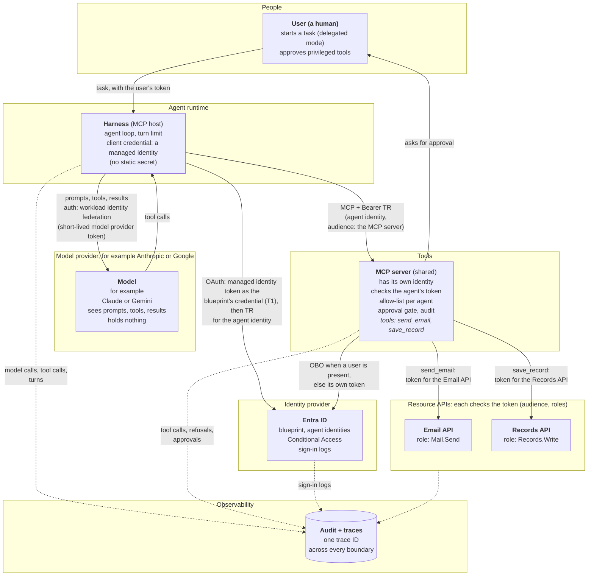
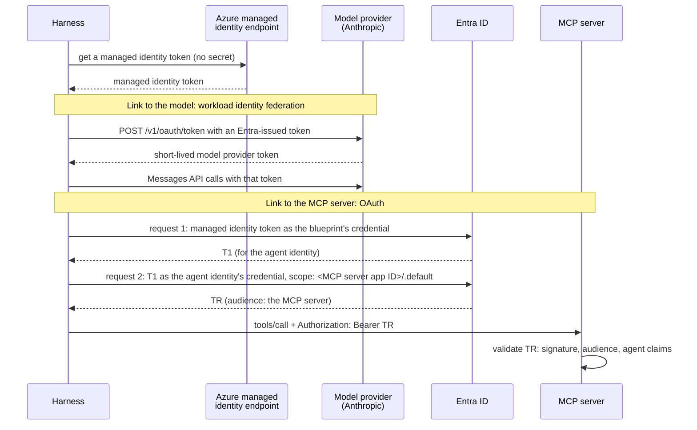
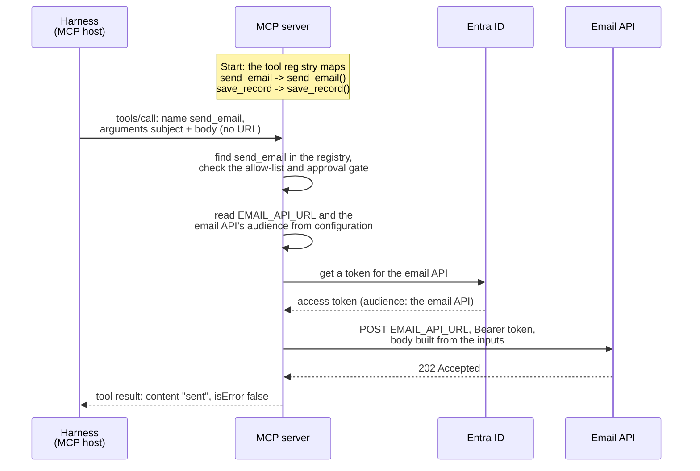
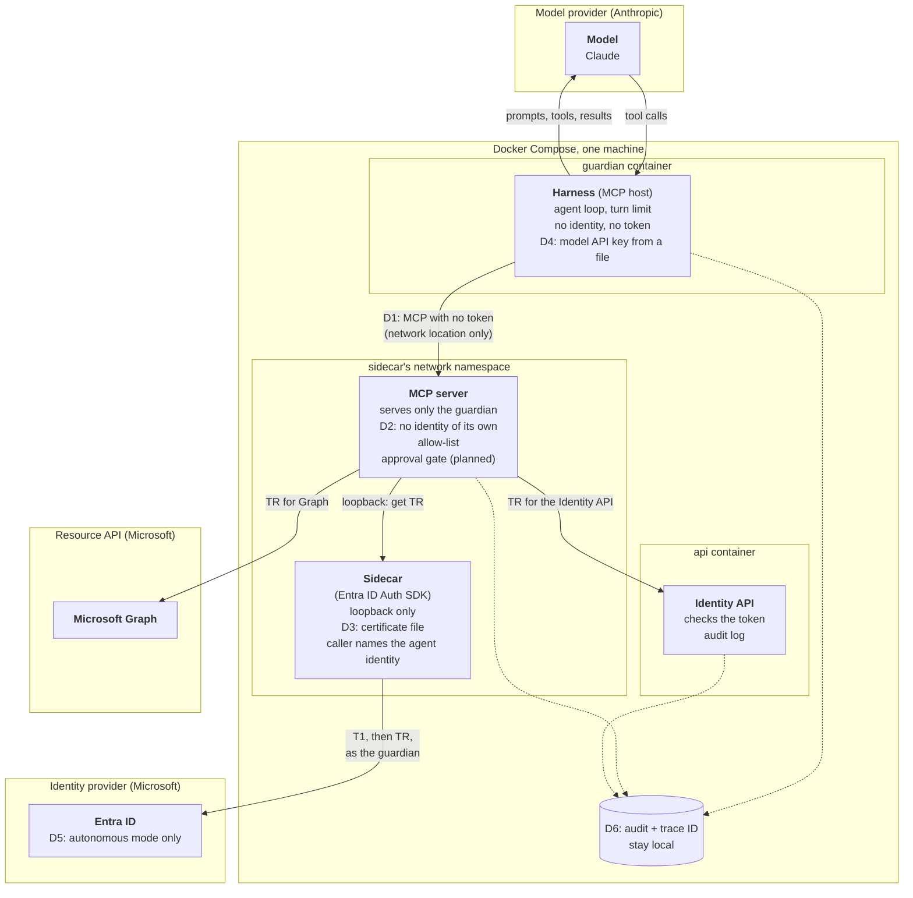
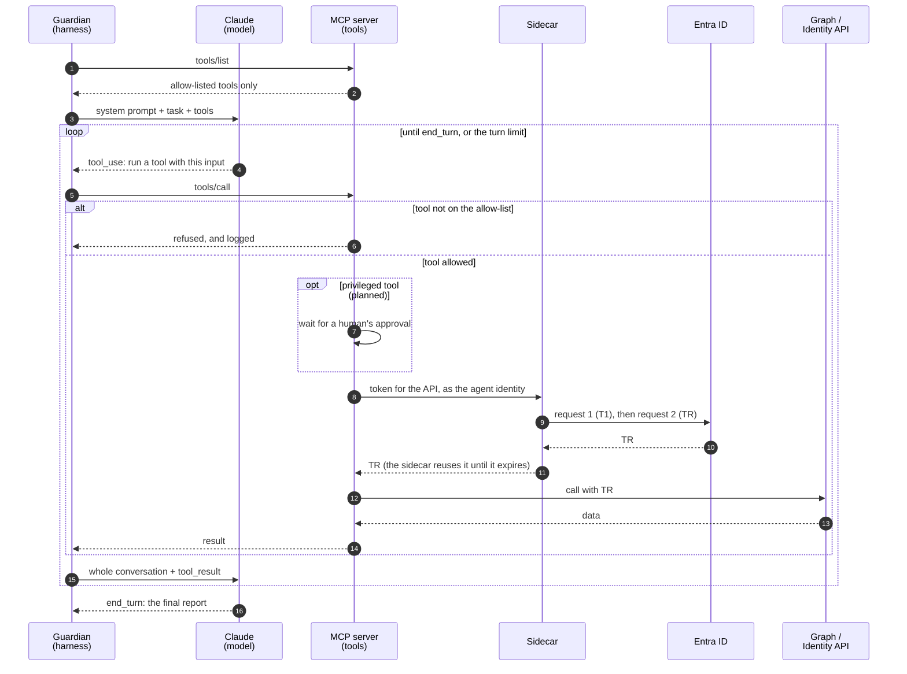

# Agent Architecture: Harness, Model, Tools, and Identity

This document breaks down the anatomy of an AI agent into four distinct parts, outlines an ideal enterprise reference architecture with strict trust boundaries, and examines how our project's **Guardian** agent is built today—including every pragmatic shortcut it takes and the security trade-offs involved.

> **Current Implementation Status: Partly Built**
> * **Built:** The Entra identity, the sidecar (Microsoft Entra ID Auth SDK), the Identity API, the MCP server with two tools (`scan_registry` runs the Guardian's four registry rules, `get_agent` reads one agent), and the harness's agent loop with Claude. The Guardian's container cannot reach the sidecar, and an end-to-end test proves it.
> * **Not built yet:** The tool allow-list, the human approval gate, and the correlation-ID scaffold. 
> 
> *(See the README's [Delivery status](../README.md#delivery-status) for live progress tracking).*

## Contents

* [1. The Anatomy of an Agent (The Four Parts)](#1-the-anatomy-of-an-agent-the-four-parts)
* [2. The Enterprise Reference Design](#2-the-enterprise-reference-design)
  * [Three Architectural Pillars](#three-architectural-pillars)
  * [How the Harness Authenticates](#how-the-harness-authenticates)
  * [Zero Trust: Who Checks Whom?](#zero-trust-who-checks-whom)
  * [How Each Caller Proves Who It Is](#how-each-caller-proves-who-it-is)
  * [Under the Hood: How a Tool Reaches Its API](#under-the-hood-how-a-tool-reaches-its-api)
  * [The MCP Contract](#the-mcp-contract)
* [3. The Guardian's Design Today](#3-the-guardians-design-today)
  * [Architectural Shortcuts (Where the Guardian Differs)](#architectural-shortcuts-where-the-guardian-differs)
  * [Component Inventory: Who Holds What?](#component-inventory-who-holds-what)
* [4. The Agent Loop in Action](#4-the-agent-loop-in-action)
  * [Step-by-Step: How One Run Works](#step-by-step-how-one-run-works)
  * [The API Payloads](#the-api-payloads)
  * [Why the Model Stopped: stop_reason](#why-the-model-stopped-stop_reason)
  * [The Model Settings](#the-model-settings)
* [5. Blast Radius: What Happens If One Part Is Compromised?](#5-blast-radius-what-happens-if-one-part-is-compromised)
* [6. Credentials and Tokens: How a Workload Gets Them](#6-credentials-and-tokens-how-a-workload-gets-them)
  * [Layer 1: The Client Credential](#layer-1-the-client-credential)
  * [Layer 2: Who Gets the Tokens](#layer-2-who-gets-the-tokens)
  * [What the Guardian Uses and Why](#what-the-guardian-uses-and-why)

---

## 1. The Anatomy of an Agent (The Four Parts)

An AI agent is much more than just a Large Language Model (LLM). It is a logical system made of four distinct parts, each operating within its own **trust boundary**:

1. **The Harness (the agent harness):** This is the code that runs the agent loop. Anthropic defines it as "the loop that calls Claude and routes Claude's tool calls to the relevant infrastructure". It is the only bridge between the model and the MCP server: it sends the model the tool definitions and the tool results, and it forwards the model's tool calls to the MCP server. Because it sits in the middle, the harness controls what the model sees, so a compromised harness could change or fake a tool result. In Model Context Protocol (MCP) terms, the harness plays the **host** role, because it holds the MCP client that connects to the MCP server. It does much more than speak MCP, though.
2. **The Model (the LLM):** It runs at the model provider (for example, Anthropic or Google) and never talks to the MCP server directly. It only sees what the harness sends it: the system prompt, the task, the tool definitions, and the tool results. From that context, it decides the next step and *asks* for a tool call. It holds nothing: no credentials and no tokens.
3. **The Tools (on the MCP Server):** The MCP server is a separate component, outside the harness. In an enterprise setup, a single MCP server can serve many different agents. It only acts when called by the harness, and it enforces its own security checks (such as per-agent allow-lists and human approval gates). Inside the MCP server, the tools call downstream APIs like Microsoft Graph. Those downstream APIs are **not** tools; they are independent resource servers in their own trust boundaries that validate the token of whatever calls them.
4. **The Identity (The Agent Identity in Entra):** This defines *who* the agent is, while its assigned roles dictate what its tokens are allowed to do. Because it is a directory record living inside Entra's trust boundary rather than a running piece of code, it has no credential of its own. Another component must sign in on its behalf: in our enterprise reference design, the **harness** signs in; in the Guardian's local design, the **MCP server** signs in (via the sidecar).

**The Takeaway:** An agent is the combination of all four parts working together. The harness coordinates, the model decides, the tools act, and the identity authorizes. The model never touches the MCP server or sees a token. In Microsoft Entra Agent ID, the agent identity represents this entire four-part system—the LLM itself has no identity.

**A note on "brain" and "hands".** Anthropic's engineering blog uses these words with a different split: the "brain" is Claude *and* its harness, and the "hands" are the sandboxes and tools that perform actions ([Scaling Managed Agents: Decoupling the brain from the hands](https://www.anthropic.com/engineering/managed-agents), 8 April 2026). So this document uses the plain terms: model, harness and tools.

---

## 2. The Enterprise Reference Design

In a production enterprise environment, every component lives in its own isolated trust boundary. Every cross-boundary call carries a token, and every receiving boundary validates its caller. 

This architecture supports two operational modes:
* **Delegated Mode:** A human user initiates a task, and the agent acts on their behalf.
* **Autonomous Mode:** The agent runs on a schedule or trigger with no human user involved.



### Three Architectural Pillars

To understand why the enterprise diagram is wired this way, look closely at three core mechanics:

1. **Tools Are Not APIs:** A *tool* is simply a function exposed to the model by the MCP server (defined by a name, description, and input format). An *API* is a backend resource server registered in Entra with its own app roles (like `Mail.Send` or `Records.Write`). When a tool runs, the MCP server's internal code fetches a token and calls the API. The model only ever sees the tool; it is completely blind to the underlying API and token. The MCP protocol itself knows nothing about APIs—that connection exists purely inside the tool's code and configuration (the API URL and token audience). While Entra app roles dictate what the MCP server is *allowed* to call, a tool can intentionally restrict privileges further in code (for example, a `send_email` tool can hardcode the recipient address, even if the underlying `Mail.Send` API role allows emailing anyone).
2. **The Harness Signs In, Not the MCP Server:** It is the harness's job to prove who the agent is. It authenticates as the agent identity, with an Azure managed identity as the blueprint's credential so no keys sit on disk, and requests a token scoped specifically for the MCP server (`audience`: MCP server). Only the MCP server accepts that token: no other API does. The same managed identity also signs the harness in to the model provider, so the harness holds no static secret at all (see [How the Harness Authenticates](#how-the-harness-authenticates)).
3. **The MCP Server Uses Its Own Token for Downstream APIs:** How the MCP server calls backend APIs depends on the mode:
   * *With a human user (Delegated):* It uses the On-Behalf-Of (OBO) flow, meaning the downstream token carries the identity of both the human user and the calling service.
   * *Without a human user (Autonomous):* Entra's OBO flow cannot be used here because OBO strictly requires a human user in the incoming token. Instead, the MCP server authenticates using its own app token and records which agent requested the action in its audit logs. *(Note: While a standard RFC 8693 token exchange could theoretically preserve the agent's identity in the downstream token, Entra does not support it for this scenario).*

   **No token passthrough.** The MCP server never forwards the token it received to a downstream API. The MCP spec forbids this and calls it "token passthrough". There are three reasons. The token's audience is the MCP server, so a downstream API must refuse it. An MCP server that accepted a token meant for another API would let callers use that token at the API directly, which skips its allow-list and approval gate. And the API's logs would show the original caller, not who really made the call. So each hop gets its own token, with its own audience. Source: [MCP Security Best Practices](https://modelcontextprotocol.io/docs/2026-07-28/tutorials/security/security_best_practices.md) (checked 28 October 2026).

### How the Harness Authenticates

The harness talks to two services, and each one trusts a different credential. In the enterprise design, both credentials start from one **managed identity**: Azure gives it to the machine the harness runs on, and the harness gets its token from a local Azure endpoint without any secret. The harness never sends the managed identity token itself to the model or the MCP server. It uses it only to *get* the credential that each of them accepts:

1. **Managed identity token:** The harness asks the local Azure endpoint for a managed identity token.
2. **To the model provider (workload identity federation):** The harness exchanges an Entra-issued token for a short-lived token from the model provider, and calls the model with it. No API key exists.
3. **To Entra, request 1 (T1):** The harness uses the managed identity token as the *blueprint's* credential (a federated identity credential, FIC) and gets T1, which Microsoft calls the exchange token, for the agent identity.
4. **To Entra, request 2 (TR):** In this token exchange request, the harness uses T1 to sign in as the *agent identity*, asks for the scope `<MCP server app ID>/.default`, and gets TR (Microsoft's name for the resource access token). TR's audience is the MCP server, and its `roles` claim holds only the roles the agent has *on the MCP server*: never its roles on other APIs. The agent cannot pick a subset of those roles (see [App-Only Tokens and the `.default` Scope](agent-id.md#app-only-tokens-and-the-default-scope)), but it always picks which API the token is for. This is Microsoft's agent autonomous app flow, described in [Agent ID](agent-id.md#3-getting-a-token-the-agent-autonomous-app-flow).
5. **To the MCP server (OAuth):** The harness calls the MCP server with `Authorization: Bearer <TR>`. The MCP server validates TR the way any resource API does: signature, audience, and the agent claims (for example `xms_act_fct` containing 11).



**Anthropic's workload identity federation.** Anthropic supports three ways to authenticate to the Claude API: a static API key, workload identity federation, and App Attest for iOS and macOS apps. With workload identity federation, a workload presents a short-lived identity token from an identity provider it already has: AWS IAM, Google Cloud, or any standard OIDC issuer, and Anthropic's documentation names Microsoft Entra ID among them. The workload exchanges that token at `POST /v1/oauth/token` for a short-lived Claude API access token, and the SDK renews it before it expires. An admin sets it up with three objects in the Claude Console: a service account, a federation issuer and a federation rule. Anthropic's own caveat applies: the trust chain is only as strong as the identity provider's configuration, so a long-lived secret one step earlier in the chain can still undermine it. Source: [Claude API authentication](https://platform.claude.com/docs/en/manage-claude/authentication) (checked 28 October 2026). The guardian uses an API key instead, because it runs locally with no managed identity to federate (D4).

### Zero Trust: Who Checks Whom?

By forcing every boundary to verify the component calling it, a single tricked or compromised component cannot act unilaterally. This brings Zero Trust principles inside the agent itself:

| Boundary | What It Verifies on Incoming Calls |
|---|---|
| **Model** | **The system prompt only:** Relies on prompts telling it to treat tool results as passive data rather than executable instructions. *Because this is the weakest security boundary, no downstream component is allowed to trust it.* |
| **Harness** | **The model's tool calls:** Enforces the turn limit and treats all returned tool results as untrusted data before passing them back to the model. |
| **MCP Server** | **The Harness's calls:** Validates the incoming bearer token (audience and agent claims), checks the per-agent tool allow-list, and triggers human approval gates for privileged tools. |
| **Resource APIs** | **The MCP Server's token:** Validates cryptographic signatures, token audience, and assigned app roles. |
| **Entra ID** | **Every sign-in:** Validates the blueprint credential, verifies the parent blueprint relationship, and enforces Conditional Access policies. |

### How Each Caller Proves Who It Is

Each link has three parts. The **authentication method** is how the caller proves who it is. The **credential** is what it sends as proof. The **trust relationship** is what an admin set up in advance, so the receiver knows which credential to accept. Where several methods exist, the first one is the recommended choice for production. Where the choice depends on the mode, the bullets are labelled by mode. Every link also runs over TLS. TLS proves the other direction: the server certificate shows the caller that it reached the right service.

| # | Link (caller → receiver) | Authentication Method | Credentials | Trust Relationship |
|---|---|---|---|---|
| 1 | Harness → Azure managed identity endpoint | Managed identity: the platform vouches for the machine | None. Only code on that machine can reach the local endpoint. | An admin assigns a user-assigned managed identity to the machine |
| 2 | End user → Harness (delegated mode only) | OpenID Connect sign-in in a client app (authorization code flow with PKCE), then an OAuth bearer token. The blueprint cannot run the sign-in itself. | The user's access token (Tc). At sign-in, the user proves who they are to Entra ID, ideally with phishing-resistant MFA such as a passkey. | The blueprint exposes a scope, so Tc's audience is the blueprint. The harness checks signature, audience and `scp`. |
| 3 | Harness → Model provider | • Workload identity federation<br/>• API key | • A managed identity token (issued by Entra ID), exchanged for a short-lived provider token<br/>• A static API key, read from a vault | • A service account, a federation issuer and a federation rule in the Claude Console<br/>• The key, created for a service account in the Claude Console |
| 4 | Harness → Entra ID (request 1: blueprint gets T1) | OAuth 2.0 client credentials grant, with:<br/>• A federated identity credential (managed identity as its source)<br/>• A certificate<br/>• A client secret (testing only) | • The managed identity token, as `client_assertion`<br/>• A JWT signed with the certificate's private key, as `client_assertion` (RFC 7523)<br/>• The secret | • A federated identity credential on the blueprint (issuer, subject, audience `api://AzureADTokenExchange`)<br/>• The certificate's public key, uploaded to the blueprint<br/>• The secret, registered on the blueprint |
| 5 | Harness → Entra ID (request 2: agent identity gets TR) | • **Autonomous:** OAuth 2.0 client credentials grant<br/>• **Delegated:** On-Behalf-Of (`jwt-bearer` grant) | • T1, as `client_assertion`<br/>• T1, as `client_assertion`, plus the user's token (Tc), as `assertion` | • The parent link from the agent identity to its blueprint, plus app roles granted by an admin<br/>• The same parent link, plus delegated permissions an admin consented to on the blueprint (inheritable permissions). Entra also checks that Tc was issued for the blueprint.<br/>Conditional Access runs at this sign-in in both modes. |
| 6 | Harness → MCP server | • OAuth bearer token (the MCP authorization spec)<br/>• API key<br/>• Network isolation only (no authentication) | • TR, as `Authorization: Bearer TR`<br/>• A key in a request header<br/>• None | • Entra's public signing keys, plus an app role assignment for the agent identity on the MCP server's app ([checks](tokens.md#what-an-api-must-check))<br/>• A key the MCP server issued and stores<br/>• None: any code that reaches the port is trusted |
| 7 | MCP server → Entra ID | • **Autonomous:** OAuth 2.0 client credentials grant<br/>• **Delegated:** On-Behalf-Of (`jwt-bearer` grant) | • A managed identity token, as the `client_assertion` of the MCP server's own app registration<br/>• The same, plus the incoming token that carries the user, as `assertion` | • A federated identity credential on the MCP server's app registration that trusts its managed identity, plus app roles on each API<br/>• The same, plus consented delegated permissions. Entra also checks that the incoming token was issued for the MCP server. |
| 8 | MCP server → Resource API | OAuth bearer token, new for this API (no token passthrough) | An access token whose audience is this API, never the token the MCP server received | Entra's public signing keys, plus an app role assignment (or delegated permission) for the MCP server on this API. The API checks `aud` and `roles` (or `scp` and the user, with OBO). |
| 9 | End user → MCP server (approval gate) | OpenID Connect sign-in at approval time. This is one common design: no spec defines it. | The approver's access token | An admin assigns the approver role. The MCP server checks the token and the role. |
| 10 | Model → Harness (tool calls)<br/>MCP server → Harness (tool results) | None. This is content, not a caller. | None. TLS only proves which service sent it. | None. The harness treats it as untrusted data. |

**Where the Guardian differs:** It runs locally, so row 1 does not exist. Row 3 uses an API key file (**D4**). The harness never talks to Entra ID: the sidecar runs requests 1 and 2 for the MCP server, as the Guardian's agent identity, with a certificate file (**D2**, **D3**). Row 6 has no token, only network isolation (**D1**). Row 2 and the delegated bullets in rows 5 and 7 are not built (**D5**). Row 9, the approval gate, is planned. See [Architectural Shortcuts](#architectural-shortcuts-where-the-guardian-differs).

Sources: [Agent autonomous app OAuth flow](https://learn.microsoft.com/entra/agent-id/agent-autonomous-app-oauth-flow) and [Agent OAuth flows: On-behalf-of flow](https://learn.microsoft.com/entra/agent-id/agent-on-behalf-of-oauth-flow) (checked 29 October 2026).

### Under the Hood: How a Tool Reaches Its API

Think of an MCP server like a standard ASP.NET web application: a developer writes code for each tool, and the MCP server routes incoming requests to the right function based on the tool's name—just like ASP.NET routes an HTTP request to a controller action based on the URL path. 

Inside that function, the code makes a standard HTTP request to the target API. Crucially, **the API's URL comes from the MCP server's internal configuration, never from the harness's MCP message.** The message from the harness only ever contains the tool name and business inputs.

Here is the exact lifecycle of a `send_email` call:

1. **Build Time:** A developer writes the `send_email` function inside the MCP server to read an API URL from environment configuration, request a token, and send an HTTP POST.
2. **Deploy Time:** An operator configures the environment variables (the email API's URL and its token audience).
3. **Startup:** The MCP server populates its internal tool registry, mapping the tool's name, description, and input schema to the actual Python function.
4. **Call Arrives:** The harness sends a `tools/call` message specifying `send_email` along with the `subject` and `body` arguments.
5. **Dispatch:** The MCP server looks up `send_email` in its registry, verifies the caller against the allow-list and approval gate, and invokes the function.
6. **Execution:** The function reads the configured URL, requests an access token from Entra for the email API, and fires the HTTP POST with the bearer token and payload.
7. **Return:** The function returns `"sent"`, which the MCP server wraps and sends back to the harness as a standard MCP tool result.



> **Security Insight — Why URLs Must Be Configuration:** 
> Because the destination URL is locked in the server's environment configuration rather than passed as a tool argument, neither a hallucinating model nor a compromised harness can redirect where the email goes. If a tool accepted a target URL as an input parameter, a simple prompt injection could trick the agent into exfiltrating sensitive data to an attacker's server. Tool inputs must strictly carry business data (like `subject` and `body`), never endpoints.

Here is what the code and wire payloads look like across Steps 1, 4, 6, and 7 *(note: this code is an illustrative sketch; the Guardian's actual tools will be implemented in a later phase)*:

```python
# Step 1: The tool function, written by a developer inside the MCP server
import os
import httpx
from mcp.server import MCPServer      # MCP Python SDK 2.x

mcp = MCPServer("email-tools")

@mcp.tool()   # Step 3: Registers the tool — pulls the name from the function, 
              # description from the docstring, and input format from the parameters.
def send_email(subject: str, body: str) -> str:
    """Send an email to the team mailbox."""
    url = os.environ["EMAIL_API_URL"]                              # Step 2: Set at deploy time
    token = get_token(audience=os.environ["EMAIL_API_AUDIENCE"])   # Helper that asks Entra
    httpx.post(url, headers={"Authorization": f"Bearer {token}"},
               json={"to": "team@example.com", "subject": subject, "body": body})
    return "sent"
```

```jsonc
// Step 4: Harness -> MCP Server. Carries only a tool name and business inputs (no URL).
// (Note: Every MCP request also carries "_meta" with the protocol version and client details, omitted here for brevity.)
{ "jsonrpc": "2.0", "id": 7, "method": "tools/call",
  "params": { "name": "send_email",
              "arguments": { "subject": "Weekly report", "body": "4 findings..." } } }
```

```http
# Step 6: MCP Server -> Email API. A standard HTTPS request.
POST https://mailserver.example.com/api/send
Authorization: Bearer eyJ...      (audience: the email API)
Content-Type: application/json

{ "to": "team@example.com", "subject": "Weekly report", "body": "4 findings..." }
```

```jsonc
// Step 7: MCP Server -> Harness. The formatted MCP tool result.
{ "jsonrpc": "2.0", "id": 7,
  "result": { "resultType": "complete",
              "content": [ { "type": "text", "text": "sent" } ],
              "isError": false } }
```

### The MCP Contract

All MCP messages use **JSON-RPC 2.0**, governed by a strict schema defined in the MCP specification (current version: **2026-07-28**). When working with tools, the contract revolves around three elements:

* **Tool Definitions (`tools/list`):** Every tool exposes a `name`, a `description`, and an `inputSchema` (a JSON Schema validating its parameters). Optionally, it can include a human-friendly `title`, an `outputSchema` for its return data, and `annotations` (behavioral hints like `"read-only"`—though clients must treat annotations as untrusted unless the MCP server itself is trusted). Because `tools/list` can dynamically filter results based on the caller's identity, it naturally supports per-agent allow-lists.
* **Tool Results (`tools/call`):** Returns a `content` array containing blocks of text, images, audio, resource links, or embedded resources. It can also return optional JSON in `structuredContent` (which must validate against `outputSchema` if the tool declared one), alongside an `isError` boolean flag.
* **Two Distinct Error Types:** 
  1. *Protocol Errors:* Standard JSON-RPC errors (such as code `-32602` when requesting an unknown tool).
  2. *Tool Execution Errors:* Returned as a normal tool result with `isError: true` and a plain-text explanation. This allows the LLM to read what went wrong, fix its arguments, and retry the call.
* **Security Rules:** The specification says MCP servers **must** validate all tool inputs, implement proper access controls, rate-limit tool calls, and sanitize tool outputs. Clients **should** ask for confirmation on sensitive operations, validate tool results before passing them to the model, and log tool usage for audit. This is why the Guardian's MCP server checks every input before using it: for example, `get_agent` checks that its `app_id` input is a GUID before it builds a Graph URL, so a tricked model cannot point the call at a different Graph path.

*(Protocol Version Note: As of MCP **2026-07-28**, the stateful `initialize` handshake has been removed. Instead, every single request is self-contained and carries its protocol version, client details, and capabilities inside a `_meta` field. Older versions up to **2025-11-25** required starting every session with an `initialize` call).*

---

## 3. The Guardian's Design Today

While our **Guardian** agent shares the same four-part conceptual anatomy, it runs locally on a single machine via Docker Compose. To fit our project's timebox, it takes six deliberate architectural shortcuts (labeled **D1** through **D6** in the diagram and detailed in the table below). The decisions behind this design, with their reasons, are recorded in the [decision log](decisions.md).



### Architectural Shortcuts (Where the Guardian Differs)

| ID | Enterprise Reference Design | The Guardian Today | Why We Took the Shortcut | Risk Accepted |
|---|---|---|---|---|
| **D1** | The harness sends a bearer token to the MCP server, which validates it. | **No token:** The MCP server relies on Docker network isolation, trusting that only the Guardian container can reach it. | Project timebox. | Any code that manages to reach the MCP server's network port can invoke allow-listed tools. |
| **D2** | The MCP server has its own Entra identity and serves multiple agents. | **Shared Identity:** The MCP server serves *only* the Guardian and fetches tokens using the Guardian's identity (it acts as the Guardian itself). | Keeping one identity and one sidecar is simpler, and ensures no Entra token ever reaches the harness. | The MCP server cannot be shared with other agents. If compromised, it can request tokens for *any* agent identity under the blueprint (since the sidecar lets callers specify which agent identity they want). |
| **D3** | The blueprint authenticates via an Azure Managed Identity (zero keys on disk). | **Certificate File:** A certificate file is mounted exclusively into the sidecar container ([details](infra.md#the-blueprints-credential)). | The demo runs locally in Docker, not in Azure. | If the certificate file is stolen from disk, every agent identity tied to the blueprint is exposed. |
| **D4** | No static model key: the harness signs in to the model provider with workload identity federation (or, failing that, reads a key from a cloud vault). | **API Key File:** An Anthropic service account API key in `secrets/anthropic.env` (the folder is excluded via `.gitignore`), given only to the guardian container. | Local demo environment, with no managed identity to federate. | The Anthropic API key sits unencrypted on the host disk. |
| **D5** | Supports Delegated mode with OBO when a human user is present. | **Autonomous Mode Only:** OBO exists strictly as written documentation. | Project timebox. | No human user ever appears in the token chain. |
| **D6** | Audit logs and distributed traces ship to a central SIEM/sink. | **Local Logs:** A single trace ID flows across the Guardian, MCP server, and Identity API, written locally. | Project timebox. | All audit logs reside on the same single machine. |

For the credential options behind D2, D3 and D4, and how to move from the Guardian's shortcuts to the enterprise design, see [Credentials and Tokens](#6-credentials-and-tokens-how-a-workload-gets-them).

### Component Inventory: Who Holds What?

To verify our security posture, here is exactly what each container holds and what it can reach over the network:

| Component | Agent Part | Credentials Held | Network Reach |
|---|---|---|---|
| **Claude** | Model | *Nothing* | *Nothing* (only responds to incoming requests from the `guardian`). |
| **`guardian`** | Harness | Anthropic API key | Can reach Claude and `mcp-server`. **Cannot reach `sidecar`** (meaning it can never obtain an Entra token). |
| **`mcp-server`** | Tools | *No stored secrets* (requests TR tokens on-demand from `sidecar`). | Can reach `sidecar`, Microsoft Graph, and `api`. |
| **`sidecar`** | Token acquisition | The blueprint's certificate file. | Can reach Entra ID. Listens strictly on loopback ([details](infra.md#local-run-the-sidecar)). |
| **`api`** | Resource API | *No secrets* (validates tokens using Entra's public signing keys). | *Nothing* (only responds to incoming API calls). |

*(Transport Note: The communication between the harness and the MCP server uses **MCP over Streamable HTTP**, the standard transport for standalone networked MCP services. The client sends each MCP message as an HTTP POST to a single `/mcp` endpoint, and the server either replies with a standard JSON payload or streams the response back over the same connection).*

---

## 4. The Agent Loop in Action

All four parts come together during the **agent loop** (Anthropic also calls it the *agentic loop*; the pattern behind it is known as **ReAct**—*Reason, then Act*—from the academic literature).

The foundational security principle of this loop is that **the model never acts**. It can only *ask* the harness to run a tool, and the harness and MCP server independently decide whether to allow it. If a prompt injection tricks the model, the attacker can only influence what the model *asks* for—they cannot bypass the downstream checks.

### Step-by-Step: How One Run Works

1. **Tool Discovery:** The Guardian harness queries the MCP server (`tools/list`), which returns *only* the tools on the Guardian's allow-list.
2. **Model Request:** The Guardian sends Claude the system prompt (its role and rules), the first user message (the task), and the tool definitions of the allowed tools.
3. **Tool Call:** Claude evaluates the task and replies with a tool call (a `tool_use` block)—for example, asking to run `scan_registry`. At this stage, nothing has actually executed.
4. **Tool Execution:** The Guardian forwards the tool call to the MCP server (`tools/call`). If the requested tool isn't on the allow-list, the MCP server blocks it and logs the refusal. If allowed, the MCP server requests a TR token from the sidecar, calls Microsoft Graph or the Identity API, and packages the result.
5. **Tool Result:** Because Claude is completely stateless between API calls, the Guardian sends a fresh request containing the *entire conversation history* plus the new `tool_result`.
6. **Next Turn or Final Answer:** Claude either asks for another tool call (repeating Steps 3–5) or outputs its final report (`end_turn`). As a safety net, the Guardian enforces a turn limit (a maximum number of turns) and will terminate the loop if Claude fails to send `end_turn` in time.



### The API Payloads

The Guardian communicates with Claude using the Anthropic Messages API. Below are the simplified JSON shapes for Steps 2, 3, and 5:

```jsonc
// Step 2: Guardian -> Claude (Initial prompt and tool definitions)
{ "model": "claude-opus-5-5",
  "system": "You are the guardian...",
  "tools": [{ "name": "scan_registry", "description": "...", "input_schema": { } }],
  "messages": [{ "role": "user", "content": "Run today's check and report." }] }

// Step 3: Claude -> Guardian (The model asks to run a tool)
{ "stop_reason": "tool_use",
  "content": [{ "type": "tool_use", "id": "toolu_01", "name": "scan_registry", "input": { } }] }

// Step 5: Guardian -> Claude (The full conversation history, appending this result at the end)
{ "role": "user",
  "content": [{ "type": "tool_result", "tool_use_id": "toolu_01", "content": "4 findings: ..." }] }
```

### Why the Model Stopped: stop_reason

Every answer from the model says why it stopped, in `BetaMessage.stop_reason`. The harness reads it first, before any content block ([harness.py](../src/guardian/harness.py), `run_agent`). The general meaning of each value is in [The Messages API](messages-api.md#4-extraction--checking-why-the-model-stopped-stop_reason).

The harness fails closed: only `tool_use` continues the loop, and only `end_turn` counts as a finished report. Every other value stops the run with an error that names the value, and no report. That includes values the API may add later.

| `stop_reason` | Meaning | What the guardian's harness does |
|---|---|---|
| `tool_use` | The model asks for one or more tools | Sends each request to the MCP server, sends all results back in one message, and asks again |
| `end_turn` | The model has finished | Takes the `text` blocks as the report, and the run ends |
| `max_tokens` | The answer reached the `max_tokens` cap, so it is cut off | Stops the run, no report |
| `refusal` | The model, or a safety classifier, declined | With `refusal_fallback` on, Anthropic first retries on a fallback model in the same call. If the answer is still a refusal, the harness stops the run, no report. |
| `model_context_window_exceeded` | The conversation no longer fits in the context window (the most text the model can read at once) | Stops the run, no report, because the text could be cut off |
| `pause_turn` | A tool that Anthropic runs, such as web search, paused | Stops the run, no report. Not expected: the guardian offers no tools that Anthropic runs. |
| `stop_sequence` | The model wrote a text set as a stop marker | Stops the run, no report. Not expected: the harness sets no stop markers. |
| `compaction` | Only with the beta compaction feature, which summarizes long conversations | Stops the run, no report. Not expected: compaction is not turned on. |

### The Model Settings

The harness reads its settings from [config/guardian.json](../config/guardian.json) once, when a run starts, and prints them, so every run records what it used. Every key is required and unknown keys are refused. A missing or wrong value stops the run before the first model call: there is no default to fall back to (C12).

| Setting in the file | Value today | What it does |
|---|---|---|
| `model` | `claude-opus-5-5` | The model: sent as `model` on every request. |
| `effort` | `medium` | Sent as `output_config.effort`. How deeply the model thinks, and so how many tokens it spends. The levels are `low`, `medium`, `high`, `xhigh` and `max`. `medium` is also this model's default, but the harness sets it explicitly, so the choice is visible and does not change if the default changes. |
| `max_rounds` | `10` | The turn limit: the most model calls in one run (C12). The Claude Agent SDK and the OpenAI Agents SDK call this setting `max_turns`. The file may set at most 25, so a typo cannot remove the limit. |
| `strict_tool_inputs` | `true` | Adds `strict: true` to every tool definition, so Anthropic's API makes each tool input match the tool's schema (C21). Strict mode needs a closed schema, so the harness also adds `additionalProperties: false`: the MCP server's schemas do not say it. It checks the shape only, so the MCP server still checks every input (C8). |
| `refusal_fallback` | `true` | Sends `fallbacks: "default"` with the beta header `server-side-fallback-2026-07-01`. If a safety classifier declines the request, Anthropic runs it again on a fallback model in the same call. Anthropic chooses that model, so the configured model is not always the one that answers: the harness logs the answer's `BetaMessage.model` in every turn. |

Some settings are fixed in the code, because they are not choices an operator should make:

| Setting | Value | Why |
|---|---|---|
| `thinking` | `adaptive`, with `display: summarized` in trace mode only | This model always thinks; thinking cannot be turned off. The setting only decides whether a readable summary of the thinking comes back. |
| `max_tokens` | `16000` | A hard cap on the output of one answer. |
| `temperature` | not set | This model does not accept `temperature`, `top_p` or `top_k` (HTTP 400). Effort does not control randomness, so two runs can give different answers. |

**Why `medium`:** the guardian's task is short and routine: two tools, two or three turns, and a short report. The level was chosen by judgment, not measured.

**Effort is not a security control.** A lower effort usually means fewer tool calls, but no control in this design depends on it. The turn limit (C12) is the hard limit.

**How an enterprise application sets effort:**

* **Per task, not one global value.** A routine check and a hard investigation get different levels.
* **Chosen by measurement.** Run a set of real tasks (an eval) at each level, and pick the lowest level that keeps the quality. Compare the cost per *completed* task, not per request.
* **Kept in configuration,** per environment, so it can change without a new release.
* **Sometimes chosen at run time:** a router picks the level from the task type, or the application retries at a higher level when an answer fails a check.

The guardian has one task, so it has one effort level, kept in its settings file. In an enterprise application, the same values would come from a configuration service, with one value per environment.

---

## 5. Blast Radius: What Happens If One Part Is Compromised?

We separate the agent into distinct trust boundaries specifically to contain the blast radius when something goes wrong. Here is how the Guardian's architecture holds up if individual components fail:

* **Scenario 1: The Model Is Tricked (Prompt Injection)**
  * *Impact:* Minimal (this is the primary failure mode the architecture is built to handle). The model can only *ask* the harness to invoke tools. The MCP server's allow-list, the human approval gate, and the harness's turn limit all remain strictly enforced, and the model never sees an Entra token.
* **Scenario 2: The Harness is Compromised**
  * *Impact:* Moderate. Because the harness mediates all communication with the model, it can manipulate the tool list, alter or fabricate tool results, invoke any allow-listed tool, and burn through the local Anthropic API key. However, **it still cannot obtain an Entra token**, and it cannot bypass the tool allow-list or approval gates because those checks are enforced inside the MCP server. 
  * *Crucial Audit Rule:* Because a compromised harness can lie to the model, **the LLM's final report is never proof of what actually happened—only the Identity API's audit log is.**
* **Scenario 3: The MCP Server is Compromised**
  * *Impact:* High. Due to shortcut **D2** (where the sidecar lets its caller request tokens for any child of the blueprint), a compromised MCP server can obtain TR access tokens for *any* agent identity under that blueprint. Consequently, in the Guardian's current design, the MCP server is our most trusted component and its codebase must be kept as small and auditable as possible.
* **Scenario 4: The Sidecar is Compromised**
  * *Impact:* Critical. The blueprint's private certificate is exposed (**D3**), immediately compromising every agent identity governed by that blueprint *(see the blast radius note in [Agent ID](agent-id.md#why-use-two-requests-instead-of-one))*.

---

## 6. Credentials and Tokens: How a Workload Gets Them

Every part of an agent that calls a protected service must answer two questions, and the second one always stands on the first:

1. **The client credential:** What does the workload prove itself with, and how does it get that credential safely?
2. **The tokens:** Which component uses that credential to get tokens, and how does that component know who is asking?

### Layer 1: The Client Credential

Every way of storing a credential runs into the **secret zero** problem: to protect a secret, you put it in a vault, but to open the vault, the workload needs a first credential of its own. There are three options, from weakest to strongest:

1. **A file (a secret or a certificate):** The workload reads it from disk or from an environment variable. It is the simplest option, but the file can be copied and used anywhere, and someone must rotate it by hand. The Guardian uses this locally (**D3**, **D4**).
2. **A vault, such as Azure Key Vault:** The workload reads the secret from the vault when it starts, so no secret sits in its image or its configuration. But this only *moves* the problem: the workload still needs a credential to open the vault. In Azure, that credential is usually a managed identity.
3. **A managed identity, used directly:** The platform vouches for the machine the workload runs on, so no secret exists at all: nothing to store, copy or rotate. It replaces the vault, not just the key that opens it. For the blueprint, it becomes a federated identity credential, so the blueprint trusts tokens from that managed identity. For the model provider, workload identity federation swaps an Entra-issued token for a short-lived provider token ([How the Harness Authenticates](#how-the-harness-authenticates)). It works only where a platform can vouch for the machine, such as Azure.

Applied to each credential the agent needs:

| Credential | The Guardian today | Enterprise design |
|---|---|---|
| The blueprint's credential | A certificate file, mounted only into the sidecar (**D3**) | A managed identity, as the blueprint's federated identity credential |
| The model provider's credential | An API key in a file, given only to the Guardian's container (**D4**) | Workload identity federation: no key |
| The MCP server's own identity | None: it acts as the Guardian (**D2**) | Its own app registration, with a managed identity as its federated identity credential |

### Layer 2: Who Gets the Tokens

Once a workload has a client credential, some component must use it to get tokens. There are three patterns.

**In-process.** A library inside the program gets tokens itself, for example Microsoft.Identity.Web in a .NET program, with a managed identity as the credential.
* *How the caller proves itself:* There is no separate caller: the code that needs the token is the code that gets it.
* *Where the credential lives:* Inside the program's own process.
* *Blast radius:* That one program.
* *Fits when:* The program's language has a good token library, and the platform offers a managed identity.

**Sidecar.** A token service runs next to one workload, in the same pod, and serves only that workload over `127.0.0.1`. This is the general [sidecar pattern](https://learn.microsoft.com/azure/architecture/patterns/sidecar).
* *How the caller proves itself:* By location. Only code in the same pod shares the loopback, so no extra authentication is needed.
* *Where the credential lives:* With the sidecar: a file it mounts, or the platform's managed identity. The program that asks for tokens never sees it.
* *Blast radius:* One pod. If it is compromised, the identities that pod's sidecar can sign in as are exposed.
* *Fits when:* The program has no good token library in its language, or it should never touch the credential. Microsoft's Entra ID Auth SDK (sidecar), which the Guardian uses, exists for exactly this.

**Token broker.** One central service holds the credentials and issues tokens to many workloads over the network.
* *How the caller proves itself:* Explicitly, for example with mTLS or a workload identity token, because any machine on the network could ask.
* *Where the credential lives:* All of them in one place, which makes rotation and audit easier.
* *Blast radius:* Every workload the broker serves. That makes it a high-value target, and also a single point of failure.
* *Fits when:* Many workloads need tokens, central control and audit matter, and strong workload authentication (mTLS, SPIFFE) already exists. Examples: HashiCorp Vault issuing short-lived credentials, or GCP service account impersonation.

**The differences:**
1. **Caller proof:** none needed (in-process), location (sidecar), or explicit authentication (broker).
2. **Credential location:** inside each program, next to each program, or in one central place.
3. **Breach impact:** one program, one pod, or every workload the broker serves.

**How to choose:** Prefer **in-process** with a managed identity when the language has a good library, because there is no second component to protect. Use a **sidecar** when it does not, or when the program must never touch the credential. Use a **broker** only when central control is worth more than the larger blast radius, and only with strong workload authentication in place.

### What the Guardian Uses and Why

* **Locally (today):** A certificate file (layer 1, **D3**) and a **sidecar** (layer 2). Python has no Microsoft library for agent identities, and the sidecar keeps the private key out of every container except its own. Only the MCP server shares the sidecar's network namespace, so only the Guardian's tools can get tokens ([Component Inventory](#component-inventory-who-holds-what)).
* **In the enterprise design:** A managed identity as the client credential, so no file and no vault key exist. The sidecar can stay, or an in-process library can replace it where the language has one.
