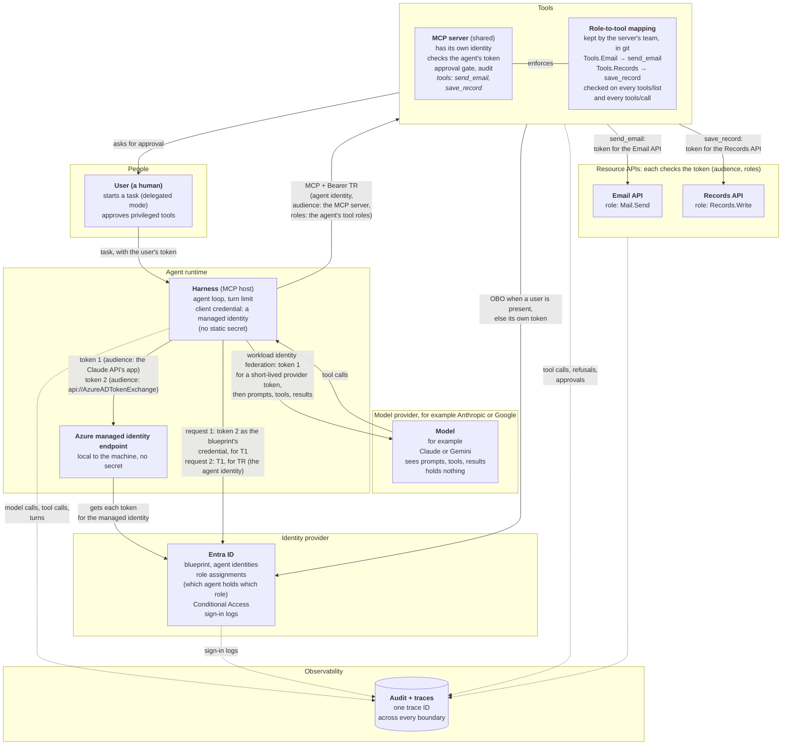
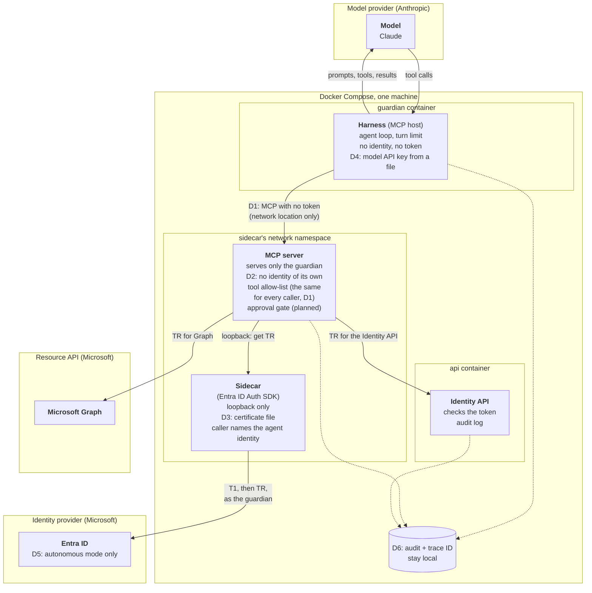
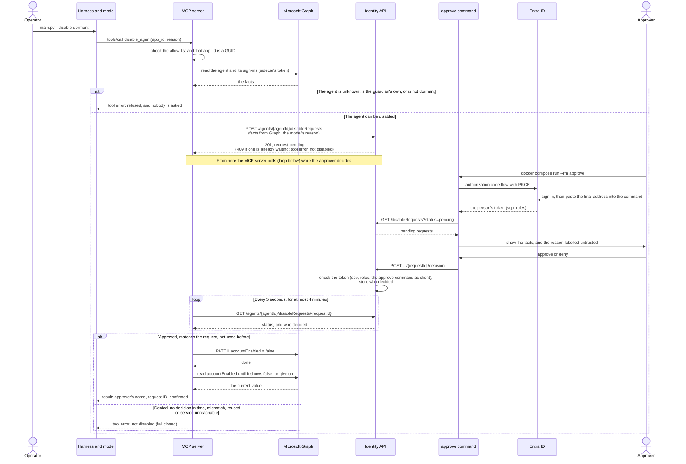

# Agent Architecture: Harness, Model, Tools, and Identity

This document breaks down the anatomy of an AI agent into four distinct parts, outlines an ideal enterprise reference architecture with strict trust boundaries, and examines how our project's **Guardian** agent is built today—including every pragmatic shortcut it takes and the security trade-offs involved.

The details of each part are in their own documents:

| Document | What it covers |
|---|---|
| [The harness](harness.md) | The agent loop, why the model stopped, the model settings, and how to see a run |
| [Authentication](authentication.md) | How each part proves who it is, and how a workload gets its credential and its tokens |
| [JWT Bearer and Token Exchange](jwt-bearer-and-token-exchange.md) | The two questions every token request answers (client authentication, and the grant), the three token-endpoint values, the issuer, subject and requester roles, why Anthropic uses the grant, and why Entra's OBO is not RFC 8693 |
| [MCP](mcp.md) | The MCP protocol, how a tool reaches its API, and the guardian's MCP server |
| [The Messages API](messages-api.md) | How any harness talks to a model |
| [Security controls](security-controls.md) | Every control in place, with its evidence |

> **Current Implementation Status: Partly Built**
> * **Built:** The Entra identity, the sidecar (Microsoft Entra ID Auth SDK), the Identity API, the MCP server with three tools (`scan_registry` runs the Guardian's four registry rules, `get_agent` reads one agent, `disable_agent` disables a dormant agent after a human approves) and its tool allow-list, and the harness's agent loop with Claude. The Guardian's container cannot reach the sidecar, and an MCP integration test proves it.
> * **Not built yet:** The correlation-ID scaffold across all components.
> 
> *(See the README's [Delivery status](../README.md#delivery-status) for live progress tracking).*

## Contents

* [1. The Anatomy of an Agent (The Four Parts)](#1-the-anatomy-of-an-agent-the-four-parts)
* [2. The Enterprise Reference Design](#2-the-enterprise-reference-design)
  * [Four Architectural Pillars](#four-architectural-pillars)
  * [Zero Trust: Who Checks Whom?](#zero-trust-who-checks-whom)
  * [Error Handling: When a Call Fails](#error-handling-when-a-call-fails)
  * [Human Approval: Who Approves, and How](#human-approval-who-approves-and-how)
* [3. The Guardian's Design Today](#3-the-guardians-design-today)
  * [Architectural Shortcuts (Where the Guardian Differs)](#architectural-shortcuts-where-the-guardian-differs)
  * [Component Inventory: Who Holds What?](#component-inventory-who-holds-what)
  * [The Human Approval Flow: `disable_agent`](#the-human-approval-flow-disable_agent)
* [4. Blast Radius: What Happens If One Part Is Compromised?](#4-blast-radius-what-happens-if-one-part-is-compromised)

---

## 1. The Anatomy of an Agent (The Four Parts)

An AI agent is much more than just a Large Language Model (LLM). It is a logical system made of four distinct parts, each operating within its own **trust boundary**:

1. **The Harness (the agent harness):** This is the code that runs the agent loop. Anthropic defines it as "the loop that calls Claude and routes Claude's tool calls to the relevant infrastructure". It is the only bridge between the model and the MCP server: it sends the model the tool definitions and the tool results, and it forwards the model's tool calls to the MCP server. Because it sits in the middle, the harness controls what the model sees, so a compromised harness could change or fake a tool result. In Model Context Protocol (MCP) terms, the harness plays the **host** role, because it holds the MCP client that connects to the MCP server. It does much more than speak MCP, though.
2. **The Model (the LLM):** It runs at the model provider (for example, Anthropic or Google) and never talks to the MCP server directly. It only sees what the harness sends it: the system prompt, the task, the tool definitions, and the tool results. From that context, it decides the next step and *asks* for a tool call. It holds nothing: no credentials and no tokens.
3. **The Tools (on the MCP Server):** The MCP server is a separate component, outside the harness. In an enterprise setup, a single MCP server can serve many different agents. It only acts when called by the harness, and it enforces its own security checks (such as a role-to-tool mapping, which decides which agent may use which tool, and human approval gates). Inside the MCP server, the tools call downstream APIs like Microsoft Graph. Those downstream APIs are **not** tools; they are independent resource servers in their own trust boundaries that validate the token of whatever calls them.
4. **The Identity (The Agent Identity in Entra):** This defines *who* the agent is, while its assigned roles dictate what its tokens are allowed to do. Because it is a directory record living inside Entra's trust boundary rather than a running piece of code, it has no credential of its own. Another component must sign in on its behalf: in our enterprise reference design, the **harness** signs in; in the Guardian's local design, the **MCP server** signs in (via the sidecar).

**The Takeaway:** An agent is the combination of all four parts working together. The harness coordinates, the model decides, the tools act, and the identity authorizes. The model never touches the MCP server or sees a token. In Microsoft Entra Agent ID, the agent identity represents this entire four-part system—the LLM itself has no identity.

**A note on "brain" and "hands".** Anthropic's engineering blog uses these words with a different split: the "brain" is Claude *and* its harness, and the "hands" are the sandboxes and tools that perform actions ([Scaling Managed Agents: Decoupling the brain from the hands](https://www.anthropic.com/engineering/managed-agents), 8 April 2026). So this document uses the plain terms: model, harness and tools.

---

## 2. The Enterprise Reference Design

In a production enterprise environment, every component lives in its own isolated trust boundary. Every cross-boundary call carries a token, and every receiving boundary validates its caller. 

This architecture supports two operational modes:
* **Delegated Mode:** A human user initiates a task, and the agent acts on their behalf.
* **Autonomous Mode:** The agent runs on a schedule or trigger with no human user involved.

### Four Architectural Pillars

To understand why the enterprise diagram is wired this way, look closely at four core mechanics:

1. **Tools Are Not APIs:** A *tool* is simply a function exposed to the model by the MCP server (defined by a name, description, and input format). An *API* is a backend resource server registered in Entra with its own app roles (like `Mail.Send` or `Records.Write`). When a tool runs, the MCP server's internal code fetches a token and calls the API. The model only ever sees the tool; it is completely blind to the underlying API and token. The MCP protocol itself knows nothing about APIs—that connection exists purely inside the tool's code and configuration (the API URL and token audience; see [How a tool reaches its API](mcp.md#3-how-a-tool-reaches-its-api)). While Entra app roles dictate what the MCP server is *allowed* to call, a tool can intentionally restrict privileges further in code (for example, a `send_email` tool can hardcode the recipient address, even if the underlying `Mail.Send` API role allows emailing anyone).
2. **The Harness Signs In, Not the MCP Server:** It is the harness's job to prove who the agent is. It authenticates as the agent identity, with an Azure managed identity as the blueprint's credential so no keys sit on disk, and requests a token scoped specifically for the MCP server (`audience`: MCP server). Only the MCP server accepts that token: no other API does. The same managed identity also authenticates the harness to the model provider, so the harness holds no static secret at all (see [How the Harness Authenticates](authentication.md#1-how-the-harness-authenticates)).
3. **The MCP Server Maps Roles to Tools:** The MCP server decides which tools each agent may use. The decision has two halves, stored in two places:
   * *Which agent holds which role (stored in Entra):* The MCP server's app registration defines app roles, for example `Tools.Email` and `Tools.Records`. An admin assigns them to each agent identity. They reach the MCP server in the `roles` claim of the agent's token (TR).
   * *Which role opens which tool (stored with the MCP server):* The team that owns the MCP server keeps a **role-to-tool mapping** with the server's code, in git, and changes it through code review. A tool that no role opens is open to no one.

   The MCP server checks the mapping on every request, in two places:
   * **`tools/list`:** It returns only the tools that the agent's roles open, so the model never sees the others. The MCP spec allows this: the list "MAY vary by the authorization presented on the request" ([MCP spec, Tools](https://modelcontextprotocol.io/specification/2026-07-28/server/tools), checked 30 October 2026).
   * **`tools/call`:** It checks again before the tool runs, because a caller can name a tool it was never shown. So hiding a tool is not enough on its own. A refused call goes to the audit log.

   **Two kinds of roles.** `Tools.Email` is a role that the *agent* holds on the *MCP server*: it opens the `send_email` tool. `Mail.Send` is a role that the *MCP server* holds on the *Email API*: it lets the tool's code call that API. In this design, the agent never holds `Mail.Send`.
4. **The MCP Server Uses Its Own Token for Downstream APIs:** How the MCP server calls backend APIs depends on the mode:
   * *With a human user (Delegated):* It uses the On-Behalf-Of (OBO) flow, meaning the downstream token carries the identity of both the human user and the calling service.
   * *Without a human user (Autonomous):* Entra's OBO flow cannot be used here because OBO strictly requires a human user in the incoming token. Instead, the MCP server authenticates using its own app token and records which agent requested the action in its audit logs. *(Note: RFC 8693 token exchange can carry the caller's identity into the new token, in an `act` (actor) claim ([RFC 8693, section 4.1](https://www.rfc-editor.org/rfc/rfc8693.html#section-4.1)). Microsoft documents no RFC 8693 flow for this case. Its documented flow for a downstream call is OBO, which uses the `jwt-bearer` grant and "only works for user principals" ([On-Behalf-Of flow](https://learn.microsoft.com/entra/identity-platform/v2-oauth2-on-behalf-of-flow)). Entra's token endpoint does recognize the RFC 8693 grant type, but no Microsoft page says what it issues for it (both checked 29 October 2026).)*

   **No token passthrough.** The MCP server never forwards the token it received to a downstream API. The MCP spec forbids this and calls it "token passthrough". There are three reasons:
   * The token's audience is the MCP server, so a downstream API must refuse it.
   * An MCP server that accepted a token meant for another API would let callers use that token at the API directly, which skips its role-to-tool mapping and approval gate.
   * The API's logs would show the original caller, not who really made the call.

   So each hop gets its own token, with its own audience. Source: [MCP Security Best Practices](https://modelcontextprotocol.io/docs/2026-07-28/tutorials/security/security_best_practices.md) (checked 28 October 2026).

### Zero Trust: Who Checks Whom?

By forcing every boundary to verify the component calling it, a single tricked or compromised component cannot act unilaterally. This brings Zero Trust principles inside the agent itself:

| Boundary | What It Verifies on Incoming Calls |
|---|---|
| **Model** | **The system prompt only:** Relies on prompts telling it to treat tool results as passive data rather than executable instructions. *Because this is the weakest security boundary, no downstream component is allowed to trust it.* |
| **Harness** | **The model's tool calls:** Enforces the turn limit and treats all returned tool results as untrusted data before passing them back to the model. |
| **MCP Server** | **The Harness's calls:** Validates the incoming bearer token (audience and agent claims), checks the agent's roles against the role-to-tool mapping on every `tools/list` and `tools/call`, and triggers human approval gates for privileged tools. |
| **Resource APIs** | **The MCP Server's token:** Validates cryptographic signatures, token audience, and assigned app roles. |
| **Entra ID** | **Every sign-in:** Validates the blueprint credential, verifies the parent blueprint relationship, and enforces Conditional Access policies. |

How each caller proves who it is, link by link, is in [Authentication](authentication.md#2-how-each-caller-proves-who-it-is).

### Error Handling: When a Call Fails

One agent run makes many calls across boundaries. The harness calls the model provider and the MCP server, and each tool calls its downstream APIs. Any of these calls can fail. Error handling decides, for each failure, what happens next. This section gives the general practice for an enterprise agent, with its sources (all checked 30 October 2026).

**The rule: three answers.** Every failure gets one of three answers:

1. **Retry:** the failure is temporary, and the call is safe to repeat. The caller waits and tries again, a limited number of times. Examples: a rate limit (429), an overloaded service (503), a lost connection.
2. **Back to the model:** the model can fix the failure itself. The tool returns an error result, and the harness sends it to the model in a `tool_result` with `is_error: true`. The model then corrects its input or tries another way. Example: a date in the wrong format.
3. **Stop the run (fail closed):** the failure is permanent, the model cannot fix it, or it may be a sign of an attack. The run ends without a result, the reason goes to the audit log, and a human or a workflow decides what comes next. Examples: a bad API key, a tool the agent may not use, a cut-off model answer.

**Who handles it: the layer nearest to the failure.** Each layer retries only its own calls. The harness (through the model provider's SDK) retries the model call, and the MCP server retries its call to a downstream API. When the retries run out, the failure moves up one layer as an error.

#### Where a Call Fails, and What to Do

| Where it fails | Example | What to do |
|---|---|---|
| Model provider: a temporary error | 429 `rate_limit_error`, 500 `api_error`, 529 `overloaded_error`, a lost connection | Retry, then stop. Anthropic's SDKs already retry these "with exponential backoff, twice by default, honoring the `retry-after` header when present" ([Claude API errors](https://platform.claude.com/docs/en/api/errors)). |
| Model provider: a permanent error | 400 invalid request, 401 bad key, 403 no permission | Stop. The same request gets the same answer. At Anthropic, one 429 belongs here too: a 429 for a spent monthly cap has no `retry-after` and "keeps failing until access resumes". |
| The model's answer | `stop_reason` is `max_tokens`, `refusal`, or a value the harness does not know | Stop. A cut-off or refused answer is not a result ([Why the model stopped](messages-api.md#4-extraction--checking-why-the-model-stopped-stop_reason)). |
| The agent loop | The turn limit, the token budget or the time limit is reached | Stop. Limits stop a run that would never end, and its cost. OWASP calls this risk Unbounded Consumption ([LLM10:2025](https://genai.owasp.org/llmrisk/llm102025-unbounded-consumption/)). |
| MCP: a protocol error | `-32602` "Unknown tool", a malformed request | Stop, in an agent that runs alone and reads untrusted content. See [Protocol Errors and Tool Execution Errors](#protocol-errors-and-tool-execution-errors). |
| MCP: a tool execution error | Bad input, a broken business rule | Back to the model, with a short message that says what to fix. The turn limit caps the attempts. |
| Inside a tool: a downstream API is throttled or down | Microsoft Graph returns 429 with `Retry-After`, or 503 | The MCP server retries. It waits the `Retry-After` seconds, or backs off when there is none ([Graph throttling guidance](https://learn.microsoft.com/graph/throttling)). If the call still fails, the tool returns a tool execution error. |
| A token is refused, by the MCP server or a downstream API | 401 or 403 | On a 401, the token may have expired or been revoked: get a new token once and retry. If the 401 carries a claims challenge (`error="insufficient_claims"`, from Entra's Continuous Access Evaluation), put those claims in the token request ([CAE-enabled APIs](https://learn.microsoft.com/entra/identity-platform/app-resilience-continuous-access-evaluation)). On a 403, or a second 401: no retry. Stop the run, or return a tool execution error, and give an operator the details: a permission problem is not something the model can fix. |
| A tool call times out | No answer within the time limit | Cancel the request. The outcome is now unknown: the tool may have run. See [Safe Retries](#safe-retries). |
| The MCP server or the network is down | Connection refused | Retry the connection a few times, then stop. If it keeps failing, a [circuit breaker](#circuit-breaker) stops the calls for a while. |

**Every call needs a timeout.** The MCP spec says implementations "SHOULD establish timeouts for all sent requests", and "SHOULD always enforce a maximum timeout", even while progress notifications arrive. On Streamable HTTP, closing the response stream cancels the request ([MCP spec, Cancellation](https://modelcontextprotocol.io/specification/2026-07-28/basic/utilities/cancellation)).

#### Protocol Errors and Tool Execution Errors

The MCP spec (2026-07-28) defines two kinds of tool errors, and it treats them differently ([MCP spec, Tools, Error Handling](https://modelcontextprotocol.io/specification/2026-07-28/server/tools)):

* **Tool execution errors** (a normal result with `isError: true`): "Clients **SHOULD** provide tool execution errors to language models to enable self-correction."
* **Protocol errors** (a JSON-RPC error, such as `-32602`): "Clients **MAY** provide protocol errors to language models, though these are less likely to result in successful recovery."

So for a protocol error, the spec leaves the choice to the client. How to choose:

* **Stop the run** when the agent runs alone, can change things, and reads untrusted content. A request for a tool that `tools/list` never showed is more likely an injection than a mistake the model can fix. If the error went back, the model could try again, or try other tool names.
* **Send it to the model** when a stopped run is costly and the risk is low. An example is an interactive assistant whose tool list can change during a session (`notifications/tools/list_changed`). There, "Unknown tool" helps the model switch to the current tool.

#### Safe Retries

A retry helps only when it is done with care. Five rules:

* **Back off, with jitter:** each wait is longer than the last (exponential backoff). Jitter "adds some amount of randomness to the backoff to spread the retries around in time", so many clients do not retry at the same moment.
* **Honor `Retry-After`:** when the server says how long to wait, wait that long.
* **Cap the attempts:** after a few tries, the failure moves up one layer.
* **Retry at one layer only:** retries multiply across layers. In AWS's example, five layers that each retry independently raise the load on the bottom layer 243 times. So AWS's practice is "to retry at a single point in the stack" ([Timeouts, retries, and backoff with jitter](https://builder.aws.com/content/3EumjoZascWd1oZiEgL8ORlv3qE/timeouts-retries-and-backoff-with-jitter)).
* **Retry a write only when it is idempotent:** an idempotent operation "can be retransmitted or retried with no additional side effects" ([Making retries safe with idempotent APIs](https://aws.amazon.com/builders-library/making-retries-safe-with-idempotent-APIs/)). Reads are safe. A write is not: when a `send_email` call times out, nobody knows if the email went out. So the caller sends a unique idempotency key with each write and keeps it on every retry. The server records the key together with the work, and answers a repeat with the first result. Without a key, the caller must first check the current state, and only then decide.

For an agent, the last rule has one more step. A write with an unknown outcome should not go back to the model as a plain error, because the model may simply call the tool again. The MCP server resolves the outcome first, or says clearly that it is unknown.

#### Circuit Breaker

When a downstream service keeps failing, more retries make it worse. A circuit breaker counts recent failures. After a threshold, it fails every call at once for a while (open). Then it lets a few calls through as a test (half-open), and goes back to normal when they succeed (closed) ([Circuit Breaker pattern](https://learn.microsoft.com/azure/architecture/patterns/circuit-breaker)). For an agent, an open circuit means a clear tool execution error ("Graph is unavailable"), so the model stops asking for that tool, or a stopped run.

#### Error Text Is Untrusted Content

An error message from a downstream API reaches the model inside a tool result. So it is untrusted content, like any other tool result, and it can carry a prompt injection. Anthropic warns that tool results "often carry content from sources outside your control" ([Handle tool calls](https://platform.claude.com/docs/en/agents-and-tools/tool-use/handle-tool-calls)). An error message can also leak internal details, such as stack traces, internal URLs or tokens ([CWE-209](https://cwe.mitre.org/data/definitions/209.html), "Generation of Error Message Containing Sensitive Information"). The MCP spec says servers MUST "sanitize tool outputs". So the MCP server gives the model a short, fixed error message, and writes the full details only to its own log.

#### Long Runs: Checkpoints

A run that takes minutes or hours, or waits for a human approval, should not start over after a crash. A durable execution engine saves each finished step and resumes from the last one. Examples are [Azure Durable Functions](https://learn.microsoft.com/azure/durable-task/durable-functions/durable-functions-overview), whose runtime "manages state, checkpoints, retries, and recovery", and [Temporal](https://docs.temporal.io/). Each model call and each tool call becomes one step, with its own retry policy. Together with idempotency keys, a resumed run does not repeat a side effect.

#### Log Every Failure

Each failure writes one audit line with the run's correlation ID, the layer, the error code, and the answer chosen: retry, back to the model, or stop. Then an operator can follow one failed run across the harness, the MCP server and the identity provider's sign-in logs. The MCP spec asks clients to "log tool usage for audit purposes".

### Human Approval: Who Approves, and How

A model must not have the last word on a privileged action. A person decides, on a path the model cannot reach, and the decision is bound to one action. The service then acts only on that decision.

**The general rules:**

* **The approval path never runs through the model.** The model can ask. It cannot carry, change or answer the request.
* **Who approved comes from the person's token,** never from a request body or from the model.
* **An approval is bound to one action, works once, and expires.**
* **Anything but a clear approval means no action** (fail closed): a denial, no answer in time, or a service that cannot be reached.
* **The approver sees facts the service read itself.** The model's text is shown too, labelled as untrusted.
* **The request, the decision and the action are all on record,** linked by one correlation ID.

#### Who Approves

A **group** of approvers holds the approver role, so adding or removing a person changes only the membership. The group is kept separate from the owners and operators of the agent that asks, so nobody can both steer an agent and approve its actions. This is separation of duties ([NIST SP 800-53, AC-5](https://csrc.nist.gov/projects/cprt/catalog#/cprt/framework/version/SP_800_53_5_1_1/home?element=AC-05)).

**Deviation:** Microsoft makes the **sponsor** of the *target* agent accountable for its purpose and lifecycle decisions, and a sponsor can disable an agent ([Learn](https://learn.microsoft.com/en-us/entra/agent-id/agent-owners-sponsors-managers)). So a design can send the approval to the target's sponsor instead of a central group.

#### How the Approver Proves Who They Are

The approver signs in through a client app with the **authorization code flow and PKCE**, the OAuth best practice ([RFC 9700](https://www.rfc-editor.org/rfc/rfc9700)), ideally with phishing-resistant MFA. The token carries two separate proofs: the **scope** says this app may act for the person, and the **role** says this person may approve ([Scopes and app roles](tokens.md#scopes-and-app-roles)). The service also checks that the caller is a person and not an agent, so an agent can never approve its own request.

**Deviations:**

* **The device code flow** suits devices that are hard to type on, but it is a known phishing route. Entra's security defaults block it ([Learn](https://learn.microsoft.com/en-us/entra/fundamentals/security-defaults)).
* **CIBA** (OpenID Connect) lets a service ask a person to approve on another device, and **RAR** ([RFC 9396](https://www.rfc-editor.org/rfc/rfc9396)) puts the exact transaction into the consent. Both are the closest standards to an approval gate, but neither is a common choice for agent tools today.

#### How the Request Reaches the Approver

The service **notifies** the approvers, for example by email or Teams, with a link that already identifies the request. The approver never has to look for it, or copy an ID.

**Deviation:** MCP's **URL-mode elicitation** does this inside the tool call: the server sends the client a URL to show the person, and the model is not part of that path. The server "MUST verify the identity of the user who opens the URL" ([MCP spec](https://modelcontextprotocol.io/specification/2026-07-28/client/elicitation)).

#### Who Does the Work After the Approval

A **domain service** owns the rules, the approval workflow and the write, with its own identity. The MCP server stays a thin adapter, and the agent's identity never holds the write permission, so the agent can only ask. Every other way in, such as a portal or a script, passes the same rules.

**Deviation:** a tool can either **wait** inside one call, which is simple but ties the call to the caller's connection, or **return "pending" at once**, which needs a later step to report the outcome.

---

## 3. The Guardian's Design Today

While our **Guardian** agent shares the same four-part conceptual anatomy, it runs locally on a single machine via Docker Compose. To fit our project's timebox, it takes six deliberate architectural shortcuts (labeled **D1** through **D6** in the diagram and detailed in the table below). The decisions behind this design, with their reasons, are recorded in the [decision log](decisions.md).

### Architectural Shortcuts (Where the Guardian Differs)

| ID | Enterprise Reference Design | The Guardian Today | Why We Took the Shortcut | Risk Accepted |
|---|---|---|---|---|
| **D1** | The harness sends a bearer token to the MCP server, which validates it. | **No token:** The MCP server relies on Docker network isolation, trusting that only the Guardian container can reach it. Because it does not know who calls it, its tool allow-list is one list for every caller, not a role-to-tool mapping per agent. | Project timebox. | Any code that manages to reach the MCP server's network port can invoke allow-listed tools. |
| **D2** | The MCP server has its own Entra identity and serves multiple agents. | **Shared Identity:** The MCP server serves *only* the Guardian and fetches tokens using the Guardian's identity (it acts as the Guardian itself). | Keeping one identity and one sidecar is simpler, and ensures no Entra token ever reaches the harness. | The MCP server cannot be shared with other agents. If compromised, it can request tokens for *any* agent identity under the blueprint (since the sidecar lets callers specify which agent identity they want). |
| **D3** | The blueprint authenticates via an Azure Managed Identity (zero keys on disk). | **Certificate File:** A certificate file is mounted exclusively into the sidecar container ([details](infra.md#the-blueprints-credential)). | The demo runs locally in Docker, not in Azure. | If the certificate file is stolen from disk, every agent identity tied to the blueprint is exposed. |
| **D4** | No static model key: the harness authenticates to the model provider with workload identity federation (or, failing that, reads a key from a cloud vault). | **API Key File:** An Anthropic service account API key in `secrets/anthropic.env` (the folder is excluded via `.gitignore`), given only to the guardian container. | Local demo environment, with no managed identity to federate. | The Anthropic API key sits unencrypted on the host disk. |
| **D5** | Supports Delegated mode with OBO when a human user is present. | **Autonomous Mode Only:** OBO exists strictly as written documentation. | Project timebox. | No human user ever appears in the token chain. |
| **D6** | Audit logs and distributed traces ship to a central SIEM/sink. | **Local Logs:** Audit lines and traces are written locally. One trace ID across the Guardian, the MCP server and the Identity API is planned (FR8). | Project timebox. | All audit logs reside on the same single machine. |

For the credential options behind D2, D3 and D4, and how to move from the Guardian's shortcuts to the enterprise design, see [Credentials and Tokens](authentication.md#3-credentials-and-tokens-how-a-workload-gets-them).

### Component Inventory: Who Holds What?

To verify our security posture, here is exactly what each container holds and what it can reach over the network:

| Component | Agent Part | Credentials Held | Network Reach |
|---|---|---|---|
| **Claude** | Model | *Nothing* | *Nothing* (only responds to incoming requests from the `guardian`). |
| **`guardian`** | Harness | Anthropic API key | Can reach Claude and `mcp-server`. **Cannot reach `sidecar`** (meaning it can never obtain an Entra token). |
| **`mcp-server`** | Tools | *No stored secrets* (requests TR tokens on-demand from `sidecar`). | Can reach `sidecar`, Microsoft Graph, and `api`. |
| **`sidecar`** | Token acquisition | The blueprint's certificate file. | Can reach Entra ID. Listens strictly on loopback ([details](infra.md#local-run-the-sidecar)). |
| **`api`** | Resource API | *No secrets* (validates tokens using Entra's public signing keys). | *Nothing* (only responds to incoming API calls). |

*(Transport Note: The communication between the harness and the MCP server uses **MCP over Streamable HTTP**, the standard transport for standalone networked MCP services. The client sends each MCP message as an HTTP POST to a single `/mcp` endpoint, and the server either replies with a standard JSON payload or streams the response back over the same connection).*

### The Human Approval Flow: `disable_agent`

`disable_agent` disables one dormant agent identity, and only after a human approves (FR7). The MCP server does the checks and the write. The model only asks. The Identity API records who decided.

> **Run live on 31 October 2026:** one approval disabled a fixture, and a read confirmed it. Four denials left their fixtures enabled.

**Where the guardian differs from [the general practice](#human-approval-who-approves-and-how):**

| General practice | The guardian | Why |
|---|---|---|
| A domain service does the write, with its own identity | The MCP server writes, as the guardian, which holds `AgentIdentity.EnableDisable.All` | Timebox |
| A domain service checks the rules and reads the facts itself | The MCP server does both, and the Identity API trusts the facts it sends | Timebox |
| A notification delivers the request | The approver runs the `approve` command, which lists what is pending | No web page in the timebox |
| A local listener or a web page catches the sign-in redirect | The person pastes the final address into the terminal | The command runs in a container |
| A durable store | In memory. A restart loses pending requests, and nothing is disabled (fail closed) | Lab |
| An approval is refused once nobody is waiting for it | The Identity API still accepts it, and nothing follows. The MCP server writes `disable_abandoned`, so the record explains why | Known limit |

The next version would use URL-mode elicitation and an approval web page, on the same identity design.

---

## 4. Blast Radius: What Happens If One Part Is Compromised?

We separate the agent into distinct trust boundaries specifically to contain the blast radius when something goes wrong. Here is how the Guardian's architecture holds up if individual components fail:

* **Scenario 1: The Model Is Tricked (Prompt Injection)**
  * *Impact:* Minimal (this is the primary failure mode the architecture is built to handle). The model can only *ask* the harness to invoke tools. The MCP server's checks (the tool allow-list and its input checks today; the human approval gate is planned) and the harness's turn limit all remain strictly enforced, and the model never sees an Entra token.
* **Scenario 2: The Harness is Compromised**
  * *Impact:* Moderate. Because the harness mediates all communication with the model, it can manipulate the tool list, alter or fabricate tool results, invoke any allow-listed tool, and burn through the local Anthropic API key. However, **it still cannot obtain an Entra token**, and it cannot bypass the tool allow-list or approval gates because those checks are enforced inside the MCP server. 
  * *Crucial Audit Rule:* Because a compromised harness can lie to the model, **the LLM's final report is never proof of what actually happened—only the Identity API's audit log is.**
* **Scenario 3: The MCP Server is Compromised**
  * *Impact:* High. Due to shortcut **D2** (where the sidecar lets its caller request tokens for any child of the blueprint), a compromised MCP server can obtain TR access tokens for *any* agent identity under that blueprint. Consequently, in the Guardian's current design, the MCP server is our most trusted component and its codebase must be kept as small and auditable as possible.
* **Scenario 4: The Sidecar is Compromised**
  * *Impact:* Critical. The blueprint's private certificate is exposed (**D3**), immediately compromising every agent identity governed by that blueprint *(see the blast radius note in [Agent ID](agent-id.md#why-use-two-requests-instead-of-one))*.

