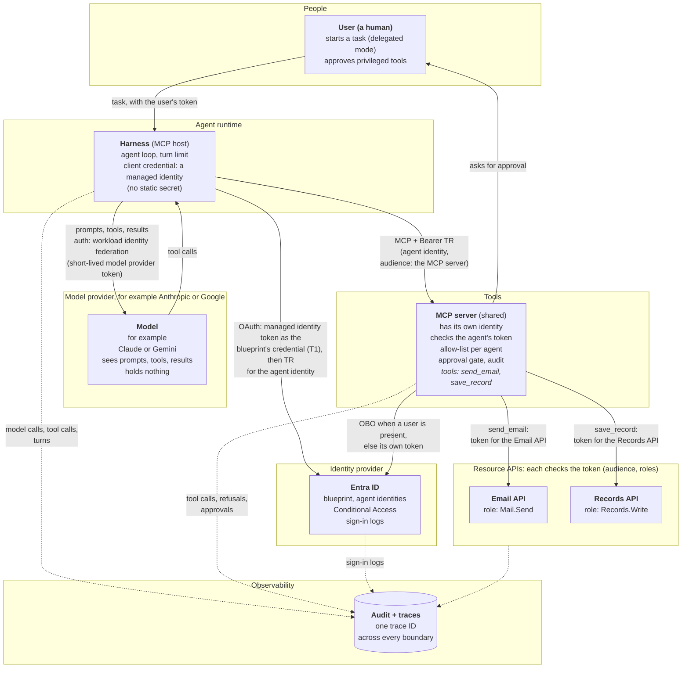
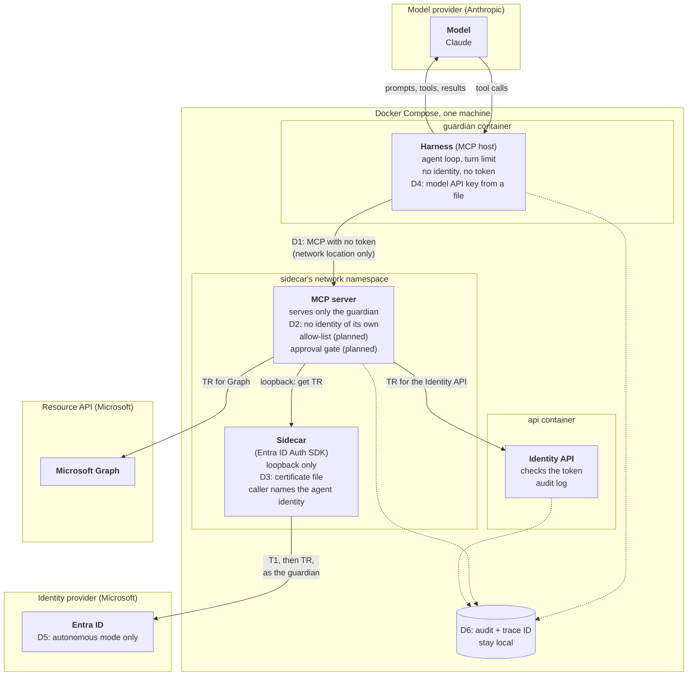

# Agent Architecture: Harness, Model, Tools, and Identity

This document breaks down the anatomy of an AI agent into four distinct parts, outlines an ideal enterprise reference architecture with strict trust boundaries, and examines how our project's **Guardian** agent is built today—including every pragmatic shortcut it takes and the security trade-offs involved.

The details of each part are in their own documents:

* [The harness](harness.md): the agent loop, why the model stopped, the model settings, and how to see a run.
* [Authentication](authentication.md): how each part proves who it is, and how a workload gets its credential and its tokens.
* [MCP](mcp.md): the MCP protocol, how a tool reaches its API, and the guardian's MCP server.
* [The Messages API](messages-api.md): how any harness talks to a model.
* [Security controls](security-controls.md): every control in place, with its evidence.

> **Current Implementation Status: Partly Built**
> * **Built:** The Entra identity, the sidecar (Microsoft Entra ID Auth SDK), the Identity API, the MCP server with two tools (`scan_registry` runs the Guardian's four registry rules, `get_agent` reads one agent), and the harness's agent loop with Claude. The Guardian's container cannot reach the sidecar, and an end-to-end test proves it.
> * **Not built yet:** The tool allow-list, the human approval gate, and the correlation-ID scaffold. 
> 
> *(See the README's [Delivery status](../README.md#delivery-status) for live progress tracking).*

## Contents

* [1. The Anatomy of an Agent (The Four Parts)](#1-the-anatomy-of-an-agent-the-four-parts)
* [2. The Enterprise Reference Design](#2-the-enterprise-reference-design)
  * [Three Architectural Pillars](#three-architectural-pillars)
  * [Zero Trust: Who Checks Whom?](#zero-trust-who-checks-whom)
* [3. The Guardian's Design Today](#3-the-guardians-design-today)
  * [Architectural Shortcuts (Where the Guardian Differs)](#architectural-shortcuts-where-the-guardian-differs)
  * [Component Inventory: Who Holds What?](#component-inventory-who-holds-what)
* [4. Blast Radius: What Happens If One Part Is Compromised?](#4-blast-radius-what-happens-if-one-part-is-compromised)

---

## 1. The Anatomy of an Agent (The Four Parts)

An AI agent is much more than just a Large Language Model (LLM). It is a logical system made of four distinct parts, each operating within its own **trust boundary**:

1. **The Harness (the agent harness):** This is the code that runs the agent loop. Anthropic defines it as "the loop that calls Claude and routes Claude's tool calls to the relevant infrastructure". It is the only bridge between the model and the MCP server: it sends the model the tool definitions and the tool results, and it forwards the model's tool calls to the MCP server. Because it sits in the middle, the harness controls what the model sees, so a compromised harness could change or fake a tool result. In Model Context Protocol (MCP) terms, the harness plays the **host** role, because it holds the MCP client that connects to the MCP server. It does much more than speak MCP, though.
2. **The Model (the LLM):** It runs at the model provider (for example, Anthropic or Google) and never talks to the MCP server directly. It only sees what the harness sends it: the system prompt, the task, the tool definitions, and the tool results. From that context, it decides the next step and *asks* for a tool call. It holds nothing: no credentials and no tokens.
3. **The Tools (on the MCP Server):** The MCP server is a separate component, outside the harness. In an enterprise setup, a single MCP server can serve many different agents. It only acts when called by the harness, and it enforces its own security checks (such as per-agent allow-lists and human approval gates). Inside the MCP server, the tools call downstream APIs like Microsoft Graph. Those downstream APIs are **not** tools; they are independent resource servers in their own trust boundaries that validate the token of whatever calls them.
4. **The Identity (The Agent Identity in Entra):** This defines *who* the agent is, while its assigned roles dictate what its tokens are allowed to do. Because it is a directory record living inside Entra's trust boundary rather than a running piece of code, it has no credential of its own. Another component must sign in on its behalf: in our enterprise reference design, the **harness** signs in; in the Guardian's local design, the **MCP server** signs in (via the sidecar).

**The Takeaway:** An agent is the combination of all four parts working together. The harness coordinates, the model decides, the tools act, and the identity authorizes. The model never touches the MCP server or sees a token. In Microsoft Entra Agent ID, the agent identity represents this entire four-part system—the LLM itself has no identity.

**A note on "brain" and "hands".** Anthropic's engineering blog uses these words with a different split: the "brain" is Claude *and* its harness, and the "hands" are the sandboxes and tools that perform actions ([Scaling Managed Agents: Decoupling the brain from the hands](https://www.anthropic.com/engineering/managed-agents), 8 April 2026). So this document uses the plain terms: model, harness and tools.

---

## 2. The Enterprise Reference Design

In a production enterprise environment, every component lives in its own isolated trust boundary. Every cross-boundary call carries a token, and every receiving boundary validates its caller. 

This architecture supports two operational modes:
* **Delegated Mode:** A human user initiates a task, and the agent acts on their behalf.
* **Autonomous Mode:** The agent runs on a schedule or trigger with no human user involved.

### Three Architectural Pillars

To understand why the enterprise diagram is wired this way, look closely at three core mechanics:

1. **Tools Are Not APIs:** A *tool* is simply a function exposed to the model by the MCP server (defined by a name, description, and input format). An *API* is a backend resource server registered in Entra with its own app roles (like `Mail.Send` or `Records.Write`). When a tool runs, the MCP server's internal code fetches a token and calls the API. The model only ever sees the tool; it is completely blind to the underlying API and token. The MCP protocol itself knows nothing about APIs—that connection exists purely inside the tool's code and configuration (the API URL and token audience; see [How a tool reaches its API](mcp.md#3-how-a-tool-reaches-its-api)). While Entra app roles dictate what the MCP server is *allowed* to call, a tool can intentionally restrict privileges further in code (for example, a `send_email` tool can hardcode the recipient address, even if the underlying `Mail.Send` API role allows emailing anyone).
2. **The Harness Signs In, Not the MCP Server:** It is the harness's job to prove who the agent is. It authenticates as the agent identity, with an Azure managed identity as the blueprint's credential so no keys sit on disk, and requests a token scoped specifically for the MCP server (`audience`: MCP server). Only the MCP server accepts that token: no other API does. The same managed identity also signs the harness in to the model provider, so the harness holds no static secret at all (see [How the Harness Authenticates](authentication.md#1-how-the-harness-authenticates)).
3. **The MCP Server Uses Its Own Token for Downstream APIs:** How the MCP server calls backend APIs depends on the mode:
   * *With a human user (Delegated):* It uses the On-Behalf-Of (OBO) flow, meaning the downstream token carries the identity of both the human user and the calling service.
   * *Without a human user (Autonomous):* Entra's OBO flow cannot be used here because OBO strictly requires a human user in the incoming token. Instead, the MCP server authenticates using its own app token and records which agent requested the action in its audit logs. *(Note: While a standard RFC 8693 token exchange could theoretically preserve the agent's identity in the downstream token, Entra does not support it for this scenario).*

   **No token passthrough.** The MCP server never forwards the token it received to a downstream API. The MCP spec forbids this and calls it "token passthrough". There are three reasons. The token's audience is the MCP server, so a downstream API must refuse it. An MCP server that accepted a token meant for another API would let callers use that token at the API directly, which skips its allow-list and approval gate. And the API's logs would show the original caller, not who really made the call. So each hop gets its own token, with its own audience. Source: [MCP Security Best Practices](https://modelcontextprotocol.io/docs/2026-07-28/tutorials/security/security_best_practices.md) (checked 28 October 2026).

### Zero Trust: Who Checks Whom?

By forcing every boundary to verify the component calling it, a single tricked or compromised component cannot act unilaterally. This brings Zero Trust principles inside the agent itself:

| Boundary | What It Verifies on Incoming Calls |
|---|---|
| **Model** | **The system prompt only:** Relies on prompts telling it to treat tool results as passive data rather than executable instructions. *Because this is the weakest security boundary, no downstream component is allowed to trust it.* |
| **Harness** | **The model's tool calls:** Enforces the turn limit and treats all returned tool results as untrusted data before passing them back to the model. |
| **MCP Server** | **The Harness's calls:** Validates the incoming bearer token (audience and agent claims), checks the per-agent tool allow-list, and triggers human approval gates for privileged tools. |
| **Resource APIs** | **The MCP Server's token:** Validates cryptographic signatures, token audience, and assigned app roles. |
| **Entra ID** | **Every sign-in:** Validates the blueprint credential, verifies the parent blueprint relationship, and enforces Conditional Access policies. |

How each caller proves who it is, link by link, is in [Authentication](authentication.md#2-how-each-caller-proves-who-it-is).

---

## 3. The Guardian's Design Today

While our **Guardian** agent shares the same four-part conceptual anatomy, it runs locally on a single machine via Docker Compose. To fit our project's timebox, it takes six deliberate architectural shortcuts (labeled **D1** through **D6** in the diagram and detailed in the table below). The decisions behind this design, with their reasons, are recorded in the [decision log](decisions.md).

### Architectural Shortcuts (Where the Guardian Differs)

| ID | Enterprise Reference Design | The Guardian Today | Why We Took the Shortcut | Risk Accepted |
|---|---|---|---|---|
| **D1** | The harness sends a bearer token to the MCP server, which validates it. | **No token:** The MCP server relies on Docker network isolation, trusting that only the Guardian container can reach it. | Project timebox. | Any code that manages to reach the MCP server's network port can invoke allow-listed tools. |
| **D2** | The MCP server has its own Entra identity and serves multiple agents. | **Shared Identity:** The MCP server serves *only* the Guardian and fetches tokens using the Guardian's identity (it acts as the Guardian itself). | Keeping one identity and one sidecar is simpler, and ensures no Entra token ever reaches the harness. | The MCP server cannot be shared with other agents. If compromised, it can request tokens for *any* agent identity under the blueprint (since the sidecar lets callers specify which agent identity they want). |
| **D3** | The blueprint authenticates via an Azure Managed Identity (zero keys on disk). | **Certificate File:** A certificate file is mounted exclusively into the sidecar container ([details](infra.md#the-blueprints-credential)). | The demo runs locally in Docker, not in Azure. | If the certificate file is stolen from disk, every agent identity tied to the blueprint is exposed. |
| **D4** | No static model key: the harness signs in to the model provider with workload identity federation (or, failing that, reads a key from a cloud vault). | **API Key File:** An Anthropic service account API key in `secrets/anthropic.env` (the folder is excluded via `.gitignore`), given only to the guardian container. | Local demo environment, with no managed identity to federate. | The Anthropic API key sits unencrypted on the host disk. |
| **D5** | Supports Delegated mode with OBO when a human user is present. | **Autonomous Mode Only:** OBO exists strictly as written documentation. | Project timebox. | No human user ever appears in the token chain. |
| **D6** | Audit logs and distributed traces ship to a central SIEM/sink. | **Local Logs:** Audit lines and traces are written locally. One trace ID across the Guardian, the MCP server and the Identity API is planned (FR8). | Project timebox. | All audit logs reside on the same single machine. |

For the credential options behind D2, D3 and D4, and how to move from the Guardian's shortcuts to the enterprise design, see [Credentials and Tokens](authentication.md#3-credentials-and-tokens-how-a-workload-gets-them).

### Component Inventory: Who Holds What?

To verify our security posture, here is exactly what each container holds and what it can reach over the network:

| Component | Agent Part | Credentials Held | Network Reach |
|---|---|---|---|
| **Claude** | Model | *Nothing* | *Nothing* (only responds to incoming requests from the `guardian`). |
| **`guardian`** | Harness | Anthropic API key | Can reach Claude and `mcp-server`. **Cannot reach `sidecar`** (meaning it can never obtain an Entra token). |
| **`mcp-server`** | Tools | *No stored secrets* (requests TR tokens on-demand from `sidecar`). | Can reach `sidecar`, Microsoft Graph, and `api`. |
| **`sidecar`** | Token acquisition | The blueprint's certificate file. | Can reach Entra ID. Listens strictly on loopback ([details](infra.md#local-run-the-sidecar)). |
| **`api`** | Resource API | *No secrets* (validates tokens using Entra's public signing keys). | *Nothing* (only responds to incoming API calls). |

*(Transport Note: The communication between the harness and the MCP server uses **MCP over Streamable HTTP**, the standard transport for standalone networked MCP services. The client sends each MCP message as an HTTP POST to a single `/mcp` endpoint, and the server either replies with a standard JSON payload or streams the response back over the same connection).*

---

## 4. Blast Radius: What Happens If One Part Is Compromised?

We separate the agent into distinct trust boundaries specifically to contain the blast radius when something goes wrong. Here is how the Guardian's architecture holds up if individual components fail:

* **Scenario 1: The Model Is Tricked (Prompt Injection)**
  * *Impact:* Minimal (this is the primary failure mode the architecture is built to handle). The model can only *ask* the harness to invoke tools. The MCP server's checks (its input checks today; the allow-list and the human approval gate are planned) and the harness's turn limit all remain strictly enforced, and the model never sees an Entra token.
* **Scenario 2: The Harness is Compromised**
  * *Impact:* Moderate. Because the harness mediates all communication with the model, it can manipulate the tool list, alter or fabricate tool results, invoke any allow-listed tool, and burn through the local Anthropic API key. However, **it still cannot obtain an Entra token**, and it cannot bypass the tool allow-list or approval gates because those checks are enforced inside the MCP server. 
  * *Crucial Audit Rule:* Because a compromised harness can lie to the model, **the LLM's final report is never proof of what actually happened—only the Identity API's audit log is.**
* **Scenario 3: The MCP Server is Compromised**
  * *Impact:* High. Due to shortcut **D2** (where the sidecar lets its caller request tokens for any child of the blueprint), a compromised MCP server can obtain TR access tokens for *any* agent identity under that blueprint. Consequently, in the Guardian's current design, the MCP server is our most trusted component and its codebase must be kept as small and auditable as possible.
* **Scenario 4: The Sidecar is Compromised**
  * *Impact:* Critical. The blueprint's private certificate is exposed (**D3**), immediately compromising every agent identity governed by that blueprint *(see the blast radius note in [Agent ID](agent-id.md#why-use-two-requests-instead-of-one))*.

