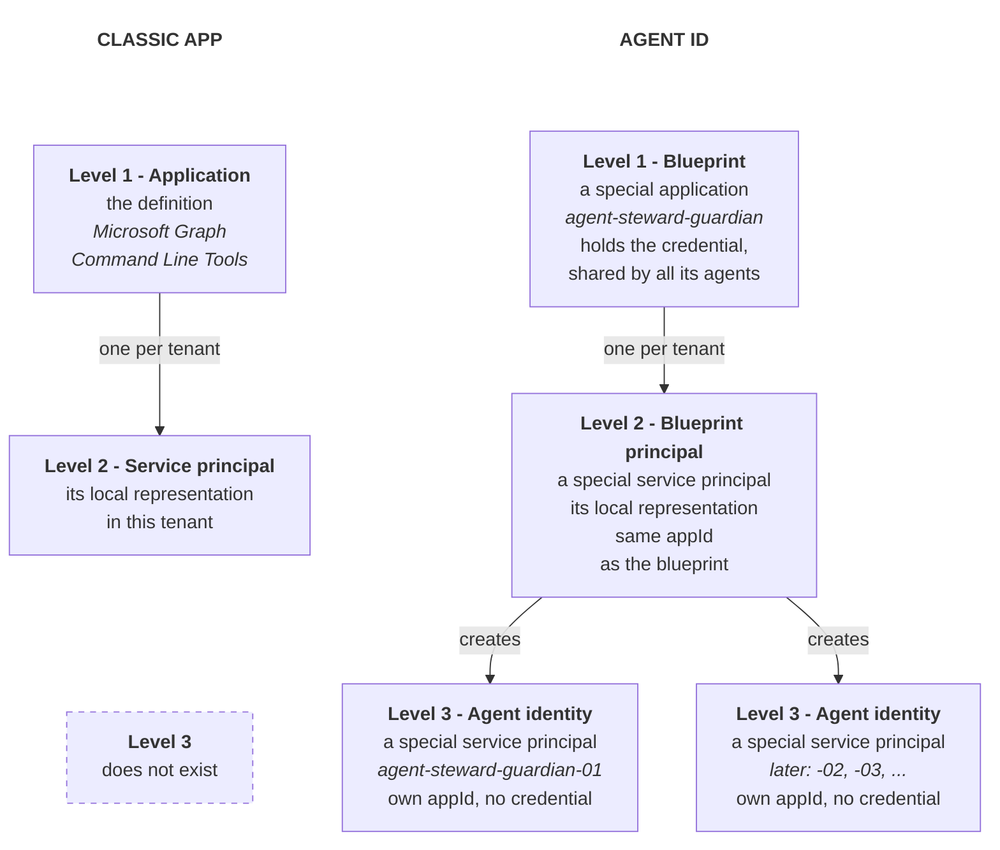
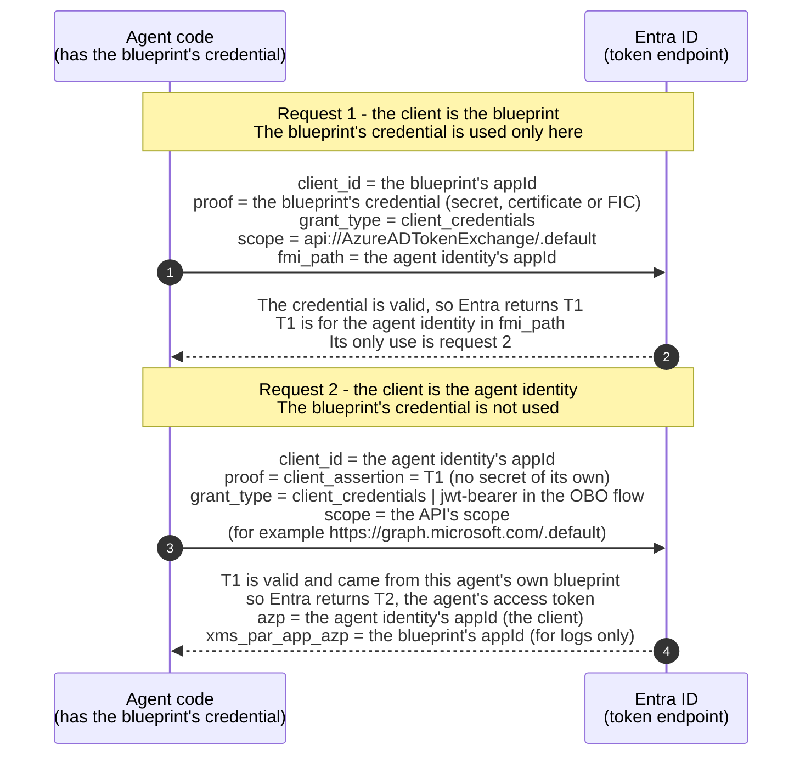

# Agent ID: object model and sign-in

How the Microsoft Entra Agent ID objects fit together, and how an agent identity signs in through its blueprint. For short definitions of each term, with the OAuth, OIDC and CDR terms they map to, see the [glossary](../GLOSSARY.md).

## Contents

- [Object hierarchy](#object-hierarchy)
- [Who it is vs how it proves it](#who-it-is-vs-how-it-proves-it)
  - [Why Agent ID splits them](#why-agent-id-splits-them)
  - [One agent identity per logical agent, not per copy or session](#one-agent-identity-per-logical-agent-not-per-copy-or-session)
  - [How it works](#how-it-works)
  - [The two requests](#the-two-requests)
  - [Why two requests, not one](#why-two-requests-not-one)
  - [Where it leaves plain OAuth](#where-it-leaves-plain-oauth)
  - [What the two requests are not](#what-the-two-requests-are-not)

## Object hierarchy

**The short version:** think in **three levels**. A classic app has two of them. Agent ID adds a third.

| Level | Classic app | Agent ID | Graph base type | How many per tenant |
|---|---|---|---|---|
| 1. The definition (the "class") | Application | **Blueprint** | application | One, in its home tenant |
| 2. Its **own** local representation in the tenant | Service principal | **Blueprint principal** | service principal | One |
| 3. Identities for its **agents** | **- does not exist -** | **Agent identities** | service principal | **Many** |

So Graph still has only two base types: application and service principal. A blueprint is a special kind of application. A blueprint principal and an agent identity are special kinds of service principal, and each of the three has its own Graph type (see the detail table below). Their jobs differ: the blueprint principal represents the blueprint itself in the tenant, and each agent identity represents one agent.

**OOP view:** the blueprint is a class with a factory method. The blueprint principal is its one static instance in this tenant, and it runs the factory. The agent identities are the instances that the factory creates.

**The detail per object:**

| Object | Graph collection and type | `servicePrincipalType` | Per tenant | Credentials | Portal page |
|---|---|---|---|---|---|
| Application | `applications` | - | One, in its home tenant | Usually here | App registrations |
| Service principal | `servicePrincipals` | `Application` | At most one | Rarely | Enterprise apps |
| Agent identity blueprint | `applications`, type `agentIdentityBlueprint` | - | One, in its home tenant | **Only here**, shared by all its agent identities | Agents > Agent blueprints > open a row > Developer settings |
| Blueprint principal | `servicePrincipals`, type `agentIdentityBlueprintPrincipal` | `Application` | At most one | No | Agents > Agent blueprints (each row is a principal) |
| Agent identity | `servicePrincipals`, type `agentIdentity` | `ServiceIdentity` | **Many** | **None of its own** (not allowed); signs in through the blueprint's | Agents > Agent identities |

Seen in this tenant: the blueprint `agent-steward-guardian` shows "Agent identities: 1" on the Agent blueprints page, and that child is `agent-steward-guardian-01`. Enterprise apps lists neither the blueprint principal nor the agent identity, although both are service principals. Microsoft Learn documents an Application type value "Agent ID (Preview)" in Enterprise apps that shows agent identities, but this tenant's filter does not offer it (checked 23 October 2026).

## Who it is vs how it proves it

**In one line:** an agent identity says who it is with its own `appId`, but it proves it with its blueprint's credential.

In OAuth, a client answers two questions. Its `client_id` says who it is. Its client authentication, such as a secret or a key, proves it. Agent ID puts these two answers on two different objects:

- **Who it is - the agent identity:** Each agent identity has its own `appId`. So tokens, logs, permissions and disable all work per agent. With a shared `appId`, Entra could not tell the agents apart.
- **How it proves it - the blueprint:** Only the blueprint holds a credential, and all its agent identities share it. So there is one secret to protect and rotate, not one per agent.

Because the agent identity holds no credential, it cannot sign in alone. So its blueprint signs in for it. That is why the blueprint needs its own `appId` too: in OAuth, only a client with a `client_id` can sign in.

### Why Agent ID splits them

- **Agents on the fly:** The credential lives on the blueprint. So creating a new agent is one Graph call, with no secret to make, deliver or rotate. Because of this, a platform can create and delete agents on the fly, at scale. Here "a new agent" means a new logical agent, not a new copy of a running one or a new chat session (see [One agent identity per logical agent, not per copy or session](#one-agent-identity-per-logical-agent-not-per-copy-or-session)).
- **One credential, outside the agent:** Instead of one credential per agent, there is one credential on the blueprint. With 100 agents, the team creates, stores and rotates one credential, not 100. Because it belongs to the blueprint, it can live outside the agent's own code, for example in the hosting platform. This matters more for agents, because an LLM drives what an agent does. If the agent's code held a secret, a prompt injection could trick the agent into leaking it. When the credential lives outside the agent's code, the agent has no secret to leak.
- **One place for governance:** Every agent signs in through its blueprint. So rotating one credential, or applying one Conditional Access policy to the blueprint, covers all its agents.

So what is shared and what is per agent:

- **Shared by all agents of a blueprint:** the credential, and the blueprint's `appId` (the `client_id` of request 1 below).
- **Per agent:** the agent identity's `appId` (the `client_id` of request 2, and the client named in the final token).

### One agent identity per logical agent, not per copy or session

**In one line:** an agent identity stands for one logical agent, which is a job with its own purpose, permissions and sponsor. It does not stand for one running copy of the agent's code, and not for one chat session.

So when a platform scales out, or when users open new chat sessions, nothing new is created in the directory. Every copy and every session of the same agent signs in as the same agent identity, through the same blueprint. Each one still gets its own tokens, because tokens are issued per request, not per identity.

- **Success - 100 pods of one agent:** A traffic spike starts 100 pods of the HR policy agent. All 100 pods get T1 and T2 for the same agent identity. Nothing is created in the directory.
- **Success - 1,000 chat sessions:** Each session is state inside the application, not an object in the directory. So all 1,000 sessions use the same agent identity, and a session ID in the application's logs tells them apart. When a session acts for a user (a human), the user goes into the token through the on-behalf-of flow, not through a new agent identity.
- **Success - a new kind of work:** A team adds a code review agent with its own permissions and sponsor. That is a new logical agent, so it gets a new agent identity, created once.
- **Failure - one identity per pod or per session:** The platform creates a new agent identity for every pod or every chat session. This is an anti-pattern, for the reasons below.

#### Why creating identities on the fly fails

- **A heavy, long-lived object:** An agent identity is a directory object, built to live for months, and it needs a sponsor when it is created. A short session is the wrong unit for it.
- **Eventual consistency:** Entra copies a new object to its replicas in the background. So using it right away can fail with "Object with id {id} not found" (Agent ID FAQ), and every new session would start by retrying.
- **Rate limits:** Microsoft Graph throttles bursts of writes with 429 Too Many Requests, and each new identity costs at least one write.
- **Quotas:** Soft-deleted identities count against the tenant quota for 30 days, so creating and deleting them per session fills it.
- **Automated privilege assignment:** Granting permissions on the fly needs a permission like `AppRoleAssignment.ReadWrite.All`, which needs admin consent. Microsoft warns that it lets an app "grant additional privileges to itself", so the identity factory becomes the most dangerous service in the tenant.
- **Orphans:** Pods and sessions often end without cleanup, so their identities stay behind, and nobody reviews them.

#### When you really need many agent identities

**The limit:** a non-Microsoft platform that creates agent identities with app-only permissions can have at most 250 agent identities per blueprint. Delegated calls and Microsoft's own platforms (Foundry, Copilot Studio) have no such cap.

So a design that truly needs 1,000 distinct logical agents has two options:

- **More blueprints:** Create 4 blueprints, and let each one hold up to 250 agent identities. The cost is governance: there are 4 credentials to protect, and every Conditional Access policy or disable must cover all 4 blueprints.
- **Delegated creation:** Create the agent identities with delegated calls, which have no cap. A delegated call needs a signed-in user (a human), so this fits setup scripts like this project's, not unattended automation.

**Sessions are not agents:** If the real need is to tell thousands of user sessions apart, use the on-behalf-of (OBO) flow instead. One agent identity then serves every session, and each token names the user (a human) as its subject. So logs and permissions work per user, and no new directory objects are created.

**How to choose:** if what differs between them is the user, use OBO. If what differs is the job (its purpose, permissions and sponsor), they are separate logical agents, so use more blueprints or delegated creation.

Because all copies and sessions share one identity, the sign-in logs cannot tell them apart. That is the job of the application's own logs: a correlation ID per request (NFR4) shows which copy or session did what.

**Anchor:** in IdentityServer, nobody registers a new client for every server behind a load balancer, or for every user session. The same rule holds here.

### How it works

The same agent program makes both requests, so it plays two roles. Only the `client_id` it sends tells Entra which role it is in:

- **Role 1, the blueprint (request 1):** It gets T1. Its proof is the blueprint's credential. With a certificate, that is a `client_assertion` signed with the private key that all agents of the blueprint share. Other credential types are listed under [The two requests](#the-two-requests).
- **Role 2, the agent identity (request 2):** It gets T2, the access token. Its proof is T1, sent as a `client_assertion`.

The diagram shows the autonomous flow. The on-behalf-of flow changes only request 2 (see [The two requests](#the-two-requests)).

1. **Blueprint signs in:** The blueprint asks Entra for a token, using its own `appId` and its credential. In the same request, it names the agent identity it acts for.
2. **Entra issues T1:** Entra checks the blueprint's credential and returns a first token, T1, for that one agent identity. So T1 is not a general blueprint token, and it is not for calling an API. Its only use is that agent's request 2.
3. **Agent identity signs in:** The agent identity asks Entra for its own token, using its own `appId`. Unlike a normal client, it sends no secret or key. Instead, it sends T1 as its proof. The blueprint's credential is not used in this request.
4. **Entra issues the agent's token (T2):** Entra checks that T1 is valid and came from this agent identity's own blueprint. Then it returns T2, a token that names the agent identity as the client. So the API that receives T2 sees the agent identity. T2 still names the blueprint in `xms_par_app_azp`, so the API can log which blueprint the agent belongs to.

### The two requests

**Request 1 - the blueprint gets T1:**

- **`client_id`:** the blueprint's `appId`.
- **Grant:** `client_credentials`, with `scope=api://AzureADTokenExchange/.default`.
- **`fmi_path`:** the agent identity's `appId`. This is a Microsoft extension. It is not in any RFC.
- **Client authentication:** a client secret, a certificate, or a federated identity credential. A certificate or a federated credential is sent as an RFC 7523 `client_assertion`.

**Request 2 - the agent identity gets its token:**

- **`client_id`:** the agent identity's `appId`.
- **Grant:** `client_credentials` in the autonomous flow, or `jwt-bearer` in the on-behalf-of (OBO) flow.
- **Client authentication:** `client_assertion` = T1 (RFC 7523).

### Why two requests, not one

The agent program holds the blueprint's key anyway, so in theory it could sign request 2 with it and skip T1. Entra does not allow this, because OAuth binds each proof to one client.

- **Each request stays standard OAuth:** In `private_key_jwt` client authentication, the assertion's `sub` must be the `client_id` (RFC 7523 section 3), and the server checks the signature with keys registered for that client. A direct request would send the agent identity's `client_id` with a signature from the blueprint's key, which is registered on another client. With two requests, each proof matches its `client_id`: the blueprint's key proves the blueprint, and T1 proves the agent identity.
- **T1 reuses federated credentials:** Learn calls T1 "the token-exchange token for FIC". Its audience, `api://AzureADTokenExchange`, is the same audience a managed identity token uses as a federated identity credential. So in effect, each agent identity is federated to its own blueprint, and Entra needed no new kind of credential.
- **One T1 works with every grant:** T1 is a normal `client_assertion`, so the agent identity can use it with `client_credentials` (autonomous flow) or `jwt-bearer` (OBO flow). A direct "sign as my parent" rule would need special handling in each flow.
- **Each step leaves its own record:** Learn lists "Agent Identity Blueprint" and "Agent Identity" as separate agent types in the sign-in logs. So request 1 is a sign-in by the blueprint, and request 2 is a sign-in by the agent identity. On top of that, T2 names the blueprint in `xms_par_app_azp`, and the audit logs link every agent identity to its blueprint with `blueprintId`. Because of this, an investigator can follow an action from the agent back to the blueprint that signed it in. (Phase 2 checks this against real sign-in logs.)

Microsoft does not publish its reasons for the two-step design. These four follow from the design, the RFC and the Learn pages.

**The same pattern elsewhere.** One trusted caller that gets tokens for many separate identities is common:

- **GCP service account impersonation:** One caller with the Token Creator role gets access tokens for many service accounts. Each service account keeps its own permissions and audit trail.
- **AWS STS AssumeRole:** One principal assumes many roles. Each role has its own permissions, and CloudTrail logs both the caller and the role.

Unlike Entra, AWS and GCP do it in one call. There it is an authorization question on an IAM API: "may caller X get a token for Y?". Entra does it at the OAuth token endpoint, where the question is "does this client prove itself with its own credential?". So Entra splits it in two: first it gives the agent identity a proof (T1), and then the agent identity signs in like any other client.

### Where it leaves plain OAuth

- **The anchor:** OAuth already lets a client prove itself with an assertion that a third party created for it (RFC 7521 section 3, RFC 7523 section 2.2). Entra's federated identity credentials work the same way: Entra trusts an assertion from another issuer instead of a secret. Entra calls this pattern workload identity federation.
- **The break:** OAuth does not say how the client gets that assertion. Entra fills this gap in a new way. The third party is Entra itself, and the one who asks for the assertion is another client: the agent's own blueprint.

### What the two requests are not

Some explanations of T1 and T2 get these points wrong:

- **Not an RFC 8693 token exchange:** T1's audience is named `api://AzureADTokenExchange`, but request 2 is a normal `client_credentials` request (or `jwt-bearer` in the OBO flow) with T1 as the client assertion. It sends no `subject_token`, and it does not use the token-exchange grant type.
- **Not the creation of the agent:** Creating an agent identity is a separate Graph call that happens earlier (audit log: "Add service principal"). Request 2 only signs in an agent identity that already exists.
- **No extra trust to configure:** Entra accepts T1 only from the agent identity's own blueprint. That link is set when the agent identity is created (`agentIdentityBlueprintId`), so there is no separate trust policy.
- **Not a cryptographic audit trail:** The sign-in and audit logs are records that Entra keeps. T1 and T2 are signed, but they are short-lived, and nobody stores T1 as a receipt. So the logs are only as trustworthy as the access controls that protect them.

**In short:** both are OAuth clients. T1 proves "the blueprint is asking, for this agent". T2 says "this agent is acting", and the API sees the agent.

**Security note:** the cost of this design is the blast radius. A blueprint can get T1 for any of its agent identities, so a leaked blueprint credential exposes all of them.
