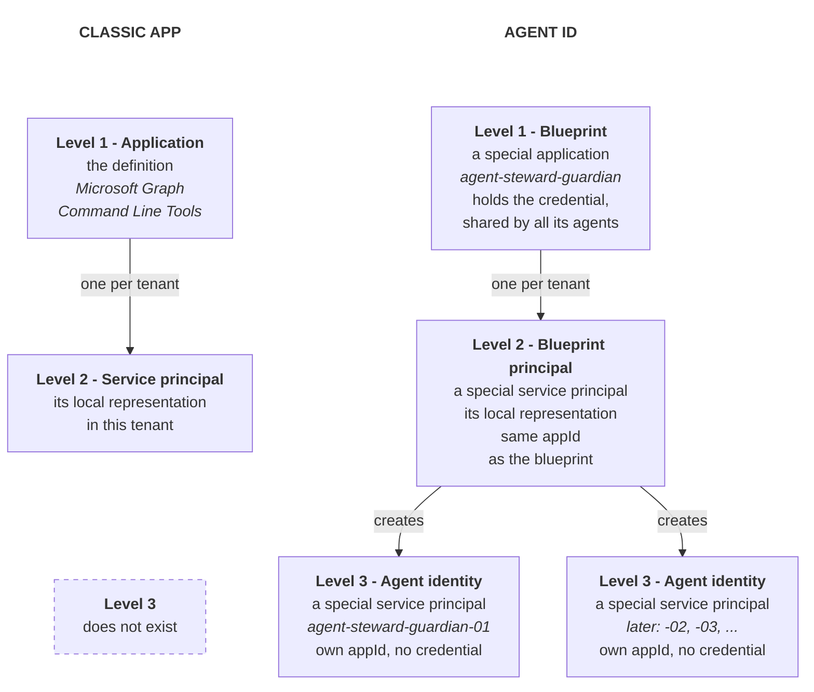
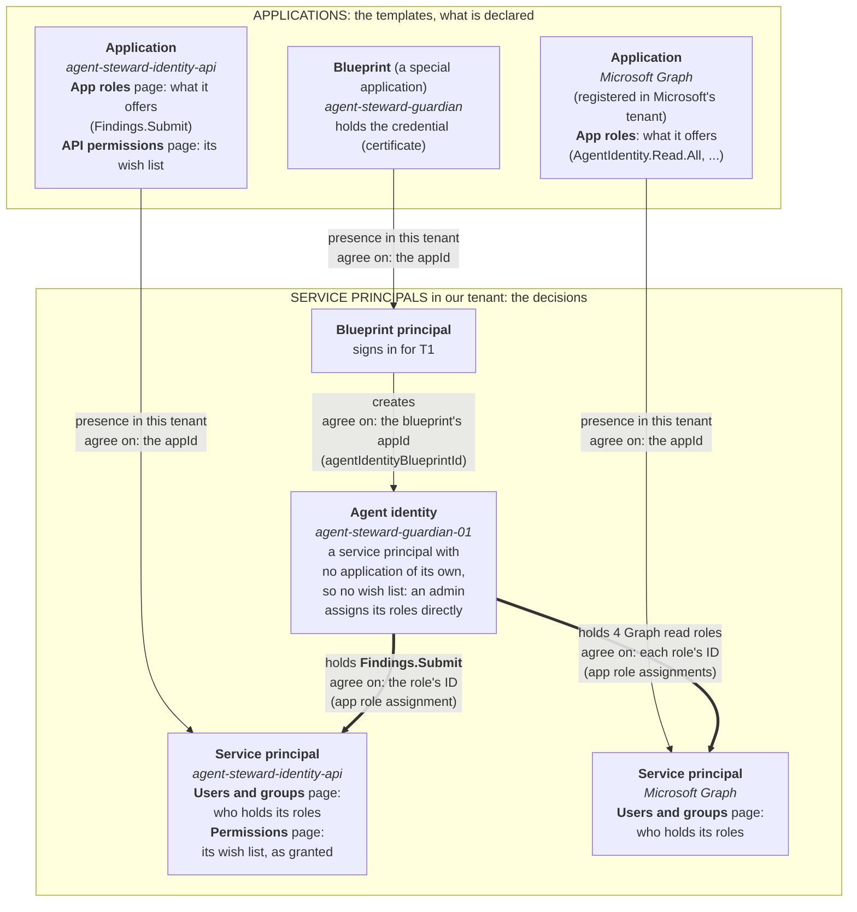
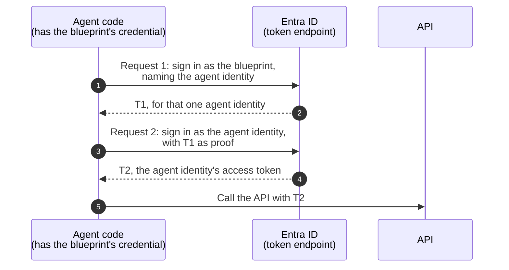

# Agent ID: object model and sign-in

This doc explains how the Microsoft Entra Agent ID objects fit together, and how an agent signs in. It has four parts, and each part builds on the one before. For short definitions of each term, with the OAuth, OIDC and CDR terms they map to, see the [glossary](../GLOSSARY.md).

## Contents

- [Object hierarchy](#object-hierarchy)
  - [A classic app](#a-classic-app)
  - [Agent ID](#agent-id)
  - [What is different](#what-is-different)
  - [Why an agent identity has no application](#why-an-agent-identity-has-no-application)
  - [How the objects connect](#how-the-objects-connect)
  - [Quick reference](#quick-reference)
- [Who it is vs how it proves it](#who-it-is-vs-how-it-proves-it)
  - [Why Agent ID splits them](#why-agent-id-splits-them)
- [How an agent signs in](#how-an-agent-signs-in)
  - [How it works](#how-it-works)
  - [The two requests](#the-two-requests)
  - [App-only tokens and the .default scope](#app-only-tokens-and-the-default-scope)
  - [Why two requests, not one](#why-two-requests-not-one)
  - [What the two requests are not](#what-the-two-requests-are-not)
  - [Where it leaves plain OAuth](#where-it-leaves-plain-oauth)
- [One agent identity per logical agent, not per copy or session](#one-agent-identity-per-logical-agent-not-per-copy-or-session)
  - [Why creating identities on the fly fails](#why-creating-identities-on-the-fly-fails)
  - [When you really need many agent identities](#when-you-really-need-many-agent-identities)
- [Side notes](#side-notes)
  - [The same pattern elsewhere](#the-same-pattern-elsewhere)

## Object hierarchy

**In one line:** Agent ID adds a template, the blueprint, that can have many agent identities in one tenant.

To see what is new, start with the classic app model that Agent ID builds on.

### A classic app

- **The application:** An application is the global definition of an app. It lives in one tenant, its home tenant.
- **The service principal:** In each tenant that uses the app, Entra creates one service principal for it. The service principal is the app's presence in that tenant (Entra calls it the app's local representation). It holds that tenant's decisions about the app: the grants, enabled or disabled, the owners, Conditional Access, and the sign-in logs. So the application is the template, a wish list of what the app requests and offers, and the service principal is where one tenant ticks the boxes ([details](entra.md#applications-vs-service-principals)).
- **One per tenant:** A multitenant app has one service principal in each tenant that uses it, but a tenant can hold at most one service principal per application. Both are records in Entra's directory. Neither runs any code: the code that uses them runs elsewhere.

### Agent ID

- **The blueprint:** A blueprint is a special application. It defines one kind of agent, and it holds the credential that all its agents share.
- **The blueprint principal:** In the tenant, the blueprint gets one service principal of its own, the blueprint principal. It has the same `appId` as the blueprint, and it represents the blueprint itself.
- **The agent identities:** From the blueprint, one agent identity is created for each agent. Each agent identity is a special service principal, with its own `appId` and no credential of its own.

### What is different

- **A third level:** A classic app stops at one service principal per tenant. A blueprint adds a third level: many agent identities in the same tenant.
- **One credential for all:** A classic app's credential proves only that app. A blueprint holds the only credential, and all its agent identities sign in through it.
- **Still two base types:** Graph still has only applications and service principals. So a blueprint is a special application, and a blueprint principal and an agent identity are special service principals, each with its own Graph type.

**In short:** the blueprint is the global definition of one kind of agent, and the blueprint principal is its presence in this tenant, just like a classic app. What is new is that the blueprint also creates many agent identities in the same tenant, and each one is a service principal of its own. All of them are records in Entra's directory. The code that runs is elsewhere.

### Why an agent identity has no application

**In one line:** an agent identity is a service principal with no application behind it, because it can never live in more than one tenant, so it needs no template of its own.

The split into an application and a service principal exists because an app can live in many tenants. The application is the one template, and each tenant that uses the app gets its own service principal, where that tenant ticks the boxes ([details](entra.md#applications-vs-service-principals)). Even a single-tenant app keeps both halves, because the model is the same for every app.

- **A classic app can be multitenant:** It can be published to other tenants. So it needs both halves.
- **A blueprint can be multitenant too:** A publisher can offer it to other tenants. So it also has both halves: the blueprint (its template) and a blueprint principal in each tenant that uses it.
- **An agent identity never can:** Microsoft Learn says agent identities "are always single-tenant regardless of their parent Agent identity blueprint's tenancy model". So it needs no template of its own, because its blueprint already is one. It needs only the tenant half, and that half is the agent identity itself.

| Object | Template half (application) | Tenant half (service principal) |
|---|---|---|
| Classic app | The application | Its service principal, one per tenant |
| Blueprint | The blueprint | The blueprint principal, one per tenant |
| Agent identity | None: the blueprint is its template | The agent identity itself, in exactly one tenant |

So an agent identity's grants, sign-ins, sponsor and enabled flag all live on the agent identity, the same way they live on any service principal. This project's roles (`Findings.Submit` and the guardian's Graph roles) are assigned to the agent identity's object ID.

Source: [Agent autonomous app OAuth flow](https://learn.microsoft.com/en-us/entra/agent-id/agent-autonomous-app-oauth-flow) (Microsoft Learn, checked 26 October 2026).

### How the objects connect

**In one line:** the applications declare, the service principals in the tenant hold the decisions, and every link between two objects is an ID that both sides agree on.

The diagram shows this project's real objects. The applications on top are the templates. The service principals below are their presence in our tenant. The agent identity is the only one with no application of its own, and its roles are app role assignments that point at an API's service principal.

| Link | They agree on | Where you see it |
|---|---|---|
| An application and its service principal | The `appId` | In the portal: the same Application ID on both pages |
| The blueprint principal and an agent identity | The blueprint's `appId`, stored as the agent's `agentIdentityBlueprintId` | T1's `sub` (the FMI path) and T2's `xms_par_app_azp` |
| An agent identity and an API's service principal | The role's ID (`appRoleId`), defined on the API's application | The API's Users and groups page, and T2's `roles` |
| An agent identity and the API it calls | The API's `appId`, asked for as `<appId>/.default` | T2's `aud` ([tokens.md](tokens.md#t1-and-t2-side-by-side)) |

**The portal pages in the picture:**

- **App registrations > the app > App roles:** What the app offers. The roles are defined here, and only here.
- **App registrations > the app > API permissions:** What the app asks for on other APIs, its wish list, under "Configured permissions". Asking grants nothing. The same page also lists "Other permissions granted for <tenant>": grants that exist on the app's service principal in this tenant without being on the wish list, like the test client's `Findings.Submit`, which Bicep assigned directly.
- **Enterprise apps > the app > Security > Permissions:** The wish list as granted in this tenant.
- **Enterprise apps > the app > Manage > Users and groups:** Who holds the app's roles. Agent identities are listed here too.

**Roles and administrators** (Enterprise apps > the app) is not part of this picture. It shows the Entra admin roles that may manage the app, such as Cloud Application Administrator, not what the app may call.

**Inherited permissions.** An agent can also inherit permissions from its blueprint: the blueprint lists which APIs' permissions may pass down to its agents, and an admin consents to them on the blueprint principal. The key detail: **inherited permissions never show on the agent identity, neither in Graph nor in the portal, only in its tokens.** Graph beta lists them for each agent (`inheritedAppRoleAssignments`), and the guardian reads them too, so its over-permissioned check sees what an agent can really do ([graph_reader.py](../src/guardian/graph_reader.py)). Source: [Inheritable permissions](https://learn.microsoft.com/en-us/entra/agent-id/concept-inheritable-permissions) (Microsoft Learn).

### Quick reference

| Object | Graph collection and type | `servicePrincipalType` | Per tenant | Credentials | Portal page |
|---|---|---|---|---|---|
| Application | `applications` | - | One, in its home tenant | Usually here | App registrations |
| Service principal | `servicePrincipals` | `Application` | At most one | Rarely | Enterprise apps |
| Agent identity blueprint | `applications`, type `agentIdentityBlueprint` | - | One, in its home tenant | **Only here**, shared by all its agent identities | Agents > Agent blueprints > open a row > Developer settings |
| Blueprint principal | `servicePrincipals`, type `agentIdentityBlueprintPrincipal` | `Application` | At most one | No | Agents > Agent blueprints (each row is a principal) |
| Agent identity | `servicePrincipals`, type `agentIdentity` | `ServiceIdentity` | **Many** | **None of its own** (not allowed); signs in through the blueprint's | Agents > Agent identities |

In this tenant, the blueprint `agent-steward-guardian` shows "Agent identities: 1" on the Agent blueprints page, and that child is `agent-steward-guardian-01`. Enterprise apps lists neither the blueprint principal nor the agent identity, so use the Agents pages to find them.

## Who it is vs how it proves it

**In one line:** an agent identity says who it is with its own `appId`, and it proves it with its blueprint's credential.

In OAuth, a client answers two questions. Its `client_id` says who it is, and its client authentication, such as a secret or a key, proves it. Agent ID puts these two answers on two different objects:

- **Who it is - the agent identity:** Each agent identity has its own `appId`. So tokens, logs, permissions and disable all work per agent. With a shared `appId`, Entra could not tell the agents apart.
- **How it proves it - the blueprint:** Only the blueprint holds a credential, and all its agent identities share it. So there is one secret to protect and rotate, not one per agent.

Because the agent identity holds no credential, it cannot sign in alone. So its blueprint signs in for it. That is why the blueprint needs its own `appId` too: in OAuth, only a client with a `client_id` can sign in.

So some things are shared, and some are per agent:

- **Shared by all agents of a blueprint:** the credential, and the blueprint's `appId`.
- **Per agent:** the agent identity's `appId`, which is the client named in the agent's token.

### Why Agent ID splits them

- **New agents need no secret:** The credential lives on the blueprint. So creating a new agent is one Graph call, with no secret to make, deliver or rotate. Here "a new agent" means a new logical agent, not a new copy of a running one or a new chat session (see [One agent identity per logical agent, not per copy or session](#one-agent-identity-per-logical-agent-not-per-copy-or-session)).
- **One credential, outside the agent:** With 100 agents, the team creates, stores and rotates one credential, not 100. Because the credential belongs to the blueprint, it can live outside the agent's own code, for example in the hosting platform. This matters because an LLM drives what an agent does: if the agent's code held a secret, a prompt injection could trick the agent into leaking it.
- **One place for governance:** Every agent signs in through its blueprint. So rotating one credential, or applying one Conditional Access policy to the blueprint, covers all its agents.

## How an agent signs in

**In one line:** an agent gets its access token in two requests. First its blueprint gets a one-time proof, T1, and then the agent identity uses T1 to get its own token, T2.

The same agent program makes both requests. Only the `client_id` it sends tells Entra which role it plays: the blueprint in request 1, and the agent identity in request 2.

### How it works

1. **Blueprint signs in:** The agent program asks Entra for a token as the blueprint, using the blueprint's credential. In the same request, it names the agent identity it acts for.
2. **Entra issues T1:** Entra checks the blueprint's credential and returns T1 for that one agent identity. So T1 is not a general blueprint token, and it cannot call an API. Its only use is the next request.
3. **Agent identity signs in:** The agent program asks Entra for a token again, this time as the agent identity. It sends no secret or key. Instead, it sends T1 as its proof.
4. **Entra issues T2:** Entra checks that T1 is valid and came from this agent identity's own blueprint. Then it returns T2, the agent's access token, which names the agent identity as the client.
5. **Agent calls the API:** The agent sends T2 to the API. So the API sees the agent identity as the caller, and it can also log which blueprint the agent belongs to.

To see what T2 contains, claim by claim, and what an API must check, see [Agent tokens](tokens.md). To see real T1 and T2 tokens side by side, see [T1 and T2 side by side](tokens.md#t1-and-t2-side-by-side).

The on-behalf-of (OBO) flow follows the same steps. Only request 2 changes, as the next section shows.

### The two requests

**Request 1 - the blueprint gets T1:**

- **`client_id`:** the blueprint's `appId`.
- **Grant:** `client_credentials`, with `scope=api://AzureADTokenExchange/.default`.
- **`fmi_path`:** the agent identity's `appId`. This is a Microsoft extension. It is not in any RFC.
- **Client authentication:** a client secret, a certificate, or a federated identity credential. A certificate or a federated credential is sent as an RFC 7523 `client_assertion`.

**Request 2 - the agent identity gets T2:**

- **`client_id`:** the agent identity's `appId`.
- **Grant:** `client_credentials` in the autonomous flow, or `jwt-bearer` in the OBO flow.
- **Client authentication:** `client_assertion` = T1 (RFC 7523).
- **`scope`:** the API's scope, for example `https://graph.microsoft.com/.default`.

**What T2 carries:**

- **`azp`:** the agent identity's `appId`, the client.
- **`xms_par_app_azp`:** the blueprint's `appId`. Use it in logs, but do not authorize on it.

### App-only tokens and the .default scope

**In one line:** an app-only token is about the agent identity itself, with no user (a human) in it, so its permissions come from what an admin granted, not from what the agent asks for.

- **Application permissions are app roles:** What the portal calls an "application permission", for example `AuditLog.Read.All`, is an app role on the API's application. Granting it creates an app role assignment from the client's service principal (here, the agent identity) to the API's service principal. So it is a fixed fact about the identity, like a role in role-based access control, and not a choice made per request.
- **No user, so no consent at runtime:** In a delegated flow, Entra can show the user a consent prompt for exactly the scopes requested at that moment. An app-only client has no user to ask, so an admin must grant its permissions ahead of time. There is no incremental or dynamic consent for app-only clients.
- **The scope names only the API:** So in the app-only flow, the `scope` is always the API's identifier plus `/.default`, for example `https://graph.microsoft.com/.default`. It names the API, not single permissions.
- **The admin decides the permissions:** `.default` means "every application permission that an admin granted to this client for this API". So Entra puts all of them into the token's `roles` claim, and the token has no `scp` claim.
- **No subset per request:** In plain OAuth, and in IdentityServer, a client can ask for a subset of its scopes. Entra does not let an app-only client narrow its token. So least privilege comes from granting each agent identity only what it needs.
- **A named scope is refused:** Asking for `https://graph.microsoft.com/AuditLog.Read.All` instead of `/.default` fails. Seen in this lab on 26 October 2026: the token sidecar refused it before it called Entra, with `IDW10404: 'scope' parameter should be of the form 'AppIdUri/.default'`. Microsoft Learn's [client credentials flow](https://learn.microsoft.com/en-us/entra/identity-platform/v2-oauth2-client-creds-grant-flow) also requires the resource identifier plus `.default`.

Asking for single named scopes, which arrive in the `scp` claim, works only in delegated flows such as on-behalf-of, where a user (a human) is in the token.

### Why two requests, not one

The agent program holds the blueprint's key anyway, so in theory it could sign request 2 with it and skip T1. Entra does not allow this, because OAuth binds each proof to one client.

- **Each request stays standard OAuth:** In `private_key_jwt` client authentication, the assertion's `sub` must be the `client_id` (RFC 7523 section 3), and the server checks the signature with keys registered for that client. A direct request would send the agent identity's `client_id` with a signature from the blueprint's key, which is registered on another client. With two requests, each proof matches its `client_id`: the blueprint's key proves the blueprint, and T1 proves the agent identity.
- **T1 reuses federated credentials:** Learn calls T1 "the token-exchange token for FIC". Its audience, `api://AzureADTokenExchange`, is the same audience a managed identity token uses as a federated identity credential. So in effect, each agent identity is federated to its own blueprint, and Entra needed no new kind of credential.
- **One T1 works with every grant:** T1 is a normal `client_assertion`, so the agent identity can use it with `client_credentials` (autonomous flow) or `jwt-bearer` (OBO flow). A direct "sign as my parent" rule would need special handling in each flow.
- **Each step leaves its own record:** Learn lists "Agent Identity Blueprint" and "Agent Identity" as separate agent types in the sign-in logs. So request 1 is a sign-in by the blueprint, and request 2 is a sign-in by the agent identity. On top of that, T2 names the blueprint in `xms_par_app_azp`, and the audit logs link every agent identity to its blueprint with `blueprintId`. Because of this, an investigator can follow an action from the agent back to the blueprint that signed it in. (Phase 2 checks this against real sign-in logs.)

Microsoft does not publish its reasons for the two-step design. These four follow from the design, the RFC and the Learn pages.

### What the two requests are not

Some explanations of T1 and T2 get these points wrong:

- **Not an RFC 8693 token exchange:** T1's audience is named `api://AzureADTokenExchange`, but request 2 is a normal `client_credentials` request (or `jwt-bearer` in the OBO flow) with T1 as the client assertion. It sends no `subject_token`, and it does not use the token-exchange grant type.
- **Not the creation of the agent:** Creating an agent identity is a separate Graph call that happens earlier (audit log: "Add service principal"). Request 2 only signs in an agent identity that already exists.
- **No extra trust to configure:** Entra accepts T1 only from the agent identity's own blueprint. That link is set when the agent identity is created (`agentIdentityBlueprintId`), so there is no separate trust policy.
- **Not a cryptographic audit trail:** The sign-in and audit logs are records that Entra keeps. T1 and T2 are signed, but they are short-lived, and nobody stores T1 as a receipt. So the logs are only as trustworthy as the access controls that protect them.

### Where it leaves plain OAuth

- **The anchor:** OAuth already lets a client prove itself with an assertion that a third party created for it (RFC 7521 section 3, RFC 7523 section 2.2). Entra's federated identity credentials work the same way: Entra trusts an assertion from another issuer instead of a secret. Entra calls this pattern workload identity federation.
- **The break:** OAuth does not say how the client gets that assertion. Entra fills this gap in a new way. The third party is Entra itself, and the one who asks for the assertion is another client: the agent's own blueprint.

**In short:** both are OAuth clients. T1 proves "the blueprint is asking, for this agent". T2 says "this agent is acting", and the API sees the agent.

**Security note:** the cost of this design is the blast radius. A blueprint can get T1 for any of its agent identities, so a leaked blueprint credential exposes all of them. It exposes no other blueprint's agents: Entra checks the parent at request 2 ([tested](tokens.md#where-entra-checks-the-parent-blueprint)).

## One agent identity per logical agent, not per copy or session

**In one line:** an agent identity stands for one logical agent, which is a job with its own purpose, permissions and sponsor. It does not stand for one running copy of the agent's code, and not for one chat session.

So when a platform scales out, or when users open new chat sessions, nothing new is created in the directory. Every copy and every session of the same agent signs in as the same agent identity, through the same blueprint. Each one still gets its own tokens, because tokens are issued per request, not per identity.

- **Success - 100 pods of one agent:** A traffic spike starts 100 pods of the HR policy agent. All 100 pods get T1 and T2 for the same agent identity. Nothing is created in the directory.
- **Success - 1,000 chat sessions:** Each session is state inside the application, not an object in the directory. So all 1,000 sessions use the same agent identity, and a session ID in the application's logs tells them apart. When a session acts for a user (a human), the user goes into the token through the on-behalf-of flow, not through a new agent identity.
- **Success - a new kind of work:** A team adds a code review agent with its own permissions and sponsor. That is a new logical agent, so it gets a new agent identity, created once.
- **Failure - one identity per pod or per session:** The platform creates a new agent identity for every pod or every chat session. This is an anti-pattern, for the reasons below.

Because all copies and sessions share one identity, the sign-in logs cannot tell them apart. That is the job of the application's own logs: a correlation ID per request (NFR4) shows which copy or session did what.

**Anchor:** in IdentityServer, nobody registers a new client for every server behind a load balancer, or for every user session. The same rule holds here.

### Why creating identities on the fly fails

- **A heavy, long-lived object:** An agent identity is a directory object, built to live for months, and it needs a sponsor when it is created. A short session is the wrong unit for it.
- **Eventual consistency:** Entra copies a new object to its replicas in the background. So using it right away can fail with "Object with id {id} not found" (Agent ID FAQ), and every new session would start by retrying.
- **Rate limits:** Microsoft Graph throttles bursts of writes with 429 Too Many Requests, and each new identity costs at least one write.
- **Quotas:** Soft-deleted identities count against the tenant quota for 30 days, so creating and deleting them per session fills it.
- **Automated privilege assignment:** Granting permissions on the fly needs a permission like `AppRoleAssignment.ReadWrite.All`, which needs admin consent. Microsoft warns that it lets an app "grant additional privileges to itself", so the identity factory becomes the most dangerous service in the tenant.
- **Orphans:** Pods and sessions often end without cleanup, so their identities stay behind, and nobody reviews them.

### When you really need many agent identities

**The limit:** a non-Microsoft platform that creates agent identities with app-only permissions can have at most 250 agent identities per blueprint. Delegated calls and Microsoft's own platforms (Foundry, Copilot Studio) have no such cap.

So a design that truly needs 1,000 distinct logical agents has two options:

- **More blueprints:** Create 4 blueprints, and let each one hold up to 250 agent identities. The cost is governance: there are 4 credentials to protect, and every Conditional Access policy or disable must cover all 4 blueprints.
- **Delegated creation:** Create the agent identities with delegated calls, which have no cap. A delegated call needs a signed-in user (a human), so this fits setup scripts like this project's, not unattended automation.

**Sessions are not agents:** If the real need is to tell thousands of user sessions apart, use the on-behalf-of (OBO) flow instead. One agent identity then serves every session, and each token names the user (a human) as its subject. So logs and permissions work per user, and no new directory objects are created.

**How to choose:** if what differs between them is the user, use OBO. If what differs is the job (its purpose, permissions and sponsor), they are separate logical agents, so use more blueprints or delegated creation.

## Side notes

### The same pattern elsewhere

One trusted caller that gets tokens for many separate identities is common:

- **GCP service account impersonation:** One caller with the Token Creator role gets access tokens for many service accounts. Each service account keeps its own permissions and audit trail.
- **AWS STS AssumeRole:** One principal assumes many roles. Each role has its own permissions, and CloudTrail logs both the caller and the role.

Unlike Entra, AWS and GCP do it in one call. There it is an authorization question on an IAM API: "may caller X get a token for Y?". Entra does it at the OAuth token endpoint, where the question is "does this client prove itself with its own credential?". So Entra splits it in two: first it gives the agent identity a proof (T1), and then the agent identity signs in like any other client.
