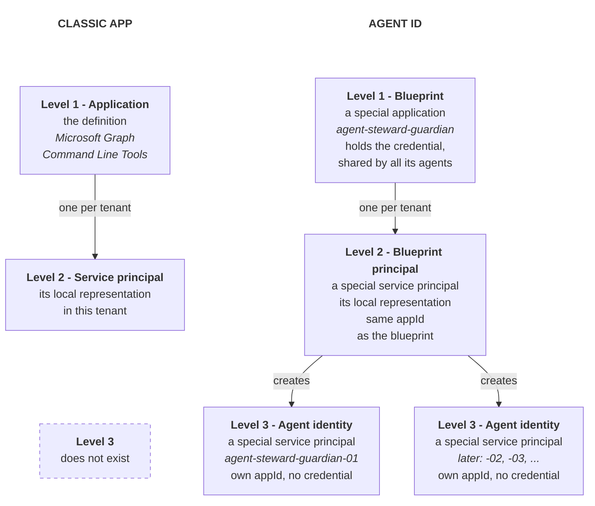
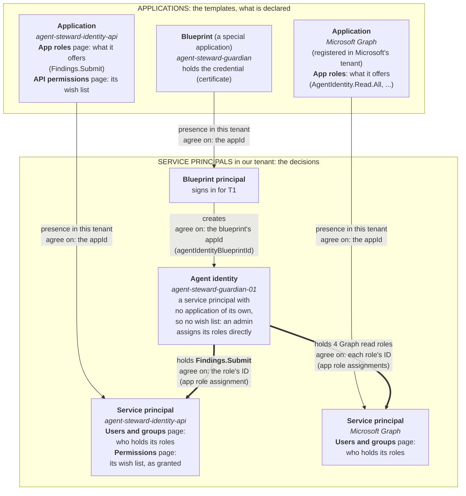
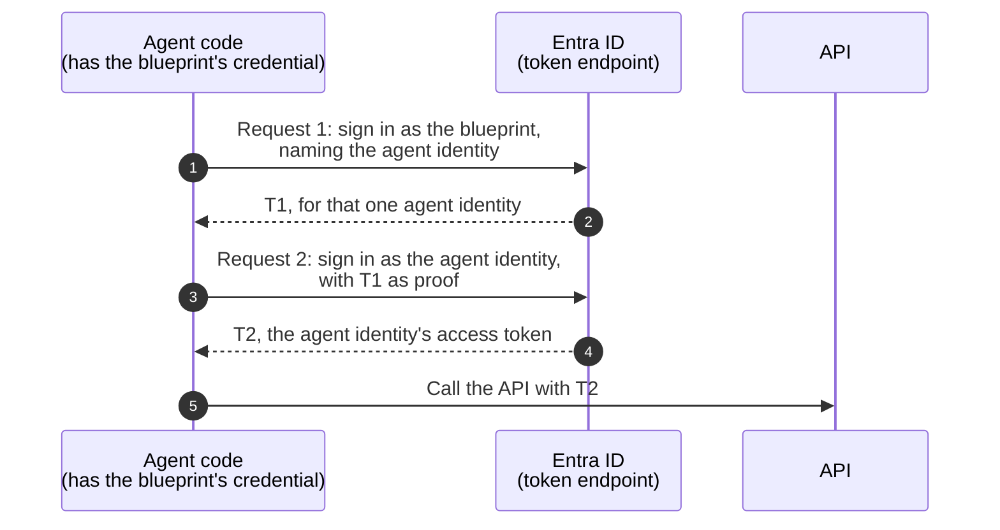

# Agent ID: Object Model and Sign-In

This document breaks down how Microsoft Entra Agent ID objects fit together and explains the mechanics behind how an agent signs in. We will cover this in four progressive parts, with each section building on the concepts from the last. 

*(For short definitions of each term and how they map to OAuth, OIDC, and CDR terminology, please see the [glossary](../GLOSSARY.md). For foundational context, you can reference the `agent-id.md` file).*

## Contents
- [1. The Object Hierarchy](#1-the-object-hierarchy)
- [2. Identity vs. Credential (Who you are vs. How you prove it)](#2-identity-vs-credential-who-you-are-vs-how-you-prove-it)
- [3. The Two-Step Sign-In Dance](#3-the-two-step-sign-in-dance)
- [4. Scaling: Logical Agents vs. Copies and Sessions](#4-scaling-logical-agents-vs-copies-and-sessions)
- [5. Industry Parallels](#5-industry-parallels)

---

## 1. The Object Hierarchy

**The Short Version:** Agent ID introduces a new type of template—the *blueprint*—which holds shared credentials and can generate multiple, separate agent identities within a single tenant.

To understand what is new here, it helps to first look at the classic app model that Agent ID is built upon.

### The Classic App Model
- **The Application (Level 1):** Think of this as the global definition or "template" of an app. It lives entirely in its home tenant.
- **The Service Principal (Level 2):** When a tenant uses an app, Entra creates a local representation of it called a Service Principal. This holds the tenant-specific configurations: granted permissions, Conditional Access policies, sign-in logs, etc. 
- **The Rule:** A multitenant app has one service principal per tenant. Both the application and the service principal are just records in the Entra directory—the actual code runs somewhere else.

### The Agent ID Model
Agent ID adds a third layer to this hierarchy:
- **The Blueprint (Level 1):** A special type of application. It defines a specific *kind* of agent and centrally holds the credential that all of its agents will share.
- **The Blueprint Principal (Level 2):** The local representation of the blueprint in your tenant. It shares the same `appId` as the blueprint.
- **The Agent Identities (Level 3):** These are generated *from* the blueprint principal. Each agent identity is a special service principal with its own unique `appId`, but importantly, **it has no credentials of its own**.

### Why Agent Identities Don't Need an "Application" Template
In the classic model, the split between an Application (the template) and a Service Principal (the local instance) exists because an app can be published to multiple tenants. 

Agent identities, however, are **always single-tenant**, regardless of their parent blueprint's model. Because an agent identity will never live in more than one tenant, it doesn't need a template of its own—its blueprint already serves that purpose. 

| Object | Template Half (Application) | Tenant Half (Service Principal) |
|---|---|---|
| **Classic app** | The application | Its service principal (one per tenant) |
| **Blueprint** | The blueprint | The blueprint principal (one per tenant) |
| **Agent identity** | *None* (the blueprint is its template) | The agent identity itself (in exactly one tenant) |

This means an agent identity's role assignments (like `Findings.Submit` or Graph roles), sign-in logs, and enabled/disabled flags live directly on the agent identity itself.

### How the Objects Connect
Every link between two objects in Entra is simply an ID that both sides agree on. Applications declare what they need, while Service Principals hold the actual decisions (grants). 

#### Where to Find These Links in the Azure Portal
| Link | What They Agree On | Where to Find It |
|---|---|---|
| **App ↔ Service Principal** | The `appId` | Portal: The same "Application ID" on both pages. |
| **Blueprint Principal ↔ Agent Identity** | The blueprint's `appId` (`agentIdentityBlueprintId`) | Token T1 (`sub` / `fmi_path`) and T2 (`xms_par_app_azp`). |
| **Agent Identity ↔ API's Service Principal** | The role's ID (`appRoleId`) | Portal: The API's "Users and groups" page, and T2's `roles`. |
| **Agent Identity ↔ The API it calls** | The API's `appId` (asked as `<appId>/.default`) | Token T2's `aud` claim. |

*Note on Inherited Permissions:* Agents can inherit permissions from their blueprint. The critical detail here is that **tokens and the directory view behave differently**. The agent's token (`roles` claim) combines its own roles *plus* inherited ones. However, the standard Entra portal and Graph API only show the agent's direct assignments. (The only exception is Graph Beta, which lists them under `inheritedAppRoleAssignments`).

### Quick Reference Guide

| Object | Graph Type | `servicePrincipalType` | Quantity per Tenant | Credentials | Portal Page |
|---|---|---|---|---|---|
| **Application** | `applications` | - | One (in home tenant) | Usually here | App registrations |
| **Service Principal** | `servicePrincipals` | `Application` | At most one | Rarely | Enterprise apps |
| **Blueprint** | `agentIdentityBlueprint` | - | One (in home tenant) | **Only here** (Shared) | Agents > Agent blueprints > Developer settings |
| **Blueprint Principal** | `agentIdentityBlueprintPrincipal` | `Application` | At most one | No | Agents > Agent blueprints |
| **Agent Identity** | `agentIdentity` | `ServiceIdentity` | **Many** | **None** (Signs in via blueprint) | Agents > Agent identities |

---

## 2. Identity vs. Credential (Who you are vs. How you prove it)

In standard OAuth, a client uses a `client_id` to say *who it is*, and a secret/key to *prove it*. The Agent ID model deliberately splits these two responsibilities:

- **Who it is (The Agent Identity):** Each agent has its own `appId`. This allows tokens, permissions, logs, and disable-flags to work on a per-agent basis.
- **How it proves it (The Blueprint):** All agent identities share the credential held by their blueprint. Because the agent identity has no credential of its own, it cannot sign in alone—its blueprint must sign in *for* it. 

### Why a Blueprint Is Needed
Without blueprints, every agent would be a classic application, with its own service principal and its own credential. The blueprint model changes this in three ways.

**1. Separation of concerns: the value of credential-less segmentation.** This is where the blueprint model pays off.
- **The sidecar holds the credential:** In this project, the blueprint's credential lives only in the sidecar (in production, often the hosting platform), and the sidecar runs no AI logic. So a prompt injection cannot trick the agent into leaking a secret it does not have. This works only when the credential stays out of the agent code.
- **The agent code holds only T2:** The agent code runs the AI logic, which is the part an attacker can reach. It signs in as its agent identity and receives only T2. T2 carries only the roles granted to that one agent identity, for one API (see [the `.default` rule](#app-only-tokens-and-the-default-scope)). So T2 is exactly as narrow as the agent identity's grants.
- **Segmentation costs no credential:** Each agent identity has its own grants, sign-in logs and disable flag, but no credential. So you can give each job its own agent identity without adding a credential. With classic applications, each extra identity is one more application with its own credential to register and rotate.
- *Limit:* This protects the credential, not the choice of identity. The sidecar lets its caller name the agent identity, so any code that can reach the sidecar can get T2 for any agent identity of that blueprint ([docs/infra.md](infra.md#local-run-the-token-sidecar)).

**2. Directory bloat and quota: fewer objects.** The blueprint is the aggregation layer: it maps many lightweight service principals under one heavyweight application.
- **Without blueprints:** One application can have at most one service principal in a tenant. So 1,000 agents need 1,000 applications and 1,000 service principals. That is 2,000 directory objects, 1,000 application definitions to maintain, and every object counts against the tenant's directory object quota.
- **With blueprints:** The blueprint (the application) holds the definition and the credential once. The agent identities are service principals with no application of their own. So 1,000 agents need 1,002 objects: the blueprint, its blueprint principal and 1,000 agent identities.

**3. Credential management at scale.**
- **Without blueprints:** 1,000 agents need 1,000 credentials. Each one must be created, stored in a vault and rotated on its own schedule, and the orchestrator must mount the correct one into the correct pod.
- **With blueprints:** You manage and rotate one credential per blueprint. It works for all of the blueprint's agent identities, and only for them, because Entra checks the parent at request 2 ([docs/tokens.md](tokens.md#where-entra-checks-the-parent-blueprint)). Creating a new agent is one Graph call, with no credential to create, deliver or rotate. A pod only needs its agent identity's `appId`, which is not a secret.
- **Central control:** Rotating the blueprint's credential, or a Conditional Access policy that targets the blueprint, covers all of its agent identities at once.
- **The 250 limit:** A blueprint can have at most 250 agent identities when a non-Microsoft platform creates them with app-only permissions (see [Hitting the Limits](#hitting-the-limits-and-how-to-bypass-them)). So 1,000 such agents need 4 blueprints: 4 credentials, not 1,000.
- *Trade-off:* One credential for many agents means a larger blast radius. A stolen blueprint credential exposes all of its agent identities (see the *Note on Blast Radius* in section 3).

---

## 3. The Two-Step Sign-In Dance

Because the agent has no credential, it gets its access token in two distinct requests. First, the blueprint gets a one-time proof (**T1**), and then the agent identity uses T1 to get its actual access token (**T2**).

### The Requests in Detail

**Request 1: The Blueprint gets T1**
- **Client ID:** The blueprint's `appId`.
- **Grant:** `client_credentials` with `scope=api://AzureADTokenExchange/.default`.
- **Target (`fmi_path`):** The agent identity's `appId` (a Microsoft extension).
- **Auth:** The blueprint's secret, certificate, or federated credential (RFC 7523 `client_assertion`).
*Result:* Entra issues **T1**, a token whose *only* purpose is for the next request. It cannot call APIs.

**Request 2: The Agent Identity gets T2**
- **Client ID:** The agent identity's `appId`.
- **Grant:** `client_credentials` (autonomous) or `jwt-bearer` (On-Behalf-Of flow).
- **Auth:** The **T1** token is sent as the `client_assertion`.
- **Scope:** The API's scope (e.g., `https://graph.microsoft.com/.default`).
*Result:* Entra verifies T1 came from the correct blueprint and issues **T2**. T2 names the agent identity (`azp`) as the client, and the blueprint (`xms_par_app_azp`) for logging. The agent uses T2 to call the API.

### App-Only Tokens and the `.default` Scope
App-only tokens represent the agent itself, with no human user involved. Because there is no user to click "Accept" on a consent prompt, permissions must be granted by an admin ahead of time.
- **No dynamic subsets:** You cannot ask for specific scopes (like `AuditLog.Read.All`) per request. If you try, Entra rejects it with error `AADSTS1002012`: "Client credential flows must have a scope value with /.default suffixed to the resource identifier" (tested in this lab on 27 October 2026, by asking for the Identity API's role `Findings.Submit`).
- **The `.default` rule:** You must request the API identifier plus `/.default` (e.g., `https://graph.microsoft.com/.default`). This tells Entra to look at every permission an admin has granted this agent and bundle them all into the token's `roles` claim. (The `scp` claim is not used here).
- **The agent cannot narrow itself:** There is no per-request least privilege for app roles. Least privilege lives entirely in the grant.
- **Different access means different identity:** If one agent needs a narrow token for path A and a wide token for path B, you need two agent identities (or two blueprints), not one agent asking for two scopes. Two blueprints are needed when the wide roles are inheritable permissions on the blueprint, because every agent identity under that blueprint inherits them.

### Why use two requests instead of one?
While the agent code holds the blueprint's key and *could* theoretically sign Request 2 directly, Entra prevents this to maintain OAuth standards:
1. **OAuth Compliance:** In standard OAuth (RFC 7523), a signature must match the keys registered to the `client_id` making the request. Two requests ensure each proof matches its respective client.
2. **Federated Credential Reuse:** T1 utilizes the same audience (`api://AzureADTokenExchange`) as managed identity tokens. In essence, the agent identity is "federated" to its own blueprint without Entra needing to invent a new credential type.
3. **Flow Flexibility:** Because T1 is a standard `client_assertion`, it works flawlessly across both `client_credentials` and `jwt-bearer` (OBO) flows.
4. **Audit Granularity:** Request 1 logs a sign-in by the Blueprint. Request 2 logs a sign-in by the Agent Identity. This allows investigators to trace API calls back from the agent directly to the blueprint that authorized it.

*Note on Blast Radius:* Because a blueprint can generate a T1 for *any* of its agents, a compromised blueprint credential exposes all of its child agents (but no agents belonging to other blueprints).

### Clarifying Misconceptions
- **It is NOT RFC 8693 Token Exchange:** Despite the audience name, Request 2 is a standard `client_credentials` (or `jwt-bearer`) request. It does not use the token-exchange grant type.
- **It is NOT agent creation:** Creating the agent is a separate Graph API call made earlier. Request 2 only signs in an *existing* agent.
- **It is NOT a cryptographic audit trail:** T1 and T2 are short-lived tokens. The audit logs are kept by Entra, not secured by the tokens themselves.

---

## 4. Scaling: Logical Agents vs. Copies and Sessions

**The Golden Rule:** An agent identity represents one **logical agent** (a specific job with a unique purpose, permissions, and sponsor). It does *not* represent a single running pod of code, nor a single user chat session. 

If your app experiences a traffic spike and spins up 100 pods of your "HR Policy Agent," all 100 pods will use the exact same agent identity, pulling their own T1 and T2 tokens per request. 

### Why dynamic, on-the-fly identity creation is an anti-pattern:
Creating a new agent identity for every session or pod will fail for several reasons:
- **Rate Limits & Quotas:** Graph API will throttle you (429 errors), and deleted identities count against your tenant quota for 30 days.
- **Replication Lag:** Entra takes time to sync new objects. Trying to use an identity the second it's created often results in "Object not found" errors.
- **Security Risks:** Assigning permissions programmatically on the fly requires highly dangerous roles like `AppRoleAssignment.ReadWrite.All`, turning your identity-generator into a massive security vulnerability.
- **Orphans:** Abandoned sessions leave behind unused identities that clutter the directory.

### Hitting the Limits (and how to bypass them)
For non-Microsoft platforms using app-only permissions, Entra limits you to **250 agent identities per blueprint**. 

If you truly have a design that requires 1,000 distinct logical agents, you have two choices:
1. **Create more blueprints:** Make 4 blueprints to house 250 agents each (Note: this increases your credential management overhead).
2. **Use Delegated Creation:** Creating identities via delegated calls (which requires a signed-in human user) bypasses this cap. This is ideal for setup scripts, but not unattended automation.

**What if I just have 1,000 user sessions?** 
If the only thing changing between instances is the *human user*, do not create new agent identities. Use the **On-Behalf-Of (OBO)** flow. A single agent identity can serve all 1,000 sessions, and Entra will put the human user's details into the token subject.

---

## 5. Industry Parallels

If this architecture feels familiar, it's because similar patterns exist in other major cloud providers:
- **GCP:** A trusted caller with the "Token Creator" role gets access tokens for multiple service accounts (Service Account Impersonation).
- **AWS:** A single principal uses STS to assume multiple different roles (`AssumeRole`).

The primary difference is that GCP and AWS handle this in a single authorization call ("May caller X get a token for Y?"). Entra, adhering strictly to OAuth token endpoint standards ("Does this client prove itself?"), splits the process into the two-step dance (T1, then T2) outlined above.