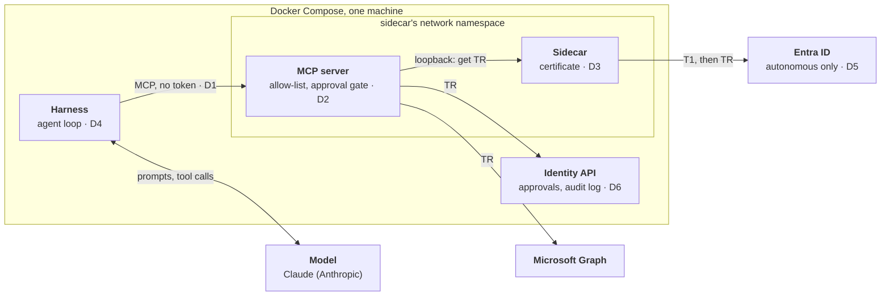
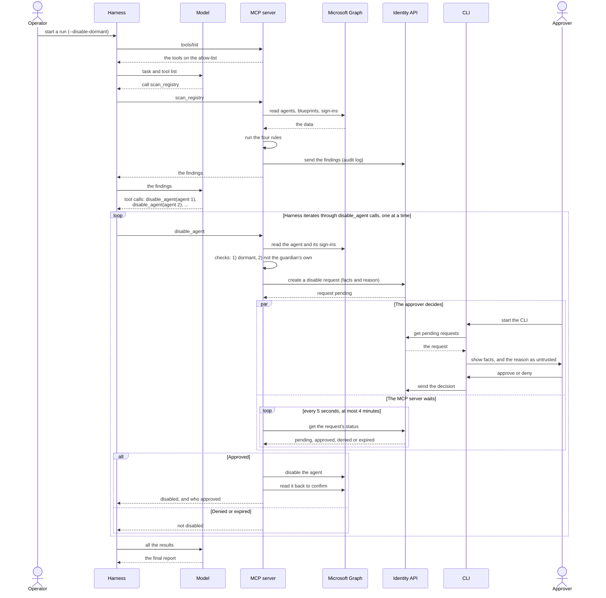
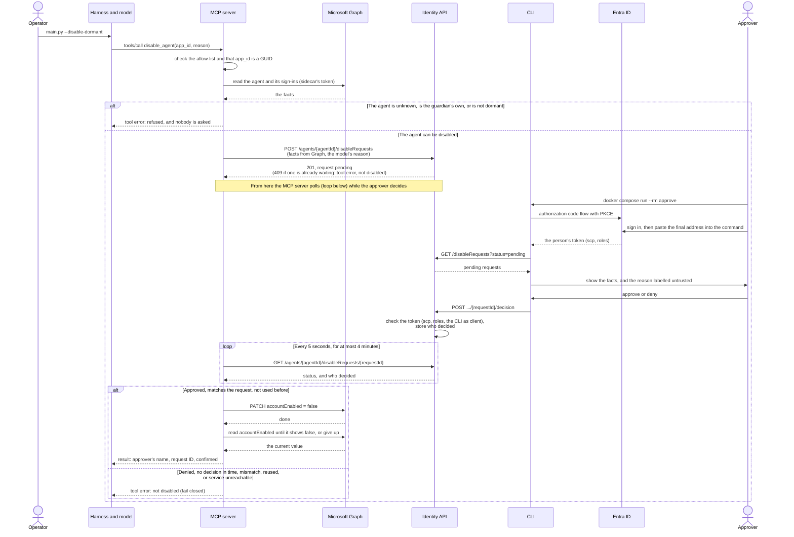
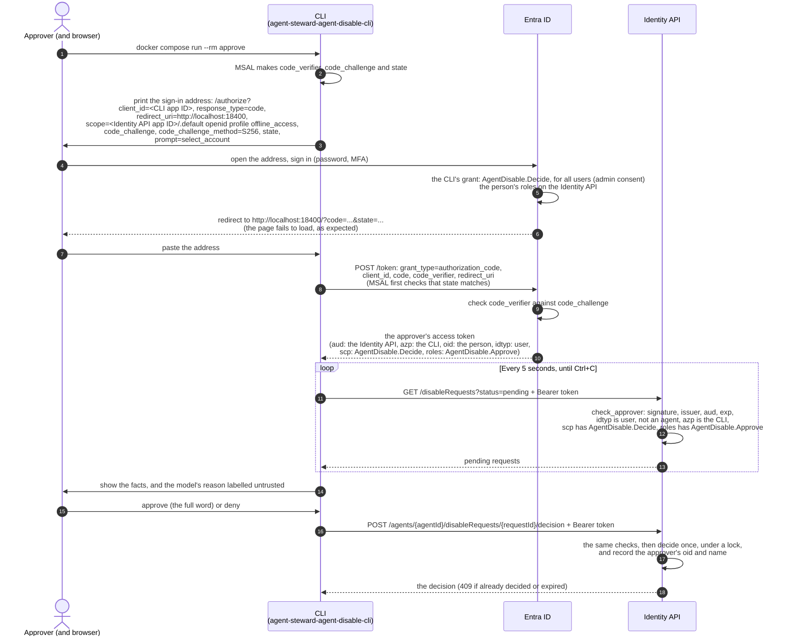

# Agent Steward Architecture: The Guardian's Design and Decisions

This document shows how this project's **Guardian** agent is built today: its parts, its main flows, and every shortcut it takes from the enterprise design, with the risk each one accepts. For the general design that the Guardian is compared with, see [Agent Architecture: The Enterprise Reference Design](agent-architecture.md). The decisions behind this design, with their reasons, are in the [decision log](decisions.md).

> **Current Implementation Status: Partly Built**
> * **Built:** The Entra identity, the sidecar (Microsoft Entra ID Auth SDK), the Identity API, the MCP server with three tools (`scan_registry` runs the Guardian's four registry rules, `get_agent` reads one agent, `disable_agent` disables a dormant agent after a human approves) and its tool allow-list, and the harness's agent loop with Claude. The Guardian's container cannot reach the sidecar, and an MCP integration test proves it.
> * **Not built yet:** The correlation-ID scaffold across all components.
> 
> *(See [Delivery status](delivery-status.md) for live progress tracking).*

## Contents

* [1. The Guardian's Design Today](#1-the-guardians-design-today)
  * [Why the Guardian Uses a Model](#why-the-guardian-uses-a-model)
  * [Why the Guardian Runs as Itself, Not On Behalf of a User](#why-the-guardian-runs-as-itself-not-on-behalf-of-a-user)
  * [Component Inventory: Who Holds What?](#component-inventory-who-holds-what)
  * [The Main Flow at a Glance](#the-main-flow-at-a-glance)
  * [The Human Approval Flow: `disable_agent`](#the-human-approval-flow-disable_agent)
  * [Architectural Shortcuts (Where the Guardian Differs)](#architectural-shortcuts-where-the-guardian-differs)
* [2. Blast Radius](#2-blast-radius)

---

## 1. The Guardian's Design Today

While our **Guardian** agent shares the same four-part conceptual anatomy, it runs locally on a single machine via Docker Compose. To fit our project's timebox, it takes six deliberate architectural shortcuts (labeled **D1** through **D6** in the diagram and detailed in [Architectural Shortcuts](#architectural-shortcuts-where-the-guardian-differs), at the end of this section). The decisions behind this design, with their reasons, are recorded in the [decision log](decisions.md).

### Why the Guardian Uses a Model

Every safety decision is deterministic, on purpose. The MCP server's rules decide which agents are flagged, the allow-list decides which tools exist, the MCP server checks each disable again (the agent must be dormant and not the guardian's own), and a human approves each disable. The operator's `--disable-dormant` option only changes the model's task, so it is not a control.

The model is used where rules fail: scanning unstructured data, such as an agent's description, for malicious text. A rule could search for known words, but an attacker can reword the text easily. In the NFR3 agent eval, it flagged the planted prompt injection in a description on its own ([eval_prompt_injection.py](../tests/agent_eval/eval_prompt_injection.py)).

So if the model is wrong, the system stays safe, just less useful.

### Why the Guardian Runs as Itself, Not On Behalf of a User

The scan runs as the guardian's own agent identity (autonomous mode, client credentials) because of what the scan does. It reads the whole agent registry in the background, and nobody is signed in when it runs. OBO starts from a signed-in user's token, so there would be nothing to exchange. Microsoft Learn describes autonomous agents for exactly this kind of work: they "run in the background, making decisions and taking actions without human intervention", for example "processing scheduled maintenance tasks", and they use "their agent identity and the client credentials flow" ([Key concepts](https://learn.microsoft.com/en-us/entra/agent-id/key-concepts#autonomous-agents)).

Running as itself also keeps the scan consistent and least-privileged. With delegated permissions, the agent "can't exceed that user's access" ([Authorization in Agent ID](https://learn.microsoft.com/en-us/entra/agent-id/authorization-agent-id#delegated-microsoft-graph-permissions)), so what the scan sees would change with who signed in. As itself, the guardian always holds the same application permissions: four read-only Graph permissions for the scan, plus the one write permission for the approval-gated disable ([A1](../THREATMODEL.md#accepted-risks)). So every run sees the same picture, and the Entra sign-in logs show every token request under the agent identity.

OBO still has a place in the design, but for the fixes, not the scan. **The agent proposes, and the approver decides.** No person starts a fix: the guardian proposes it from the scan, and the approver decides. So one person is enough for separation of duties: the agent is the proposer, and the approver is the decider.

Today the approver's sign-in only proves who decided, and the disable then runs with the guardian's own write permission ([A1](../THREATMODEL.md#accepted-risks)). The planned change (in progress, not built yet) adds delegation to the approval:

1. **The approver signs in:** the approve CLI gets the usual token for the Identity API, and a second token for the blueprint's scope (Tc).
2. **The decision:** recorded at the Identity API, as today.
3. **Tc reaches the MCP server:** the CLI sends it to a new approval endpoint, and the MCP server validates it. The Identity API never stores it.
4. **The OBO exchange:** the MCP server exchanges Tc for a Microsoft Graph token with the guardian's delegated permission.
5. **The disable:** it runs with the approver's rights, so Graph checks that this person may disable agents.

So the guardian no longer needs a standing write permission, and the audit names the agent that proposed and acted, and the person who decided and lent their rights. The hop from the harness to the MCP server still carries no token ([D1](#architectural-shortcuts-where-the-guardian-differs)), because Tc comes from the approve CLI, not from the harness. The general OBO design is in [DESIGN-NOTES.md](DESIGN-NOTES.md#6-delegation-and-on-behalf-of-obo-for-agents).

### Component Inventory: Who Holds What?

To verify our security posture, here is exactly what each container holds and what it can reach over the network:

| Component | Agent Part | Credentials Held | Network Reach |
|---|---|---|---|
| **Claude** | Model | *Nothing* | *Nothing* (only responds to incoming requests from the `guardian`). |
| **`guardian`** | Harness | Anthropic API key | Can reach Claude and `mcp-server`. **Cannot reach `sidecar`** (meaning it can never obtain an Entra token). |
| **`mcp-server`** | Tools | *No stored secrets* (requests TR tokens on-demand from `sidecar`). | Can reach `sidecar`, Microsoft Graph, and `api`. |
| **`sidecar`** | Token acquisition | The blueprint's certificate file. | Can reach Entra ID. Listens strictly on loopback ([details](infra.md#local-run-the-sidecar)). |
| **`api`** | Resource API | *No secrets* (validates tokens using Entra's public signing keys). | *Nothing* (only responds to incoming API calls). |

*(Transport Note: The communication between the harness and the MCP server uses **MCP over Streamable HTTP**, the standard transport for standalone networked MCP services. The client sends each MCP message as an HTTP POST to a single `/mcp` endpoint, and the server either replies with a standard JSON payload or streams the response back over the same connection).*

### The Main Flow at a Glance

One run of the guardian on the `--disable-dormant` task, from the scan to the disable. Sign-in and tokens are left out: they are in [Authentication](authentication.md) and in the next section.

* **The MCP server does all the Graph work:** reading, the rules and the disable.
* **The Identity API only stores things:** findings, requests and decisions.
* **The approver and the MCP server never talk directly.** The Identity API connects them.
* **The model chooses, the harness loops.** The model can ask for several disables in one answer. The harness runs the calls one at a time, and each waits for its own approval.

### The Human Approval Flow: `disable_agent`

`disable_agent` disables one dormant agent identity, and only after a human approves (FR7). The MCP server does the checks and the write. The model only asks. The Identity API records who decided.

> **Run live on 31 October 2026:** one approval disabled a fixture, and a read confirmed it. Four denials left their fixtures enabled.

**Where the guardian differs from [the enterprise practice](agent-architecture.md#human-approval-who-approves-and-how):**

| Enterprise practice | The guardian | Why |
|---|---|---|
| A domain service does the write, with its own identity | The MCP server writes, as the guardian, which holds `AgentIdentity.EnableDisable.All` | Timebox |
| A domain service checks the rules and reads the facts itself | The MCP server does both, and the Identity API trusts the facts it sends | Timebox |
| A notification delivers the request | The approver runs the CLI, which lists what is pending | No web page in the timebox |
| A local listener or a web page catches the sign-in redirect | The person pastes the final address into the terminal | The command runs in a container |
| A durable store | In memory. A restart loses pending requests, and nothing is disabled (fail closed) | Lab |
| An approval is refused once nobody is waiting for it | The Identity API still accepts it, and nothing follows. The MCP server writes `disable_abandoned`, so the record explains why | Known limit |

The next version would use URL-mode elicitation and an approval web page, on the same identity design.

#### The Approver's Sign-In and Decision, Step by Step

The CLI ([approve.py](../src/approve_cli/approve.py)) is the client application `agent-steward-agent-disable-cli`. It gets a delegated token for the Identity API with the authorization code flow and PKCE ([ADR-002](decisions.md#adr-002-the-approver-signs-in-with-the-authorization-code-flow-not-the-device-code-flow)). No OBO happens: the command calls the Identity API with this token directly.

The token answers two questions: `scp` says the CLI may send decisions for this person, and `roles` says this person may approve. `azp` is a third check, in case the scope is ever granted to another app by mistake.

### Architectural Shortcuts (Where the Guardian Differs)

| ID | Enterprise Reference Design | The Guardian Today | Why We Took the Shortcut | Risk Accepted |
|---|---|---|---|---|
| **D1** | The harness sends a bearer token to the MCP server, which validates it. | **No token:** The MCP server relies on Docker network isolation, trusting that only the Guardian container can reach it. Because it does not know who calls it, its tool allow-list is one list for every caller, not a role-to-tool mapping per agent. | Project timebox. | Any code that manages to reach the MCP server's network port can invoke allow-listed tools. |
| **D2** | The MCP server has its own Entra identity and serves multiple agents. | **Shared Identity:** The MCP server serves *only* the Guardian and fetches tokens using the Guardian's identity (it acts as the Guardian itself). | Keeping one identity and one sidecar is simpler, and ensures no Entra token ever reaches the harness. | The MCP server cannot be shared with other agents. If compromised, it can request tokens for *any* agent identity under the blueprint (since the sidecar lets callers specify which agent identity they want). |
| **D3** | The blueprint authenticates via an Azure Managed Identity (zero keys on disk). | **Certificate File:** A certificate file is mounted exclusively into the sidecar container ([details](infra.md#the-blueprints-credential)). | The demo runs locally in Docker, not in Azure. | If the certificate file is stolen from disk, every agent identity tied to the blueprint is exposed. |
| **D4** | No static model key: the harness authenticates to the model provider with workload identity federation (or, failing that, reads a key from a cloud vault). | **API Key File:** An Anthropic service account API key in `secrets/anthropic.env` (the folder is excluded via `.gitignore`), given only to the guardian container. | Local demo environment, with no managed identity to federate. | The Anthropic API key sits unencrypted on the host disk. |
| **D5** | Supports Delegated mode with OBO when a human user is present. | **Autonomous Mode Only:** OBO for the fixes is in progress, not built yet. | The scan needs no user ([why](#why-the-guardian-runs-as-itself-not-on-behalf-of-a-user)). OBO for the approved fix was cut for the project timebox, and is now being built: the agent proposes, the approver decides and lends their rights. | No human user ever appears in the token chain, so the disable runs with the guardian's own write permission (A1). |
| **D6** | Audit logs and distributed traces ship to a central SIEM/sink. | **Local Logs:** Audit lines and traces are written locally. One trace ID across the Guardian, the MCP server and the Identity API is planned (FR8). | Project timebox. | All audit logs reside on the same single machine. |

For the credential options behind D2, D3 and D4, and how to move from the Guardian's shortcuts to the enterprise design, see [Credentials and Tokens](authentication.md#3-credentials-and-tokens-how-a-workload-gets-them).

---

## 2. Blast Radius

What happens if one part of the Guardian is compromised, part by part, is in the threat model: [Blast Radius](../THREATMODEL.md#blast-radius-what-happens-if-one-part-is-compromised).
