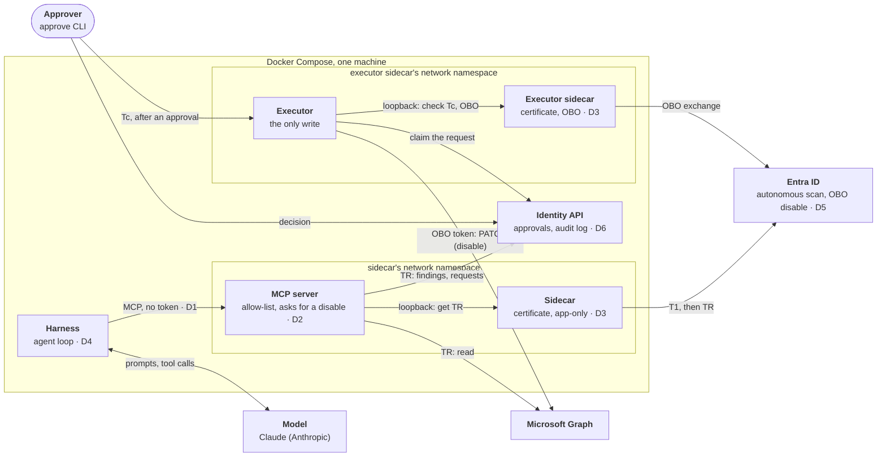
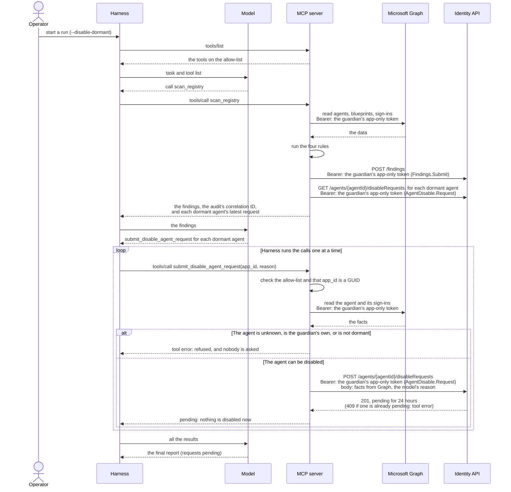
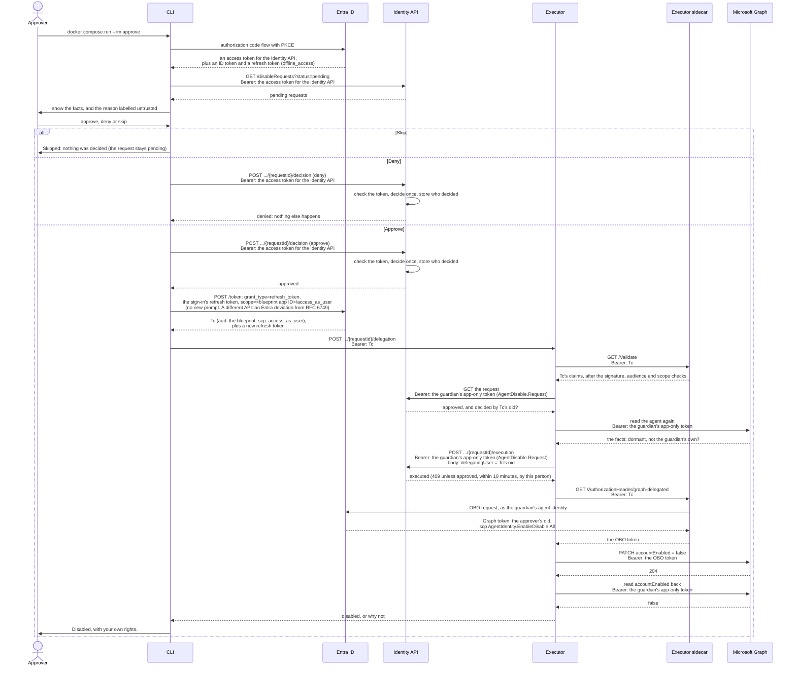
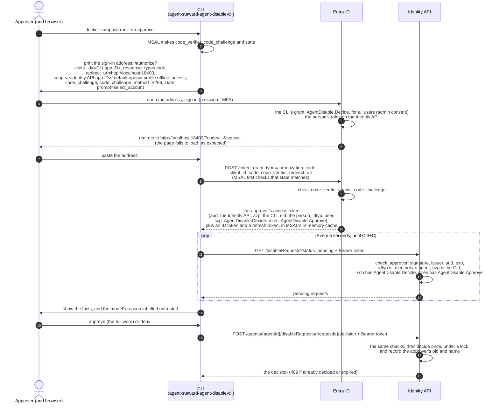

# Agent Steward Architecture: The Guardian's Design and Decisions

This document shows how this project's **Guardian** agent is built today: its parts, its main flows, and every shortcut it takes from the enterprise design, with the risk each one accepts. For the general design that the Guardian is compared with, see [Agent Architecture: The Enterprise Reference Design](agent-architecture.md). The decisions behind this design, with their reasons, are in the [decision log](decisions.md).

> **Current Implementation Status: Partly Built**
> * **Built:** The Entra identity, the sidecar (Microsoft Entra ID Auth SDK), the Identity API, the MCP server with three tools (`scan_registry` runs the Guardian's four registry rules, `get_agent` reads one agent, `submit_disable_agent_request` asks a human to approve disabling a dormant agent) and its tool allow-list, the executor, which does an approved disable with the approver's own rights (OBO), and the harness's agent loop with Claude. The Guardian's container cannot reach the sidecar, and an MCP integration test proves it.
> * **Run live:** both phases end to end, with the OBO disable, on 10 November 2026 ([the approve phase](#the-approve-phase)).
> * **Not built yet:** The correlation-ID scaffold across all components.
> 
> *(See [Delivery status](delivery-status.md) for live progress tracking).*

## Contents

* [1. The Guardian's Design Today](#1-the-guardians-design-today)
  * [Why the Guardian Uses a Model](#why-the-guardian-uses-a-model)
  * [Why the Guardian Runs as Itself, Not On Behalf of a User](#why-the-guardian-runs-as-itself-not-on-behalf-of-a-user)
  * [Component Inventory: Who Holds What?](#component-inventory-who-holds-what)
  * [The Two Phases: Propose, Then Approve](#the-two-phases-propose-then-approve)
  * [The Propose Phase](#the-propose-phase)
  * [The Approve Phase](#the-approve-phase)
  * [Architectural Shortcuts (Where the Guardian Differs)](#architectural-shortcuts-where-the-guardian-differs)
* [2. Blast Radius](#2-blast-radius)

---

## 1. The Guardian's Design Today

While our **Guardian** agent shares the same four-part conceptual anatomy, it runs locally on a single machine via Docker Compose. To fit our project's timebox, it takes six deliberate architectural shortcuts (labeled **D1** through **D6** in the diagram and detailed in [Architectural Shortcuts](#architectural-shortcuts-where-the-guardian-differs), at the end of this section). The decisions behind this design, with their reasons, are recorded in the [decision log](decisions.md).



### Why the Guardian Uses a Model

Every safety decision is deterministic, on purpose. The MCP server's rules decide which agents are flagged, the allow-list decides which tools exist, the MCP server checks each request, and the executor checks again before the write (the agent must be dormant and not the guardian's own), and a human approves each disable and lends their rights for it. The operator's `--disable-dormant` option only changes the model's task, so it is not a control.

The model is used where rules fail: scanning unstructured data, such as an agent's description, for malicious text. A rule could search for known words, but an attacker can reword the text easily. In the NFR3 agent eval, it flagged the planted prompt injection in a description on its own ([eval_prompt_injection.py](../tests/agent_eval/eval_prompt_injection.py)).

So if the model is wrong, the system stays safe, just less useful.

### Why the Guardian Runs as Itself, Not On Behalf of a User

The scan runs as the guardian's own agent identity (autonomous mode, client credentials) because of what the scan does. It reads the whole agent registry in the background, and nobody is signed in when it runs. OBO starts from a signed-in user's token, so there would be nothing to exchange. Microsoft Learn describes autonomous agents for exactly this kind of work: they "run in the background, making decisions and taking actions without human intervention", for example "processing scheduled maintenance tasks", and they use "their agent identity and the client credentials flow" ([Key concepts](https://learn.microsoft.com/en-us/entra/agent-id/key-concepts#autonomous-agents)).

Running as itself also keeps the scan consistent and least-privileged. With delegated permissions, the agent "can't exceed that user's access" ([Authorization in Agent ID](https://learn.microsoft.com/en-us/entra/agent-id/authorization-agent-id#delegated-microsoft-graph-permissions)), so what the scan sees would change with who signed in. As itself, the guardian always holds the same application permissions: four read-only Graph permissions for the scan, and no write permission: an approved disable runs with the approver's rights (below). So every run sees the same picture, and the Entra sign-in logs show every token request under the agent identity.

OBO still has a place in the design, but in the approve phase, not the propose phase ([the two phases](#the-two-phases-propose-then-approve)). **The agent proposes, and the approver decides.** No person starts a fix: the guardian proposes it from the scan, and the approver decides. So one person is enough for separation of duties: the agent is the proposer, and the approver is the decider.

So the approve phase also carries delegation. It was run live end to end on 10 November 2026:

1. **The approver signs in:** the approve CLI gets the usual token for the Identity API, and a second token for the blueprint's scope (Tc).
2. **The decision:** recorded at the Identity API.
3. **Tc reaches the executor:** the CLI sends it to the executor, a separate service with its own token sidecar, and the executor validates it. The Identity API never stores it, and the MCP server never sees it.
4. **The OBO exchange:** the executor exchanges Tc for a Microsoft Graph token with the guardian's delegated permission.
5. **The disable:** it runs with the approver's rights, so Graph checks that this person may disable agents.

So the guardian holds no standing write permission: its app-only write role was removed on 10 November 2026, which closed [A1](../THREATMODEL.md#accepted-risks). The audit names the agent that proposed and acted, and the person who decided and lent their rights. The hop from the harness to the MCP server still carries no token ([D1](#architectural-shortcuts-where-the-guardian-differs)), because Tc comes from the approve CLI, not from the harness. The general OBO design is in [DESIGN-NOTES.md](DESIGN-NOTES.md#6-delegation-and-on-behalf-of-obo-for-agents).

**Why a separate executor.** The MCP server runs the model's tool calls, so it handles untrusted input. The executor keeps the write away from that code:

- **Its own process and sidecar:** the executor runs as the same guardian agent identity, through a second sidecar. Only that sidecar has the OBO settings, and only the executor holds the write code.
- **Its own network:** the executor's sidecar is on the approval network, with the approve CLI and the Identity API. The harness is not on it, so the harness cannot reach the executor.
- **The write needs a person:** without an approver's Tc, nothing can write, and Tc goes only to the executor. So a compromised MCP server can still ask for a disable, but it cannot carry one out.
- **The same checks twice:** the executor runs the MCP server's checks again before the write (not the guardian's own, still dormant), from one shared module ([disable_checks.py](../src/mcp_server/disable_checks.py)).
- **The cost:** the blueprint's certificate is now in two sidecars, so a person on the host has two places to take it from ([D3](#architectural-shortcuts-where-the-guardian-differs)).

### Component Inventory: Who Holds What?

To verify our security posture, here is exactly what each container holds and what it can reach over the network:

| Component | Agent Part | Credentials Held | Network Reach |
|---|---|---|---|
| **Claude** | Model | *Nothing* | *Nothing* (only responds to incoming requests from the `guardian`). |
| **`guardian`** | Harness | Anthropic API key | Can reach Claude and `mcp-server`. **Cannot reach `sidecar`** (meaning it can never obtain an Entra token), and is not on the approval network, so it cannot reach the executor. |
| **`mcp-server`** | Tools | *No stored secrets* (requests app-only TR tokens on demand from `sidecar`). | Can reach `sidecar`, Microsoft Graph, and `identity-api`. Never receives an approver's token, and holds no write code. |
| **`sidecar`** | Token acquisition | The blueprint's certificate file. App-only settings only. | Can reach Entra ID. Listens strictly on loopback ([details](infra.md#local-run-the-sidecar)). |
| **`executor`** | The one write | *No stored secrets* (gets tokens from `executor-sidecar`; receives the approver's Tc for one request, never stores it). | Can reach `executor-sidecar`, Microsoft Graph, and `identity-api`. On the approval network, with the CLI and the Identity API. |
| **`executor-sidecar`** | Token acquisition, OBO | The blueprint's certificate file, plus the OBO settings. | Can reach Entra ID. Listens strictly on loopback. |
| **`approve`** | The approver's client (CLI) | The approver's tokens, in memory only. | Can reach `identity-api` and the executor. |
| **`identity-api`** | Resource API | *No secrets* (validates tokens using Entra's public signing keys). | *Nothing* (only responds to incoming API calls). |

*(Transport Note: The communication between the harness and the MCP server uses **MCP over Streamable HTTP**, the standard transport for standalone networked MCP services. The client sends each MCP message as an HTTP POST to a single `/mcp` endpoint, and the server either replies with a standard JSON payload or streams the response back over the same connection).*

### The Two Phases: Propose, Then Approve

The guardian's work has two phases, and each runs with different rights:

1. **The propose phase:** the autonomous part. The guardian scans the registry as itself, sends the findings to the audit log, and, on the `--disable-dormant` task, submits a disable request for each dormant agent. Nobody is signed in, and nothing in the tenant changes: the strongest thing this phase can do is ask.
2. **The approve phase:** the human part. Later, within 24 hours, an approver reviews each pending request in the CLI and approves, denies or skips it. Only an approval leads to a write: the executor disables the agent with the approver's own rights (OBO).

The two phases meet only at the Identity API, which stores the findings, the requests and the decisions. The propose phase does not wait for the approver: a later scan shows each request's status (pending, approved, denied, expired or executed).

### The Propose Phase

One run of the guardian on the `--disable-dormant` task. Every token is the guardian's own app-only token. On the default task, the run ends after the report, with no requests.

Who calls whom (an arrow points from the caller to the one it calls):

```text
Harness → MCP server → Graph           (reads the agent: app-only token)
          MCP server → Identity API    (creates the request: app-only token)
Harness ← MCP server                   ("pending", the tool returns at once)
```

The run ends there. Nothing waits. The same steps in detail:



* **Autonomous:** no person is signed in, so the guardian acts as itself (FR3).
* **It only asks:** the MCP server reads Graph and writes only to the Identity API. It holds no write code and never sees an approver's token.
* **The model chooses, the harness loops:** the model can ask for several requests in one answer, and the harness runs the calls one at a time.

### The Approve Phase

A person reviews the pending requests in the CLI, within 24 hours, and answers each one (FR7):

* **Approve:** the Identity API records the decision. Then the CLI lends the person's rights for that one request: it sends Tc to the executor, which disables the agent with OBO (FR4).
* **Deny:** the Identity API records the decision, and nothing else happens. A later propose phase may ask again.
* **Skip:** nothing is sent. The request stays pending, the CLI does not ask about it again in this session, and it expires after 24 hours if nobody decides.

Who calls whom after an approval (an arrow points from the caller to the one it calls):

```text
CLI → Entra              (sign-in, authorization code grant: returns an access token for the
                          Identity API, an ID token and a refresh token)
CLI → Identity API       (lists the requests, sends the decision: the access token for the Identity API)
CLI → Entra              (after "approve", refresh token grant with scope <blueprint>/access_as_user:
                          returns Tc and a new refresh token. ⚠️ A different API: an Entra deviation)
CLI → executor           (Tc)
      executor → executor sidecar   (validates Tc)
      executor → Identity API       (reads the request, then claims it: app-only token)
      executor → Graph              (re-checks the agent, reads back: app-only token)
      executor → executor sidecar → Entra   (exchanges Tc with OBO)
      executor → Graph              (the write: the OBO token, with the approver's rights)
CLI ← executor           ("disabled", or why not)
```

Four different tokens appear here. All four are access tokens, and each goes only where its audience allows:

* **The approver's token for the Identity API:** from the CLI to the Identity API, for the list and the decision. The sign-in returns it together with an ID token and a refresh token, because the CLI asks for `openid profile offline_access` too ([the sign-in](#the-approvers-sign-in-and-decision-step-by-step)).
* **Tc, the approver's token for the guardian's blueprint:** an access token like the others, with the blueprint as its audience and `scp: access_as_user`. The CLI gets it after an approval from the same sign-in: MSAL sends the sign-in's refresh token with a scope for the blueprint, so there is no second prompt. **That is an Entra deviation from the OAuth standard**, where a refresh can never reach a different API ([Deviation: one refresh token, many APIs](tokens.md#deviation-one-refresh-token-many-apis), with the references). It goes from the CLI to the executor, and from the executor to its sidecar. No resource ever receives it: Graph and the Identity API would reject it, because its audience is the blueprint, not them. OBO does not turn Tc into an access token, because it already is one: OBO exchanges it for another access token, for Graph.
* **The guardian's app-only tokens:** from the executor to the Identity API (to read and claim the request) and to Graph (to read the agent).
* **The OBO token:** from the executor to Graph, for the one write. It carries the approver and the guardian's delegated permission.

The same steps in detail:

> **Run live end to end on 10 November 2026, with this design:** the guardian asked for six dormant agents and got "pending" at once. One approval disabled `agent-steward-fixture-overperm-01` with the approver's rights: the executor's audit line says `mode: obo`, with the approver as `delegating_user` and `confirmed: true`, and the Entra admin center shows the agent as Disabled. Earlier, on 31 October 2026, the first design (one `disable_agent` tool that waited up to 4 minutes, and the guardian's own write role) disabled a fixture the same way.



Every refusal on the executor's path leaves the agent enabled: no token, a token that is not the approver's, a request that is not approved or already executed, an agent that is no longer dormant, a failed exchange or a failed write.

**Where the guardian differs from [the enterprise practice](agent-architecture.md#human-approval-who-approves-and-how):**

| Enterprise practice | The guardian | Why |
|---|---|---|
| A domain service does the write, with its own identity | The executor writes, as the guardian's agent identity, with the approver's delegated rights (OBO) | One identity keeps the OBO grants on one agent |
| A domain service checks the rules and reads the facts itself | The executor checks the rules against Graph again before the write, but the facts the approver sees come from the MCP server | Timebox |
| A notification delivers the request | The approver runs the CLI, which lists what is pending | No web page in the timebox |
| A local listener or a web page catches the sign-in redirect | The person pastes the final address into the terminal | The command runs in a container |
| A durable store | In memory. A restart loses pending requests, and nothing is disabled (fail closed) | Lab |
| An approval that is never carried out expires | It stays `approved`, and after 10 minutes it can no longer be executed. Nothing is disabled, and the CLI tells the approver | Known limit |

The next version would use URL-mode elicitation and an approval web page, on the same identity design.

#### The Approver's Sign-In and Decision, Step by Step

The CLI ([approve.py](../src/approve_cli/approve.py)) is the client application `agent-steward-agent-disable-cli`. It gets a delegated token for the Identity API with the authorization code flow and PKCE ([ADR-002](decisions.md#adr-002-the-approver-signs-in-with-the-authorization-code-flow-not-the-device-code-flow)). The CLI itself does no OBO. It calls the Identity API with this token directly: OBO only makes sense when a service sits between the person and the API, and the next service decides per user ([when OBO fits](jwt-bearer-and-token-exchange.md#g-when-obo-fits)). After an approval, it gets a second token, Tc, from the same sign-in, and hands it to the executor (the flow above).



The token answers two questions: `scp` says the CLI may send decisions for this person, and `roles` says this person may approve. `azp` is a third check, in case the scope is ever granted to another app by mistake.

### Architectural Shortcuts (Where the Guardian Differs)

| ID | Enterprise Reference Design | The Guardian Today | Why We Took the Shortcut | Risk Accepted |
|---|---|---|---|---|
| **D1** | The harness sends a bearer token to the MCP server, which validates it. | **No token:** The MCP server relies on Docker network isolation, trusting that only the Guardian container can reach it. Because it does not know who calls it, its tool allow-list is one list for every caller, not a role-to-tool mapping per agent. | Project timebox. | Any code that manages to reach the MCP server's network port can invoke allow-listed tools. |
| **D2** | The MCP server has its own Entra identity and serves multiple agents. | **Shared Identity:** The MCP server serves *only* the Guardian and fetches tokens using the Guardian's identity (it acts as the Guardian itself). | Keeping one identity and one sidecar is simpler, and ensures no Entra token ever reaches the harness. | The MCP server cannot be shared with other agents. If compromised, it can request tokens for *any* agent identity under the blueprint (since the sidecar lets callers specify which agent identity they want). |
| **D3** | The blueprint authenticates via an Azure Managed Identity (zero keys on disk). | **Certificate File:** A certificate file is mounted only into the two sidecar containers: the MCP server's and the executor's ([details](infra.md#the-blueprints-credential)). | The demo runs locally in Docker, not in Azure. | If the certificate file is stolen from disk, every agent identity tied to the blueprint is exposed. |
| **D4** | No static model key: the harness authenticates to the model provider with workload identity federation (or, failing that, reads a key from a cloud vault). | **API Key File:** An Anthropic service account API key in `secrets/anthropic.env` (the folder is excluded via `.gitignore`), given only to the guardian container. | Local demo environment, with no managed identity to federate. | The Anthropic API key sits unencrypted on the host disk. |
| **D5** | Supports Delegated mode with OBO when a human user is present. | **Autonomous propose phase, OBO in the approve phase:** the scan runs as the guardian, and the disable runs with the approver's rights, in the executor. Built, and run live on 10 November 2026. | The scan needs no user ([why](#why-the-guardian-runs-as-itself-not-on-behalf-of-a-user)). | Only the disable uses OBO. The other fixes in FR4 (remove a permission, assign a sponsor) are not built. |
| **D6** | Audit logs and distributed traces ship to a central SIEM/sink. | **Local Logs:** Audit lines and traces are written locally. One trace ID across the Guardian, the MCP server and the Identity API is planned (FR8). | Project timebox. | All audit logs reside on the same single machine. |

For the credential options behind D2, D3 and D4, and how to move from the Guardian's shortcuts to the enterprise design, see [Credentials and Tokens](authentication.md#3-credentials-and-tokens-how-a-workload-gets-them).

---

## 2. Blast Radius

What happens if one part of the Guardian is compromised, part by part, is in the threat model: [Blast Radius](../THREATMODEL.md#blast-radius-what-happens-if-one-part-is-compromised).
