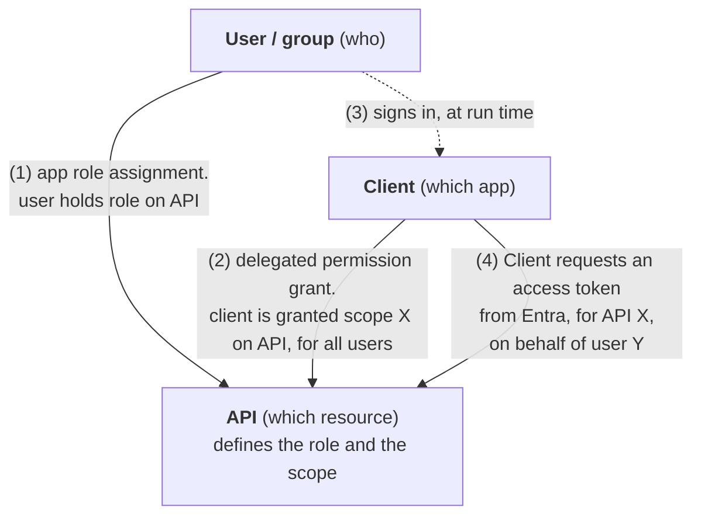
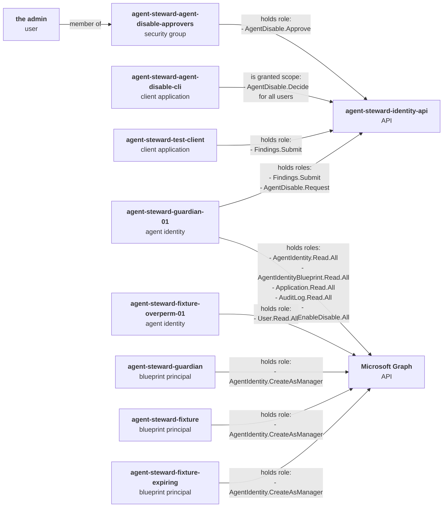
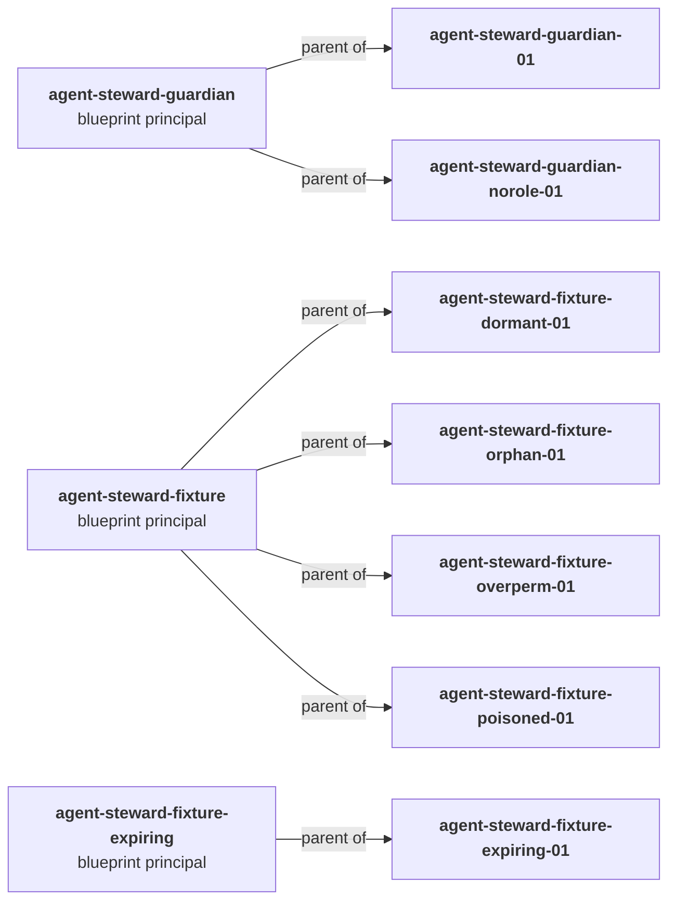

# Applications and APIs in Entra

This page explains what an application, a client and an API are in Entra, and how roles and scopes reach a token. It ends with every binding in this project's tenant. For how each caller proves who it is, see [Authentication](authentication.md).

## Contents

- [Roles and Scopes](#roles-and-scopes)
- [Applications, Clients and APIs](#applications-clients-and-apis)
- [One API, Many Permissions](#one-api-many-permissions)
- [The Two Flows](#the-two-flows)
- [How the Links Join in One Token](#how-the-links-join-in-one-token)
- [Our Tenant: Every Binding in the Project](#our-tenant-every-binding-in-the-project)
  - [Permissions: Who May Do What](#permissions-who-may-do-what)
  - [Agent Structure: Blueprints](#agent-structure-blueprints)

## Roles and Scopes

- **Role:** what the caller may do. Used when the caller acts alone, with no end user involved, and also for a user's own role.
- **Scope:** what a caller may do when it acts for a user. Used when an end user is involved and has to give consent, or an admin consented for them. Entra calls scopes "delegated permissions".

## Applications, Clients and APIs

An application is an OAuth client, an OAuth resource (API), or both.

- **When an application does not expose permissions,** it is just a client: it can get tokens for other APIs (apps that expose permissions). Use cases:
  - Sign people in.
  - Call an API for a user.
  - Call an API as itself.
  - Single sign-on (SSO) to a SaaS product.
- **When an application exposes permissions,** it is called an API. It can be a client too.

In Entra, an API is an application that exposes permissions. An application can do one job, the other, or both:

| Job | Means | Example |
|---|---|---|
| OAuth client | It asks for tokens to call other APIs. | `agent-steward-agent-disable-cli` |
| Resource (the API job) | Tokens are made for it, because it defines scopes or app roles. | `agent-steward-identity-api` |
| Both | It receives tokens and also gets tokens to call others. | The MCP server in the enterprise design: an API for the harness, and a client for the APIs behind it (rows 6 to 8 in [authentication.md](authentication.md#who-proves-to-whom)) |

**API:** in Entra, "an API" means an application that exposes permissions (scopes, app roles, or both), so tokens can be issued for it. Microsoft also calls it a resource application, or a "web API".

**App-only access:** when a client needs app-only tokens for an API (no user), the API defines app roles with member type "Applications", and an admin assigns them to the client. Entra calls that assignment an "application permission". The API itself is not called to obtain tokens: Entra issues them.

```
Client  ──(1) asks for a token for the API──►  Entra
Client  ◄─(2) token: aud = API, roles = [...]── Entra
Client  ──(3) calls with the token──────────►  API (the running code checks aud and roles)
```

Example: the guardian gets an app-only token for `agent-steward-identity-api` with the roles `Findings.Submit` and `AgentDisable.Request`.

## One API, Many Permissions

An API with roles only:

```
One application  =  one API  =  one `aud`  =  one OAuth resource
                     │
                     ├── role   Findings.Submit         ┐  many permissions,
                     ├── role   AgentDisable.Request    │  all on the same API
                     └── role   AgentDisable.Approve    ┘
```

You add scopes (the "Expose an API" page) only when delegated permissions are needed, that is, when a user is involved:

```
One application  =  one API  =  one `aud`  =  one OAuth resource
                     │
                     ├── scope  AgentDisable.Decide     ┐
                     ├── role   Findings.Submit         │  many permissions,
                     ├── role   AgentDisable.Request    │  all on the same API
                     └── role   AgentDisable.Approve    ┘
```

One API can accept calls with a scope, with a role, or with both. Which one the caller brings depends on whether a person is signed in:

| Caller | It comes with | Where the API defines it |
|---|---|---|
| An app or an agent alone (no person) | A role, in `roles` | The App roles page, with member type "Applications" |
| A client app acting for a signed-in person | A scope, in `scp`, and maybe the person's role, in `roles` | The scope on the Expose an API page. The person's role on the App roles page, with member type "Users/Groups". |

Our Identity API uses both:

- **The guardian** (alone) calls with the role `AgentDisable.Request`.
- **The `approve` command** (for the signed-in approver) calls with the scope `AgentDisable.Decide` and the approver's role `AgentDisable.Approve`.

The running code decides which one each endpoint needs. Entra only writes the claims into the token, and the API reads them. For example, the decision endpoint requires the scope and the role together.

## The Two Flows

The two flows, with their OAuth and Entra names. OAuth names roles and grants. Entra names objects and flows. Where OAuth says "grant", Entra says "flow".

**The delegated flow:** a client gets a token from Entra for an API when a user is involved.

| Part | OAuth name | Entra name |
|---|---|---|
| Flow | **Authorization code grant** ([RFC 6749 §4.1](https://www.rfc-editor.org/rfc/rfc6749#section-4.1)) + PKCE ([RFC 7636](https://www.rfc-editor.org/rfc/rfc7636)); **device authorization grant** ([RFC 8628](https://www.rfc-editor.org/rfc/rfc8628)) | **Authorization code flow**; **device code flow**; **On-Behalf-Of (OBO) flow** (Entra only: it uses the JWT bearer grant, [RFC 7523](https://www.rfc-editor.org/rfc/rfc7523), not RFC 8693) |
| Client | **Client**: public or confidential ([RFC 6749 §2.1](https://www.rfc-editor.org/rfc/rfc6749#section-2.1)) | **Client application** (an application and its service principal). MSAL: `PublicClientApplication` or `ConfidentialClientApplication` |
| API | **Resource server** (the running service); its ID in the token is the **audience** | **API**, **resource application** or **web API** (an application that exposes scopes) |
| User | **Resource owner** ([RFC 6749 §1.1](https://www.rfc-editor.org/rfc/rfc6749#section-1.1)) | **Signed-in user**; in Agent ID, also an **agent's user account** |
| Permission | **Scope** | **Delegated permission** |
| Claim | `scope` ([RFC 9068](https://www.rfc-editor.org/rfc/rfc9068#section-2.2.3)) | `scp` |

Entra's access tokens have no `scope` claim. They use `scp`.

**The app-only flow:** a client gets a token from Entra for an API when no user is involved.

| Part | OAuth name | Entra name |
|---|---|---|
| Flow | **Client credentials grant** ([RFC 6749 §4.4](https://www.rfc-editor.org/rfc/rfc6749#section-4.4)) | **Client credentials flow**; the access is called **app-only access** |
| Client | **Confidential client** | **Client application**, **managed identity** or **agent identity** (the last two are Entra only) |
| API | **Resource server**; **audience** in the token | **API**, **resource application** (an application that defines app roles) |
| User | none (the client acts as itself) | none |
| Permission | **Scope**: OAuth allows scopes here too | **Application permission**: an app role assigned to the client |
| Claim | `scope`; `roles` is optional ([RFC 9068 §2.2.3.1](https://www.rfc-editor.org/rfc/rfc9068#section-2.2.3.1)) | `roles` only, never `scp` |

## How the Links Join in One Token

**The three boxes of the delegated flow:** two lasting links in Entra, and one sign-in at run time that joins them.



| # | Link | Kind | How to read it | Puts into the token |
|---|---|---|---|---|
| 1 | User/group → API | **App role assignment** (lasting record) | User **holds** role `AgentDisable.Approve` **on** API | `roles: AgentDisable.Approve` |
| 2 | Client → API | **Delegated permission grant** (lasting record) | Client **is granted** scope `AgentDisable.Decide` **on** API, **for** all users | `scp: AgentDisable.Decide` |
| 3 | User → Client | **Sign-in** (only at run time, no record) | User **signs in through** client | `oid`, `name`: who signed in |

When the user signs in through the client, Entra checks both links and writes one token with both claims:

- **Link 1 missing** (the user is not in the group): the token has no role, and the API refuses the call.
- **Link 2 missing** (no consent for that client): Entra issues no token, so the call never reaches the API.

**"For all users"** is the grant's `consentType`:

| `consentType` | How to read it | Who gives it |
|---|---|---|
| `AllPrincipals` | Client is granted scope on API, **for all users** in the tenant | An admin (admin consent) |
| `Principal` | Client is granted scope on API, **for one user** (named in `principalId`) | That user, at a consent prompt (user consent) |

"For all users" does not mean that all users can approve. The client may act for any user who signs in, and link 1 (the role) decides who can do anything.

App-only access is the same picture without the user box and without link 3: link 1 goes from the client itself to the API.

## Our Tenant: Every Binding in the Project

Read from the tenant on 31 October 2026. Two diagrams, because one would have too many lines: the first shows **who may do what** (roles, scopes, membership), the second shows **how the agents are built** (blueprints).

### Permissions: Who May Do What



| Link | Kind (Graph object) | Binding attribute |
|---|---|---|
| admin → approvers group | Group membership | `members` |
| approvers group → identity API | App role assignment (`appRoleAssignment`) | `appRoleId`: `AgentDisable.Approve` |
| disable CLI → identity API | Delegated permission grant (`oauth2PermissionGrant`) | `scope`: `AgentDisable.Decide`, `consentType`: `AllPrincipals` |
| test client → identity API | App role assignment | `appRoleId`: `Findings.Submit` |
| guardian → identity API | App role assignment | `appRoleId`: `Findings.Submit`, `AgentDisable.Request` |
| guardian → Microsoft Graph | App role assignment | `appRoleId`: 4 read roles and `AgentIdentity.EnableDisable.All` |
| overperm fixture → Microsoft Graph | App role assignment | `appRoleId`: `User.Read.All`, the deliberate flaw the guardian must find |
| each blueprint principal → Microsoft Graph | App role assignment | `appRoleId`: `AgentIdentity.CreateAsManager`, so the blueprint can create its own agent identities |

`agent-steward-guardian-norole-01` and the other fixture agents hold no roles, so they have no line here.

### Agent Structure: Blueprints



| Link | Kind | Binding attribute |
|---|---|---|
| blueprint → agent identity | Parent link | `agentIdentityBlueprintId` on the agent identity |
