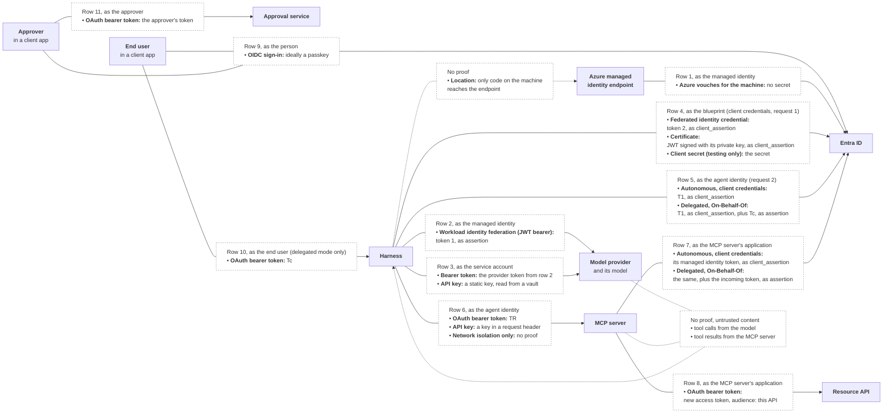
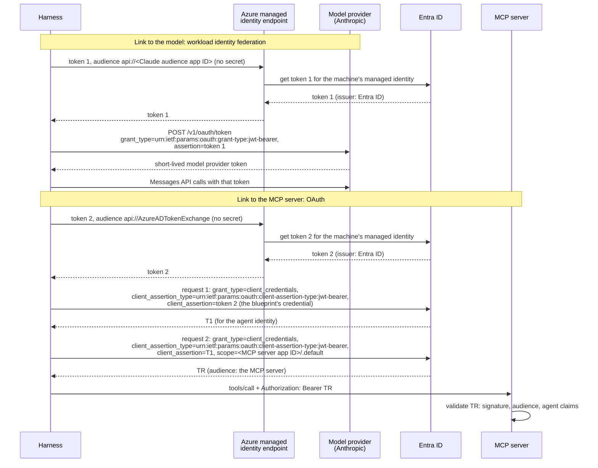

# Authentication: Who Proves What to Whom, and How

Every part of an agent that calls a protected service must prove who it is. This document shows who proves what to whom in the enterprise reference design, one proof at a time, and then how a workload gets its credential and its tokens. The last section gives the Guardian's differences.

For the enterprise design, see [Agent architecture](agent-architecture.md). For the Guardian's shortcuts (D1 to D6), see [Agent Steward architecture](agent-steward-architecture.md#architectural-shortcuts-where-the-guardian-differs). For the two Agent ID token requests (T1 and TR), see [Agent ID](agent-id.md#3-getting-a-token-the-agent-autonomous-app-flow), and for the claims in each token, see [Agent tokens](tokens.md).

## Contents

- [1. The High-Level View](#1-the-high-level-view)
  - [The Pattern and the General Rules](#the-pattern-and-the-general-rules)
  - [Who Proves to Whom](#who-proves-to-whom)
- [2. Deep Dive: Each Kind of Proof](#2-deep-dive-each-kind-of-proof)
  - [The Harness's Proofs, in Order](#the-harnesss-proofs-in-order)
  - [Part A: A Workload Proves Itself to Entra ID](#part-a-a-workload-proves-itself-to-entra-id)
  - [Part B: A Workload Proves Itself to the Model Provider](#part-b-a-workload-proves-itself-to-the-model-provider)
  - [Two Values That Look Alike](#two-values-that-look-alike)
  - [Part C: A Person Proves Who They Are](#part-c-a-person-proves-who-they-are)
  - [Part D: A Token Proves the Caller to a Service](#part-d-a-token-proves-the-caller-to-a-service)
  - [Part E: Where Nothing Is Proved](#part-e-where-nothing-is-proved)
- [3. Credentials and Tokens: How a Workload Gets Them](#3-credentials-and-tokens-how-a-workload-gets-them)
  - [Layer 1: The Client Credential](#layer-1-the-client-credential)
  - [Layer 2: Who Gets the Tokens](#layer-2-who-gets-the-tokens)
- [4. The Guardian](#4-the-guardian)

---

## 1. The High-Level View

### The Pattern and the General Rules

Each proof has three parts. The **authentication method** is how the caller proves who it is. The **credential** is what it sends as proof. The **trust relationship** is what an admin set up in advance, so the receiver knows which credential to accept.

Most calls have two proofs. First, the caller proves itself to an **issuer** and gets a token. Then it shows that token to the **receiver**, which checks it without calling the caller back. So one component can prove different identities in one run: the harness proves as a managed identity, as the blueprint and as the agent identity.

The general rules:

* **One audience per token:** Each token names its receiver in `aud`, and each receiver accepts only its own audience.
* **No token passthrough:** Each hop gets a new token, never the one it received ([why](agent-architecture.md#four-architectural-pillars)).
* **Short lifetimes:** A stolen token is useful only for a short time.
* **No stored secret where possible:** A platform identity is better than a key in a file ([section 3](#3-credentials-and-tokens-how-a-workload-gets-them)).
* **Content is not a caller:** Tool calls and tool results prove nothing, so they stay untrusted data ([Part E](#part-e-where-nothing-is-proved)).

Every link also runs over TLS. TLS proves the other direction: the server certificate shows the caller that it reached the right service.

### Who Proves to Whom

The boxes are components. Each arrow goes from the component that makes the call to the one that receives it. Its label gives the row in the table below, the identity that proves ("as ..."), then each option in bold with its credential. Where there are several options, the first one is the recommended choice for production. Dotted arrows carry no proof.

The table shows the recommended option for each proof. The other options are in the deep dive.

| # | Who proves | To whom | Authentication method | Credential | Trust relationship | Gets |
|---|---|---|---|---|---|---|
| 1 | Managed identity | Entra ID | Managed identity: the platform vouches for the machine | None. Only code on that machine can reach the local endpoint. | An admin assigns a user-assigned managed identity to the machine | Tokens 1 and 2 |
| 2 | Managed identity | Model provider | Workload identity federation (JWT bearer grant) | Token 1, as `assertion` | An app registration that stands for the Claude API audience, plus a service account, a federation issuer and a federation rule in the Claude Console | Provider token |
| 3 | The harness's service account | Model provider | Bearer token | The provider token from row 2 | The service account named in the federation rule | Model access |
| 4 | Blueprint | Entra ID | Client credentials grant, with a federated identity credential | Token 2, as `client_assertion` | A federated identity credential on the blueprint: issuer, subject, audience | T1 |
| 5 | Agent identity | Entra ID | Client credentials grant | T1, as `client_assertion` | The parent link from the agent identity to its blueprint, plus app roles granted by an admin | TR |
| 6 | Agent identity | MCP server | OAuth bearer token | TR | Entra's public signing keys, plus an app role assignment for the agent identity on the MCP server's app | Tool call |
| 7 | MCP server's application | Entra ID | Client credentials grant, with a federated identity credential | Its managed identity token, as `client_assertion` | A federated identity credential on its app registration, plus app roles on each API | Token for the API |
| 8 | MCP server's application | Resource API | OAuth bearer token | That token, audience: this API | Entra's public signing keys, plus an app role assignment for the MCP server on this API | API call |
| 9 | End user or approver | Entra ID | OpenID Connect sign-in in a client app | What the person signs in with, ideally a passkey | The person's account in the tenant | The person's token |
| 10 | End user (delegated mode only) | Harness | OAuth bearer token | Tc | The blueprint exposes a scope, so Tc's audience is the blueprint | Delegated run |
| 11 | Approver | Approval service | OAuth bearer token | The approver's access token | The service exposes a scope that an admin consented to, and an admin assigns the approver role to a group of approvers | Recorded decision |

The MCP server gets its managed identity token the same way as in row 1, so the diagram does not draw that arrow twice.

---

## 2. Deep Dive: Each Kind of Proof

### The Harness's Proofs, in Order

The harness talks to two services, and each one trusts a different credential. In the enterprise design, both credentials start from one managed identity. The harness never sends a managed identity token to the Messages API or to the MCP server. It uses each one only to *get* the credential that the receiver accepts:

1. **Two managed identity tokens, one for each receiver (row 1):** The harness asks the local Azure endpoint twice: token 1 for the model provider, and token 2 for the blueprint ([Part A](#part-a-a-workload-proves-itself-to-entra-id)).
2. **To the model provider, workload identity federation (rows 2 and 3):** The harness sends token 1 to the provider's `POST /v1/oauth/token` and gets a short-lived provider token. It calls the model with that token ([Part B](#part-b-a-workload-proves-itself-to-the-model-provider)).
3. **To Entra, request 1, T1 (row 4):** In a request with `grant_type=client_credentials`, the harness sends token 2 as `client_assertion`, with `client_assertion_type=urn:ietf:params:oauth:client-assertion-type:jwt-bearer`. Token 2 is the *blueprint's* credential (a federated identity credential, FIC). The harness gets T1, which Microsoft calls the exchange token, for the agent identity.
4. **To Entra, request 2, TR (row 5):** In a second request with `grant_type=client_credentials`, the harness sends T1 as `client_assertion`, with the same `client_assertion_type`, to sign in as the *agent identity*, asks for the scope `<MCP server app ID>/.default`, and gets TR (Microsoft's name for the resource access token). TR's audience is the MCP server.
5. **To the MCP server, OAuth (row 6):** The harness calls the MCP server with `Authorization: Bearer <TR>`. The MCP server validates TR the way any resource API does: signature, audience, and the agent claims (for example `xms_act_fct` containing 11).

### Part A: A Workload Proves Itself to Entra ID

**In short:** The chain is managed identity, then blueprint, then agent identity. Each step's token is the credential for the next one. The MCP server proves itself with a credential of its own.

**The managed identity (row 1).** Azure gives a managed identity to the machine the harness runs on. The harness asks the local Azure endpoint for a token, and the endpoint gets it from Entra ID for that managed identity. So a managed identity token is an Entra-issued token. Trust: an admin assigns a user-assigned managed identity to the machine. Only a user-assigned managed identity can be a federated identity credential ([source](https://learn.microsoft.com/en-us/entra/workload-id/workload-identity-federation-config-app-trust-managed-identity)).

**Two managed identity tokens, one for each receiver.** Each receiver accepts only its own audience, so the harness asks twice:

* **Token 1, for the model provider,** with the audience `api://<Claude audience app ID>`. Entra issues a token only for an audience that exists in the tenant, so an admin first creates an app registration that stands for the Claude API ([source](https://platform.claude.com/docs/en/manage-claude/wif-providers/azure)).
* **Token 2, for the blueprint,** with the audience `api://AzureADTokenExchange`, which a federated identity credential requires ([source](https://learn.microsoft.com/en-us/entra/workload-id/workload-identity-federation-config-app-trust-managed-identity)).

Two tokens, not one, because a token that worked at both receivers could be replayed from one to the other: whoever holds token 1 could use it at Entra as the blueprint's credential.

**The blueprint, request 1 (row 4).** The options for the blueprint's credential:

| Option | Credential | Trust |
|---|---|---|
| Federated identity credential (recommended) | Token 2, as `client_assertion` | A federated identity credential on the blueprint: issuer, subject, and audience `api://AzureADTokenExchange` ([source](https://learn.microsoft.com/en-us/entra/workload-id/workload-identity-federation-config-app-trust-managed-identity)) |
| Certificate | A JWT signed with the certificate's private key, as `client_assertion` (RFC 7523) | The certificate's public key, uploaded to the blueprint |
| Client secret (testing only, [source](https://learn.microsoft.com/entra/agent-id/agent-autonomous-app-oauth-flow)) | The secret | The secret, registered on the blueprint |

**The agent identity, request 2 (row 5).** TR's audience is the MCP server, and its `roles` claim holds only the roles the agent has *on the MCP server*: never its roles on other APIs. The agent cannot pick a subset of those roles (see [App-Only Tokens and the `.default` Scope](agent-id.md#app-only-tokens-and-the-default-scope)), but it always picks which API the token is for. This is Microsoft's agent autonomous app flow, described in [Agent ID](agent-id.md#3-getting-a-token-the-agent-autonomous-app-flow).

| Mode | Grant type | Credential | Trust |
|---|---|---|---|
| Autonomous | `client_credentials` | T1, as `client_assertion` | The parent link from the agent identity to its blueprint, plus app roles granted by an admin ([source](https://learn.microsoft.com/entra/agent-id/agent-autonomous-app-oauth-flow)) |
| Delegated (On-Behalf-Of) | `urn:ietf:params:oauth:grant-type:jwt-bearer` | T1, as `client_assertion`, plus the user's token (Tc), as `assertion` | The same parent link, plus delegated permissions an admin consented to on the blueprint (inheritable permissions). Entra also checks that Tc was issued for the blueprint ([source](https://learn.microsoft.com/entra/agent-id/agent-on-behalf-of-oauth-flow)). |

Conditional Access policies for agents apply only in the autonomous mode, when the agent uses its own identity. In the delegated mode, the user's policies apply instead ([source](https://learn.microsoft.com/en-us/entra/identity/conditional-access/howto-target-agent-identities)).

**The MCP server's application (row 7).** It proves itself with its own credential, not with the token it received.

| Mode | Grant type | Credential | Trust |
|---|---|---|---|
| Autonomous | `client_credentials` | A managed identity token, as the `client_assertion` of the MCP server's own app registration ([source](https://learn.microsoft.com/en-us/entra/workload-id/workload-identity-federation-config-app-trust-managed-identity)) | A federated identity credential on the MCP server's app registration that trusts its managed identity, plus app roles on each API |
| Delegated (On-Behalf-Of) | `urn:ietf:params:oauth:grant-type:jwt-bearer` | The same, plus the incoming token that carries the user, as `assertion` | The same federated identity credential, plus consented delegated permissions: OBO uses only delegated scopes, never app roles. Entra also checks that the incoming token was issued for the MCP server ([source](https://learn.microsoft.com/en-us/entra/identity-platform/v2-oauth2-on-behalf-of-flow)). |

**Deviations.** Entra's request 1 goes beyond RFC 7523, and its On-Behalf-Of flow reuses the JWT bearer value with its own rules: [Two Values That Look Alike](#two-values-that-look-alike).

### Part B: A Workload Proves Itself to the Model Provider

**In short:** The harness swaps an Entra-issued token for a short-lived provider token, so no API key has to exist.

**With workload identity federation (rows 2 and 3, recommended).** The harness sends token 1 to the provider's `POST /v1/oauth/token`, with `grant_type=urn:ietf:params:oauth:grant-type:jwt-bearer` and token 1 as `assertion`, and gets a short-lived provider token. Anthropic checks token 1 against its federation rule: the issuer (the tenant's Entra ID), the subject (the managed identity's object ID) and the audience. The harness calls the model with the provider token, and the SDK renews it before it expires. No API key exists. Trust: an app registration in Entra that stands for the Claude API audience, plus three objects in the Claude Console: a service account, a federation issuer and a federation rule ([source](https://platform.claude.com/docs/en/manage-claude/wif-providers/azure)).

**With an API key (row 3).** A static key, read from a vault, and created for a service account in the Claude Console.

**Other providers of the identity token.** The token can come from an identity provider the workload already has: AWS IAM, Google Cloud, or any standard OIDC issuer. Anthropic's documentation names Microsoft Entra ID among them. Anthropic also supports App Attest for iOS and macOS apps.

**A caveat from Anthropic.** The trust chain is only as strong as the identity provider's configuration, so a long-lived secret one step earlier in the chain can still undermine it.

**Deviations.** Anthropic adds parameters of its own: [Two Values That Look Alike](#two-values-that-look-alike).

Sources: [Claude API authentication](https://platform.claude.com/docs/en/manage-claude/authentication) (checked 28 October 2026) and [Use WIF with Microsoft Entra ID](https://platform.claude.com/docs/en/manage-claude/wif-providers/azure) (checked 29 October 2026).

### Two Values That Look Alike

RFC 7523 defines two ways to send a JWT to a token endpoint, and each way has its own value. Vendors reuse both values with rules of their own, so the value alone does not tell you what a request means.

* `grant_type=urn:ietf:params:oauth:grant-type:jwt-bearer`: the JWT is the *grant*, sent in `assertion` ([RFC 7523, section 2.1](https://www.rfc-editor.org/rfc/rfc7523.html#section-2.1)).
  * **Anthropic (step 2)** uses it as the RFC describes: a JWT from another issuer, Entra ID, is the grant. It adds parameters of its own: the federation rule, the organization, the service account and the workspace. Why the grant and not a client assertion: [Grant or Client Assertion](jwt-bearer-and-token-exchange.md#51-anthropic-uses-the-grant-not-a-client-assertion).
  * **Entra's On-Behalf-Of flow** reuses the same value as a Microsoft extension, with `requested_token_use=on_behalf_of`. Its assertion is the access token the middle tier received, so the audience is the middle tier. RFC 7523 says a token endpoint must reject a JWT whose audience is not the token endpoint itself ([section 3](https://www.rfc-editor.org/rfc/rfc7523.html#section-3)). So OBO is neither plain RFC 7523 nor RFC 8693 token exchange ([On-Behalf-Of flow](https://learn.microsoft.com/entra/identity-platform/v2-oauth2-on-behalf-of-flow)).
* `client_assertion_type=urn:ietf:params:oauth:client-assertion-type:jwt-bearer`: the JWT proves who the *client* is, in place of a secret, sent in `client_assertion`. The grant is something else, here `client_credentials` ([RFC 7523, section 2.2](https://www.rfc-editor.org/rfc/rfc7523.html#section-2.2)).
  * **Entra's requests 1 and 2 (steps 3 and 4)** use it. Request 1 also goes beyond the RFC. The RFC says the JWT's subject must be the client's ID, but token 2's subject is the managed identity's object ID. Entra accepts it because the blueprint's federated identity credential names that issuer and subject ([source](https://learn.microsoft.com/en-us/entra/workload-id/workload-identity-federation-config-app-trust-managed-identity)). `fmi_path`, which names the agent identity, is a Microsoft extension too.

The two questions every token request answers (who is asking, and what token for whom), what each value sends and gets back, the RFC 8693 token exchange grant, and why OBO is not RFC 8693: [JWT Bearer and Token Exchange](jwt-bearer-and-token-exchange.md).

### Part C: A Person Proves Who They Are

**In short:** A person never sends a password to the agent. The person proves who they are to Entra ID (row 9), and a client app gets a token for them.

**The end user (row 9, then row 10, delegated mode only).** The method is OpenID Connect sign-in in a client app (authorization code flow with PKCE). The blueprint cannot run the sign-in itself, and neither can its agent identities: Microsoft says they "can't initiate interactive authorization (`/authorize`) flows directly" and "must receive a user token from a client application" ([source](https://learn.microsoft.com/entra/agent-id/agent-on-behalf-of-oauth-flow)). At sign-in, the user proves who they are, ideally with phishing-resistant MFA such as a passkey. The client app then holds the user's access token, Tc.

**The approver (row 9, then row 11).** The approver signs in the same way at approval time, in a client app, and also ideally with phishing-resistant MFA. Trust: the approval service exposes a scope, and an admin consents to it for the client app. An admin assigns the approver role to a group of approvers.

**Deviations.** No spec defines the approval design above: it is one common design. With MCP URL-mode elicitation, the MCP server sends the person to a web page, and the server must check who opened it ([source](https://modelcontextprotocol.io/specification/2026-07-28/client/elicitation), checked 30 October 2026).

### Part D: A Token Proves the Caller to a Service

**In short:** The receiver does not call the issuer for each request. It checks the token itself, with Entra's public signing keys ([checks](tokens.md#what-an-api-must-check)). What it checks depends on the caller:

| Row | Caller's identity → Receiver | Token | The receiver checks | Trust set up in advance |
|---|---|---|---|---|
| 6 | Agent identity → MCP server | TR | Signature, audience, and the agent claims (for example `xms_act_fct` containing 11) | An app role assignment for the agent identity on the MCP server's app |
| 8 | MCP server's application → Resource API | A new access token, audience: this API, never the token the MCP server received | `aud` and `roles` (or `scp` and the user, with OBO) | An app role assignment (or delegated permission) for the MCP server on this API |
| 10 | End user → Harness | Tc | Signature, audience and `scp` | The blueprint exposes a scope, so Tc's audience is the blueprint ([source](https://learn.microsoft.com/entra/agent-id/agent-on-behalf-of-oauth-flow)) |
| 11 | Approver → Approval service | The approver's access token | Signature, audience, scope (`scp`), role (`roles`), and that the caller is a person, not an agent. Then it records the approver. | The scope and the approver role ([Part C](#part-c-a-person-proves-who-they-are)) |

**Other option for row 6.** An API key in a request header, which the MCP server issued and stores. Network isolation is the third option, and it proves nothing ([Part E](#part-e-where-nothing-is-proved)).

**Deviations.** RFC 9068, the JWT profile for access tokens, requires a `client_id` claim ([section 2.2](https://www.rfc-editor.org/rfc/rfc9068.html#section-2.2)). Entra's access tokens carry the same fact in `azp` (v2.0 tokens) or `appid` (v1.0 tokens) instead ([source](https://learn.microsoft.com/en-us/entra/identity-platform/access-token-claims-reference)).

### Part E: Where Nothing Is Proved

**In short:** Three links carry no proof of who is calling, and each one has a different reason:

* **Tool calls from the model, and tool results from the MCP server:** This is content, not a caller. TLS only proves which service sent it, so the harness treats it as untrusted data.
* **The harness to the managed identity endpoint:** The harness sends no credential. Only code on that machine can reach the local endpoint, so location does the work.
* **Network isolation in front of the MCP server:** Any code that reaches the port is trusted.

**Deviations.** The MCP specification treats authorization as optional, and implementations with the STDIO transport should not follow it, but take credentials from the environment instead ([source](https://modelcontextprotocol.io/specification/2026-07-28/basic/authorization)). So a server with no authentication can still follow the spec.

Sources for section 2 (Microsoft Learn, checked 29 October 2026): [Agent autonomous app OAuth flow](https://learn.microsoft.com/entra/agent-id/agent-autonomous-app-oauth-flow), [Agent OAuth flows: On-behalf-of flow](https://learn.microsoft.com/entra/agent-id/agent-on-behalf-of-oauth-flow), [Configure an application to trust a managed identity](https://learn.microsoft.com/en-us/entra/workload-id/workload-identity-federation-config-app-trust-managed-identity), [Microsoft identity platform and OAuth 2.0 On-Behalf-Of flow](https://learn.microsoft.com/en-us/entra/identity-platform/v2-oauth2-on-behalf-of-flow) and [Target agents in Conditional Access policies](https://learn.microsoft.com/en-us/entra/identity/conditional-access/howto-target-agent-identities). Checked 31 October 2026: [RFC 9068](https://www.rfc-editor.org/rfc/rfc9068.html), [Access token claims reference](https://learn.microsoft.com/en-us/entra/identity-platform/access-token-claims-reference) and [MCP authorization](https://modelcontextprotocol.io/specification/2026-07-28/basic/authorization).

---

## 3. Credentials and Tokens: How a Workload Gets Them

Every part of an agent that calls a protected service must answer two questions, and the second one always stands on the first:

1. **The client credential:** What does the workload prove itself with, and how does it get that credential safely?
2. **The tokens:** Which component uses that credential to get tokens, and how does that component know who is asking?

### Layer 1: The Client Credential

Every way of storing a credential runs into the **secret zero** problem: to protect a secret, you put it in a vault, but to open the vault, the workload needs a first credential of its own. There are three options, from weakest to strongest:

1. **A file (a secret or a certificate):** The workload reads it from disk or from an environment variable. It is the simplest option, but the file can be copied and used anywhere, and someone must rotate it by hand.
2. **A vault, such as Azure Key Vault:** The workload reads the secret from the vault when it starts, so no secret sits in its image or its configuration. But this only *moves* the problem: the workload still needs a credential to open the vault. In Azure, that credential is usually a managed identity.
3. **A managed identity, used directly:** The platform vouches for the machine the workload runs on, so no secret exists at all: nothing to store, copy or rotate. It replaces the vault, not just the key that opens it. For the blueprint, it becomes a federated identity credential, so the blueprint trusts tokens from that managed identity. For the model provider, workload identity federation swaps an Entra-issued token for a short-lived provider token ([Part B](#part-b-a-workload-proves-itself-to-the-model-provider)). It works only where a platform can vouch for the machine, such as Azure.

### Layer 2: Who Gets the Tokens

Once a workload has a client credential, some component must use it to get tokens. There are three patterns.

**In-process.** A library inside the program gets tokens itself, for example Microsoft.Identity.Web in a .NET program, with a managed identity as the credential.
* *How the caller proves itself:* There is no separate caller: the code that needs the token is the code that gets it.
* *Where the credential lives:* Inside the program's own process.
* *Blast radius:* That one program.
* *Fits when:* The program's language has a good token library, and the platform offers a managed identity.

**Sidecar.** A token service runs next to one workload, in the same pod, and serves only that workload over `127.0.0.1`. This is the general [sidecar pattern](https://learn.microsoft.com/azure/architecture/patterns/sidecar).
* *How the caller proves itself:* By location. Only code in the same pod shares the loopback, so no extra authentication is needed.
* *Where the credential lives:* With the sidecar: a file it mounts, or the platform's managed identity. The program that asks for tokens never sees it.
* *Blast radius:* One pod. If it is compromised, the identities that pod's sidecar can sign in as are exposed.
* *Fits when:* The program has no good token library in its language, or it should never touch the credential. Microsoft's Entra ID Auth SDK (sidecar) exists for exactly this.

**Token broker.** One central service holds the credentials and issues tokens to many workloads over the network.
* *How the caller proves itself:* Explicitly, for example with mTLS or a workload identity token, because any machine on the network could ask.
* *Where the credential lives:* All of them in one place, which makes rotation and audit easier.
* *Blast radius:* Every workload the broker serves. That makes it a high-value target, and also a single point of failure.
* *Fits when:* Many workloads need tokens, central control and audit matter, and strong workload authentication (mTLS, SPIFFE) already exists. Examples: HashiCorp Vault issuing short-lived credentials, or GCP service account impersonation.

**The differences:**
1. **Caller proof:** none needed (in-process), location (sidecar), or explicit authentication (broker).
2. **Credential location:** inside each program, next to each program, or in one central place.
3. **Breach impact:** one program, one pod, or every workload the broker serves.

**How to choose:** Prefer **in-process** with a managed identity when the language has a good library, because there is no second component to protect. Use a **sidecar** when it does not, or when the program must never touch the credential. Use a **broker** only when central control is worth more than the larger blast radius, and only with strong workload authentication in place.

---

## 4. The Guardian

The Guardian runs locally, so it differs from the design above. The shortcuts D1 to D5 are explained in [Architectural Shortcuts](agent-steward-architecture.md#architectural-shortcuts-where-the-guardian-differs).

| Row | The Guardian today |
|---|---|
| 1, 2 | Do not exist: there is no managed identity locally. |
| 3 | An API key in a file, given only to the Guardian's container, because it runs locally with no managed identity to federate (**D4**). |
| 4, 5 | The harness never talks to Entra ID. The sidecar makes requests 1 and 2 for the MCP server, as the Guardian's agent identity, with a certificate file (**D2**, **D3**). |
| 6 | No token, only network isolation (**D1**). |
| 7, 8 | The MCP server has no application of its own. It gets its tokens from the sidecar and calls the APIs as the Guardian's agent identity (**D2**). |
| 9, 11 | The Identity API serves the approval service. The approver signs in with the authorization code flow and PKCE, in the `approve` command's public client app `agent-steward-agent-disable-cli`. Built and run live on 31 October 2026 ([README](../README.md#delivery-status)). |
| 10, and the delegated options in rows 5 and 7 | Not built (**D5**). |

**The Guardian's credentials, against the enterprise design:**

| Credential | The Guardian today | Enterprise design |
|---|---|---|
| The blueprint's credential | A certificate file, mounted only into the sidecar (**D3**) | A managed identity, as the blueprint's federated identity credential |
| The model provider's credential | An API key in a file, given only to the Guardian's container (**D4**) | Workload identity federation: no key |
| The MCP server's own identity | None: it acts as the Guardian (**D2**) | Its own app registration, with a managed identity as its federated identity credential ([source](https://learn.microsoft.com/en-us/entra/workload-id/workload-identity-federation-config-app-trust-managed-identity)) |

**Who gets the tokens:**

* **Locally (today):** A certificate file (layer 1, **D3**) and a **sidecar** (layer 2). Python has no Microsoft library for agent identities, and the sidecar keeps the private key out of every container except its own. Only the MCP server shares the sidecar's network namespace, so only the Guardian's tools can get tokens ([Component Inventory](agent-steward-architecture.md#component-inventory-who-holds-what)). How the sidecar is set up and run: [Local run: the sidecar](infra.md#local-run-the-sidecar).
* **In the enterprise design:** A managed identity as the client credential, so no file and no vault key exist. The sidecar can stay, or an in-process library can replace it where the language has one.
