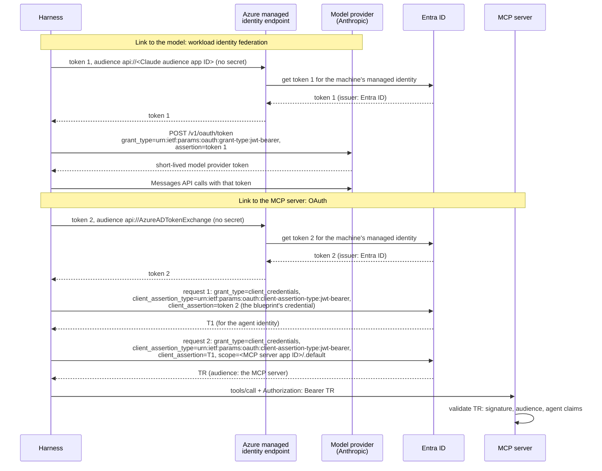

# Authentication: How Each Part Proves Who It Is

Every part of an agent that calls a protected service must prove who it is. This document shows how that works in the enterprise reference design, link by link, and where the Guardian differs today. It ends with the general question behind every link: how a workload gets its credential and its tokens.

For the enterprise design and the Guardian's shortcuts (D1 to D6), see [Agent architecture](agent-architecture.md). For the two Agent ID token requests (T1 and TR), see [Agent ID](agent-id.md#3-getting-a-token-the-agent-autonomous-app-flow), and for the claims in each token, see [Agent tokens](tokens.md).

## Contents

- [1. How the Harness Authenticates](#1-how-the-harness-authenticates)
- [2. How Each Caller Proves Who It Is](#2-how-each-caller-proves-who-it-is)
- [3. Credentials and Tokens: How a Workload Gets Them](#3-credentials-and-tokens-how-a-workload-gets-them)
  - [Layer 1: The Client Credential](#layer-1-the-client-credential)
  - [Layer 2: Who Gets the Tokens](#layer-2-who-gets-the-tokens)
  - [What the Guardian Uses and Why](#what-the-guardian-uses-and-why)

---

## 1. How the Harness Authenticates

The harness talks to two services, and each one trusts a different credential. In the enterprise design, both credentials start from one **managed identity**: Azure gives it to the machine the harness runs on, and the harness gets its token from a local Azure endpoint without any secret. The harness never sends a managed identity token to the Messages API or to the MCP server. It uses each one only to *get* the credential that the receiver accepts:

1. **Two managed identity tokens, one for each receiver:** The harness asks the local Azure endpoint for a token, and the endpoint gets it from Entra ID for the machine's managed identity. So a managed identity token is an Entra-issued token. Each token names its receiver in its audience (`aud`), and each receiver accepts only its own audience. So the harness asks twice:
   * **Token 1, for the model provider,** with the audience `api://<Claude audience app ID>`. Entra issues a token only for an audience that exists in the tenant, so an admin first creates an app registration that stands for the Claude API ([source](https://platform.claude.com/docs/en/manage-claude/wif-providers/azure)).
   * **Token 2, for the blueprint,** with the audience `api://AzureADTokenExchange`, which a federated identity credential requires ([source](https://learn.microsoft.com/en-us/entra/workload-id/workload-identity-federation-config-app-trust-managed-identity)).

   Two tokens, not one, because a token that worked at both receivers could be replayed from one to the other: whoever holds token 1 could use it at Entra as the blueprint's credential.
2. **To the model provider (workload identity federation):** The harness sends token 1 to the provider's `POST /v1/oauth/token`, with `grant_type=urn:ietf:params:oauth:grant-type:jwt-bearer` and token 1 as `assertion`, and gets a short-lived provider token. Anthropic checks token 1 against its federation rule: the issuer (the tenant's Entra ID), the subject (the managed identity's object ID) and the audience. The harness calls the model with the provider token. No API key exists.
3. **To Entra, request 1 (T1):** In a request with `grant_type=client_credentials`, the harness sends token 2 as `client_assertion`, with `client_assertion_type=urn:ietf:params:oauth:client-assertion-type:jwt-bearer`. Token 2 is the *blueprint's* credential (a federated identity credential, FIC). The harness gets T1, which Microsoft calls the exchange token, for the agent identity.
4. **To Entra, request 2 (TR):** In a second request with `grant_type=client_credentials`, the harness sends T1 as `client_assertion`, with the same `client_assertion_type`, to sign in as the *agent identity*, asks for the scope `<MCP server app ID>/.default`, and gets TR (Microsoft's name for the resource access token). TR's audience is the MCP server, and its `roles` claim holds only the roles the agent has *on the MCP server*: never its roles on other APIs. The agent cannot pick a subset of those roles (see [App-Only Tokens and the `.default` Scope](agent-id.md#app-only-tokens-and-the-default-scope)), but it always picks which API the token is for. This is Microsoft's agent autonomous app flow, described in [Agent ID](agent-id.md#3-getting-a-token-the-agent-autonomous-app-flow).
5. **To the MCP server (OAuth):** The harness calls the MCP server with `Authorization: Bearer <TR>`. The MCP server validates TR the way any resource API does: signature, audience, and the agent claims (for example `xms_act_fct` containing 11).

**Two values that look alike.** RFC 7523 uses a JWT in two different ways, and each way has its own value:

* `grant_type=urn:ietf:params:oauth:grant-type:jwt-bearer`: the JWT is the *grant*, sent in `assertion`. The token request itself rests on it. Anthropic's token endpoint (step 2) and OBO use it ([RFC 7523, section 2.1](https://www.rfc-editor.org/rfc/rfc7523.html#section-2.1)).
* `client_assertion_type=urn:ietf:params:oauth:client-assertion-type:jwt-bearer`: the JWT proves who the *client* is, in place of a secret, sent in `client_assertion`. The grant is something else, here `client_credentials`. Entra's requests 1 and 2 (steps 3 and 4) use it ([RFC 7523, section 2.2](https://www.rfc-editor.org/rfc/rfc7523.html#section-2.2)).

**Anthropic's workload identity federation.** Anthropic supports three ways to authenticate to the Claude API:

* A static API key
* Workload identity federation
* App Attest for iOS and macOS apps

With workload identity federation, a workload presents a short-lived identity token from an identity provider it already has: AWS IAM, Google Cloud, or any standard OIDC issuer, and Anthropic's documentation names Microsoft Entra ID among them. The workload exchanges that token at `POST /v1/oauth/token` for a short-lived Claude API access token, and the SDK renews it before it expires. An admin sets it up with three objects in the Claude Console: a service account, a federation issuer and a federation rule. Anthropic's own caveat applies: the trust chain is only as strong as the identity provider's configuration, so a long-lived secret one step earlier in the chain can still undermine it. Sources: [Claude API authentication](https://platform.claude.com/docs/en/manage-claude/authentication) (checked 28 October 2026) and [Use WIF with Microsoft Entra ID](https://platform.claude.com/docs/en/manage-claude/wif-providers/azure) (checked 29 October 2026). The guardian uses an API key instead, because it runs locally with no managed identity to federate (D4).

---

## 2. How Each Caller Proves Who It Is

Each link has three parts. The **authentication method** is how the caller proves who it is. The **credential** is what it sends as proof. The **trust relationship** is what an admin set up in advance, so the receiver knows which credential to accept. Where several methods exist, the first one is the recommended choice for production. Where the choice depends on the mode, the bullets are labelled by mode. Every link also runs over TLS. TLS proves the other direction: the server certificate shows the caller that it reached the right service.

| # | Link (caller → receiver) | Authentication Method | Credentials | Trust Relationship |
|---|---|---|---|---|
| 1 | Harness → Azure managed identity endpoint | Managed identity: the platform vouches for the machine | None. Only code on that machine can reach the local endpoint. | An admin assigns a user-assigned managed identity to the machine. Only a user-assigned managed identity can be a federated identity credential ([source](https://learn.microsoft.com/en-us/entra/workload-id/workload-identity-federation-config-app-trust-managed-identity)). |
| 2 | End user → Harness (delegated mode only) | OpenID Connect sign-in in a client app (authorization code flow with PKCE), then an OAuth bearer token. The blueprint cannot run the sign-in itself ([source](https://learn.microsoft.com/entra/agent-id/agent-on-behalf-of-oauth-flow)). | The user's access token (Tc). At sign-in, the user proves who they are to Entra ID, ideally with phishing-resistant MFA such as a passkey. | The blueprint exposes a scope, so Tc's audience is the blueprint ([source](https://learn.microsoft.com/entra/agent-id/agent-on-behalf-of-oauth-flow)). The harness checks signature, audience and `scp`. |
| 3 | Harness → Model provider | • Workload identity federation (grant type `urn:ietf:params:oauth:grant-type:jwt-bearer`) • API key | • A managed identity token (issued by Entra ID, audience: the Claude API's app registration), as `assertion`, exchanged for a short-lived provider token • A static API key, read from a vault | • An app registration in Entra that stands for the Claude API audience, plus a service account, a federation issuer and a federation rule in the Claude Console ([source](https://platform.claude.com/docs/en/manage-claude/wif-providers/azure)) • The key, created for a service account in the Claude Console |
| 4 | Harness → Entra ID (request 1: blueprint gets T1) | OAuth 2.0 client credentials grant (grant type `client_credentials`), with: • A federated identity credential (managed identity as its source) • A certificate • A client secret (testing only, [source](https://learn.microsoft.com/entra/agent-id/agent-autonomous-app-oauth-flow)) | • The managed identity token (audience `api://AzureADTokenExchange`), as `client_assertion` • A JWT signed with the certificate's private key, as `client_assertion` (RFC 7523) • The secret | • A federated identity credential on the blueprint (issuer, subject, audience `api://AzureADTokenExchange`, [source](https://learn.microsoft.com/en-us/entra/workload-id/workload-identity-federation-config-app-trust-managed-identity)) • The certificate's public key, uploaded to the blueprint • The secret, registered on the blueprint |
| 5 | Harness → Entra ID (request 2: agent identity gets TR) | • **Autonomous:** OAuth 2.0 client credentials grant (grant type `client_credentials`) • **Delegated:** On-Behalf-Of (grant type `urn:ietf:params:oauth:grant-type:jwt-bearer`) | • T1, as `client_assertion` • T1, as `client_assertion`, plus the user's token (Tc), as `assertion` | • The parent link from the agent identity to its blueprint, plus app roles granted by an admin ([source](https://learn.microsoft.com/entra/agent-id/agent-autonomous-app-oauth-flow)) • The same parent link, plus delegated permissions an admin consented to on the blueprint (inheritable permissions). Entra also checks that Tc was issued for the blueprint ([source](https://learn.microsoft.com/entra/agent-id/agent-on-behalf-of-oauth-flow)). Conditional Access policies for agents apply only in the autonomous mode, when the agent uses its own identity. In the delegated mode, the user's policies apply instead ([source](https://learn.microsoft.com/en-us/entra/identity/conditional-access/howto-target-agent-identities)). |
| 6 | Harness → MCP server | • OAuth bearer token (the MCP authorization spec) • API key • Network isolation only (no authentication) | • TR, as `Authorization: Bearer TR` • A key in a request header • None | • Entra's public signing keys, plus an app role assignment for the agent identity on the MCP server's app ([checks](tokens.md#what-an-api-must-check)) • A key the MCP server issued and stores • None: any code that reaches the port is trusted |
| 7 | MCP server → Entra ID | • **Autonomous:** OAuth 2.0 client credentials grant (grant type `client_credentials`) • **Delegated:** On-Behalf-Of (grant type `urn:ietf:params:oauth:grant-type:jwt-bearer`) | • A managed identity token, as the `client_assertion` of the MCP server's own app registration ([source](https://learn.microsoft.com/en-us/entra/workload-id/workload-identity-federation-config-app-trust-managed-identity)) • The same, plus the incoming token that carries the user, as `assertion` | • A federated identity credential on the MCP server's app registration that trusts its managed identity, plus app roles on each API • The same federated identity credential, plus consented delegated permissions: OBO uses only delegated scopes, never app roles. Entra also checks that the incoming token was issued for the MCP server ([source](https://learn.microsoft.com/en-us/entra/identity-platform/v2-oauth2-on-behalf-of-flow)). |
| 8 | MCP server → Resource API | OAuth bearer token, new for this API (no token passthrough, [why](agent-architecture.md#three-architectural-pillars)) | An access token whose audience is this API, never the token the MCP server received | Entra's public signing keys, plus an app role assignment (or delegated permission) for the MCP server on this API. The API checks `aud` and `roles` (or `scp` and the user, with OBO). |
| 9 | End user → MCP server (approval gate) | OpenID Connect sign-in at approval time. This is one common design: no spec defines it. | The approver's access token | An admin assigns the approver role. The MCP server checks the token and the role. |
| 10 | Model → Harness (tool calls) MCP server → Harness (tool results) | None. This is content, not a caller. | None. TLS only proves which service sent it. | None. The harness treats it as untrusted data. |

**Where the Guardian differs:** It runs locally, so row 1 does not exist. Row 3 uses an API key file (**D4**). The harness never talks to Entra ID: the sidecar runs requests 1 and 2 for the MCP server, as the Guardian's agent identity, with a certificate file (**D2**, **D3**). Row 6 has no token, only network isolation (**D1**). Row 2 and the delegated bullets in rows 5 and 7 are not built (**D5**). Row 9, the approval gate, is planned. See [Architectural Shortcuts](agent-architecture.md#architectural-shortcuts-where-the-guardian-differs).

Sources (Microsoft Learn, checked 29 October 2026): [Agent autonomous app OAuth flow](https://learn.microsoft.com/entra/agent-id/agent-autonomous-app-oauth-flow), [Agent OAuth flows: On-behalf-of flow](https://learn.microsoft.com/entra/agent-id/agent-on-behalf-of-oauth-flow), [Configure an application to trust a managed identity](https://learn.microsoft.com/en-us/entra/workload-id/workload-identity-federation-config-app-trust-managed-identity), [Microsoft identity platform and OAuth 2.0 On-Behalf-Of flow](https://learn.microsoft.com/en-us/entra/identity-platform/v2-oauth2-on-behalf-of-flow) and [Target agents in Conditional Access policies](https://learn.microsoft.com/en-us/entra/identity/conditional-access/howto-target-agent-identities). Row 3: [Claude API authentication](https://platform.claude.com/docs/en/manage-claude/authentication).

---

## 3. Credentials and Tokens: How a Workload Gets Them

Every part of an agent that calls a protected service must answer two questions, and the second one always stands on the first:

1. **The client credential:** What does the workload prove itself with, and how does it get that credential safely?
2. **The tokens:** Which component uses that credential to get tokens, and how does that component know who is asking?

### Layer 1: The Client Credential

Every way of storing a credential runs into the **secret zero** problem: to protect a secret, you put it in a vault, but to open the vault, the workload needs a first credential of its own. There are three options, from weakest to strongest:

1. **A file (a secret or a certificate):** The workload reads it from disk or from an environment variable. It is the simplest option, but the file can be copied and used anywhere, and someone must rotate it by hand. The Guardian uses this locally (**D3**, **D4**).
2. **A vault, such as Azure Key Vault:** The workload reads the secret from the vault when it starts, so no secret sits in its image or its configuration. But this only *moves* the problem: the workload still needs a credential to open the vault. In Azure, that credential is usually a managed identity.
3. **A managed identity, used directly:** The platform vouches for the machine the workload runs on, so no secret exists at all: nothing to store, copy or rotate. It replaces the vault, not just the key that opens it. For the blueprint, it becomes a federated identity credential, so the blueprint trusts tokens from that managed identity. For the model provider, workload identity federation swaps an Entra-issued token for a short-lived provider token ([How the Harness Authenticates](#1-how-the-harness-authenticates)). It works only where a platform can vouch for the machine, such as Azure.

Applied to each credential the agent needs:

| Credential | The Guardian today | Enterprise design |
|---|---|---|
| The blueprint's credential | A certificate file, mounted only into the sidecar (**D3**) | A managed identity, as the blueprint's federated identity credential |
| The model provider's credential | An API key in a file, given only to the Guardian's container (**D4**) | Workload identity federation: no key |
| The MCP server's own identity | None: it acts as the Guardian (**D2**) | Its own app registration, with a managed identity as its federated identity credential ([source](https://learn.microsoft.com/en-us/entra/workload-id/workload-identity-federation-config-app-trust-managed-identity)) |

### Layer 2: Who Gets the Tokens

Once a workload has a client credential, some component must use it to get tokens. There are three patterns.

**In-process.** A library inside the program gets tokens itself, for example Microsoft.Identity.Web in a .NET program, with a managed identity as the credential.
* *How the caller proves itself:* There is no separate caller: the code that needs the token is the code that gets it.
* *Where the credential lives:* Inside the program's own process.
* *Blast radius:* That one program.
* *Fits when:* The program's language has a good token library, and the platform offers a managed identity.

**Sidecar.** A token service runs next to one workload, in the same pod, and serves only that workload over `127.0.0.1`. This is the general [sidecar pattern](https://learn.microsoft.com/azure/architecture/patterns/sidecar).
* *How the caller proves itself:* By location. Only code in the same pod shares the loopback, so no extra authentication is needed.
* *Where the credential lives:* With the sidecar: a file it mounts, or the platform's managed identity. The program that asks for tokens never sees it.
* *Blast radius:* One pod. If it is compromised, the identities that pod's sidecar can sign in as are exposed.
* *Fits when:* The program has no good token library in its language, or it should never touch the credential. Microsoft's Entra ID Auth SDK (sidecar), which the Guardian uses, exists for exactly this.

**Token broker.** One central service holds the credentials and issues tokens to many workloads over the network.
* *How the caller proves itself:* Explicitly, for example with mTLS or a workload identity token, because any machine on the network could ask.
* *Where the credential lives:* All of them in one place, which makes rotation and audit easier.
* *Blast radius:* Every workload the broker serves. That makes it a high-value target, and also a single point of failure.
* *Fits when:* Many workloads need tokens, central control and audit matter, and strong workload authentication (mTLS, SPIFFE) already exists. Examples: HashiCorp Vault issuing short-lived credentials, or GCP service account impersonation.

**The differences:**
1. **Caller proof:** none needed (in-process), location (sidecar), or explicit authentication (broker).
2. **Credential location:** inside each program, next to each program, or in one central place.
3. **Breach impact:** one program, one pod, or every workload the broker serves.

**How to choose:** Prefer **in-process** with a managed identity when the language has a good library, because there is no second component to protect. Use a **sidecar** when it does not, or when the program must never touch the credential. Use a **broker** only when central control is worth more than the larger blast radius, and only with strong workload authentication in place.

### What the Guardian Uses and Why

* **Locally (today):** A certificate file (layer 1, **D3**) and a **sidecar** (layer 2). Python has no Microsoft library for agent identities, and the sidecar keeps the private key out of every container except its own. Only the MCP server shares the sidecar's network namespace, so only the Guardian's tools can get tokens ([Component Inventory](agent-architecture.md#component-inventory-who-holds-what)). How the sidecar is set up and run: [Local run: the sidecar](infra.md#local-run-the-sidecar).
* **In the enterprise design:** A managed identity as the client credential, so no file and no vault key exist. The sidecar can stay, or an in-process library can replace it where the language has one.
