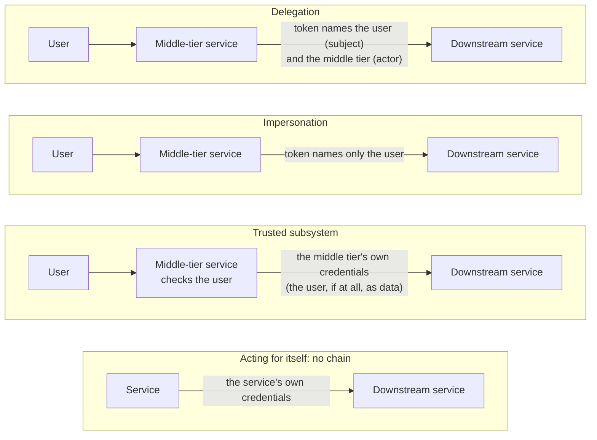

# Delegation and Trusted Subsystem

When a request passes through several services, the last service must decide whose request it is and whose rights apply ([RFC 8693, section 1.1][rfc-1.1]). Three models answer this: delegation and impersonation ([RFC 8693, section 1.1][rfc-1.1]), and the trusted subsystem ([ASP.NET guide, Resource Access Models][bsa-models]). This page explains each one from its primary source, then maps them to the guardian.

**How to read the links:** every claim links to its source. *Inference* marks a conclusion drawn from the linked sources, not stated in them. The sources were checked on 11 and 12 November 2026, and they are listed in [Sources](#sources).

## Contents

- [1. The Big Picture](#1-the-big-picture)
  - [The Question](#the-question)
  - [Three Models, and One Case Without a Chain](#three-models-and-one-case-without-a-chain)
  - [The General Rules](#the-general-rules)
  - [When a New Token Is Needed](#when-a-new-token-is-needed)
- [2. Delegation](#2-delegation)
  - [Delegation, Defined](#delegation-defined)
  - [The Two Parties: Subject and Actor](#the-two-parties-subject-and-actor)
  - [How Delegation Works in the Standard](#how-delegation-works-in-the-standard)
  - [The Data: the act Claim](#the-data-the-act-claim)
  - [Deviation: Entra's On-Behalf-Of Flow](#deviation-entras-on-behalf-of-flow)
  - [Deviation in Words: Delegation in Windows Guidance](#deviation-in-words-delegation-in-windows-guidance)
- [3. Impersonation](#3-impersonation)
  - [Impersonation, Defined](#impersonation-defined)
  - [Deviation in Words: Impersonate in Entra Agent ID](#deviation-in-words-impersonate-in-entra-agent-id)
- [4. Trusted Subsystem](#4-trusted-subsystem)
  - [Trusted Subsystem, Defined](#trusted-subsystem-defined)
  - [How a Trusted Subsystem Works](#how-a-trusted-subsystem-works)
  - [Longer Chains](#longer-chains)
  - [Passing the User Along](#passing-the-user-along)
  - [An Emerging Standard: Transaction Tokens](#an-emerging-standard-transaction-tokens)
  - [The Risks](#the-risks)
  - [Deviation: Entra Has No Such Term](#deviation-entra-has-no-such-term)
- [5. Differences and How to Choose](#5-differences-and-how-to-choose)
  - [Three Differences](#three-differences)
  - [How to Choose](#how-to-choose)
- [6. The Guardian](#6-the-guardian)
  - [Where Each Model Appears](#where-each-model-appears)
  - [When the Guardian Gets a New Token](#when-the-guardian-gets-a-new-token)
  - [The Delta From the General Practice](#the-delta-from-the-general-practice)
- [Sources](#sources)
  - [Standards and Specifications](#standards-and-specifications)
  - [Microsoft Learn](#microsoft-learn)
  - [Microsoft Patterns and Practices (Retired)](#microsoft-patterns-and-practices-retired)
  - [Other Sources](#other-sources)
  - [Seen but Not Used](#seen-but-not-used)

## 1. The Big Picture

### The Question

A user calls a middle-tier service, and the middle-tier service calls a downstream service. The downstream service must decide whose request this is, and whose rights apply.

RFC 8693 describes this case: "to allow a resource server A to make calls to a backend service C on behalf of the requesting user B" ([RFC 8693, section 1.1][rfc-1.1]). This page uses names instead of the RFC's letters: A is the middle-tier service, B is the user, and C is the downstream service. Microsoft uses the same two names: "For the middle-tier service to make authenticated requests to the downstream service" ([OBO flow][obo]).

### Three Models, and One Case Without a Chain

- **Delegation, the downstream service sees both:** the middle tier uses "its own credentials to access C along with an annotation of some form that A is acting on behalf of B" ([RFC 8693, section 1.1][rfc-1.1]).
- **Impersonation, the downstream service sees only the user:** the middle tier gets "a limited access credential to C but that continues to identify B as the authorized entity" ([RFC 8693, section 1.1][rfc-1.1]).
- **Trusted subsystem, the downstream service sees only the middle tier:** the middle tier "uses its own credentials instead of the user's credentials to access the resource" ([Trusted Subsystem pattern, Solution][pnp-solution]). The downstream service "trusts the upstream service to authorize callers" ([ASP.NET guide, The Trusted Subsystem Model][bsa-tsm]).
- **No chain, a service acting for itself:** "When a principal is acting directly on its own behalf, for example, neither delegation nor impersonation are in play" ([RFC 8693, section 1.1][rfc-1.1]).

**Where the names are defined:** RFC 8693 defines delegation and impersonation ([RFC 8693, section 1.1][rfc-1.1]). The trusted subsystem is described in Microsoft's patterns & practices guidance. A 2002 guide lists the trusted subsystem model and the impersonation/delegation model as "the two most commonly used resource-access security models used by .NET Web applications (and distributed multi-tier applications in general)" ([ASP.NET guide, Resource Access Models][bsa-models]). A 2005 guide describes the trusted subsystem as a pattern ([Trusted Subsystem pattern][pnp]). The 2002 guide uses "delegation" in another sense: see [Delegation in Windows Guidance](#deviation-in-words-delegation-in-windows-guidance).

The four cases, with what reaches the downstream service ([RFC 8693, section 1.1][rfc-1.1], [Trusted Subsystem pattern, Process][pnp-process], [Trusted Subsystem pattern, Extension 1][pnp-ext1]):



### The General Rules

- **Delegation, judge the subject and the current actor only:**

  > For the purpose of applying access control policy, the consumer of a token MUST only consider the token's top-level claims and the party identified as the current actor by the "act" claim. ([RFC 8693, section 4.1][rfc-4.1])

- **Trusted subsystem, the middle tier checks every request:** "The Web service must perform appropriate authentication and authorization of all requests that enter the subsystem." ([Trusted Subsystem pattern, Solution][pnp-solution])
- **Trusted subsystem, the downstream service checks the middle tier:** "Downstream resources must be able to verify that the midstream caller is a trusted subsystem and not just any system process." ([Trusted Subsystem pattern, Enforcing the Trust Relationship][pnp-enforce]) One way is "establishing security claims that are issued by a trusted third party and that are verified by the downstream resource" ([Trusted Subsystem pattern, Security Considerations][pnp-sec]).
- **With OAuth tokens, each API needs a token issued for it:** the API rejects any other ([RFC 9068, section 4][rfc9068-4]). The full rule is in the next section.

### When a New Token Is Needed

The caller's identity does not decide when a new token is needed. What decides it is what the token is bound to: an audience, a client, a lifetime and a set of permissions ([RFC 9700, section 2.3][rfc9700-2.3], [RFC 8693, section 4.3][rfc-4.3], [RFC 6750, section 3.1][rfc6750-3.1]).

**What a token is bound to:**

1. **Its audience, a hard rule:** the API must refuse a token that was not issued for it.

   > The JWT access token MUST be rejected if "aud" does not contain a resource indicator of the current resource server as a valid audience. ([RFC 9068, section 4][rfc9068-4])

   The best practice is a token "audience-restricted to a specific resource server or, if that is not feasible, to a small set of resource servers" ([RFC 9700, section 2.3][rfc9700-2.3]). **Entra's deviation:** in v2.0 tokens, `aud` "is always the client ID of the API" ([Access token claims reference][claims]). So an Entra token is for one API (*inference* from the same text).
2. **Its holder, a practice:** the token names the client it was issued to.

   > The "client_id" claim carries the client identifier of the OAuth 2.0 [RFC6749] client that requested the token. ([RFC 8693, section 4.3][rfc-4.3])

   Entra uses `azp`: "The application ID of the client using the token." ([Access token claims reference][claims]) But a bearer token can be used by "any party in possession of the token" ([RFC 6750, section 1.2][rfc6750-1.2]). So the protocol itself does not stop another workload from using it. Two things close that gap:
   - **A rule against passing tokens on:** "The access token used at the upstream API is a separate token, issued by the upstream authorization server. The MCP server MUST NOT pass through the token it received from the MCP client." ([MCP, Authorization Security Considerations][mcp-sec-priv])
   - **Sender-constrained tokens:** servers "SHOULD use mechanisms for sender-constraining access tokens, such as mutual TLS for OAuth 2.0 [RFC8705] or OAuth 2.0 Demonstrating Proof of Possession (DPoP) [RFC9449]", "to prevent misuse of stolen and leaked access tokens" ([RFC 9700, section 2.2.1][rfc9700-2.2.1]).
3. **Its lifetime and its permissions:** a token fails when it is "expired, revoked, malformed, or invalid for other reasons", and then "The client MAY request a new access token and retry the protected resource request." ([RFC 6750, section 3.1][rfc6750-3.1]) It also fails when "The request requires higher privileges than provided by the access token." ([RFC 6750, section 3.1][rfc6750-3.1])

**The test before each call to an API:**

1. **Audience:** is this API the token's audience? If not, get a new token ([RFC 9068, section 4][rfc9068-4]).
2. **Holder:** was this token issued to me, this workload? If not, get my own, and never pass it on ([MCP, Authorization Security Considerations][mcp-sec-priv]).
3. **Validity:** is the token still valid, with the permission this call needs? If not, get a new one ([RFC 6750, section 3.1][rfc6750-3.1]).

If all three answers are yes, the token can be reused (*inference* from the three rules above).

**A token that arrives for another audience: reject it, never exchange it.**

- **The rule:** the API that receives it must reject it ([RFC 9068, section 4][rfc9068-4]). MCP servers "MUST reject tokens that do not include them in the audience claim or otherwise verify that they are the intended recipient of the token" ([MCP, Authorization Security Considerations][mcp-sec-priv]).
- **An exchange starts only from a token issued to you:** in Entra's OBO, the incoming token "must have an audience (`aud`) claim of the app making this OBO request" ([OBO flow, Middle-tier access token request][obo-request]). Then: "Applications can't redeem a token for a different app (for example, if a client sends an API a token meant for Microsoft Graph, the API can't redeem it using OBO. It should instead reject the token)." ([OBO flow, Middle-tier access token request][obo-request]) For agents, "a token audienced to another resource (for example, Microsoft Graph) is rejected with `AADSTS50013`" ([Agent OBO flow, Protocol steps][agent-obo-steps]).
- **Why accepting it is a risk:** "An attacker can gain unauthorized access or otherwise compromise an MCP server if the server accepts tokens issued for other resources." ([MCP, Authorization Security Considerations][mcp-sec-priv]) It "breaks a fundamental OAuth security boundary, allowing attackers to reuse legitimate tokens across different services than intended" ([MCP Security Best Practices, Token Passthrough][mcp-bp-passthrough]). The audience check also stops a phished token: "the resource server will detect the mismatch (wrong audience) and refuse to serve the request" ([RFC 9700, section 4.10.2][rfc9700-4.10.2]).
- **Even a valid exchange carries a risk:** "Any time one principal is delegated the rights of another principal, the potential for abuse is a concern." ([RFC 8693, section 5][rfc-5]) The RFC's mitigation:

  > The use of the "scope" claim (in addition to other typical constraints such as a limited token lifetime) is suggested to mitigate potential for such abuse, as it restricts the contexts in which the delegated rights can be exercised. ([RFC 8693, section 5][rfc-5])

**How to get the new token:** it depends on whose rights the next API should check.

- **The user's rights:** an exchange, OBO in Entra, so the new token still names the user ([Delegation](#2-delegation)).
- **Your own rights, while serving someone else's request:** client credentials, as a trusted subsystem ([Trusted Subsystem](#4-trusted-subsystem)).
- **Your own rights, for your own work:** client credentials again, with the new API in the scope. In Entra, the scope decides the audience ([pillar 4 of the enterprise design](agent-architecture.md#four-architectural-pillars)).

## 2. Delegation

### Delegation, Defined

With delegation, the downstream service sees two parties: the user, and the service acting for the user ([RFC 8693, section 1.1][rfc-1.1]).

> With delegation semantics, principal A still has its own identity separate from B, and it is explicitly understood that while B may have delegated some of its rights to A, any actions taken are being taken by A representing B. In a sense, A is an agent for B. ([RFC 8693, section 1.1][rfc-1.1])

- **The token carries both:** "Delegation semantics are typically expressed in a token by including information about both the primary subject of the token as well as the actor to whom that subject has delegated some of its rights." ([RFC 8693, section 1.1][rfc-1.1])
- **Its name:** "Such a token is sometimes referred to as a composite token because it is composed of information about multiple subjects." ([RFC 8693, section 1.1][rfc-1.1])
- **A loose definition to avoid:** "the user's context is carried across the hops". It also fits impersonation, whose credential "continues to identify B as the authorized entity" ([RFC 8693, section 1.1][rfc-1.1]). In delegation, the actor stays visible too ([RFC 8693, section 1.1][rfc-1.1]).

### The Two Parties: Subject and Actor

**In one line:** the subject is the party the token is about, and the actor is the party that uses the token for it. In OBO, the subject is the end user and the actor is the agent. This page uses these two words for every vendor.

- **The subject, in the standard:**

  > A security token that represents the identity of the party on behalf of whom the request is being made. ([RFC 8693, section 2.1][rfc-2.1])

- **The actor, in the standard:**

  > A security token that represents the identity of the acting party. ([RFC 8693, section 2.1][rfc-2.1])

- **The same words in Entra Agent ID:**

  > The agent identity (actor) is used to obtain a token for itself (subject). ([Agent app-only flow][agent-auto])

Where each party is in a token:

| Party | RFC | Entra |
|---|---|---|
| **Actor in the autonomous flow:** the client, acting for itself | `sub` and `client_id` both name the client ([RFC 9068, section 2.2][rfc9068-2.2]). No `act` claim: "neither delegation nor impersonation are in play" ([RFC 8693, section 1.1][rfc-1.1]) | `azp` (v2.0) or `appid` (v1.0). `oid` and `sub` name the same client, and `idtyp` is `app`. For an agent, `xms_act_fct` contains `11` ([TR, claim by claim](tokens.md#tr-claim-by-claim)) |
| **Actor in OBO:** the current actor | `act.sub`, in the outermost `act` ([RFC 8693, section 4.1][rfc-4.1]). `client_id` names the client that asked for the token ([RFC 8693, section 4.3][rfc-4.3]) | `azp` (v2.0) or `appid` (v1.0). For an agent, `xms_act_fct` contains `11`, and `xms_par_app_azp` names its blueprint ([the OBO token](tokens.md#who-is-who-in-the-token)) |
| **Subject in OBO:** the user | The top-level `sub` ([RFC 8693, section 4.1][rfc-4.1]) | `oid`. `sub` is pairwise, so its value changes from one client to the next ([Access token claims reference][claims]). `idtyp` is `user`, and `xms_sub_fct` has no `11` or `13` ([the OBO token](tokens.md#who-is-who-in-the-token)) |
| **Prior actors** | Each one nested in the `act` of the actor after it, the oldest deepest. "Informational only", never for access control ([RFC 8693, section 4.1][rfc-4.1]) | None: no claim names them (searched on 11 November 2026: [Access token claims reference][claims]). The guardian's OBO token does not name the approve CLI, Tc's client ([From Tc to the OBO token](tokens.md#from-tc-to-the-obo-token)) |

**`azp` or `appid`:** the API that receives the token decides, not the flow. It sets the token version in its registration: "The values of `null` and `1` result in v1.0 tokens, and the value of `2` results in v2.0 tokens." ([Access tokens, Token formats][at-formats]) So the guardian's tokens for the Identity API carry `azp` ([identity-api.bicep](../setup/bicep/identity-api.bicep)), and its tokens for Graph carry `appid`.

**The subject is not always a user:** with no user, the agent is both the subject and the actor ([Agent app-only flow][agent-auto]). So write "the user (subject)" and "the agent (actor)" when the case is not clear.

**Why not "resource owner":** OAuth defines it by the right to grant access, not by ownership:

> An entity capable of granting access to a protected resource. ([RFC 6749, section 1.1][rfc6749-1.1])

But a token can have a subject and no resource owner. With "the client credentials grant", `sub` names the client application ([RFC 9068, section 2.2][rfc9068-2.2]). The client can even reach "those of another resource owner that have been previously arranged with the authorization server" ([RFC 6749, section 4.4][rfc6749-4.4]). So "subject" covers every case, and "resource owner" does not.

### How Delegation Works in the Standard

1. **The middle tier receives a token:** for example, "service16 receiving a token in a call from service77" ([RFC 8693, section 4.1][rfc-4.1]).
2. **It asks for an exchange:** it sends a token exchange request, with `grant_type` set to `urn:ietf:params:oauth:grant-type:token-exchange` ([RFC 8693, section 2.1][rfc-2.1]).
3. **It names both parties in the request:**

   > Typically, in the request, the "subject_token" represents the identity of the party on behalf of whom the token is being requested while the "actor_token" represents the identity of the party to whom the access rights of the issued token are being delegated. ([RFC 8693, section 1.1][rfc-1.1])

4. **The authorization server checks both tokens:** it "MUST perform the appropriate validation procedures for the indicated token type and, if the actor token is present, also perform the appropriate validation procedures for its indicated token type" ([RFC 8693, section 2.1][rfc-2.1]).
5. **The authorization server decides what to issue:** "When and if a composite token is issued is at the discretion of the authorization server and applicable policy and configuration." ([RFC 8693, section 1.1][rfc-1.1])
6. **The middle tier calls the downstream service:** with "a token suitable to call service26" ([RFC 8693, section 4.1][rfc-4.1]). The downstream service judges only the top-level claims and the current actor ([RFC 8693, section 4.1][rfc-4.1]).

### The Data: the act Claim

- **What it marks:**

  > The "act" (actor) claim provides a means within a JWT to express that delegation has occurred and identify the acting party to whom authority has been delegated. ([RFC 8693, section 4.1][rfc-4.1])

- **A chain of hops:**

  > A chain of delegation can be expressed by nesting one "act" claim within another. The outermost "act" claim represents the current actor while nested "act" claims represent prior actors. The least recent actor is the most deeply nested. ([RFC 8693, section 4.1][rfc-4.1])

- **Why keep the chain:**

  > The nested "act" claims serve as a history trail that connects the initial request and subject through the various delegation steps undertaken before reaching the current actor. ([RFC 8693, section 4.1][rfc-4.1])

- **What counts for access control:**

  > Prior actors identified by any nested "act" claims are informational only and are not to be considered in access control decisions. ([RFC 8693, section 4.1][rfc-4.1])

The RFC's own example is on the left ([RFC 8693, Figure 6][rfc-fig6]). The token is about the user, service16 is the current actor, and service77 was a prior actor ([RFC 8693, section 4.1][rfc-4.1]).

On the right, for comparison, is an app-only token: service16 calls service26 for its own work, with no user. This example is *my illustration*, not from an RFC. It changes only two things:

- **The subject is the service:** with "the client credentials grant, the value of "sub" SHOULD correspond to an identifier the authorization server uses to indicate the client application" ([RFC 9068, section 2.2][rfc9068-2.2]).
- **No act claim:** nobody delegated anything, so "neither delegation nor impersonation are in play" ([RFC 8693, section 1.1][rfc-1.1]).

<table>
<tr>
<th>Delegation: the user, with service16 acting (RFC 8693, Figure 6)</th>
<th>App-only: service16 for itself (illustration)</th>
</tr>
<tr>
<td>

```json
{
  "aud":"https://service26.example.com",
  "iss":"https://issuer.example.com",
  "exp":1443904100,
  "nbf":1443904000,
  "sub":"user@example.com",
  "act":
  {
    "sub":"https://service16.example.com",
    "act":
    {
      "sub":"https://service77.example.com"
    }
  }
}
```

</td>
<td>

```json
{
  "aud":"https://service26.example.com",
  "iss":"https://issuer.example.com",
  "exp":1443904100,
  "nbf":1443904000,
  "sub":"https://service16.example.com"
}
```

</td>
</tr>
</table>

So service26 reads the two tokens differently. On the left, it applies the user's rights, with service16 as the current actor ([RFC 8693, section 4.1][rfc-4.1]). On the right, it applies service16's own rights (*inference* from [RFC 9068, section 2.2][rfc9068-2.2]).

A real Entra app-only token is TR, the guardian's own token for the Identity API: `sub` and `oid` name the agent identity, and there is no `act` claim ([TR and T1, masked](tokens.md#the-claims-masked)).

A real Entra delegation token is the guardian's OBO token for Graph: `oid` names the approver, `appid` names the agent identity that acts for them, and there is no `act` claim and no chain ([The OBO token](tokens.md#the-obo-token-the-agent-acting-for-the-approver)).

### Deviation: Entra's On-Behalf-Of Flow

Microsoft calls its On-Behalf-Of (OBO) flow delegation: "Referred to as delegation in OAuth, the intent is to pass a user's identity and permissions through the request chain." ([OBO flow][obo])

How it works, in Microsoft's steps ([OBO flow, Protocol diagram][obo-steps]):

1. **The client calls the middle tier:** "The client application makes a request to API A with token A (with an `aud` claim of API A)."
2. **The middle tier asks Entra:** "API A authenticates to the Microsoft identity platform token issuance endpoint and requests a token to access API B."
3. **Entra checks both parties:** "The Microsoft identity platform token issuance endpoint validates API A's credentials along with token A and issues the access token for API B (token B) to API A."
4. **The middle tier calls downstream:** "Token B is set by API A in the authorization header of the request to API B."
5. **The answer returns:** "Data from the secured resource is returned by API B to API A, then to the client."

Where it differs from the standard:

- **A different grant:** OBO uses `urn:ietf:params:oauth:grant-type:jwt-bearer`, with `requested_token_use` set to `on_behalf_of` ([OBO flow, Middle-tier access token request][obo-request]). RFC 8693 uses its own token exchange grant ([RFC 8693, section 2.1][rfc-2.1]). Why Microsoft did this: [OBO Is Not RFC 8693](jwt-bearer-and-token-exchange.md#52-obo-is-not-rfc-8693).
- **Users only:**

  > If a service principal requested an app-only token and sent it to an API, that API would then exchange a token that doesn't represent the original service principal. This is because the OBO flow only works for user principals. Instead, it must use the client credentials flow to get an app-only token. ([OBO flow, Client limitations][obo-limits])

  The RFC's definitions are written for principals: "With delegation semantics, principal A still has its own identity separate from B" ([RFC 8693, section 1.1][rfc-1.1]). So the standard does not limit the subject to users (*inference* from the same section).
- **The rights stay with the user:** "It only uses delegated scopes and not application roles. Roles remain attached to the principal (the user) and never to the application operating on the user's behalf." ([OBO flow][obo])
- **One actor, no chain:** `azp` is "The application ID of the client using the token. The application can act as itself or on behalf of a user." ([Access token claims reference][claims]) The reference lists no `act` claim and no claim for earlier actors (searched on 11 November 2026: [Access token claims reference][claims]). So after a second OBO hop, the token names the user and the second middle tier, not the first (*inference* from the `azp` text). Seen in this lab: the OBO token for Graph does not name the approve CLI, Tc's client ([From Tc to the OBO token](tokens.md#from-tc-to-the-obo-token)).
- **For agents:** "User delegation enables agent identities to operate on behalf of signed-in users using standard OAuth 2.0 On-Behalf-Of flows with agent-specific impersonation." ([Agent OBO flow][agent-obo]) The user's token must be issued for the agent's blueprint: "a token audienced to another resource (for example, Microsoft Graph) is rejected with `AADSTS50013`" ([Agent OBO flow, Protocol steps][agent-obo-steps]). An agent's own app-only token is refused as well: see [the live test](#where-each-model-appears).
- **Other vendors:** not covered here. Each one would need its own primary source.

### Deviation in Words: Delegation in Windows Guidance

Older Microsoft guidance uses "delegation" for an operating system feature:

> With this model, a service or component (usually somewhere within the logical business services layer) impersonates the client's identity (using operating system-level impersonation) before it accesses the next downstream service. If the next service in line is on the same computer, impersonation is sufficient. Delegation is required if the downstream service is located on a remote computer. ([ASP.NET guide, The Impersonation / Delegation Model][bsa-impdel])

- **The result:** "As a result of the delegation, the security context used for the downstream resource access is that of the client." ([ASP.NET guide, The Impersonation / Delegation Model][bsa-impdel])
- **The glossary version:** a model "that flows the security context of the original caller through successive application tiers and onto back-end resource managers" ([ASP.NET guide, Glossary][bsa-gloss-impdel]).

So in that guide, the downstream service works in the user's security context ([ASP.NET guide, The Impersonation / Delegation Model][bsa-impdel]). In RFC 8693, the delegated actor "still has its own identity separate from B" ([RFC 8693, section 1.1][rfc-1.1]). The same word has two meanings (*inference* from the two sources). So when a source says "delegation", check which one it means.

## 3. Impersonation

### Impersonation, Defined

With impersonation, the downstream service sees only the user, and the middle tier disappears ([RFC 8693, section 1.1][rfc-1.1]).

> When principal A impersonates principal B, A is given all the rights that B has within some defined rights context and is indistinguishable from B in that context. Thus, when principal A impersonates principal B, then insofar as any entity receiving such a token is concerned, they are actually dealing with B. ([RFC 8693, section 1.1][rfc-1.1])

- **Others may know:** "It is true that some members of the identity system might have awareness that impersonation is going on, but it is not a requirement." ([RFC 8693, section 1.1][rfc-1.1])
- **It can be limited:** "A's ability to impersonate B could be limited in scope or time, or even with a one-time-use restriction, whether via the contents of the token or an out-of-band mechanism." ([RFC 8693, section 1.1][rfc-1.1])
- **Close to delegation, but different:** "Delegation semantics are different than impersonation semantics, though the two are closely related." ([RFC 8693, section 1.1][rfc-1.1])
- **In COM+:** the database checks each user, and the application "impersonates clients whenever it is accessing the database" ([COM+, Impersonation Scenario][complus-imp]). The database side: "The database does its own authentication and authorization of end users to help limit access to data in the database." ([COM+, Impersonation Scenario][complus-imp])

### Deviation in Words: Impersonate in Entra Agent ID

Entra Agent ID uses the word for a blueprint and its own agent identity, not for a user ([Agent app-only flow][agent-auto]):

- **The app-only flow:** "The agent identity (actor) is used to obtain a token for itself (subject). To obtain this token, the agent identity blueprint impersonates the agent identity." ([Agent app-only flow][agent-auto])
- **Only its own children:** "Agent identity blueprints can only impersonate their child agent identities." ([Agent app-only flow][agent-auto])
- **The parameter that names the child:** `fmi_path` "tells Microsoft Entra ID which child agent identity the blueprint is impersonating during the token exchange" ([Agent app-only flow, Protocol steps][agent-auto-steps]).
- **Its name on the OBO page:** "FIC impersonation" ([Agent OBO flow, Permission inheritance][agent-obo-inherit]).

So in Entra Agent ID, B is the agent identity, not a user (*inference* from the quotes above). The RFC's definition is written for principals: "When principal A impersonates principal B" ([RFC 8693, section 1.1][rfc-1.1]). One agent OBO flow then has both ideas: the blueprint impersonates the agent identity ([Agent OBO flow, Protocol steps][agent-obo-steps]), and the agent identity acts on behalf of the user. Microsoft's own sentence names both: "User delegation enables agent identities to operate on behalf of signed-in users using standard OAuth 2.0 On-Behalf-Of flows with agent-specific impersonation." ([Agent OBO flow][agent-obo])

## 4. Trusted Subsystem

### Trusted Subsystem, Defined

With a trusted subsystem, the middle tier calls the downstream service as itself. The downstream service checks the middle tier, and trusts it to have checked the user ([Trusted Subsystem pattern, Process][pnp-process], [ASP.NET guide, The Trusted Subsystem Model][bsa-tsm]).

> The Web service acts as a trusted subsystem to access additional resources. It uses its own credentials instead of the user's credentials to access the resource. The Web service must perform appropriate authentication and authorization of all requests that enter the subsystem. Remote resources should also be able to verify that the midstream caller is a trusted subsystem and not an upstream user of the application that is trying to bypass access to the trusted subsystem. ([Trusted Subsystem pattern, Solution][pnp-solution])

- **The middle tier's role:** "A Web service that accesses the downstream resource and replaces the client's security context with its own." ([Trusted Subsystem pattern, Participants][pnp-participants])
- **Where the name comes from:** "The model name stems from the fact that the downstream service (perhaps a database) trusts the upstream service to authorize callers." ([ASP.NET guide, The Trusted Subsystem Model][bsa-tsm])
- **A one-line definition:**

  > A trusted subsystem model is a resource access model adopted by Web applications in which the application uses a fixed "trusted" identity to access downstream resource managers such as databases. ([ASP.NET guide, Glossary][bsa-gloss-tsm])

- **The same idea in COM+, the "Trusted Server Scenario":** "The database fully trusts the COM+ application to authenticate and authorize end users to access data in the database." ([COM+, Trusted Server Scenario][complus-ts])

### How a Trusted Subsystem Works

The pattern's steps ([Trusted Subsystem pattern, Process][pnp-process]):

1. **The client calls the middle tier:** "The client submits a request to the trusted subsystem. The client provides credentials to the trusted subsystem."
2. **The middle tier checks the user:** "The trusted subsystem authenticates and authorizes the user."
3. **The middle tier calls as itself:** "The trusted subsystem sends a request message to the remote resource. This request is accompanied by the credentials for the trusted subsystem (or the service account under which the trusted subsystem process is being executed)."
4. **The downstream service checks the middle tier only:** "The downstream resource authenticates and authorizes the trusted subsystem. It then processes the request and issues a response to the trusted subsystem."
5. **The middle tier answers:** "The trusted subsystem processes the response and issues its own response to the client."

The current WCF documentation gives the same five steps in slightly different words. It sums them up: "The trusted subsystem authenticates the client and the resource authenticates the trusted subsystem service." ([WCF, Trusted Subsystem][wcf])

### Longer Chains

- **Each service vouches for the one before it:** "a Web service can simultaneously be a trusted subsystem and a resource that is accessed by a trusted subsystem" ([Trusted Subsystem pattern, Process][pnp-process]). In the pattern's example of two:

  > the trusted subsystem 1 taking responsibility for authenticating the client and the trusted subsystem 2 taking responsibility for authenticating trusted subsystem 1. Trusted subsystem 2's credentials are then used to access the remote resource. ([Trusted Subsystem pattern, Process][pnp-process])

- **So the last service cannot check the client itself:** it receives only trusted subsystem 2's credentials (*inference* from the same paragraph).
- **Which hops must pass the caller on:** in a chain of subsystems, "Each performs authentication and authorization". You must find the subsystems "that must flow the caller's identity (and associated security context) to the next downstream subsystem in order to support authorization against the original caller" ([ASP.NET guide, Flowing Identity][bsa-flowing]).

### Passing the User Along

- **Why:** "in many cases, the resource must perform authorization or data entitlement checks that are based on the identity of the originating client - and not on the identity of the trusted subsystem" ([Trusted Subsystem pattern, Extension 1][pnp-ext1]).
- **Approach 1, the user as data:** the client's identity goes into the message, and the message "must be signed by the trusted subsystem" ([Trusted Subsystem pattern, Extension 1][pnp-ext1]). Then: "The resource must assume that the trusted subsystem has authenticated the client whose identity is contained in the message. Otherwise, it has no way to know directly that the client has been authenticated." ([Trusted Subsystem pattern, Extension 1][pnp-ext1])
- **Approach 2, a token from a third party:** the middle tier forwards a token "signed by a trusted third party, such as a Security Token Service (STS)". This "also allows the resource to verify that the client was authenticated recently" ([Trusted Subsystem pattern, Extension 1][pnp-ext1]).
- **The limit of both:** "the downstream resource relies on the integrity of the trusted subsystem" ([Trusted Subsystem pattern, Extension 1][pnp-ext1]). "It is not possible to detect if the trusted subsystem substituted one user's signed or unsigned credentials in place of alternative (perhaps cached) credentials for malicious reasons." ([Trusted Subsystem pattern, Extension 1][pnp-ext1])
- **In the 2002 guide:** the application "may choose to flow the original caller's identity at the application level" ([ASP.NET guide, The Trusted Subsystem Model][bsa-tsm]). It typically passes credentials (or tickets) "using method arguments or stored procedure parameters" ([ASP.NET guide, Application vs. Operating System Identity Flow][bsa-flow]). One such approach "is sometimes referred to as a trusted query parameter approach" ([ASP.NET guide, Application vs. Operating System Identity Flow][bsa-flow]).

### An Emerging Standard: Transaction Tokens

The IETF OAuth working group is writing a standard that carries this context in a signed token ([IETF datatracker][txn-dt]):

- **What they do:** "Transaction Tokens (Txn-Tokens) are designed to maintain and propagate user identity, workload identity and authorization context throughout the Call Chain within a trusted domain" ([Txn-Tokens draft-11, Abstract][txn-abs]).
- **What they are:** "short-lived, signed JWTs [RFC7519] that assert the identity of a user or a workload and an authorization context" ([Txn-Tokens draft-11, section 4][txn-4]).
- **What they add over the user as data:** "Txn-Tokens are cryptographically protected, enabling downstream workloads to detect unauthorized modification of this information." ([Txn-Tokens draft-11, section 1][txn-1])
- **Who issues them:** a Transaction Token Service, "A special service within the Trust Domain that issues Txn-Tokens to requesting workloads." ([Txn-Tokens draft-11, section 3][txn-3])
- **Work in progress:** draft-11 is dated 30 July 2026, with "Intended status: Standards Track" ([Txn-Tokens draft-11][txn]). On 12 November 2026, the working group state was "WG Consensus: Waiting for Write-Up" ([IETF datatracker][txn-dt]). "Internet-Drafts are working documents of the Internet Engineering Task Force (IETF)." ([Txn-Tokens draft-11, Status of This Memo][txn-memo])

### The Risks

- **A compromised middle tier:** "If a trusted subsystem is compromised, the trusted subsystem can be used to exploit the downstream resource, potentially on behalf of a legitimate user." ([Trusted Subsystem pattern, Liabilities][pnp-liab]) The 2002 guide agrees: "In the trusted-subsystem model, the middle-tier service is granted broad access to back-end resources. As a result, a compromised middle-tier service potentially makes it easier for an attacker to gain broad access to back-end resources." ([ASP.NET guide, Disadvantages of the trusted subsystem model][bsa-tsm-dis])
- **Auditing:**

  > To perform auditing at the back end, you can explicitly pass (at the application level) the identity of the original caller to the back end, and have the auditing performed there. You have to trust the middle-tier and you do have a potential repudiation risk. Alternatively, you can generate an audit trail in the middle tier and then correlate it with back-end audit trails (for this you must ensure that the server clocks are synchronized). ([ASP.NET guide, Disadvantages of the trusted subsystem model][bsa-tsm-dis])

- **The confused deputy:** Hardy's 1988 paper tells of a compiler that overwrote a billing file for a user: "The crime was perpetrated through unintended application of the compiler's authority over SYSX when writing the user's data." Its cause: "The fundamental problem is that the compiler runs with authority stemming from two sources." ([Hardy, The Confused Deputy][hardy]) AWS defines the problem today: "The confused deputy problem is a security issue where an entity that doesn't have permission to perform an action can coerce a more-privileged entity to perform the action." ([AWS IAM User Guide][aws-cd]) A trusted subsystem uses its own rights while it serves callers, so it can become a confused deputy (*inference* from [Hardy][hardy] and [Trusted Subsystem pattern, Solution][pnp-solution]).

### Deviation: Entra Has No Such Term

- **The flow is client credentials:** it "permits a web service (confidential client) to use its own credentials, instead of impersonating a user, to authenticate when calling another web service" ([Client credentials flow][cc]).
- **The downstream service checks the calling service:** "When the app presents a token to a resource, the resource enforces that the app itself has authorization to perform an action since there is no user involved in the authentication." ([Client credentials flow][cc])
- **The term:** the five Entra pages used here never say "trusted subsystem" (searched on 12 November 2026: [OBO flow][obo], [Client credentials flow][cc], [Access token claims reference][claims], [Agent OBO flow][agent-obo], [Agent app-only flow][agent-auto]). A client credentials call made while serving someone else's request is a trusted subsystem hop (*inference*: compare [Client credentials flow][cc] with step 3 of [Trusted Subsystem pattern, Process][pnp-process]).

## 5. Differences and How to Choose

### Three Differences

1. **Who vouches for the user:**
   - *Delegation:* the token issuer, at each exchange. Entra "validates API A's credentials along with token A" ([OBO flow, Protocol diagram][obo-steps]). The RFC's authorization server "MUST perform the appropriate validation procedures for the indicated token type" ([RFC 8693, section 2.1][rfc-2.1]).
   - *Trusted subsystem:* the middle tier. The resource "must assume that the trusted subsystem has authenticated the client" ([Trusted Subsystem pattern, Extension 1][pnp-ext1]).
2. **Whose rights apply downstream:**
   - *Delegation:* the user's, lent to the actor: "B may have delegated some of its rights to A" ([RFC 8693, section 1.1][rfc-1.1]). OBO passes "a user's identity and permissions through the request chain" ([OBO flow][obo]).
   - *Trusted subsystem:* the middle tier's own: "all back-end resource access uses the security context of the service account, regardless of the caller's identity" ([ASP.NET guide, Advantages of the trusted subsystem model][bsa-tsm-adv]).
3. **What the downstream service can log:**
   - *Delegation:* both parties, because the token includes "information about both the primary subject of the token as well as the actor" ([RFC 8693, section 1.1][rfc-1.1]).
   - *Trusted subsystem:* the middle tier, and the user only if the middle tier passes it on: "Auditing and logging can be done by the COM+ application, or this information can be passed into the database by the application." ([COM+, Trusted Server Scenario][complus-ts])

### How to Choose

- **No user in the request, a trusted subsystem or a service acting for itself:** client credentials are "commonly used for server-to-server interactions that must run in the background, without immediate interaction with a user" ([Client credentials flow][cc]). And Entra's OBO "only works for user principals" ([OBO flow, Client limitations][obo-limits]).
- **The downstream service cannot check users, or users must not reach it, a trusted subsystem:** the pattern's reasons include remote resources that "cannot validate user credentials", and "Security policy prohibits users from accessing downstream resources directly." ([Trusted Subsystem pattern, Forces][pnp-forces])
- **Many users and role-based rules, a trusted subsystem:** "The trusted subsystem model is used in the vast majority of Internet applications and large-scale intranet applications, primarily for scalability reasons." ([ASP.NET guide, Choosing a Resource Access Model][bsa-choose]) In COM+, it "works best for data that can be accessed by predictable categories of users that can be encapsulated in roles" ([COM+, Trusted Server Scenario][complus-ts]).
- **The downstream service must decide or audit per user, the user must reach it:** the impersonation/delegation model "allows the downstream service to perform per-caller authorization using the original caller's identity" ([ASP.NET guide, The Impersonation / Delegation Model][bsa-impdel]). It suits applications "where auditing (for reasons of non-repudiation) is a critical concern" ([ASP.NET guide, Choosing a Resource Access Model][bsa-choose]). In COM+, impersonation "works best for data that is closely bound to very small classes of users" ([COM+, Impersonation Scenario][complus-imp]). These sources use the Windows sense of delegation. With OAuth tokens, RFC 8693 delegation also brings the user to the downstream service, as the subject ([RFC 8693, section 1.1][rfc-1.1]) (*inference*).
- **Delegation or impersonation, delegation when the acting service must stay visible:** with impersonation, A "is indistinguishable from B", and with delegation, A "still has its own identity separate from B" ([RFC 8693, section 1.1][rfc-1.1]).
- **Mixing them is normal:** COM+ names a "Hybrid Scenario": "A combination of the preceding two scenarios, where impersonation is used only when it is needed." ([COM+, Hybrid Scenario][complus-hybrid])

## 6. The Guardian

### Where Each Model Appears

1. **The scan, a service acting for itself:** in the propose phase, the MCP server calls the Identity API with the guardian's own app-only token, TR ([Component Inventory](agent-steward-architecture.md#component-inventory-who-holds-what)). The Identity API records no user for the findings: `delegating_user=None`, with the comment "autonomous mode: no user (a human) in the token" ([main.py:120](../src/identity_api/main.py#L120)). So neither delegation nor impersonation is in play ([RFC 8693, section 1.1][rfc-1.1]).
   - **This holds because of a shortcut:** the MCP server uses the guardian's own identity ([D2](agent-steward-architecture.md#architectural-shortcuts-where-the-guardian-differs)). So the Identity API cannot tell the MCP server from the agent (*inference* from D2).
2. **The disable at Graph, delegation:** the executor exchanges the approver's token, Tc, with OBO, and the Graph token carries the approver's `oid` ([The Approve Phase](agent-steward-architecture.md#the-approve-phase)). The guardian has no standing write permission: "its app-only write role was removed on 10 November 2026" ([Why the Guardian Runs as Itself](agent-steward-architecture.md#why-the-guardian-runs-as-itself-not-on-behalf-of-a-user)).
   - **The audit names both:** the executor's `agent_disabled` line has the agent and the approver ([the run](agent-steward-architecture.md#the-two-phases-propose-then-approve)). The agent's ID comes from config ([executor.py:61](../src/executor/executor.py#L61)), and the approver's from Tc's `oid` ([executor.py:141](../src/executor/executor.py#L141)).
3. **The claim at the Identity API, a trusted subsystem with the user as data:** right before the write, the executor claims the request at the Identity API. It calls with the guardian's own app-only token, and the approver's `oid` travels in the request body as `delegatingUser` ([main.py:177](../src/identity_api/main.py#L177), [The Approve Phase](agent-steward-architecture.md#the-approve-phase)). Tc goes only to the executor and its sidecar ([The Approve Phase](agent-steward-architecture.md#the-approve-phase)), so the Identity API relies on the executor's check of Tc ([executor.py:145-150](../src/executor/executor.py#L145-L150)). This is close to the pattern's approach 1, the user's identity in the message body ([Trusted Subsystem pattern, Extension 1][pnp-ext1]). One difference: the pattern signs the message, while here the bearer token authenticates the caller ([The Approve Phase](agent-steward-architecture.md#the-approve-phase)) (*inference*).
   - **How the trust is limited:** the Identity API accepts the `oid` only if it is the approver it recorded from the approver's own token ([disable_requests.py:89](../src/identity_api/disable_requests.py#L89), [disable_requests.py:159](../src/identity_api/disable_requests.py#L159)), and only within 10 minutes of the approval ([disable_requests.py:49](../src/identity_api/disable_requests.py#L49), [disable_requests.py:161](../src/identity_api/disable_requests.py#L161)).
   - **What is left:** a compromised executor could still name the recorded approver without holding Tc. It still could not write: the guardian has no app-only write permission ([Why the Guardian Runs as Itself](agent-steward-architecture.md#why-the-guardian-runs-as-itself-not-on-behalf-of-a-user)), and the OBO exchange needs the user's token ([Agent OBO flow, Protocol steps][agent-obo-steps]) (*inference*).
4. **Why the propose phase cannot use OBO:** on 11 November 2026, the guardian's agent identity sent its own app-only token as the OBO assertion, and Entra refused it with `AADSTS50058` ([pillar 4 of the enterprise design](agent-architecture.md#four-architectural-pillars)). This matches "the OBO flow only works for user principals" ([OBO flow, Client limitations][obo-limits]).
5. **After the planned D1 and D2 fixes, a trusted subsystem:** the harness will sign in to the MCP server, and the MCP server will call the APIs with its own identity ([Future work](DESIGN-NOTES.md#future-work)). The guardian then "shows in the logs only through the request and the audit lines, not in the tokens" ([Future work](DESIGN-NOTES.md#future-work)).

### When the Guardian Gets a New Token

- **Same identity, two APIs, two tokens:** the MCP server runs as the guardian's agent identity, and it asks its sidecar for one token per API ([server.py:46](../src/mcp_server/server.py#L46)), with one scope per API ([docker-compose.yml:35-41](../docker-compose.yml#L35-L41)).
- **A token addressed to the guardian is exchanged, never passed on:** Tc's audience is the guardian's blueprint ([The Approve Phase](agent-steward-architecture.md#the-approve-phase)), and the executor's sidecar holds "The blueprint's certificate file, plus the OBO settings" ([Component Inventory](agent-steward-architecture.md#component-inventory-who-holds-what)). So Tc is addressed to the executor's side, and the sidecar checks its signature, audience and scope ([The Approve Phase](agent-steward-architecture.md#the-approve-phase)). Graph is another audience, so the executor sends Tc to its sidecar for the OBO exchange, and gets back a Graph token ([executor.py:84-91](../src/executor/executor.py#L84-L91)).
- **The Identity API checks every token's audience:** it rejects any other with "audience: token is not for this API" ([token_validation.py:97-98](../src/identity_api/token_validation.py#L97-L98)).
- **One shared identity, separate tokens:** the MCP server and the executor share the guardian's identity ([D2](agent-steward-architecture.md#architectural-shortcuts-where-the-guardian-differs)). Each one still gets its own tokens, through its own sidecar ([docker-compose.yml:39-41](../docker-compose.yml#L39-L41), [docker-compose.yml:77-79](../docker-compose.yml#L77-L79)).
- **One hop has no token at all:** the harness calls the MCP server with no token ([D1](agent-steward-architecture.md#architectural-shortcuts-where-the-guardian-differs)). So the MCP server has no audience to check, which the MCP rule requires ([MCP, Authorization Security Considerations][mcp-sec-priv]). The plan to close it is in [Future work](DESIGN-NOTES.md#future-work).

### The Delta From the General Practice

- **Delegation without an actor chain:** the guardian's delegation is Entra OBO, and Entra's claims reference lists no `act` claim ([Access token claims reference][claims]). The guardian records who acted for whom in its own audit lines instead ([the run](agent-steward-architecture.md#the-two-phases-propose-then-approve)).
- **The user-as-data hop is cross-checked:** in the pattern's approach 1, the resource "must assume" that the client was authenticated ([Trusted Subsystem pattern, Extension 1][pnp-ext1]). The Identity API also compares the passed `oid` with its own record ([disable_requests.py:159](../src/identity_api/disable_requests.py#L159)).
- **Audit trails are correlated:** the 2002 guide's second auditing option is to "correlate it with back-end audit trails" ([ASP.NET guide, Disadvantages of the trusted subsystem model][bsa-tsm-dis]). The guardian's audit lines carry the trace ID and span ID ([telemetry.py:43](../src/shared/telemetry.py#L43)), in the Identity API, the executor and the MCP server ([main.py:50](../src/identity_api/main.py#L50), [executor.py:52](../src/executor/executor.py#L52), [server.py:120](../src/mcp_server/server.py#L120)). One trace spans several services ([The Two Traces](tracing.md#the-two-traces)), so their audit lines can be joined by trace ID (*inference*).
- **One hop is hidden today:** the MCP server shares the agent's identity ([D2](agent-steward-architecture.md#architectural-shortcuts-where-the-guardian-differs)). The planned fix gives it its own identity ([Future work](DESIGN-NOTES.md#future-work)), which makes that hop a visible trusted subsystem hop (*inference*).

## Sources

Checked on 11 and 12 November 2026. "Used" names the sections this page quotes.

### Standards and Specifications

1. **RFC 8693, OAuth 2.0 Token Exchange.** M. Jones, A. Nadalin, B. Campbell (Ed.), J. Bradley, C. Mortimore. IETF, Standards Track, January 2020. Used: sections 1.1, 2.1, 4.1, 4.3 and 5, Figure 6. [rfc-editor.org/rfc/rfc8693](https://www.rfc-editor.org/rfc/rfc8693.html)
2. **RFC 9068, JSON Web Token (JWT) Profile for OAuth 2.0 Access Tokens.** V. Bertocci. IETF, Standards Track, October 2021. Used: sections 2.2 and 4. [rfc-editor.org/rfc/rfc9068](https://www.rfc-editor.org/rfc/rfc9068.html)
3. **RFC 9700, Best Current Practice for OAuth 2.0 Security.** T. Lodderstedt, J. Bradley, A. Labunets, D. Fett. IETF, Best Current Practice (BCP 240), January 2025. Used: sections 2.2.1, 2.3 and 4.10.2. [rfc-editor.org/rfc/rfc9700](https://www.rfc-editor.org/rfc/rfc9700.html)
4. **RFC 6750, The OAuth 2.0 Authorization Framework: Bearer Token Usage.** M. Jones, D. Hardt. IETF, Standards Track, October 2012. Used: sections 1.2 and 3.1. [rfc-editor.org/rfc/rfc6750](https://www.rfc-editor.org/rfc/rfc6750.html)
5. **Transaction Tokens, draft-ietf-oauth-transaction-tokens-11.** A. Tulshibagwale, G. Fletcher, P. Kasselman. IETF Internet-Draft, 30 July 2026, expires 31 January 2027. Work in progress, not an RFC. Used: the header, Abstract, Status of This Memo, sections 1, 3 and 4. [The draft][txn], and its status on the [IETF datatracker][txn-dt].
6. **Model Context Protocol specification, version 2026-07-28: Authorization Security Considerations.** Used: Access Token Privilege Restriction. [Link][mcp-sec-priv]
7. **Model Context Protocol, Security Best Practices** (documentation for version 2026-07-28). Used: Token Passthrough. [Link][mcp-bp-passthrough]
8. **RFC 6749, The OAuth 2.0 Authorization Framework.** D. Hardt (Ed.). IETF, Standards Track, October 2012. Used: sections 1.1 and 4.4. [rfc-editor.org/rfc/rfc6749](https://www.rfc-editor.org/rfc/rfc6749.html)

### Microsoft Learn

Current pages. The date is the "Last updated on" date the page showed on 12 November 2026.

9. **Microsoft identity platform and OAuth 2.0 On-Behalf-Of flow.** Last updated 4 January 2025. Used: the introduction, Client limitations, Protocol diagram, Middle-tier access token request. [Link][obo]
10. **Microsoft identity platform and the OAuth 2.0 client credentials flow.** Last updated 30 January 2026. Used: the introduction. [Link][cc]
11. **Access token claims reference.** Last updated 25 June 2026. Used: Payload claims (`azp`), and a search of the page for an actor claim. [Link][claims]
12. **Access tokens in the Microsoft identity platform.** Last updated 17 July 2026. Used: Token formats. [Link][at-formats]
13. **Agent OAuth flows: On behalf of flow** (Microsoft Entra Agent ID). Last updated 10 August 2026. Used: the introduction, Protocol steps, Permission inheritance. [Link][agent-obo]
14. **Agent autonomous app OAuth flow - App-only protocol** (Microsoft Entra Agent ID). Last updated 11 June 2026. Used: the introduction, Protocol steps. [Link][agent-auto]
15. **Trusted Subsystem** (WCF, .NET Framework). Last updated 15 September 2021. Used: the steps and the summary row "Authentication (client)". An archived .NET Framework 3.5 copy from 2009 has the same steps: [ms730288](https://learn.microsoft.com/en-us/previous-versions/dotnet/netframework-3.5/ms730288(v=vs.90)). [Link][wcf]
16. **Basic Scenarios for Securing Data in Multi-Tier Applications** (COM+). Last updated 6 January 2021. Used: the Trusted Server, Impersonation and Hybrid scenarios. [Link][complus-ts]

### Microsoft Patterns and Practices (Retired)

Both pages say: "This content is outdated and is no longer being maintained." They are used here for the definitions, which later sources repeat (the WCF and COM+ pages above).

17. **Trusted Subsystem.** In *Web Service Security: Scenarios, Patterns, and Implementation Guidance for Web Services Enhancements (WSE) 3.0*. Microsoft patterns & practices, December 2005. Used: Forces, Solution, Participants, Process, Enforcing the Trust Relationship, Liabilities, Security Considerations, Extension 1. [Link][pnp]
18. **"ASP.NET guide": *Building Secure ASP.NET Applications: Authentication, Authorization, and Secure Communication*,** chapter "Authentication and Authorization". J.D. Meier, Alex Mackman, Michael Dunner, Srinath Vasireddy. Microsoft, published November 2002, last revised January 2006. Used: Resource Access Models, The Trusted Subsystem Model, The Impersonation / Delegation Model, Choosing a Resource Access Model, the advantages and disadvantages, Flowing Identity. [Link][bsa-models] The same guide's Glossary: the two model definitions. [Link][bsa-gloss-tsm]

### Other Sources

19. **N. Hardy, "The Confused Deputy (or why capabilities might have been invented)".** ACM SIGOPS Operating Systems Review 22(4), pages 36-38, October 1988. DOI [10.1145/54289.871709](https://doi.org/10.1145/54289.871709), checked through Crossref. The text was read from a copy at cap-lore.com, which notes "Originally published in Operating Systems Reviews, Vol 22, #4, 1988." [Link][hardy]
20. **AWS, "The confused deputy problem".** AWS Identity and Access Management User Guide. Used: the definition. [Link][aws-cd]

### Seen but Not Used

Found during the research, but not quoted here: they are secondary sources, or they were not read in full.

- [Trusted Subsystem Security Pattern in an API Gateway Architecture](https://wso2.com/library/article/2018/09/trusted-subsystem-security-pattern-in-an-api-gateway-architecture/) (WSO2, 2018).
- [Trusted Subsystem](https://patterns.arcitura.com/soa-patterns/design_patterns/trusted_subsystem) (Arcitura SOA patterns).
- [Zero trust for AI agents: why delegation beats impersonation](https://next.redhat.com/2026/05/21/zero-trust-for-ai-agents-why-delegation-beats-impersonation/) (Red Hat, May 2026).
- [To delegate or not to](https://learn.microsoft.com/en-us/archive/blogs/darwin/to-delegate-or-not-to) (archived Microsoft blog, 2005).
- [An arXiv survey](https://arxiv.org/pdf/2009.02114) (not read).
- [NIST SP 800-204B](https://nvlpubs.nist.gov/nistpubs/SpecialPublications/NIST.SP.800-204B.pdf) (its text was not checked, so this page makes no claim about it).
- [AD FS identity delegation](https://learn.microsoft.com/en-us/windows-server/identity/ad-fs/development/ad-fs-identity-delegation) and [Delegation and impersonation with WCF](https://learn.microsoft.com/en-us/dotnet/framework/wcf/feature-details/delegation-and-impersonation-with-wcf) (Microsoft Learn, product-specific).

[rfc-1.1]: https://www.rfc-editor.org/rfc/rfc8693.html#section-1.1
[rfc-2.1]: https://www.rfc-editor.org/rfc/rfc8693.html#section-2.1
[rfc-4.1]: https://www.rfc-editor.org/rfc/rfc8693.html#section-4.1
[rfc-fig6]: https://www.rfc-editor.org/rfc/rfc8693.html#figure-6
[rfc-4.3]: https://www.rfc-editor.org/rfc/rfc8693.html#section-4.3
[rfc-5]: https://www.rfc-editor.org/rfc/rfc8693.html#section-5
[rfc9068-2.2]: https://www.rfc-editor.org/rfc/rfc9068.html#section-2.2
[rfc6749-1.1]: https://www.rfc-editor.org/rfc/rfc6749.html#section-1.1
[rfc6749-4.4]: https://www.rfc-editor.org/rfc/rfc6749.html#section-4.4
[rfc9068-4]: https://www.rfc-editor.org/rfc/rfc9068.html#section-4
[rfc9700-2.2.1]: https://www.rfc-editor.org/rfc/rfc9700.html#section-2.2.1
[rfc9700-2.3]: https://www.rfc-editor.org/rfc/rfc9700.html#section-2.3
[rfc9700-4.10.2]: https://www.rfc-editor.org/rfc/rfc9700.html#section-4.10.2
[rfc6750-1.2]: https://www.rfc-editor.org/rfc/rfc6750.html#section-1.2
[rfc6750-3.1]: https://www.rfc-editor.org/rfc/rfc6750.html#section-3.1
[mcp-sec-priv]: https://modelcontextprotocol.io/specification/2026-07-28/basic/authorization/security-considerations#access-token-privilege-restriction
[mcp-bp-passthrough]: https://modelcontextprotocol.io/docs/2026-07-28/tutorials/security/security_best_practices#token-passthrough
[txn]: https://datatracker.ietf.org/doc/html/draft-ietf-oauth-transaction-tokens-11
[txn-abs]: https://datatracker.ietf.org/doc/html/draft-ietf-oauth-transaction-tokens-11#abstract
[txn-memo]: https://datatracker.ietf.org/doc/html/draft-ietf-oauth-transaction-tokens-11#status-of-memo
[txn-1]: https://datatracker.ietf.org/doc/html/draft-ietf-oauth-transaction-tokens-11#section-1
[txn-3]: https://datatracker.ietf.org/doc/html/draft-ietf-oauth-transaction-tokens-11#section-3
[txn-4]: https://datatracker.ietf.org/doc/html/draft-ietf-oauth-transaction-tokens-11#section-4
[txn-dt]: https://datatracker.ietf.org/doc/draft-ietf-oauth-transaction-tokens/
[obo]: https://learn.microsoft.com/en-us/entra/identity-platform/v2-oauth2-on-behalf-of-flow
[obo-limits]: https://learn.microsoft.com/en-us/entra/identity-platform/v2-oauth2-on-behalf-of-flow#client-limitations
[obo-steps]: https://learn.microsoft.com/en-us/entra/identity-platform/v2-oauth2-on-behalf-of-flow#protocol-diagram
[obo-request]: https://learn.microsoft.com/en-us/entra/identity-platform/v2-oauth2-on-behalf-of-flow#middle-tier-access-token-request
[cc]: https://learn.microsoft.com/en-us/entra/identity-platform/v2-oauth2-client-creds-grant-flow
[at-formats]: https://learn.microsoft.com/en-us/entra/identity-platform/access-tokens#token-formats
[claims]: https://learn.microsoft.com/en-us/entra/identity-platform/access-token-claims-reference#payload-claims
[agent-obo]: https://learn.microsoft.com/en-us/entra/agent-id/agent-on-behalf-of-oauth-flow
[agent-obo-steps]: https://learn.microsoft.com/en-us/entra/agent-id/agent-on-behalf-of-oauth-flow#protocol-steps
[agent-obo-inherit]: https://learn.microsoft.com/en-us/entra/agent-id/agent-on-behalf-of-oauth-flow#permission-inheritance
[agent-auto]: https://learn.microsoft.com/en-us/entra/agent-id/agent-autonomous-app-oauth-flow
[agent-auto-steps]: https://learn.microsoft.com/en-us/entra/agent-id/agent-autonomous-app-oauth-flow#protocol-steps
[wcf]: https://learn.microsoft.com/en-us/dotnet/framework/wcf/feature-details/trusted-subsystem
[complus-ts]: https://learn.microsoft.com/en-us/windows/win32/cossdk/basic-scenarios-for-securing-data-in-multi-tier-applications#trusted-server-scenario
[complus-imp]: https://learn.microsoft.com/en-us/windows/win32/cossdk/basic-scenarios-for-securing-data-in-multi-tier-applications#impersonation-scenario
[complus-hybrid]: https://learn.microsoft.com/en-us/windows/win32/cossdk/basic-scenarios-for-securing-data-in-multi-tier-applications#hybrid-scenario
[pnp]: https://learn.microsoft.com/en-us/previous-versions/msp-n-p/ff649178(v=pandp.10)
[pnp-forces]: https://learn.microsoft.com/en-us/previous-versions/msp-n-p/ff649178(v=pandp.10)#forces
[pnp-solution]: https://learn.microsoft.com/en-us/previous-versions/msp-n-p/ff649178(v=pandp.10)#solution
[pnp-participants]: https://learn.microsoft.com/en-us/previous-versions/msp-n-p/ff649178(v=pandp.10)#participants
[pnp-process]: https://learn.microsoft.com/en-us/previous-versions/msp-n-p/ff649178(v=pandp.10)#process
[pnp-enforce]: https://learn.microsoft.com/en-us/previous-versions/msp-n-p/ff649178(v=pandp.10)#enforcing-the-trust-relationship
[pnp-liab]: https://learn.microsoft.com/en-us/previous-versions/msp-n-p/ff649178(v=pandp.10)#liabilities
[pnp-sec]: https://learn.microsoft.com/en-us/previous-versions/msp-n-p/ff649178(v=pandp.10)#security-considerations
[pnp-ext1]: https://learn.microsoft.com/en-us/previous-versions/msp-n-p/ff649178(v=pandp.10)#extension-1---flowing-the-identity-of-the-client
[bsa-models]: https://learn.microsoft.com/en-us/previous-versions/msp-n-p/ff649350(v=pandp.10)#resource-access-models
[bsa-tsm]: https://learn.microsoft.com/en-us/previous-versions/msp-n-p/ff649350(v=pandp.10)#the-trusted-subsystem-model
[bsa-impdel]: https://learn.microsoft.com/en-us/previous-versions/msp-n-p/ff649350(v=pandp.10)#the-impersonation--delegation-model
[bsa-choose]: https://learn.microsoft.com/en-us/previous-versions/msp-n-p/ff649350(v=pandp.10)#choosing-a-resource-access-model
[bsa-tsm-adv]: https://learn.microsoft.com/en-us/previous-versions/msp-n-p/ff649350(v=pandp.10)#advantages-of-the-trusted-subsystem-model
[bsa-tsm-dis]: https://learn.microsoft.com/en-us/previous-versions/msp-n-p/ff649350(v=pandp.10)#disadvantages-of-the-trusted-subsystem-model
[bsa-flowing]: https://learn.microsoft.com/en-us/previous-versions/msp-n-p/ff649350(v=pandp.10)#flowing-identity
[bsa-flow]: https://learn.microsoft.com/en-us/previous-versions/msp-n-p/ff649350(v=pandp.10)#application-vs-operating-system-identity-flow
[bsa-gloss-tsm]: https://learn.microsoft.com/en-us/previous-versions/msp-n-p/ff649776(v=pandp.10)#trusted-subsystem-model
[bsa-gloss-impdel]: https://learn.microsoft.com/en-us/previous-versions/msp-n-p/ff649776(v=pandp.10)#impersonationdelegation-model
[hardy]: http://www.cap-lore.com/CapTheory/ConfusedDeputy.html
[aws-cd]: https://docs.aws.amazon.com/IAM/latest/UserGuide/confused-deputy.html
