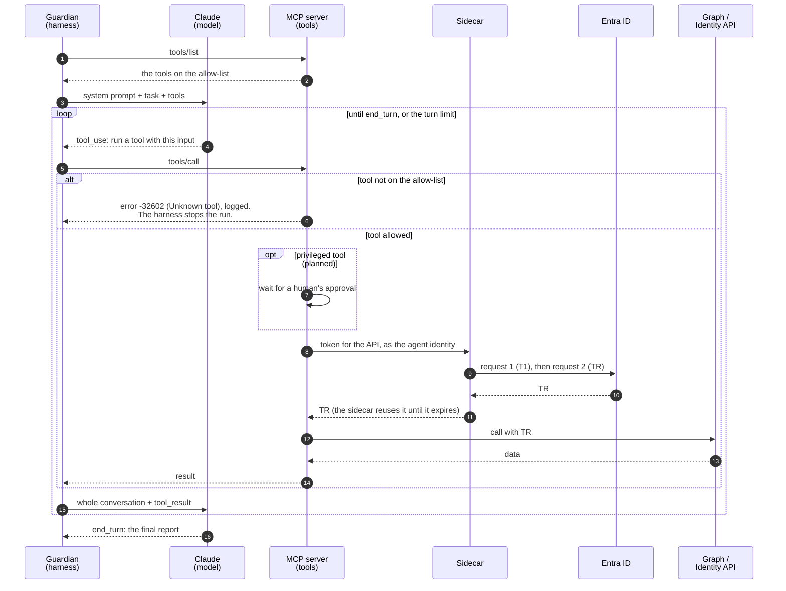

# The Harness: the Guardian's Agent Loop

This document is the reference for the guardian's harness: how one run works, why the model stopped, which settings a run uses, and how to see what the harness sends and gets back. The code is in [src/guardian/harness.py](../src/guardian/harness.py) and [src/guardian/main.py](../src/guardian/main.py).

For where the harness sits in the agent's design, see [Agent architecture](agent-architecture.md). For how any harness talks to a model (roles, content blocks, stop reasons), see [The Messages API](messages-api.md). IDs such as C12 are controls in the [control register](security-controls.md#the-harness).

## Contents

- [1. The Agent Loop in Action](#1-the-agent-loop-in-action)
  - [Step-by-Step: How One Run Works](#step-by-step-how-one-run-works)
- [2. Why the Model Stopped: stop_reason](#2-why-the-model-stopped-stop_reason)
- [3. The Model Settings](#3-the-model-settings)
- [4. Seeing a Run: Tags and Traces](#4-seeing-a-run-tags-and-traces)

---

## 1. The Agent Loop in Action

All four parts of the agent come together during the **agent loop** (Anthropic also calls it the *agentic loop*; the pattern behind it is known as **ReAct**—*Reason, then Act*—from the academic literature).

The foundational security principle of this loop is that **the model never acts**. It can only *ask* the harness to run a tool, and the harness and MCP server independently decide whether to allow it. If a prompt injection tricks the model, the attacker can only influence what the model *asks* for—they cannot bypass the downstream checks.

### Step-by-Step: How One Run Works

1. **Tool Discovery:** The harness asks the MCP server for its tools (`tools/list`), once per run. The server returns *only* the tools on its allow-list (FR6, [config/tool-allow-list.json](../config/tool-allow-list.json)).
2. **Model Request:** The harness sends Claude the system prompt (its role and rules), the first user message (the task), and the tool definitions.
3. **Tool Call:** Claude evaluates the task and replies with a tool call (a `tool_use` block)—for example, asking to run `scan_registry`. At this stage, nothing has actually executed.
4. **Tool Execution:** The harness forwards the tool call to the MCP server (`tools/call`). The MCP server requests a TR token from the sidecar, calls Microsoft Graph or the Identity API, and packages the result. A tool that is not on the allow-list is refused before it runs, with the MCP spec's protocol error `-32602` ("Unknown tool"), and the refusal is logged. The harness then stops the run (fail closed), because the model was never shown that tool.
5. **Tool Result:** Because Claude is completely stateless between API calls, the harness sends a fresh request containing the *entire conversation history* plus the new `tool_result`.
6. **Next Turn or Final Answer:** Claude either asks for another tool call (repeating Steps 3–5) or outputs its final report (`end_turn`). As a safety net, the harness enforces a turn limit (`max_rounds`, C12) and stops the loop if Claude does not send `end_turn` in time.



The JSON of one round, in its general form, is in [The Messages API](messages-api.md#1-the-big-picture-a-stateless-conversation-loop). To see the exact bodies of a real run, use `GUARDIAN_TRACE=full` ([Seeing a Run](#4-seeing-a-run-tags-and-traces)).

---

## 2. Why the Model Stopped: stop_reason

Every answer from the model says why it stopped, in `BetaMessage.stop_reason`. The harness reads it first, before any content block ([harness.py](../src/guardian/harness.py), `run_agent`). The general meaning of each value is in [The Messages API](messages-api.md#4-extraction--checking-why-the-model-stopped-stop_reason).

For error handling in general (retries, tool errors, timeouts), see [Error Handling](agent-architecture.md#error-handling-when-a-call-fails).

The harness fails closed: only `tool_use` continues the loop, and only `end_turn` counts as a finished report. Every other value stops the run with an error that names the value, and no report. That includes values the API may add later.

| `stop_reason` | Meaning | What the guardian's harness does |
|---|---|---|
| `tool_use` | The model asks for one or more tools | Sends each request to the MCP server, sends all results back in one message, and asks again |
| `end_turn` | The model has finished | Takes the `text` blocks as the report, and the run ends |
| `max_tokens` | The answer reached the `max_tokens` cap, so it is cut off | Stops the run, no report |
| `refusal` | The model, or a safety classifier, declined | With `refusal_fallback` on, Anthropic first retries on a fallback model in the same call. If the answer is still a refusal, the harness stops the run, no report. |
| `model_context_window_exceeded` | The conversation no longer fits in the context window (the most text the model can read at once) | Stops the run, no report, because the text could be cut off |
| `pause_turn` | A tool that Anthropic runs, such as web search, paused | Stops the run, no report. Not expected: the guardian offers no tools that Anthropic runs. |
| `stop_sequence` | The model wrote a text set as a stop marker | Stops the run, no report. Not expected: the harness sets no stop markers. |
| `compaction` | Only with the beta compaction feature, which summarizes long conversations | Stops the run, no report. Not expected: compaction is not turned on. |

---

## 3. The Model Settings

The harness reads its settings from [config/guardian.json](../config/guardian.json) once, when a run starts, and prints them, so every run records what it used. The file is mounted read-only into the guardian's container, so to change a setting, edit the file and run again: no rebuild is needed. Every key is required and unknown keys are refused. A missing or wrong value stops the run before the first model call: there is no default to fall back to (C12).

| Setting in the file | Value today | What it does |
|---|---|---|
| `model` | `claude-opus-5-5` | The model: sent as `model` on every request. |
| `effort` | `medium` | Sent as `output_config.effort`. How deeply the model thinks, and so how many tokens it spends. The levels are `low`, `medium`, `high`, `xhigh` and `max`. `medium` is also this model's default, but the harness sets it explicitly, so the choice is visible and does not change if the default changes. |
| `max_rounds` | `10` | The turn limit: the most model calls in one run (C12). The Claude Agent SDK and the OpenAI Agents SDK call this setting `max_turns`. The file may set at most 25, so a typo cannot remove the limit. |
| `strict_tool_inputs` | `true` | Adds `strict: true` to every tool definition, so Anthropic's API makes each tool input match the tool's schema (C21). Strict mode needs a closed schema, so the harness also adds `additionalProperties: false`: the MCP server's schemas do not say it. It checks the shape only, so the MCP server still checks every input (C8). |
| `refusal_fallback` | `true` | Sends `fallbacks: "default"` with the beta header `server-side-fallback-2026-07-01`. If a safety classifier declines the request, Anthropic runs it again on a fallback model in the same call. Anthropic chooses that model, so the configured model is not always the one that answers: the harness logs the answer's `BetaMessage.model` in every turn. |

Some settings are fixed in the code, because they are not choices an operator should make:

| Setting | Value | Why |
|---|---|---|
| `thinking` | `adaptive`, with `display: summarized` in trace mode only | This model always thinks; thinking cannot be turned off. The setting only decides whether a readable summary of the thinking comes back. |
| `max_tokens` | `16000` | A hard cap on the output of one answer. |
| `temperature` | not set | This model does not accept `temperature`, `top_p` or `top_k` (HTTP 400). Effort does not control randomness, so two runs can give different answers. |

**Why `medium`:** the guardian's task is short and routine: two tools, two or three turns, and a short report. The level was chosen by judgment, not measured.

**Effort is not a security control.** A lower effort usually means fewer tool calls, but no control in this design depends on it. The turn limit (C12) is the hard limit.

**How an enterprise application sets effort:**

* **Per task, not one global value.** A routine check and a hard investigation get different levels.
* **Chosen by measurement.** Run a set of real tasks (an eval) at each level, and pick the lowest level that keeps the quality. Compare the cost per *completed* task, not per request.
* **Kept in configuration,** per environment, so it can change without a new release.
* **Sometimes chosen at run time:** a router picks the level from the task type, or the application retries at a higher level when an answer fails a check.

The guardian has one task, so it has one effort level, kept in its settings file. In an enterprise application, the same values would come from a configuration service, with one value per environment.

---

## 4. Seeing a Run: Tags and Traces

Every line the guardian prints starts with a tag that says what it is about:

* **`[harness]`** is the harness itself: the settings, the report, the audit correlation ID, and errors.
* **`[model]`** is a model call: which model answered, why it stopped, and which tools it asks for.
* **`[mcp]`** is a call to the MCP server: the tool list, and each tool call with its input.

Errors go to stderr. A run without a trace prints lines like these (the IDs are placeholders here):

```
[harness] settings: model=claude-opus-5-5, effort=medium, max_rounds=10, strict_tool_inputs=True, refusal_fallback=True
[mcp]     tools/list: scan_registry, get_agent
[model]   round 1: claude-opus-5-5 stopped with tool_use, asks for scan_registry
[mcp]     round 1: tools/call scan_registry({}) succeeded
[model]   round 2: claude-opus-5-5 stopped with tool_use, asks for get_agent
[mcp]     round 2: tools/call get_agent({"app_id": "<app ID>"}) succeeded
[model]   round 3: claude-opus-5-5 stopped with end_turn
[harness] report (3 model calls):

...the model's report...

[harness] audit correlation ID, from scan_registry: <correlation ID>
```

To see every message between the harness and its two peers, set `GUARDIAN_TRACE`. Each trace keeps the conversation with the model apart from the conversation with the MCP server. A trace already shows every model and MCP step, so in a trace mode only the `[harness]` lines are printed.

| `GUARDIAN_TRACE` | What it shows |
|---|---|
| not set | Only the tagged lines above |
| `1` | Every message, as a chat in colour, shortened. Each conversation has its own panels. |
| `json` | Every message as JSON: each model message once, when it is new. The request settings and the thinking signatures are left out. |
| `full` | The exact request and response bodies, in full: what the harness sent and what it got back. It never prints headers, because a header carries the API key. |

```sh
docker compose run --rm guardian
docker compose run --rm -e GUARDIAN_TRACE=1 guardian
docker compose run --rm -e GUARDIAN_TRACE=json guardian
docker compose run --rm -e GUARDIAN_TRACE=full guardian > run.txt
```

A trace holds real tenant data (agent names, IDs). So git ignores `run*.txt`, and any screenshot of a trace must be redacted. For the whole local run, with the sidecar and the other services, see [Local run: the sidecar](infra.md#local-run-the-sidecar).
