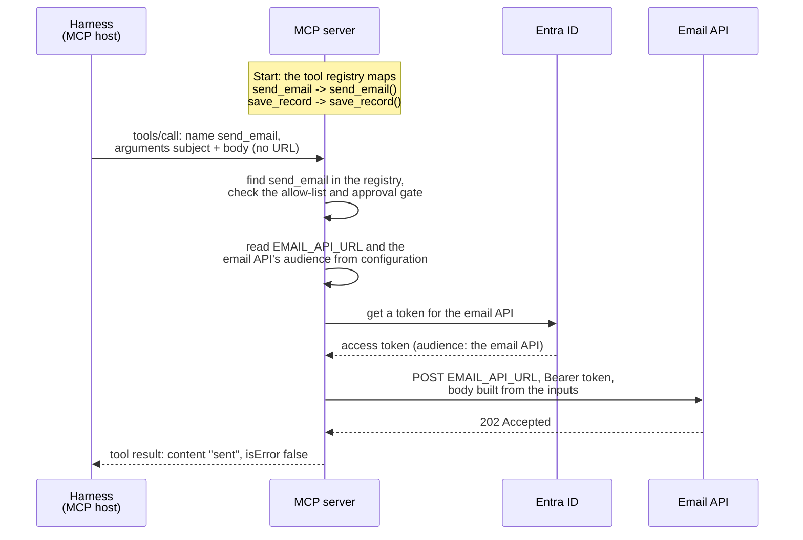

# MCP: the guardian's MCP server

This document is the hands-on reference for the guardian's MCP server: what MCP is, what travels on the wire, how a tool reaches its API, what our server offers, and how to call and inspect it. For where the MCP server sits in the agent's design and why it is the only part that can get tokens, see [Agent architecture](agent-architecture.md). For the security controls it enforces, see [Security controls](security-controls.md#the-mcp-server).

## Contents

- [1. MCP in short](#1-mcp-in-short)
- [2. On the wire](#2-on-the-wire)
  - [Capabilities and listChanged](#capabilities-and-listchanged)
  - [Tools: definitions, results and errors](#tools-definitions-results-and-errors)
- [3. How a tool reaches its API](#3-how-a-tool-reaches-its-api)
- [4. The guardian's MCP server](#4-the-guardians-mcp-server)
- [5. Calling it from your machine](#5-calling-it-from-your-machine)
  - [The MCP Inspector](#the-mcp-inspector)
  - [A Python client](#a-python-client)
  - [Raw HTTP with curl](#raw-http-with-curl)
- [6. Behaviour seen in this lab](#6-behaviour-seen-in-this-lab)

---

## 1. MCP in short

**MCP (Model Context Protocol)** is a standard protocol that lets an AI application find and use capabilities on a separate server.

- **Three roles:** The **host** is the AI application, here the guardian's harness. It holds one **client** for each server it talks to. The **server** offers the capabilities, here our MCP server.
- **Three kinds of capability:**
  - **Tools:** functions the *model* decides to call. Our server offers two.
  - **Resources:** data the *application* can read, such as files or records. Our server offers none.
  - **Prompts:** ready-made prompt templates that a *user (a human)* picks. Our server offers none.
- **The model never talks to the server.** It only asks the harness for a tool, and the harness sends the request ([The agent loop](harness.md#1-the-agent-loop-in-action)).

## 2. On the wire

MCP messages are **JSON-RPC 2.0** messages. Over **Streamable HTTP**, the transport for a server that runs as its own network service, the client sends each message as an HTTP POST to one endpoint (`/mcp`), and the server answers with JSON or streams the answer back on the same response.

There are two eras of the protocol, and our server serves both:

- **Modern (2026-07-28 and later):** There is no handshake, so every request stands alone. It carries `_meta` in its body (the protocol version, who the client is, what it can do) and three HTTP headers: `MCP-Protocol-Version`, `Mcp-Method` (which must match the body's `method`) and, for `tools/call`, `Mcp-Name` (which must match the tool's name). The headers let proxies and firewalls route MCP traffic without reading the body. The guardian's harness and the examples below use this era.
- **Legacy (2025-11-25 and earlier):** A session starts with an `initialize` request, then a `notifications/initialized` message, and later requests belong to that session.

**`_meta`** is a reserved field for information *about* a message, next to its business data (`params` or `result`). Without a handshake, every request introduces itself in `_meta` (the protocol version, the client's name and version in `clientInfo`, and its capabilities), and every answer names the server in `serverInfo`. The keys start with `io.modelcontextprotocol/`, a prefix reserved for the specification. Two different versions appear: the *protocol* version (`2026-07-28`, the version of MCP itself) and the *server* version (the version of our program). All of it is self-declared, like HTTP's `User-Agent` and `Server` headers, so it helps with logs and debugging but must never decide what a caller may do.

MCP Python SDK 2.x is *dual-era*: the same endpoint answers both kinds of client. The message shapes for tools (definitions, results, the two kinds of error) are in [Tools: definitions, results and errors](#tools-definitions-results-and-errors).

### Capabilities and listChanged

A modern client's first request is `server/discover`. The server answers with the protocol versions it supports and its **capabilities**: what it offers, and how. Our server answers with the SDK's defaults:

```json
"capabilities": {
  "prompts":   { "listChanged": true },
  "resources": { "listChanged": true, "subscribe": true },
  "tools":     { "listChanged": true }
}
```

| Flag | Meaning |
|---|---|
| `listChanged` | The list of tools (or prompts, or resources) can change while a client uses the server. The server then sends a notification, such as `notifications/tools/list_changed`, and the client should ask for the list again. |
| `subscribe` | A client can subscribe to one resource and is told when its content changes. |

**The risk.** A changing tool list is a known MCP attack, often called a *rug pull*: a server first shows harmless tools, then changes a tool's description or adds a new tool. A client that simply reloads the list on every notification hands the new tools to the model without any review. The industry answer is that the client checks every tool against its own allow-list, and pins the approved tool definitions (for example, by a hash), so a changed definition is refused.

**In the guardian.** The server declares `listChanged: true` only because these are the SDK's defaults: its two tools never change. The harness reads the tool list once, at the start of a run, and never reads it again, so the tools the model sees are fixed for the run. The harness does not check the list against an allow-list of its own, and does not pin the definitions: it trusts its own server, which this project builds and runs inside the Compose network ([D1](agent-architecture.md#architectural-shortcuts-where-the-guardian-differs)). The tool allow-list will be enforced by the MCP server (planned, FR6); a second check in the harness is not planned.

### Tools: definitions, results and errors

The MCP specification (version 2026-07-28) defines the messages for tools, and the rules that go with them:

* **Tool definitions (`tools/list`):** Every tool exposes a `name`, a `description`, and an `inputSchema` (a JSON Schema validating its parameters). Optionally, it can include a human-friendly `title`, an `outputSchema` for its return data, and `annotations` (behavioral hints like `"read-only"`—though clients must treat annotations as untrusted unless the MCP server itself is trusted). Because `tools/list` can dynamically filter results based on the caller's identity, it naturally supports per-agent allow-lists.
* **Tool results (`tools/call`):** Returns a `content` array containing blocks of text, images, audio, resource links, or embedded resources. It can also return optional JSON in `structuredContent` (which must validate against `outputSchema` if the tool declared one), alongside an `isError` boolean flag.
* **Two distinct error types:**
  1. *Protocol errors:* Standard JSON-RPC errors (such as code `-32602` when requesting an unknown tool).
  2. *Tool execution errors:* Returned as a normal tool result with `isError: true` and a plain-text explanation. This allows the LLM to read what went wrong, fix its arguments, and retry the call.
* **Security rules:** The specification says MCP servers **must** validate all tool inputs, implement proper access controls, rate-limit tool calls, and sanitize tool outputs. Clients **should** ask for confirmation on sensitive operations, validate tool results before passing them to the model, and log tool usage for audit. This is why the Guardian's MCP server checks every input before using it: for example, `get_agent` checks that its `app_id` input is a GUID before it builds a Graph URL, so a tricked model cannot point the call at a different Graph path ([C8](security-controls.md#the-mcp-server)).

## 3. How a tool reaches its API

Think of an MCP server like a standard ASP.NET web application: a developer writes code for each tool, and the MCP server routes incoming requests to the right function based on the tool's name—just like ASP.NET routes an HTTP request to a controller action based on the URL path.

Inside that function, the code makes a standard HTTP request to the target API. Crucially, **the API's URL comes from the MCP server's internal configuration, never from the harness's MCP message.** The message from the harness only ever contains the tool name and business inputs.

Here is the exact lifecycle of a `send_email` call, in the enterprise reference design ([Agent architecture](agent-architecture.md#2-the-enterprise-reference-design)):

1. **Build Time:** A developer writes the `send_email` function inside the MCP server to read an API URL from environment configuration, request a token, and send an HTTP POST.
2. **Deploy Time:** An operator configures the environment variables (the email API's URL and its token audience).
3. **Startup:** The MCP server populates its internal tool registry, mapping the tool's name, description, and input schema to the actual Python function.
4. **Call Arrives:** The harness sends a `tools/call` message specifying `send_email` along with the `subject` and `body` arguments.
5. **Dispatch:** The MCP server looks up `send_email` in its registry, verifies the caller against the allow-list and approval gate, and invokes the function.
6. **Execution:** The function reads the configured URL, requests an access token from Entra for the email API, and fires the HTTP POST with the bearer token and payload.
7. **Return:** The function returns `"sent"`, which the MCP server wraps and sends back to the harness as a standard MCP tool result.



> **Security Insight — Why URLs Must Be Configuration:**
> Because the destination URL is locked in the server's environment configuration rather than passed as a tool argument, neither a hallucinating model nor a compromised harness can redirect where the email goes. If a tool accepted a target URL as an input parameter, a simple prompt injection could trick the agent into exfiltrating sensitive data to an attacker's server. Tool inputs must strictly carry business data (like `subject` and `body`), never endpoints. The guardian's tools follow this rule ([C9](security-controls.md#the-mcp-server)).

Here is what the code and wire payloads look like across Steps 1, 4, 6, and 7 *(note: this code is an illustrative sketch of an enterprise tool; the Guardian's real tools are in [server.py](../src/mcp_server/server.py))*:

```python
# Step 1: The tool function, written by a developer inside the MCP server
import os
import httpx
from mcp.server import MCPServer      # MCP Python SDK 2.x

mcp = MCPServer("email-tools")

@mcp.tool()   # Step 3: Registers the tool — pulls the name from the function, 
              # description from the docstring, and input format from the parameters.
def send_email(subject: str, body: str) -> str:
    """Send an email to the team mailbox."""
    url = os.environ["EMAIL_API_URL"]                              # Step 2: Set at deploy time
    token = get_token(audience=os.environ["EMAIL_API_AUDIENCE"])   # Helper that asks Entra
    httpx.post(url, headers={"Authorization": f"Bearer {token}"},
               json={"to": "team@example.com", "subject": subject, "body": body})
    return "sent"
```

```jsonc
// Step 4: Harness -> MCP Server. Carries only a tool name and business inputs (no URL).
// (Note: Every MCP request also carries "_meta" with the protocol version and client details, omitted here for brevity.)
{ "jsonrpc": "2.0", "id": 7, "method": "tools/call",
  "params": { "name": "send_email",
              "arguments": { "subject": "Weekly report", "body": "4 findings..." } } }
```

```http
# Step 6: MCP Server -> Email API. A standard HTTPS request.
POST https://mailserver.example.com/api/send
Authorization: Bearer eyJ...      (audience: the email API)
Content-Type: application/json

{ "to": "team@example.com", "subject": "Weekly report", "body": "4 findings..." }
```

```jsonc
// Step 7: MCP Server -> Harness. The formatted MCP tool result.
{ "jsonrpc": "2.0", "id": 7,
  "result": { "resultType": "complete",
              "content": [ { "type": "text", "text": "sent" } ],
              "isError": false } }
```

## 4. The guardian's MCP server

| Item | Value |
|---|---|
| Code | [src/mcp_server/server.py](../src/mcp_server/server.py), built with the official MCP Python SDK 2.3.0 (`MCPServer`) |
| Server name and version | `agent-steward-mcp-server`, version `1.0.0`, sent in every answer's `_meta` as `serverInfo` |
| Endpoint | `http://sidecar:8100/mcp` inside Compose. It has no network name of its own, because it shares the sidecar's network namespace ([infra.md](infra.md#local-run-the-sidecar)). |
| Accepted names (`Host` header) | `sidecar:8100` only, as protection against DNS rebinding. The Inspector override adds `localhost:8100` and `127.0.0.1:8100`. |
| `scan_registry()` | Runs the four registry rules on Graph data, sends the findings to the Identity API's audit log itself ([ADR-001](decisions.md#adr-001-the-mcp-server-sends-the-findings-to-the-identity-api-never-the-model)), and returns the findings with the audit's correlation ID. Not read-only: every call writes to the audit log. |
| `get_agent(app_id)` | Returns one agent identity's name, blueprint and description. Read-only. It refuses any `app_id` that is not a GUID, before it calls Graph. |

## 5. Calling it from your machine

Normally the MCP server is reachable only inside the Compose network. To reach it from your machine, start it with the dev-only override, which publishes its port on `127.0.0.1` only ([docker-compose.inspect.yml](../docker-compose.inspect.yml)):

```sh
docker compose -f docker-compose.yml -f docker-compose.inspect.yml up -d sidecar mcp-server
```

While it is open, any program on your machine can call the tools. Close it again when you are done:

```sh
docker compose up -d sidecar mcp-server
```

### The MCP Inspector

The official visual tool for MCP. It runs in your browser, lists the tools with their schemas, lets you call them from a form, and logs every message.

```sh
npx @modelcontextprotocol/inspector@2.12.0
```

Choose the **Streamable HTTP** transport, enter `http://localhost:8100/mcp` and connect.

**Reading its message log.** When it connects, the Inspector uses the legacy era, so its log shows a "LEGACY" label. Read the log from the bottom up: `initialize`, then `notifications/initialized` (a notification, so it has no answer and no time), then `resources/list`, `tools/list`, `prompts/list` and `resources/templates/list`. Our server answers the resource and prompt lists with empty lists. The times are shown in UTC, not in local time.

### A Python client

From the repository's virtual environment:

```sh
.venv/bin/python -c "
import asyncio
from mcp import Client
async def main():
    async with Client('http://localhost:8100/mcp') as c:
        print([t.name for t in (await c.list_tools()).tools])
        r = await c.call_tool('get_agent', {'app_id': 'abc'})
        print(r.is_error, r.content[0].text)
asyncio.run(main())"
```

### Raw HTTP with curl

This shows the modern era exactly as it travels:

```sh
META='"_meta":{"io.modelcontextprotocol/protocolVersion":"2026-07-28","io.modelcontextprotocol/clientInfo":{"name":"curl","version":"1.0"},"io.modelcontextprotocol/clientCapabilities":{}}'

# List the tools
curl -s -X POST http://localhost:8100/mcp \
  -H "Content-Type: application/json" -H "Accept: application/json, text/event-stream" \
  -H "MCP-Protocol-Version: 2026-07-28" -H "Mcp-Method: tools/list" \
  -d "{\"jsonrpc\":\"2.0\",\"id\":1,\"method\":\"tools/list\",\"params\":{$META}}"

# Call get_agent with an input that is not a GUID: refused
curl -s -X POST http://localhost:8100/mcp \
  -H "Content-Type: application/json" -H "Accept: application/json, text/event-stream" \
  -H "MCP-Protocol-Version: 2026-07-28" -H "Mcp-Method: tools/call" -H "Mcp-Name: get_agent" \
  -d "{\"jsonrpc\":\"2.0\",\"id\":2,\"method\":\"tools/call\",\"params\":{\"name\":\"get_agent\",\"arguments\":{\"app_id\":\"abc\"},$META}}"
```

The second call returns a tool execution error, as a normal result:

```json
{"jsonrpc":"2.0","id":2,"result":{"content":[{"text":"Error executing tool get_agent: app_id must be an agent identity's app ID (a GUID)","type":"text"}],"isError":true,"resultType":"complete"}}
```

## 6. Behaviour seen in this lab

These were observed on 28 October 2026 with MCP Python SDK 2.3.0:

| What was sent | What came back | What it shows |
|---|---|---|
| A modern request without `Mcp-Method`, or with one that does not match the body | Error `-32020`: "mcp-method header does not match the request body's method" | The server checks that the headers and the body agree |
| A request with `Host: evil.example:8100` | `421 Misdirected Request` | The DNS rebinding protection works ([C10](security-controls.md#the-mcp-server)) |
| `tools/call` for a tool that does not exist | A normal result with `isError: true` and "Unknown tool" | The SDK reports an unknown tool as a *tool execution error*, although the specification describes it as a *protocol error* (`-32602`). This matters for the tool allow-list. |
| The guardian's harness connects (SDK `Client`, mode `auto`), seen with `GUARDIAN_TRACE=full` on 29 October 2026 | Its first request is `server/discover`, then `tools/list`, then one `tools/call` per tool request. Every answer is plain JSON, not an event stream. The client names itself `mcp`, version `0.1.0`, in `clientInfo` | A modern client asks the server what it supports before anything else. `clientInfo` is the SDK's default, so the server's logs cannot tell the harness from any other SDK client (self-declared anyway, D1) |
| Any call from the Inspector or curl | The MCP server's log shows the caller as `172.18.0.1` | Port publishing hides the real caller behind Docker's gateway, so a network address never proves who is calling (D1) |
