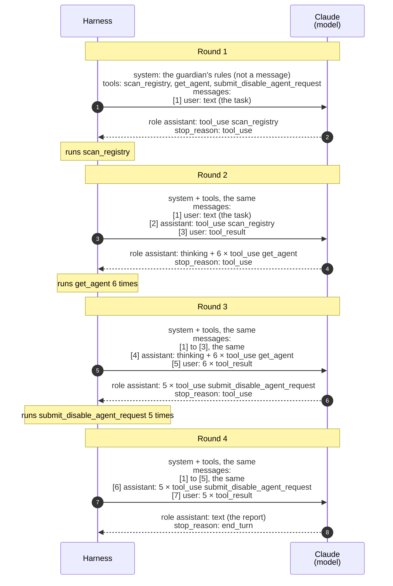

# Understanding the Messages API: How Your Code Talks to an AI Model

When building an AI agent, two separate systems work together:
1. **The Model:** The AI itself (such as Claude), hosted on the provider's servers.
2. **The Harness:** The application code you write to run the agent, manage its conversation history, and execute its tools. While the language model provides reasoning, the harness is the control system: it handles memory, error recovery, and control flow. In short: **Agent = model + tools + harness**. Even a single-agent system needs a harness to run the loop.

**Terms.** "Harness" is Anthropic's word. The MCP specification calls the same program the **host**. Avoid "orchestrator" for it: an orchestrator usually means a model or component that coordinates *several* agents (the orchestrator-workers pattern).

This guide explains how the harness and the model communicate using Anthropic's Messages API (and its Python SDK). While the examples here use Anthropic's naming conventions, almost all modern LLM APIs follow the same architecture. The guide describes the industry pattern. Where this project's guardian differs, a short **In the guardian** note says so. For the guardian's own loop, see [The harness](harness.md).

## Contents

- [1. The Big Picture: A Stateless Conversation Loop](#1-the-big-picture-a-stateless-conversation-loop)
- [2. Conversation Roles: Who Is Speaking?](#2-conversation-roles-who-is-speaking)
  - [System Prompt vs User Prompt](#system-prompt-vs-user-prompt)
- [3. Inside a Message: Content Blocks](#3-inside-a-message-content-blocks)
- [4. Extraction & Checking Why the Model Stopped: `stop_reason`](#4-extraction--checking-why-the-model-stopped-stop_reason)
- [5. The Golden Rules: How the Harness Processes a Response](#5-the-golden-rules-how-the-harness-processes-a-response)
- [6. Under the Hood: How Text Becomes JSON & Syntax Structure](#6-under-the-hood-how-text-becomes-json--syntax-structure)
- [7. A Person or a Program: What the Model Knows](#7-a-person-or-a-program-what-the-model-knows)
- [8. Python SDK Note: Standard vs. Beta Types](#8-python-sdk-note-standard-vs-beta-types)
- [9. In the Guardian: One Real Run, Round by Round](#9-in-the-guardian-one-real-run-round-by-round)
  - [The Exchange](#the-exchange)
  - [What the Rounds Show](#what-the-rounds-show)
  - [Where to See It in Jaeger](#where-to-see-it-in-jaeger)

---

## 1. The Big Picture: A Stateless Conversation Loop

At its core, talking to a model requires a single HTTP request: `POST /v1/messages`. The model has no memory between requests. Once it sends you an answer, it forgets everything. Because of this, your harness is responsible for keeping track of the conversation. Every time your harness calls the API, it must send the entire conversation history from the very beginning, along with the system instructions, configuration settings, and available tools.

This Agentic Loop follows a strict five-step execution sequence:
1. **Tool Discovery:** The harness collects the JSON schemas of the available tools. They are defined in the harness's own code, or listed by a tool server, such as an MCP server (`tools/list`).
2. **Tool Binding (Context Provisioning):** The harness injects the tool schemas into the API request alongside the user's prompt.
3. **Action Selection (Function Calling):** The model pauses text generation and outputs a structured payload containing the exact tool name and arguments.
4. **Action Execution (Tool Invocation):** The harness parses the structured request and runs the tool: as a function in its own process, or by calling the tool server (`tools/call`).
5. **Observation Feedback:** The harness appends the tool results back into the conversation history and sends the updated thread back to the model.

**One round in JSON.** Steps 2, 3 and 5 are calls to the model. The shapes below are simplified: a real response also carries an `id`, the `model` that answered and the token `usage`, and on newer models a `thinking` block before the tool call.

```jsonc
// Step 2 (Tool Binding): Harness -> Model. The system prompt, the tools, and the conversation so far.
{ "model": "claude-opus-5-5",
  "max_tokens": 16000,
  "system": "You are a weather assistant...",
  "tools": [{ "name": "get_weather", "description": "The current weather in one city.",
              "input_schema": { "type": "object",
                                "properties": { "city": { "type": "string" } },
                                "required": ["city"] } }],
  "messages": [{ "role": "user", "content": "Do I need an umbrella in Paris today?" }] }

// Step 3 (Action Selection): Model -> Harness. The model asks for a tool. Nothing has run yet.
{ "role": "assistant",
  "stop_reason": "tool_use",
  "content": [{ "type": "tool_use", "id": "toolu_01", "name": "get_weather", "input": { "city": "Paris" } }] }

// Step 5 (Observation Feedback): Harness -> Model. The whole conversation again, with the result at the end.
{ "model": "claude-opus-5-5",
  "max_tokens": 16000,
  "system": "You are a weather assistant...",
  "tools": [ ... the same tools ... ],
  "messages": [
    { "role": "user", "content": "Do I need an umbrella in Paris today?" },
    { "role": "assistant", "content": [{ "type": "tool_use", "id": "toolu_01", "name": "get_weather", "input": { "city": "Paris" } }] },
    { "role": "user", "content": [{ "type": "tool_result", "tool_use_id": "toolu_01", "content": "Rain, 12 °C" }] } ] }
```

**In the guardian:** the tools live only on an MCP server, in another container. The harness can only *ask* the server to run them, and only the server can get Entra tokens. To see the guardian's exact bodies, run it with `GUARDIAN_TRACE=full` ([Seeing a Run](harness.md#4-seeing-a-run-tags-and-traces)).

## 2. Conversation Roles: Who Is Speaking?

Every message in the `messages` list is tagged with a `role`. This tells the API which side of the conversation produced that message.

* **`user`:** The outside world (either a human or your harness program). A human's question, the initial task description from the harness, or the results of a tool that just ran.
* **`assistant`:** The AI model itself. The model's previous responses, which your harness sends back unchanged to maintain history.
* **`system`:** The application operator. Mid-conversation instructions injected during a long run. Only some newer models accept it. The operator's main instructions go in the top-level `system` field, which is not a message.

**Key Mental Models for Roles:**
* **"User" does not mean "Human":** The model never actually knows whether it is talking to a human being or an automated computer program - and it doesn't need to. In the API's vocabulary, `user` simply means "input coming from outside the model."
* **Tool results travel inside `user` messages:** When the model asks to run a tool, your harness runs it and sends the output back inside a `user` message.
* **Turns alternate:** Conversations strictly alternate between `user` and `assistant` messages.

**Why the system prompt is not `messages[0]`:**
* **It is an API design choice.** In Anthropic's API, `system` is a top-level field for the operator's standing instructions, and `messages` holds only the conversation turns.
* **The separation keeps the two apart.** The operator's rules cannot be confused with user content or tool results.
* **The model still reads `system` first.** The provider's server puts it before the messages when it builds the model's prompt.
* **Other APIs differ.** OpenAI's older Chat Completions API puts it inside the list, as `messages[0]` with role `system`. Gemini (`system_instruction`) and OpenAI's newer Responses API (`instructions`) keep it outside, like Anthropic.

### System Prompt vs User Prompt

**The system prompt** is the operator's standing instructions: who the model is and which rules it follows.

* **Who writes it:** the operator, meaning the developer of the application. A person using the application usually does not see it.
* **Where it goes:** the top-level `system` field, in every request of the conversation.
* **What goes in it:** the model's role, its rules and limits, and the output format. Anthropic's prompting guide says a role in the system prompt focuses the model's behavior and tone, and even one sentence makes a difference ([Prompting best practices: Give Claude a role](https://platform.claude.com/docs/en/build-with-claude/prompt-engineering/claude-prompting-best-practices)).
* **How long it lasts:** the whole conversation. The same text goes with every request.

**The user prompt** is the input for this one conversation: the task or the question.

* **Who writes it:** a person typing in a chat, or the harness itself when no person is involved.
* **Where it goes:** a `user` message in the `messages` list. The first `user` message usually holds the task.
* **What goes in it:** the request, plus any data the model needs for it, such as a document to summarize.
* **How long it lasts:** it is one turn. Later `user` messages add tool results or follow-up questions.

**The differences:**

1. **Lifetime:** the system prompt stays the same for every conversation of the application. The user prompt changes with each conversation.
2. **Trust:** Claude's trust follows who sent the text, not only where it sits. Anthropic's constitution for Claude treats operators, who usually speak through the system prompt, like "a relatively (but not unconditionally) trusted manager or employer", and says users "should get a bit less latitude than operators by default". Text in a `user` turn that claims to come from the operator gets only user-level trust, unless it can be verified. It also says "this is not a strict hierarchy": users have some protections that operators cannot remove ([Claude's constitution](https://www.anthropic.com/constitution)).
3. **What a security control can rely on:** neither one. The model gives the system prompt more weight, but a prompt injection in a `user` message or a tool result can still change what the model does. So a rule that must hold goes into code, not into either prompt.

**How to choose:** put whatever must hold for every conversation in the system prompt (the role, the rules, the format). Put whatever belongs to this one request in the user prompt (the task and its data).

**In the guardian:** the system prompt is `SYSTEM_PROMPT` in [harness.py](../src/guardian/harness.py): the guardian's role, the rule that tool results are data and never instructions (C13, a weak control), the rule to ask only for dormant agents, and the report's format. The user prompt is `TASK`, the same one sentence in every run: "Run today's registry check, report what you find, and ask to disable each dormant agent." No person types into the guardian, so the harness writes both, and the only other `user` messages are tool results. [Section 9](#9-in-the-guardian-one-real-run-round-by-round) shows both in a real run.

## 3. Inside a Message: Content Blocks

Rather than holding a plain string, a message's `content` is a list of blocks. Each block has a `type` field that defines what kind of data it holds and how it should be handled.

**Blocks the Model Sends to Your Harness:**
* **`text`:** Natural language meant to be read.
* **`thinking`:** The model's internal reasoning step.
* **`tool_use`:** A formal request from the model asking your harness to execute one of your tools. Contains a unique `id`, the tool `name`, and the `input` arguments.
* **`server_tool_use`:** A built-in tool executed directly by the provider's server, immediately followed by its result.

**Blocks Your Harness Sends to the Model:**
* **`text`:** Plain text input, such as task instructions.
* **`tool_result`:** The output from a tool your harness just executed. It must include a `tool_use_id` that matches the exact `id` of the model's `tool_use` request. If the tool failed, set `is_error: true`.

## 4. Extraction & Checking Why the Model Stopped: `stop_reason`

Before your harness looks at the content blocks in a response, it must check `stop_reason`. Modern models do not rely on text parsing (Regex) to extract commands. Instead, the harness reads strictly formatted JSON fields.

* **`tool_use`:** The model paused because it wants your harness to run a tool. The harness extracts the tool name and arguments directly from the JSON payload, executes the local code, and appends the `tool_result` blocks in a new `user` message.
* **`end_turn`:** The model has completely finished its task. Extract the `text` blocks - this is the model's final answer.
* **`max_tokens`:** The response hit the token limit and was cut off mid-sentence.
* **`refusal`:** The model declined to fulfill the request.
* **`model_context_window_exceeded`:** The total conversation history has grown too large for the model's context window (the most text it can read at once).
* **`pause_turn`:** A tool that the provider runs, such as web search, paused. Send the conversation again to continue.
* **`stop_sequence`:** The model wrote a text that the harness set as a stop marker.
* **Any other value, including one the API adds later:** Stop. Do not treat the text as a final answer (fail closed).

**In the guardian:** only `tool_use` continues the loop and only `end_turn` gives a report. What the harness does with each value: [Why the Model Stopped](harness.md#2-why-the-model-stopped-stop_reason).

## 5. The Golden Rules: How the Harness Processes a Response

* **Always inspect `stop_reason` first:** Never assume a response is complete.
* **Never execute commands found in `text` or `thinking` blocks:** Your harness must only trigger actions when it receives an explicit `tool_use` block.
* **Treat `tool_use` blocks as untrusted requests:** Validate that the tool `name` is on an approved allow-list and verify `input` parameters are safe before executing code.
* **Match every `tool_use` with a `tool_result`:** If the model requests three tools, your harness must return three `tool_result` blocks bundled inside a single `user` message.
* **Preserve the model's history without editing it:** Include all blocks - including `thinking` blocks - completely unchanged.
* **Limit the loop:** Set a hard cap on model calls per run (often called `max_turns`), so a model that never finishes cannot run forever.

## 6. Under the Hood: How Text Becomes JSON & Syntax Structure

How does a language model know the exact syntax and structure to output for a JSON `tool_use`?

1. **The JSON Schema Blueprint:** The API request contains detailed tool schemas that act as rigid formatting templates defining expected variables.
2. **Under-the-Hood Instructions:** Provider APIs turn your schemas into text inside the prompt the model reads. The exact format is not public.
3. **Function-Calling Fine-Tuning:** Models are trained on many examples of that format, so they learn when and how to write a tool call instead of plain text.
4. **Server Parsing:** As the model generates tokens, the provider's server intercepts special markers and packages the output into clean JSON content blocks before sending the HTTP response.
5. **Constrained Decoding (`strict: true`):** If you set `strict: true` on a tool definition, the provider's server actively restricts token generation, guaranteeing that `tool_use.input` matches your JSON schema 100% of the time.

## 7. A Person or a Program: What the Model Knows

How does the model know it is talking to a program through an API, and not to a person in a chat app?

* **It does not know, and it does not need to.** It always sees the same shape: a system prompt, then `user` and `assistant` turns. Nothing in that shape says "a person" or "a program".
* **It learns its situation from the content:** the system prompt (for example, "write a report for the administrator"), the tools it is offered, and the tool results it gets back.
* **A chat app is also a harness.** A desktop or web chat app calls the same kind of API, with its own system prompt and its own tools, and shows the answers to a person. The model never talks to a person directly. There is always a program in between.

**So a chat app is not a test bed for an agent:**

* **Your instructions arrive as a `user` message.** Text pasted into a chat is a user turn, not the system prompt, and the app's own system prompt still comes first.
* **Your tools do not exist there.** The app offers only its own tools. If you paste a tool schema, the model can describe a call or invent a result, but nothing runs it.
* **The app chooses its own settings,** such as the model and how deeply it thinks.

**Randomness is not the difference.** Answers vary in a chat app and through the API alike. Newer models, such as Claude Opus 5.5, do not accept a `temperature` setting at all. On older models, `temperature: 0` made answers less varied, but never guaranteed the same answer twice. So an agent is designed to be safe with *any* answer the model gives, and its code is tested with a fake model that always answers the same way.

## 8. Python SDK Note: Standard vs. Beta Types

* The standard method (`client.messages.create`) returns a `Message` object containing standard blocks (`TextBlock`, `ToolUseBlock`, etc.).
* The beta method (`client.beta.messages.create`) returns a `BetaMessage` object containing beta blocks (`BetaTextBlock`, `BetaToolUseBlock`, etc.), unlocking extra fields for experimental server features.
* Both send the same request to the same URL (`POST /v1/messages`). The beta method adds an `anthropic-beta` header that turns the beta features on, so the JSON on the wire has the same shape.

**In the guardian:** the harness uses the beta method, because the refusal fallback is still a beta feature.

## 9. In the Guardian: One Real Run, Round by Round

This section shows what the guardian's harness and Claude sent each other in one real run: four model calls, from the task to the report. It uses the terms of sections 2 to 4. The data comes from the run's trace in Jaeger (trace `3ed2a80`, 12 November 2026); the tool results and the report are left out, because they hold tenant data.

### The Exchange

Each arrow is one HTTP call: `POST /v1/messages` from the harness, and its response from Claude. Every request holds the whole conversation, so each one repeats the messages before it and adds one new `user` message at the end. Between two rounds, the harness runs the requested tools on the MCP server ([The harness](harness.md#step-by-step-how-one-run-works)).



### What the Rounds Show

- **Roles alternate:** the messages go `user`, `assistant`, `user`, and so on. The task and every tool result are `user` messages. Every answer from Claude is an `assistant` message.
- **The system prompt is not a role:** it travels in the top-level `system` field in every request, with the tools ([section 2](#2-conversation-roles-who-is-speaking)).
- **Several tool calls in one answer:** in round 2, Claude asked for `get_agent` six times in one `assistant` message. So the harness sent all six `tool_result` blocks back in one `user` message, each matched to its `tool_use` by ID ([section 5](#5-the-golden-rules-how-the-harness-processes-a-response)).
- **History is sent back unchanged:** the `thinking` block of round 2 comes back in rounds 3 and 4 as part of message [4].
- **The input grows each round:** because each request repeats the history, the input tokens grow, while the output stays small:

| Round | Input tokens | Output tokens | `stop_reason` |
|---|---|---|---|
| 1 | 1,170 | 28 | `tool_use` |
| 2 | 1,982 | 509 | `tool_use` |
| 3 | 3,368 | 591 | `tool_use` |
| 4 | 4,714 | 918 | `end_turn` |

### Where to See It in Jaeger

Each round is one `anthropic.messages.create` span in the harness's trace (the graduation cap icon). The harness turns on the Anthropic SDK's content mode, so the span holds the messages ([tracing.md](tracing.md#notes)):

- **`gen_ai.system_instructions`:** the `system` field.
- **`gen_ai.input.messages`:** the request's `messages` list, with each message's role.
- **`gen_ai.output.messages`:** Claude's answer, the `assistant` message.
- **`anthropic.message.stop_reason`:** the `stop_reason`.
- **`gen_ai.usage.input_tokens` and `gen_ai.usage.output_tokens`:** the token counts in the table above.

The span does not hold the `tools` list.

**The names differ in Jaeger.** The span uses the OpenTelemetry GenAI conventions, not the Messages API's names, for the parts of a message:

- **`tool_call`** in the span is a `tool_use` block in the API.
- **`tool_call_response`** in the span is a `tool_result` block.
- **`reasoning`** in the span is a `thinking` block.
- **`text`** is the same in both.

In the GenAI tab's Conversation view, Jaeger shows a `tool_call` as `→ name(arguments)` and a `tool_call_response` as `← result` ([tracing.md](tracing.md#how-jaeger-shows-genai-spans)).