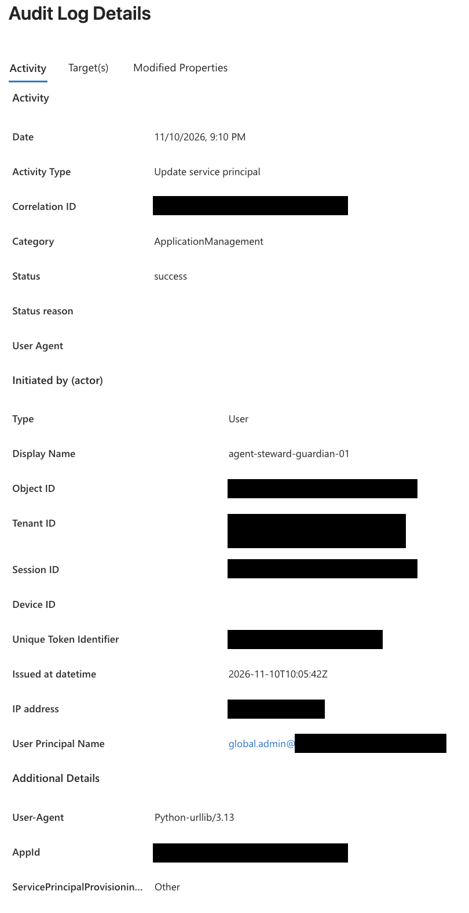
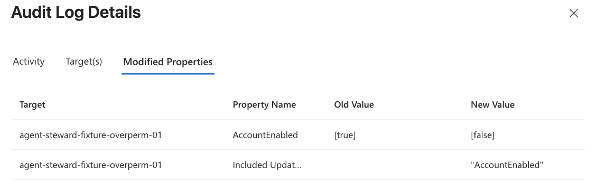
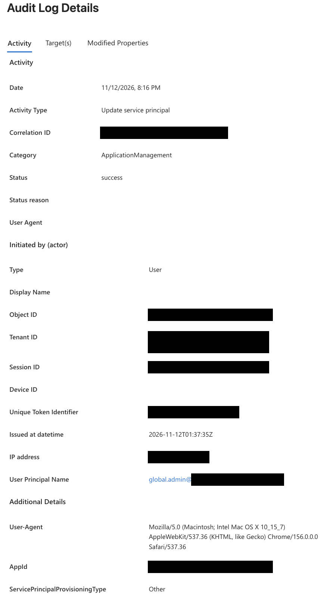
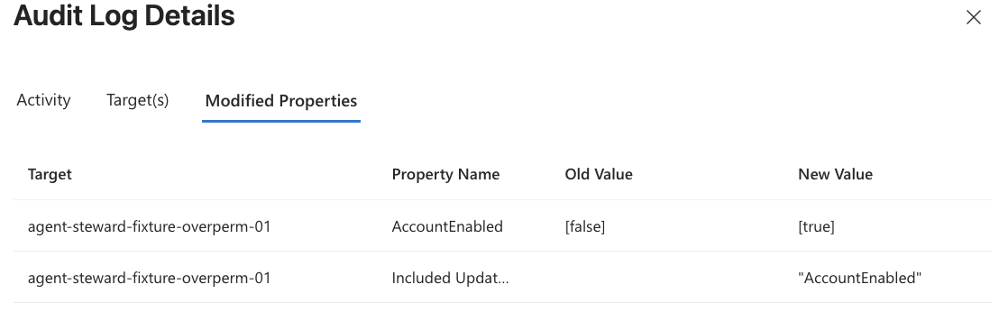

# Who Disabled This Agent? A Runbook for Entra Admins

A business-critical agent was disabled. This runbook shows an Entra admin how to find who disabled it, whether a person or an agent did it, and where to look for the reason. It needs no log tools and no engineering: only the Microsoft Entra admin center. Each claim is marked as verified (with its source), observed in this project's tenant, or not checked.

## Contents

- [1. The High-Level View](#1-the-high-level-view)
- [2. The Steps](#2-the-steps)
- [3. Reading the Audit Entry: A Real Example](#3-reading-the-audit-entry-a-real-example)
  - [3.1 The Disable: An Agent Acting for a Person](#31-the-disable-an-agent-acting-for-a-person)
  - [3.2 The Restore: A Person in the Admin Center](#32-the-restore-a-person-in-the-admin-center)
  - [3.3 What Each Field Tells You](#33-what-each-field-tells-you)
- [4. The Why: Entra Cannot Tell You](#4-the-why-entra-cannot-tell-you)
- [5. Agent Steward Today](#5-agent-steward-today)

---

## 1. The High-Level View

**Three questions.** Every investigation of a disabled agent answers the same three:

1. **Who did it?** A person, an app, or an agent acting for a person.
2. **When?** The time of the change.
3. **Why?** The reason behind the change.

**Where each answer lives.** Entra's **audit log** answers who and when: it records every change to a directory object, with the actor and the old and new values. It does not record why. The reason lives with the person or the system that made the change: a change ticket, the person's own answer, or the tool's own log.

**What you need.** The Reports Reader role is enough to read the sign-in logs ([Agent ID logs](https://learn.microsoft.com/en-us/entra/agent-id/sign-in-audit-logs-agents), verified). Enabling the agent again needs at least the Agent ID Administrator role ([Disable agent identities](https://learn.microsoft.com/en-us/entra/agent-id/disable-agent-identities), verified).

---

## 2. The Steps

1. **Restore first, if the business needs it:** Go to **Entra ID** > **Agents** > **Agent identities**, open the agent and enable it. The audit entry of the disable stays, so no evidence is lost. The restore writes its own audit entry ([section 3.2](#32-the-restore-a-person-in-the-admin-center)).

2. **Check what was disabled:** Open the agent and look at its status. Then open its blueprint under **Entra ID** > **Agents** > **Agent blueprints**. A disabled blueprint stops its agents too, so an agent can fail although nobody touched it ([Disable agent identities](https://learn.microsoft.com/en-us/entra/agent-id/disable-agent-identities), verified).
   - ✅ **The agent is disabled:** in step 3, search for the agent as the target.
   - ✅ **The blueprint is disabled:** in step 3, search for the blueprint as the target.
   - ❌ **Neither is disabled, but the agent fails:** this is not a disable. Open **Entra ID** > **Monitoring & health** > **Sign-in logs** and filter on **Is Agent: Yes**. A failed sign-in there shows the cause, for example a Conditional Access block or an expired credential.

3. **Find the change:** Go to **Entra ID** > **Monitoring & health** > **Audit logs**, and set three filters:
   - **Date:** from when the agent last worked to when it failed.
   - **Activity:** "Update service principal". Entra logs a change to an agent identity under this name ([Agent ID logs](https://learn.microsoft.com/en-us/entra/agent-id/sign-in-audit-logs-agents), verified).
   - **Target:** the agent's name.

4. **Prove that this entry is the disable:** Open the entry, and open the **Modified Properties** tab. The disable shows **AccountEnabled** going from `[true]` to `[false]` (observed, [section 3.1](#31-the-disable-an-agent-acting-for-a-person)). An "Update service principal" entry without this row changed something else.

5. **Read the actor:** On the **Activity** tab, under **Initiated by (actor)**, note the **Type**, the **Display Name**, the **User Principal Name** and the **User-Agent**. [Section 3.3](#33-what-each-field-tells-you) explains how to read them. There are three cases:
   - **A person in a browser:** Type is User, Display Name is empty, and the User-Agent names a browser.
   - **An agent acting for a person:** Type is User, the User Principal Name is the person, and the Display Name is the agent identity.
   - **An app or an agent on its own:** the actor is the app, with no person.

6. **Check the person's sign-in:** If a person is named, open **Sign-in logs**, filter by that person, and look at the time of the change.
   - ✅ **A usual place and device:** the person was really there. Ask them why (step 8).
   - ❌ **An unusual place or device, or a risky sign-in:** the account may be compromised. Start your incident process.

7. **Follow an app or an agent:** If an app or an agent is named, find who owns it: its owners, or the sponsor of an agent. Give its engineers three things: the time, the app's name and the **Correlation ID** of the entry. Their logs hold the reason.

8. **Find the why:** Entra does not record it ([section 4](#4-the-why-entra-cannot-tell-you)). Look for a change ticket, ask the person, or ask the tool's owners for its log.

9. **Prevent a repeat:** Review who holds roles that can disable agents, such as Agent ID Administrator, and which apps hold permissions to enable and disable agents. Remove what you do not expect.

**Retention.** The audit log keeps entries only for a limited time, set by the tenant's licence (not checked here). For anything older, the logs must have been sent to Log Analytics or a SIEM before the incident.

---

## 3. Reading the Audit Entry: A Real Example

These are two real entries from this project's lab tenant, for the same agent, `agent-steward-fixture-overperm-01`. The first is the disable that Agent Steward ran after an approval. The second is an admin enabling the agent again in the admin center. IDs, the IP address and the domain are blacked out.

### 3.1 The Disable: An Agent Acting for a Person

On 10 November 2026, the approver approved a disable request, and Agent Steward's executor disabled the agent with the approver's rights (On-Behalf-Of).

**The actor** (Activity tab):

**The target** (Modified Properties tab):

**What it shows** (observed):

- **The person:** Type is **User**, and the User Principal Name is the approver's account.
- **The agent:** the Display Name is **agent-steward-guardian-01**, the guardian's agent identity. So one entry names both the person whose rights were used and the agent that acted.
- **A program, not a browser:** the User-Agent is `Python-urllib/3.13`, the executor's HTTP client.
- **The target:** AccountEnabled went from `[true]` to `[false]` on `agent-steward-fixture-overperm-01`.

### 3.2 The Restore: A Person in the Admin Center

On 12 November 2026, the admin enabled the same agent again in the Entra admin center.

**The actor** (Activity tab):

**The target** (Modified Properties tab):

**What it shows** (observed):

- **The person, with no agent:** Type is **User**, and the **Display Name is empty**.
- **A browser:** the User-Agent is Chrome on a Mac. A person clicked in the admin center.
- **The target:** AccountEnabled went from `[false]` to `[true]`.

### 3.3 What Each Field Tells You

- **Date:** the time of the change, in the viewer's local time. 9:10 PM on 10 November 2026 here.
- **Activity Type:** "Update service principal", for any change to an agent identity.
- **Correlation ID:** an ID for the operation. Give it to the tool's engineers or to Microsoft Support.
- **Type:** User when a person's rights were used, even when an agent did the work.
- **Display Name:** empty when a person acted directly. The agent identity's name when an agent acted for the person (observed, not found in Microsoft's documentation).
- **User Principal Name:** the person whose rights were used.
- **Session ID:** the person's sign-in session. Both entries above show the same Session ID, because both came from the same browser sign-in (observed). Filter the sign-in logs by it to see what else that session did.
- **Unique Token Identifier:** the ID of the token used for the change. The same value appears in the sign-in log as **Unique Token Identifier**, on the event that issued the token, so it leads to when and how the token was issued ([Linkable identifiers](https://learn.microsoft.com/en-us/entra/identity/authentication/how-to-authentication-track-linkable-identifiers), verified).
- **Issued at datetime:** when that token was issued, in UTC. Here 10:05 UTC, five minutes before the change.
- **User-Agent:** the program that sent the change. A browser means a person in a portal. Anything else means a script or a service.
- **AppId** (Additional Details): the same value in both entries. The entries share only the person and the target, so it is most likely the target's app ID (not checked).

---

## 4. The Why: Entra Cannot Tell You

The audit log records who changed what, and when. It has no field for the reason. So the why always comes from outside Entra:

- **A person acted directly:** ask them, and look for a change ticket.
- **An app or an agent acted:** its owners read its log. A well-built agent records the reason for each action and the human who approved it, so the log can answer the question.
- **An agent acted for a person:** both apply. The person approved, so ask them. The agent's log shows what they were shown when they approved.

---

## 5. Agent Steward Today

**What Agent Steward records for a disable.** Every line below carries the same `request_id`, so one search finds the whole story ([main.py](../src/identity_api/main.py), [executor.py](../src/executor/executor.py)):

1. **`disable_request_created`:** the guardian asked to disable the agent. The line holds the facts, such as the last sign-in, and the guardian's reason, marked as untrusted.
2. **`disable_request_decided`:** a person decided. The line names the approver and the decision.
3. **`agent_disabled`:** the executor disabled the agent. The line names the target, the agent identity that acted, the approver, the mode (`obo`) and the delegating user.

**Why it disables.** Agent Steward disables only a dormant agent, with no sign-in for 30 days, and only after a person approves. It refuses its own agents ([disable_checks.py](../src/mcp_server/disable_checks.py)). So if Agent Steward disabled a business-critical agent, there are two answers to the why: the agent had no sign-in for 30 days, and a named approver approved it.

**From Entra to Agent Steward.** Start from the audit entry in [section 3.1](#31-the-disable-an-agent-acting-for-a-person). The Display Name says Agent Steward's agent acted, and the User Principal Name names the approver. Then search Agent Steward's audit lines for `agent_disabled` with that target agent, at that time. Its `request_id` leads to the request and the decision.

**The delta:**

- **No token ID in the lines:** Agent Steward's audit lines do not record the Unique Token Identifier yet. So the join from Entra to Agent Steward is by target, time and approver, not by a shared ID.
- **No list of business-critical agents:** Agent Steward protects only its own agents. A business-critical agent that is dormant can be proposed for a disable, and the approver is the only check.

For the full chain of logs (sign-in logs, Graph activity logs and workload audit logs), see [Investigating Agent Activity](investigating-agent-activity.md).
